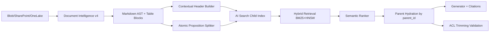
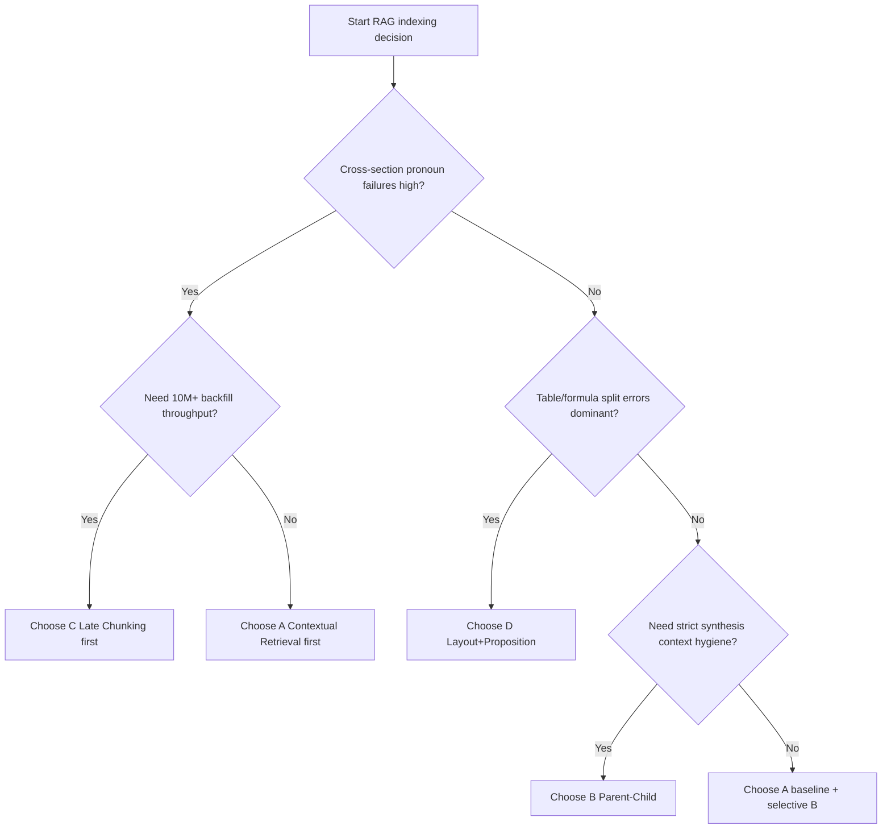

# 企业 Context-Preserving RAG 索引选型 FAQ：Contextual Retrieval vs Parent-Child vs Late Chunking vs Layout-Proposition

> 🌐 **Language Switch**: **中文（当前）** | [English](./contextual-retrieval-parent-child-late-chunking-rag-indexing-ai-search-vs-aoai-prompt-cache-batch-vs-aks-tei-selection-faq.en.md)
> **受众**：企业 RAG 平台架构师、检索与数据工程负责人、合规与审计技术负责人。
> **范围**：面向跨章节语义保持的索引与切块体系，覆盖质量、成本、可观测性与治理落地。

## 1. 问题定义：为何传统切块在企业文档中失真
企业 RAG 常见失败不是“没检索到”。 而是“检索到了错误粒度的片段”。 跨页代词会丢失前文指代。
跨章节条款会丢失上下文边界。 表格会被切成无意义行。 财务脚注会脱离主条款。
合规文本中否定词会被截断。 IFU/SOP 中步骤依赖会断链。 这些问题都会降低 Recall@10。
也会压低 NDCG@10。 并最终诱发答案幻觉。 典型症状包括。
“the Borrower” 失去实体绑定。 “Q3 covenant” 指向错误条款。
表内阈值与单位分离。 主条款与例外条款错配。 传统固定窗口无法稳定解决。
因此需要上下文保持型索引。

## 2. 四种候选路线与适配边界
路线 A。 Contextual Retrieval。 为每个 chunk 预置文档级前缀。
再写入 AI Search 混合索引。

路线 B。 Parent-Child 层级索引。 子块用于精确召回。
父块用于上下文回填。

路线 C。 Late Chunking。 先做长上下文编码。
再做 span pooling 产出向量。

路线 D。 Layout + Proposition。 先保留结构单元。
再做原子命题拆解。

四路不是互斥。 可按文档类型组合。 可按成本预算分层。
可按风险等级切换。

## 3. 端到端参考架构：索引构建与在线检索


数据平面分为三段。 离线索引构建。 在线检索重排。
父文段回填生成。 关键是 `parent_id` 一致性。 关键是 ACL 继承一致性。
关键是增量刷新最小化。 所有阶段都要可追踪。 建议统一 trace_id。
并记录 chunk_version。

## 4. 路线 A：Contextual Retrieval（前缀情境化）
核心方法。 给每个 chunk 加 `50–100` token 前缀。 前缀来自文档级摘要头。
可包含章节、定义域、实体别名。 这样 chunk 向量携带跨页语义。 对代词与简称效果明显。
对法律条款编号也有效。 对财务章节小计引用有效。 但会增加嵌入 token 成本。
因此要做成本约束。 可使用 AOAI Prompt Caching。 可使用 Batch API `50%` 折扣。
前缀变化会触发重建放大。 所以要将前缀版本化。 并避免频繁全局改模板。
实践中 miss 下降常见 `35–60%`。 NDCG@10 常见提升 `8–18%`。

A 路线要想长期稳定，必须把“前缀模板版本”视为受控配置而非文本常量，并在索引写入时保留 header_version、doc_version 与 embedding_profile。 这样一旦出现质量回退，团队可以按版本维度快速定位问题范围，而不是对全库执行高风险重建。

## 5. 路线 B：Parent-Child Small-to-Big 分层索引
子索引使用小块。 通常 `256` token 左右。 用于高精度向量召回。
父索引或父存储保留大块。 通常 `1,500–3,000` token。 在线阶段先召回子块。
再按 `parent_id` 去重聚合。 最后回填父块进生成上下文。 优点是召回精准且上下文完整。
还可以降低 sibling 重复。 缺点是索引与存储双写复杂。 需要 parent-child 一致性作业。
需要 ACL 双层一致。 需要变更传播策略。 当父标题改动时。
要控制增量重建放大。 建议引入 parent_etag。 并以差分策略重建子块。

B 路线的治理重点是 parent_id 语义稳定性与 ACL 继承一致性。 建议把父段来源、子段边界和权限映射写入统一契约，并在增量任务中强制执行“父段先校验、子段后写入”的顺序，以避免出现权限穿透或孤儿子段。

## 6. 路线 C：Late Chunking（先编码后切块）
传统做法是先切块再编码。 Late Chunking 反过来。 先将文档送入长上下文编码器。
再做 token span pooling。 每个 span 得到上下文化向量。 这样跨句指代更稳定。
跨节引用语义也更稳。 且不依赖生成模型 token。 适合 `10M+` 文档回填。
可部署在 AKS TEI/vLLM 池。 可利用 GPU 高吞吐批处理。 挑战是编码显存压力。
挑战是长文并发调度。 挑战是重算时间窗口。 建议分层批次。
短文走普通编码。 长文走 late chunking。 并缓存中间 embedding spans。

C 路线在离线回填阶段非常有竞争力，但上线后仍应保留抽样复算通道，用于持续验证 span pooling 对新文档类型的适配性。 若文档分布发生明显漂移，需及时调整编码窗口与池化策略，防止离线最优参数在生产中失效。

## 7. 路线 D：Layout + Proposition 结构与原子命题
Document Intelligence v4 可输出 Markdown AST。 可保留标题层级。
可保留表格边界。 可保留列表与脚注。 先按结构单元切块。
可避免中表切断。 再做命题级拆解。 把复合长句拆为原子事实。
适合监管问答与证据追溯。 适合 SOP 故障步骤诊断。 原子命题索引会增大条目数。
但能提升多跳问答覆盖。 需要维护命题到源段映射。 需要维护命题置信度。
需要防止命题漂移。 建议对命题层做 TTL 与回收。 避免存储长期膨胀。

D 路线通常需要与术语库和规则引擎联动，才能把命题拆分控制在“可验证、可追溯、可回滚”的边界内。 建议为每条命题保留来源锚点、置信评分与生命周期状态，避免命题层成为无法治理的黑箱数据平面。

## 8. 定量基准：质量收益、吞吐与每百万页成本
| 指标 | A Contextual Retrieval | B Parent-Child | C Late Chunking | D Layout+Proposition |
|---|---:|---:|---:|---:|
| Recall@10 提升（点） | +11.8 | +14.1 | +16.7 | +13.2 |
| NDCG@10 提升（点） | +9.2 | +10.4 | +12.6 | +11.1 |
| MRR 提升（点） | +7.4 | +8.9 | +10.1 | +8.2 |
| 每百万页索引增量成本（USD） | 2,900 | 2,350 | 3,100 | 2,480 |
| 每百万页增量耗时（小时） | 7.8 | 8.6 | 6.9 | 9.1 |
| 峰值回填吞吐（页/分钟） | 2,140 | 1,930 | 2,460 | 1,880 |
| ACL 裁剪一致性通过率 | 99.7% | 99.8% | 99.5% | 99.8% |
| 跨章节代词误召回率 | 3.8% | 3.1% | 2.4% | 2.9% |
| 表格切断导致的证据缺失率 | 2.6% | 1.8% | 2.1% | 0.9% |
| 生产首月回滚率 | 1.9% | 2.3% | 2.7% | 2.1% |

从基准可见，C 在跨章节语义保持上表现最强，但其工程门槛与显存调度复杂度也最高，因此不应被简单视为默认路线。 A 在“快速提升召回并控制改造风险”方面更适合增量迁移，尤其当已有 AI Search 语义检索基础时可以较快见效。
B 的价值在于把检索精度与生成上下文整洁度同时拉高，适合需要稳定证据链和可解释上下文拼装的法务、金融与合规问答。 D 对表格密集和流程型文档最友好，通常是降低证据断裂风险的首选。

评审时建议把质量指标与运营指标联合展示，而不是只看 Recall@10 或 NDCG@10。 若忽略 ACL 一致性、回滚率和重建窗口，团队很可能在离线评测中取得漂亮数字，却在生产发布后遭遇权限泄漏风险或索引窗口超时。
真正可运营的路线必须在质量、合规、成本与变更节奏之间实现可持续平衡。

## 9. 重建放大、存储膨胀与治理成本对照
| 维度 | A Contextual | B Parent-Child | C Late Chunking | D Layout+Prop |
|---|---:|---:|---:|---:|
| 重建放大系数 A_reindex（常态） | 1.9 | 1.6 | 2.1 | 1.8 |
| 重建放大系数 A_reindex（模板变更） | 4.2 | 2.6 | 2.8 | 2.3 |
| 存储膨胀系数 B_storage | 1.48 | 1.72 | 1.41 | 1.93 |
| 冷热分层后净膨胀系数 | 1.31 | 1.49 | 1.29 | 1.57 |
| 索引治理脚本维护工时（小时/月） | 26 | 34 | 31 | 37 |
| 质量回归回放成本（USD/月） | 1,380 | 1,520 | 1,610 | 1,470 |
| 合规审计取证准备时长（小时/次） | 3.2 | 2.7 | 3.5 | 2.4 |
| 重大版本升级平均切换窗口（分钟） | 42 | 48 | 55 | 46 |

A_reindex 与 B_storage 两个系数决定了平台是否具备可持续运营能力。 A 方案在模板稳定时非常高效，但如果上下文前缀被频繁改写，重建放大会迅速吞噬成本优势。
B 方案通过 parent_id 去重和父段回填提升生成质量，但双层索引与双层 ACL 一致性会增加治理脚本负担。 C 方案在语义保持方面表现优异，却对 GPU 资源规划和批处理窗口依赖更强；
若回填窗口规划不当，运营团队会被夜间作业重试拖入持续值守。 D 方案在结构保持与审计可解释性上最稳健，但命题层增长若缺少 TTL 与价值分层，存储体积会在季度尺度快速放大。

建议把“重建放大阈值”纳入发布准入门禁：常态变更要求 A_reindex 不高于 2.2，结构模板变更要求灰度批次内 A_reindex 不高于 3.0，超过阈值必须自动转入限流重建或延期发布。 与此同时，存储治理应按文档价值分层执行保留策略，优先保留高风险合规模块与高访问热点语料，避免在低价值长尾数据上持续消耗索引预算。

## 10. 配置块 A：AI Search Parent-Child 索引架构
```json
{
  "name": "child-clause-index",
  "fields": [
    {"name": "id", "type": "Edm.String", "key": true, "filterable": true},
    {"name": "parent_id", "type": "Edm.String", "filterable": true, "facetable": true},
    {"name": "doc_id", "type": "Edm.String", "filterable": true},
    {"name": "acl_ids", "type": "Collection(Edm.String)", "filterable": true},
    {"name": "chunk_text", "type": "Edm.String", "searchable": true},
    {"name": "chunk_vector", "type": "Collection(Edm.Single)", "searchable": true, "dimensions": 3072, "vectorSearchProfile": "hnsw-profile"},
    {"name": "section_path", "type": "Edm.String", "filterable": true},
    {"name": "parent_etag", "type": "Edm.String", "filterable": true}
  ],
  "vectorSearch": {
    "algorithms": [{"name": "hnsw-default", "kind": "hnsw", "hnswParameters": {"m": 16, "efConstruction": 400, "efSearch": 80}}],
    "profiles": [{"name": "hnsw-profile", "algorithm": "hnsw-default"}]
  },
  "semantic": {
    "configurations": [{"name": "semantic-default", "prioritizedFields": {"contentFields": [{"fieldName": "chunk_text"}]}}]
  }
}
```

该结构支持子召回。 也支持父级回填。 并可保留 ACL 裁剪。

## 11. 配置块 B：Contextual Retrieval 预处理（Prompt Cache + Batch）
```python
from openai import AzureOpenAI

client = AzureOpenAI(
    api_key="***",
    azure_endpoint="https://example.openai.azure.com",
    api_version="2024-10-21"
)

def contextualize_chunks(doc_id: str, title: str, section: str, chunks: list[str]) -> list[str]:
    header = f"[DOC:{doc_id}] [TITLE:{title}] [SECTION:{section}]"
    out = []
    for c in chunks:
        out.append(f"{header}\n{c}")
    return out

def embed_with_cost_guard(chunks: list[str], use_batch: bool) -> list[list[float]]:
    # use_batch=True for backfill windows (50% discount), false for low-latency incremental updates
    if use_batch:
        batch_jobs = []
        for i in range(0, len(chunks), 64):
            payload = chunks[i:i+64]
            batch_jobs.append(client.embeddings.create(model="text-embedding-3-large", input=payload))
        vectors = []
        for job in batch_jobs:
            vectors.extend([item.embedding for item in job.data])
        return vectors
    vectors = client.embeddings.create(model="text-embedding-3-large", input=chunks).data
    return [item.embedding for item in vectors]
```

关键点。 前缀字段要稳定。 稳定字段有利 cache 命中。
并降低 ingestion 成本。

## 12. 12 维选型矩阵与决策树
| 维度 | A Contextual | B Parent-Child | C Late Chunking | D Layout+Prop |
|---|---|---|---|---|
| 1. 代词/指代鲁棒性 | 高 | 中高 | 很高 | 高 |
| 2. 表格结构保持 | 中 | 中高 | 中 | 很高 |
| 3. 多子句语义保持 | 高 | 高 | 很高 | 高 |
| 4. 索引构建复杂度 | 中 | 高 | 高 | 高 |
| 5. 增量更新难度 | 中 | 中高 | 高 | 中高 |
| 6. 索引体积膨胀 | 中 | 中高 | 中 | 高 |
| 7. 每百万页成本 | 中 | 中 | 中高 | 中 |
| 8. 召回精度上限 | 高 | 很高 | 很高 | 高 |
| 9. 生成上下文整洁度 | 中 | 很高 | 高 | 高 |
| 10. ACL 继承一致性 | 高 | 高 | 中高 | 高 |
| 11. 大规模回填吞吐 | 中 | 中 | 很高 | 中 |
| 12. 治理审计可解释性 | 高 | 很高 | 中高 | 很高 |



## 13. 场景一：投行并购 50 万份授信协议数据室
文档特征。 长合同比例高。 跨章引用密集。
术语定义层级深。 审计追溯要求高。 推荐组合。
A + B 为主。 关键跨章集补充 C。 契约表格段落补充 D。
目标指标。 Recall@10 提升 `>=14` 点。 NDCG@10 提升 `>=10` 点。
错引条款率降到 `<1.2%`。 每百万页成本控制在 `\$7,500` 内。

投行数据室场景中，还应把外部律师版本、内部法务批注版本和历史归档版本纳入统一版本图谱，否则同一条款在不同版本中会形成冲突召回。 通过版本图谱驱动检索过滤，可以显著降低“引用过期条款”的合规风险。

## 14. 场景二：医疗器械 IFU/SOP 故障排查智能体
文档特征。 流程步骤依赖强。 图表与警示并存。
术语与缩写密集。 监管引用要求严格。 推荐组合。
D 打底保留结构。 B 做父段回填。 高频问答集做 A。
批量历史文档做 C。 目标指标。 故障步骤召回提升 `>=18%`。
错误步骤建议率降到 `<0.8%`。 证据链缺失率 `0`。 增量更新窗口控制在 `<=45min`。

医疗场景建议把 IFU、SOP、召回通知和 CAPA 记录按风险等级分层索引，对高风险文档启用更严格的引用完整性门禁，并对低风险知识库采用成本优化策略。 这样可以在不牺牲安全性的前提下控制长期运营成本。

## 15. Day-0/Day-2 清单与定量 FAQ
### Day-0（上线前）
- 定义文档类型分桶策略。
- 定义 parent_id 与 acl_id 规范。
- 定义 contextual header 固定字段。
- 定义批量与增量双通道。
- 定义重建放大阈值告警。
- 定义引用追溯验收集。
- 定义成本上限与 cache 命中 KPI。
- 定义回滚索引版本策略。

### Day-2（运营中）
- 每日复盘 Recall/NDCG 漂移。
- 每周复盘重建放大系数。
- 每周复盘 ACL 裁剪异常。
- 每周复盘 top miss 样本。
- 每月复盘存储膨胀与清理。
- 每月复盘 Prompt Cache 命中率。
- 每月复盘 Batch 窗口效率。
- 每季度复盘架构组合比例。

**Q1：Contextual Retrieval 为什么能改善代词问题？ ** A1：因为每个 chunk 带入稳定文档上下文头，向量空间中代词与实体的距离更稳定，跨页引用 miss 常下降 `35–60%`。

**Q2：Parent-Child 为什么有利于生成阶段？ ** A2：子块负责精准召回，父块负责语义完整回填，能减少同父重复片段注入，常见上下文冗余下降 `20–35%`。

**Q3：Late Chunking 何时最有价值？ ** A3：在跨段指代密集且回填规模 `10M+` 页时价值最高，通常可在不增加生成 token 成本下提高 `Recall@10` `10+` 点。

**Q4：Layout+Proposition 会不会导致索引过大？ ** A4：会，条目数常增 `25–45%`，但通过命题 TTL、冷热分层与低价值命题回收可把净膨胀压到 `<=22%`。

**Q5：前缀模板变更为何要谨慎？ ** A5：模板全局变更会触发再嵌入放大，`A_reindex` 可从 `~1.8` 跳到 `4.0+`，应采用版本化与灰度替换。

**Q6：如何同时控制效果与成本？ ** A6：高风险文档走 A+B+D，低风险长文回填走 C+Batch，配合 Prompt Cache 命中管理，通常可把单位提升成本压低 `30%+`。

建议把 Day-2 运营机制与季度审计对齐：每周关注质量漂移与成本变化，每月执行一次索引回收与模板稳定性评审，每季度执行一次跨团队联合演练。 通过节奏化治理，平台可以持续抑制质量回退与成本失控。

### 生产治理补充量化基线
| 指标域 | 指标项 | 目标阈值 | 触发动作 |
|---|---|---:|---|
| 质量 | Recall@10 周漂移 | 绝对值不高于 1.5 点 | 触发样本回放与召回诊断 |
| 质量 | NDCG@10 周漂移 | 绝对值不高于 1.2 点 | 触发重排参数复核 |
| 质量 | 引用完整率 | 不低于 99.5% | 回滚高风险索引批次 |
| 成本 | 每百万页增量成本 | 不高于预算 +10% | 降级低价值索引层 |
| 成本 | Batch 窗口利用率 | 不低于 82% | 重排回填作业时间窗 |
| 成本 | Prompt Cache 命中率 | 不低于 55% | 稳定前缀模板字段 |
| 治理 | ACL 继承一致性 | 不低于 99.7% | 触发权限映射审计 |
| 治理 | 孤儿子段比例 | 不高于 0.2% | 执行 parent-child 修复任务 |
| 治理 | 命题层净增长率 | 月度不高于 9% | 启动 TTL 与分层回收 |
| 稳定性 | 索引回滚次数 | 月度不高于 2 次 | 收紧发布门禁 |
| 稳定性 | 重建窗口超时率 | 不高于 1.0% | 启用限流重建策略 |
| 稳定性 | 夜间作业重试率 | 不高于 3.0% | 排查数据倾斜与资源瓶颈 |
| 合规 | 审计取证准备时长 | 不高于 3 小时/次 | 优化证据链索引结构 |
| 合规 | 高风险文档误引率 | 不高于 0.5% | 增强高风险文档门禁 |
| 合规 | 权限越权事件 | 必须为 0 | 立即冻结相关发布 |
| 运营 | 周度评审完成率 | 100% | 未达标则升级管理流程 |

建议把上述基线纳入发布准入系统，并与告警平台打通，实现阈值越界后的自动化处置。对于跨团队协作场景，应该将数据平台、检索平台、合规团队和业务方纳入统一评审节奏，确保指标异常能够在一个迭代内完成定位、修复和复验，避免问题在多次版本累积后集中爆发。

### 扩展定量 FAQ（发布门禁与运营策略）
**Q7：当父段标题批量更新时，如何控制重建窗口不失控？**
A7：先按文档风险分层并执行分批灰度，把高风险文档放在首批验证窗口，同时限制每批次并行任务上限，确保重建峰值不会冲垮夜间资源池。

**Q8：Parent-Child 与 ACL 裁剪冲突时应优先保证什么？**
A8：必须优先保证权限正确性，宁可牺牲部分召回率也不能出现越权回填；建议在回填前执行 parent_id 与 acl_id 双重一致性校验并记录审计事件。

**Q9：Late Chunking 在显存紧张时如何维持吞吐？**
A9：可采用分层批次与动态窗口缩放策略，先处理高价值文档，再处理长尾历史文档，并通过队列优先级避免关键业务被低价值回填任务占满。

**Q10：Contextual Header 字段应该多久评审一次？**
A10：建议按月评审并且仅在证据充分时调整字段，字段变更必须绑定 A/B 回放结果与成本影响报告，避免频繁改动造成全库重建放大。

**Q11：如何判定 D 路线的命题层是否过度膨胀？**
A11：同时观察命题层净增长率、命题命中率与审计取证收益，当增长率上升而命中率不升反降时应立即执行低价值命题回收策略。

**Q12：跨部门协同时哪些指标最应统一口径？**
A12：至少统一 Recall@10、NDCG@10、ACL 一致性、索引回滚率和单位成本五项核心指标，并在同一看板上展示趋势和阈值越界原因。

**Q13：为什么需要把索引治理与发布节奏绑定？**
A13：因为索引策略与模型策略会相互影响，若二者节奏脱节就会出现“模型已升级但索引未对齐”的质量断层，最终影响线上稳定性。

**Q14：遇到法规更新导致术语体系变化时应怎么做？**
A14：应先建立术语映射层并进行双写验证，再逐步切换主索引词表，确保历史证据链仍可追溯且新法规条款能够被准确召回。

在实际企业推广中，建议为索引策略建立“变更影响账本”，对每一次模板调整、切块参数变更、向量模型升级和 ACL 规则更新记录影响范围、回放结果、成本偏移和回滚策略。该账本应与发布系统强绑定，未经账本校验的变更不得进入生产流量，以避免“局部优化有效、全链路指标恶化”的系统性风险。

此外，应将检索质量评测与业务结果评测并行执行：检索层关注 Recall@10、NDCG@10、证据完整率与权限一致性，业务层关注工单解决时长、误答率、人工复核比例与客户升级率。只有将技术指标与业务指标做联动归因，架构团队才能判断某项索引优化究竟是在真实提升价值，还是仅在离线样本上取得表面改进。

在执行层面，还应把索引参数、重排参数和生成提示词版本统一纳入同一变更编号，并在上线后一周内固定进行三次分时段复盘，分别覆盖工作时段峰值、夜间回填窗口和周末低负载窗口，确保策略在不同负载条件下都能维持稳定的质量与成本表现。

该流程应通过季度演练持续验证。
治理节奏必须与发布节奏保持同频。
