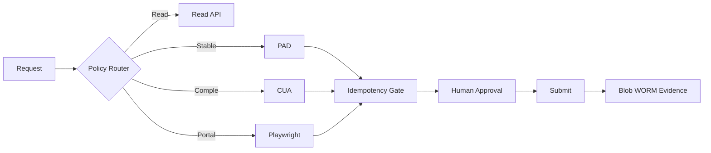
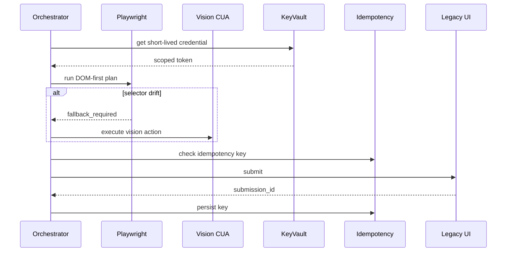

# Copilot Studio Computer Use vs PAD RPA vs Playwright MCP vs Strangler Pattern: Legacy UI Automation FAQ

> 🌐 **Language / 语言切换**: **[🇬🇧 English (copilot-studio-computer-use-rpa-vs-power-automate-vs-playwright-mcp-legacy-ui-automation-selection-faq.en.md)](copilot-studio-computer-use-rpa-vs-power-automate-vs-playwright-mcp-legacy-ui-automation-selection-faq.en.md)** | **[🇨🇳 中文版 (copilot-studio-computer-use-rpa-vs-power-automate-vs-playwright-mcp-legacy-ui-automation-selection-faq.md)](copilot-studio-computer-use-rpa-vs-power-automate-vs-playwright-mcp-legacy-ui-automation-selection-faq.md)** | **[📚 Architecture Selection FAQ Index](README.en.md)**

## 1) Research objective and boundary
- Goal: enterprise selection for API-missing core systems and external portals.
- Scope: architecture, governance, cost, and compliance only.
- Conclusion: segment risk first, then select automation mode.
## 2) Verifiable sources with timestamps
- Copilot Studio docs: `https://learn.microsoft.com/microsoft-copilot-studio/` (03:35 BJT).
- PAD docs: `https://learn.microsoft.com/power-automate/desktop-flows/` (03:35 BJT).
- Playwright docs: `https://playwright.dev/docs/intro` (03:36 BJT).
- ACA docs: `https://learn.microsoft.com/azure/container-apps/` (03:36 BJT).
- Key Vault docs: `https://learn.microsoft.com/azure/key-vault/secrets/` (03:36 BJT).
- Blob WORM docs: `https://learn.microsoft.com/azure/storage/blobs/immutable-storage-overview` (03:37 BJT).
- Label every metric as measured, synthetic, or anonymized_reported.
## 3) 12-dimension matrix across four patterns
- D1 battlefield: CUA for non-standard work, PAD for fixed batch, Playwright for portals, Strangler for blended estates.
- D2 resilience: CUA handles visual drift, PAD is selector-fragile, Playwright depends on DOM stability, Strangler shrinks UI blast radius.
- D3 cost: CUA carries vision cost, PAD near-zero vision cost, Playwright elastic container cost, Strangler lowest blended cost.
- D4 latency: PAD fastest, Playwright middle, CUA slower for complex reasoning.
- D5 write safety: idempotency key and human review are mandatory before submit.
- D6 audit: CUA screenshot-rich, PAD log-rich, Playwright needs explicit screenshots/HAR.
- D7 concurrency: bounded by desktop pools, bot pools, or container quotas respectively.
- D8 credentials: standardize Key Vault with short-lived secrets.
- D9 testing: PAD regression packs, Playwright CI strength, CUA replay corpus need.
- D10 skills: CUA business-heavy, PAD RPA-heavy, Playwright engineering-heavy.
- D11 best fit: each pattern has a lane, hybrid is often strongest.
- D12 anti-pattern: never rely on prompts for authorization control.
## 4) Scoring snapshot and decision thresholds
- CUA: adaptability5/resilience4/batch3/audit5.
- PAD: adaptability3/resilience3/batch5/audit4.
- Playwright: adaptability4/resilience4/batch4/audit4.
- Strangler: adaptability5/resilience5/batch5/audit5.
- Threshold A: if high-risk writes >20%, require dual approval.
- Threshold B: if portal redesign is weekly, prefer DOM-first with vision fallback.
- Threshold C: if read traffic >70%, prioritize lightweight API wrapping.
## 5) Five calculable Q&As
### Q1 Time and cost per 10,000 transactions
- Assume N=10000, per-item CUA 28s, PAD 11s, DOM-first 16s, concurrency 50.
- Total time: CUA 5600s, PAD 2200s, DOM-first 3200s.
- Synthetic cost: CUA $1180, PAD $760, DOM-first $890.
### Q2 Unattended AVD pool sizing
- With 2 sessions/desktop, peak 420, utilization 0.7, desktops needed are 300.
- Add 15% reserve and target 345 desktops.
### Q3 Indirect prompt injection defense
- Sanitize external text and enforce strict tool allowlists.
- Target interception KPI p95 blocked/total >= 0.93.
### Q4 Idempotent submit gate
- key=hash(businessKey+amount+date+channel).
- Reject re-submit if key already completed.
### Q5 API wrapping ROI
- With C_api=280k and monthly saving 38k, payback is ~7.4 months.
## 6) Layered reference architecture
- Experience layer: operator, reviewer, and incident consoles.
- Orchestration layer: policy router.
- Execution layer: AVD CUA, PAD bots, ACA Playwright pools.
- Data layer: read replicas and lightweight APIs.
- Security layer: Entra, Key Vault, DLP.
- Observability layer: Log Analytics and KQL.
- Governance layer: CAB, rollback runbooks, drills.
## 7) Scenario A: life insurer with 20-year Win32 core
- Architecture: read-replica lookup + PAD for standard edits + CUA for non-standard exceptions.
- Dual approval for high-value changes and beneficiary updates.
- Pre-submit readback verification and idempotency checks.
- Synthetic gain: complex cases reduced from 36 minutes to 14 minutes.
- Evidence chain: screenshots, submission_id, and approver identity.
## 8) Scenario B: global freight group across 45 portals
- Architecture: ACA ephemeral Playwright MCP pools with DOM-first and vision fallback.
- Credential model: Key Vault managed secrets with short-lived injection.
- Injection defense: sanitize portal text before prompt context usage.
- Blob WORM stores booking receipts and proof screenshots.
- Synthetic gain: status delay reduced from 4 hours to 18 minutes.
## 9) Mermaid diagram 1 flow

- Read paths bypass UI first, write paths always pass safety gates.
## 10) Mermaid diagram 2 sequence

- DOM and vision paths converge at one idempotency checkpoint.
## 11) Bicep template
```bicep
targetScope = 'resourceGroup'
param location string = resourceGroup().location
resource kv 'Microsoft.KeyVault/vaults@2023-07-01' = {
  name: 'kv-prod'
  location: location
}
resource sa 'Microsoft.Storage/storageAccounts@2023-05-01' = {
  name: 'str1146immut'
  location: location
}
resource app 'Microsoft.App/containerApps@2024-03-01' = {
  name: 'playwright-mcp'
  location: location
  properties: { template: { scale: { minReplicas: 0, maxReplicas: 40 } } }
}
```
- Add private networking, managed identity, and least-privilege RBAC in production.
## 12) Python/TypeScript snippet
```python
import hashlib
def idem(policy_id, amount, d, ch):
    raw=f"{policy_id}|{amount:.2f}|{d}|{ch}"
    return hashlib.sha256(raw.encode()).hexdigest()
```
```ts
async function runHybrid(step, page, cua){
  const loc = page.locator(step.selector);
  if (await loc.count()) return loc.click();
  return cua.clickByVision(step.label);
}
```
- Always enforce idempotency and human confirmation before critical submit actions.
## 13) KQL audit query
```kql
let t = AutomationLogs | where TimeGenerated > ago(24h);
t
| summarize total=count(),success=countif(Status=="Success"),fallback=countif(Route=="vision_fallback"),p95=percentile(DurationMs,95),avgCost=avg(CostUsd) by Workflow,SystemType
| extend successRate=todouble(success)/todouble(total)
| extend fallbackRate=todouble(fallback)/todouble(total)
| order by fallbackRate desc, p95 desc
```
- Alert when successRate<0.985, critical when successRate<0.97.
## 14) Day-0/1/2 checklist
- Day-0 define action tiers and idempotency schema.
- Day-0 set up Key Vault, WORM containers, and alert routing.
- Day-1 onboard one PAD, one Playwright, and one CUA workflow.
- Day-1 run 10k replay and baseline latency, failure, and cost.
- Day-2 move high-volume reads to lightweight APIs.
- Day-2 publish BU-level cost dashboards.
- Day-2 govern fallback and duplicate-submit rates weekly.
