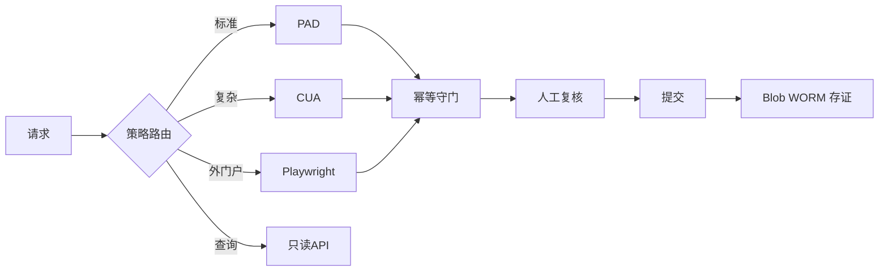
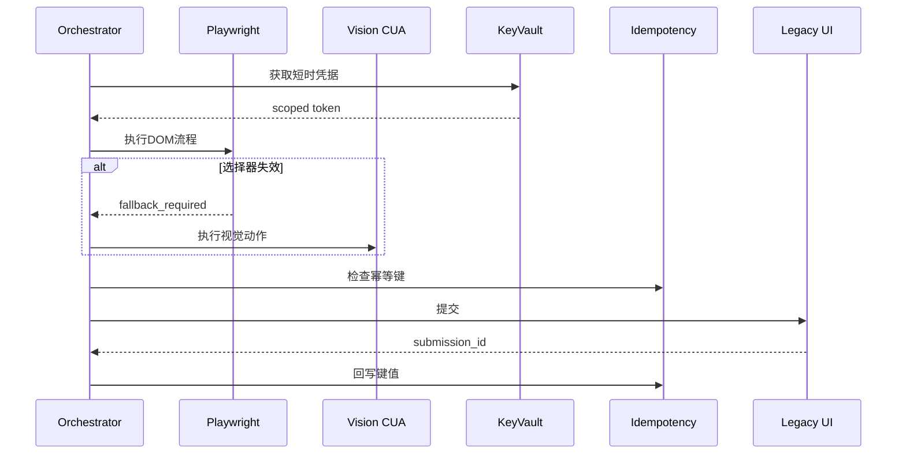

# Copilot Studio Computer Use vs PAD RPA vs Playwright MCP vs 绞杀者：无 API 老系统自动化选型 FAQ

> 🌐 **Language / 语言切换**: **[🇨🇳 中文版 (copilot-studio-computer-use-rpa-vs-power-automate-vs-playwright-mcp-legacy-ui-automation-selection-faq.md)](copilot-studio-computer-use-rpa-vs-power-automate-vs-playwright-mcp-legacy-ui-automation-selection-faq.md)** | **[🇬🇧 English (copilot-studio-computer-use-rpa-vs-power-automate-vs-playwright-mcp-legacy-ui-automation-selection-faq.en.md)](copilot-studio-computer-use-rpa-vs-power-automate-vs-playwright-mcp-legacy-ui-automation-selection-faq.en.md)** | **[📚 返回架构选型指南目录](README.md)**

## 1) 研究目标与边界
- 目标：聚焦企业级旧系统与外部门户自动化接管。
- 口径：仅讨论应用架构、成本、合规与运维。
- 结论：先做风险分层，再定自动化手段。
## 2) 当日可验证来源与时间戳
- Copilot Studio 文档：`https://learn.microsoft.com/microsoft-copilot-studio/`（抓取 03:35 BJT）。
- PAD 文档：`https://learn.microsoft.com/power-automate/desktop-flows/`（抓取 03:35 BJT）。
- Playwright 文档：`https://playwright.dev/docs/intro`（抓取 03:36 BJT）。
- ACA 文档：`https://learn.microsoft.com/azure/container-apps/`（抓取 03:36 BJT）。
- Key Vault 文档：`https://learn.microsoft.com/azure/key-vault/secrets/`（抓取 03:36 BJT）。
- Blob WORM 文档：`https://learn.microsoft.com/azure/storage/blobs/immutable-storage-overview`（抓取 03:37 BJT）。
- 数据标签统一使用 measured/synthetic/anonymized_reported。
## 3) 四类架构 12 维横向选型矩阵
- 维度1主战场：CUA=非标复杂，PAD=固定批量，Playwright=外门户，绞杀者=混合演进。
- 维度2韧性：CUA抗页面漂移强，PAD对控件漂移敏感，Playwright受DOM稳定度影响，绞杀者将UI面收缩。
- 维度3成本：CUA有视觉推理成本，PAD接近零视觉成本，Playwright容器成本可控，绞杀者综合最低。
- 维度4时延：PAD最快，Playwright中位，CUA在复杂推理时更慢。
- 维度5写安全：提交前都必须幂等键与人工复核。
- 维度6审计：CUA截图强，PAD日志强，Playwright需主动截图/HAR。
- 维度7并发：CUA受桌面池，PAD受bot池，Playwright受容器配额。
- 维度8凭据：统一 Key Vault 与短期票据优先。
- 维度9测试：PAD回归成熟，Playwright CI强，CUA需场景回放库。
- 维度10技能：CUA偏业务协同，PAD偏RPA，Playwright偏工程。
- 维度11最佳场景：各取所长，混合最稳。
- 维度12反模式：不要用提示词做授权控制。
## 4) 12 维评分（1-5）与选型阈值
- CUA：适配5/韧性4/批量3/审计5。
- PAD：适配3/韧性3/批量5/审计4。
- Playwright：适配4/韧性4/批量4/审计4。
- 绞杀者：适配5/韧性5/批量5/审计5。
- 阈值A：高风险写占比>20%时必须人工双确认。
- 阈值B：门户改版周频>2次优先 DOM-first+Vision fallback。
- 阈值C：读流量占比>70%优先轻量 API 化。
## 5) 五组可复算 Q&A
### Q1 每万笔单据耗时与成本
- 设N=10000，CUA单笔28s，PAD11s，DOM-first16s，并发50。
- 总时长：CUA5600s，PAD2200s，DOM-first3200s。
- synthetic成本：CUA$1180，PAD$760，DOM-first$890。
### Q2 AVD非值守桌面池容量
- 设每桌面并发2，峰值420，利用率0.7，需300桌面。
- 预留15%冗余，建议345桌面。
### Q3 外网页间接提示词注入防护
- 清洗恶意指令片段并执行工具白名单。
- 目标阻断率 blocked/total 的 p95 >= 0.93。
### Q4 提交按钮幂等防重
- key=hash(业务键+金额+日期+渠道)。
- 幂等表命中则拒绝重提并回写原因。
### Q5 轻 API 化 ROI
- C_api=280k，月节省38k，回本约7.4月。
## 6) 分层解耦参考架构
- 体验层：坐席台、复核台、告警台。
- 编排层：策略路由器。
- 执行层：AVD CUA / PAD Bot / ACA Playwright 池。
- 数据层：只读副本与轻 API。
- 安全层：Entra + Key Vault + DLP。
- 观测层：Log Analytics + KQL。
- 治理层：CAB + 回滚剧本 + 演练。
## 7) 场景A：寿险公司 20 年 Win32 核心系统接管
- 架构：只读副本查保单 + PAD处理标准批改 + CUA处理复杂非标。
- 关键金额与受益人变更触发双人复核。
- 提交前执行字段回读与幂等校验。
- synthetic收益：复杂工单 36 分钟降到 14 分钟。
- 存证：截图+submission_id+审批人。
## 8) 场景B：国际货代 45 家门户订舱追踪
- 架构：ACA 瞬态 Playwright MCP 池，DOM优先，改版时视觉降级。
- 凭据统一托管 Key Vault，运行时短时注入。
- 外部文本先净化再入提示上下文。
- Blob WORM 保存订舱回执截图与追踪证据。
- synthetic收益：状态延迟 4 小时降到 18 分钟。
## 9) Mermaid 图1：分层流转图

- 读路径优先绕开界面，写路径统一走守门。
## 10) Mermaid 图2：DOM-first + Vision fallback 时序

- DOM与视觉路径最终汇聚到同一幂等检查点。
## 11) Bicep 模板（ACA + KV + Blob Immutable + LA）
```bicep
targetScope = 'resourceGroup'
param location string = resourceGroup().location
resource kv 'Microsoft.KeyVault/vaults@2023-07-01' = {
  name: 'kv-prod'
  location: location
  properties: { tenantId: subscription().tenantId, sku: { family: 'A', name: 'standard' } }
}
resource sa 'Microsoft.Storage/storageAccounts@2023-05-01' = {
  name: 'str1146immut'
  location: location
  sku: { name: 'Standard_LRS' }
  kind: 'StorageV2'
}
resource app 'Microsoft.App/containerApps@2024-03-01' = {
  name: 'playwright-mcp'
  location: location
  properties: { template: { scale: { minReplicas: 0, maxReplicas: 40 } } }
}
```
- 生产请补齐私网、托管身份、RBAC最小权限。
## 12) Python/TypeScript 代码片段（幂等与降级）
```python
import hashlib
def idem(policy_id, amount, d, ch):
    raw=f"{policy_id}|{amount:.2f}|{d}|{ch}"
    return hashlib.sha256(raw.encode()).hexdigest()
```
```ts
async function runHybrid(step, page, cua){
  const loc = page.locator(step.selector);
  if (await loc.count()) return loc.click();
  return cua.clickByVision(step.label);
}
```
- 提交/放款/订舱前必须人工确认开关与幂等校验。
## 13) KQL 审计（成功率/降级率/耗时/成本）
```kql
let t = AutomationLogs | where TimeGenerated > ago(24h);
t
| summarize total=count(),success=countif(Status=="Success"),fallback=countif(Route=="vision_fallback"),p95=percentile(DurationMs,95),avgCost=avg(CostUsd) by Workflow,SystemType
| extend successRate=todouble(success)/todouble(total)
| extend fallbackRate=todouble(fallback)/todouble(total)
| order by fallbackRate desc, p95 desc
```
- successRate<0.985告警，<0.97严重告警。
## 14) Day-0/1/2 落地清单
- Day-0：完成动作分层与幂等规则。
- Day-0：建立Key Vault、WORM容器、告警路由。
- Day-1：接入1条PAD、1条Playwright、1条CUA流程。
- Day-1：完成10k回放并固化基线。
- Day-2：迁出高频查询到只读API。
- Day-2：按BU输出成本看板。
- Day-2：纳入周度降级率与重复提交率治理。
