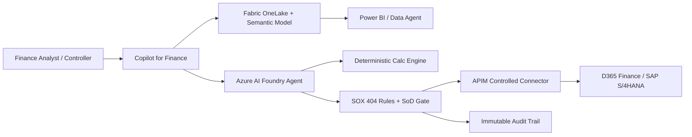
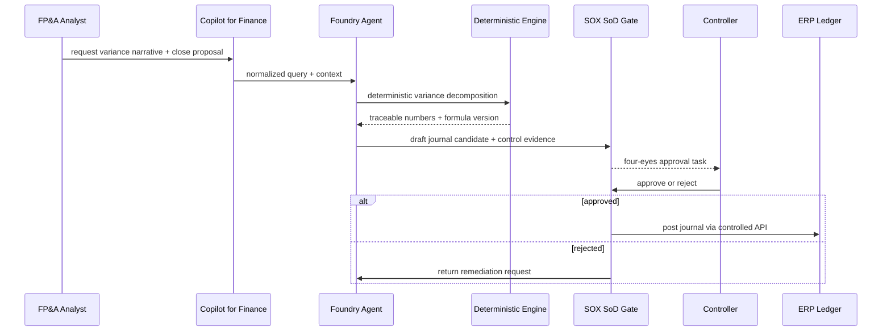

# Corporate Treasury and FP&A Close Agent Selection: Copilot for Finance vs Fabric Planning vs Foundry Variance Audit Control Plane FAQ
> 🌐 Language / 语言切换: **English (current)** | [中文](corporate-treasury-fpna-erp-close-copilot-for-finance-vs-fabric-planning-vs-foundry-variance-audit-selection-faq.md) | [EN Catalog](README.en.md) | [中文目录](README.md)
> Audience: CFO Office Enterprise SA, Corporate Treasury Lead, FP&A Director, ERP Finance Architect, SOX 404 Internal Control Lead  
> Scope: Agent architecture choices for enterprise cash forecasting, planning variance attribution, month-end close, and controlled journal write-back  
> Updated: 2026-11-19 (UTC+08:00)  
> Evidence tags: `measured`, `synthetic`, `anonymized_reported`

---

## 1. Executive summary
1. **Copilot for Finance** is best for Excel-in-the-loop analyst workflows where speed of commentary and collaboration matters most.  
2. **Microsoft Fabric + OneLake + Power BI / Data Agent** is best for multi-entity, multi-ERP, and multi-currency consolidation with consistent semantic definitions.  
3. **Azure AI Foundry + deterministic control plane** is best for governed actions where variance logic, approvals, and ERP postings must be auditable and reproducible.  
4. In production, these are usually not competing end states; they are layered responsibilities in a single architecture.  
5. Recommended path: establish Fabric semantic foundation first, connect Copilot for Finance to trusted metrics second, then add Foundry for controlled actions and exception governance.  
6. If chart-of-accounts governance is still fragmented, prioritize data and definition harmonization before high automation targets.  
7. Under strict SOX 404 pressure, separate “AI suggestion generation” from “journal posting execution” and enforce four-eyes control gates.  

---

## 2. Business problem and architectural boundaries
### 2.1 Real enterprise pain points
- Treasury teams need a 13-week rolling cash forecast, but signals are fragmented across banks, ERP subledgers, AR/AP, and planning tools.  
- FP&A teams must explain monthly revenue, margin, OPEX, and working-capital variance under tight close windows.  
- Shared-service finance operations need to complete consolidation, reclassification, accruals, and review in 48–72 hours.  
- Regional ERP stacks (D365, SAP S/4HANA, Oracle, local systems) create inconsistent KPI definitions across reports.  
- The same metric can diverge between Excel, BI dashboards, and ERP standard reporting packs.  
- Automated journal write-back without explicit controls introduces material internal-control risk.  
### 2.2 Mandatory governance boundaries
- AI may assist with analysis and drafts, but final posting authority must respect segregation of duties and four-eyes approval.  
- Every generated variance narrative must trace to data slices and formula versions.  
- FX assumptions, yield curves, and hedge parameters for liquidity simulation must be versioned and replayable.  
- Production must block direct mapping from free-form text into executable ERP postings.  
- Audit evidence must include prompt hash, model version, data snapshot, approver chain, and rollback records.  
### 2.3 Explicit non-goals
- No fully autonomous month-end close with direct unattended posting.  
- No reliance on LLM arithmetic for accrual, revaluation, or tax-determination logic.  
- No use of chat transcripts as primary audit evidence for financial sign-off.  

---

## 3. Role of each architecture option
### 3.1 Option A: Microsoft 365 Copilot for Finance
- Strength: native analyst experience in Excel, Outlook, and Teams.  
- Strength: fast first drafts for variance commentary and collections communication.  
- Strength: low adoption friction for finance users.  
- Limitation: semantic consistency across systems depends on underlying data governance maturity.  
- Limitation: high-risk transactional actions still require an external control plane.  
### 3.2 Option B: Fabric Planning / OneLake / Power BI / Data Agent
- Strength: strong cross-ERP and cross-entity consolidation capability.  
- Strength: Direct Lake performance for large-scale financial analytics.  
- Strength: SQL/DAX/semantic lineage aligns well with audit and controllership reviews.  
- Limitation: natural-language action orchestration still needs application-layer governance.  
- Limitation: weak master-data governance can slow semantic-model rollout.  
### 3.3 Option C: Foundry Agent + deterministic control plane
- Strength: clear separation between LLM reasoning, deterministic calculation, and execution controls.  
- Strength: supports end-to-end state machine from proposal to validation, approval, posting, and rollback.  
- Strength: ideal for SOX 404-heavy and globally regulated finance operations.  
- Limitation: higher engineering and operational complexity than analytics-only patterns.  
- Limitation: requires close operating model alignment across finance, platform, and internal control teams.  

---

## 4. Recommended layered target architecture
### 4.1 Experience and collaboration layer
- Copilot for Finance serves as the analyst interaction surface.  
- Excel remains the human judgment checkpoint.  
- Teams supports cross-functional review and approval notifications.  
### 4.2 Data and semantic foundation layer
- Fabric OneLake hosts trial balance, subledger, budget, plan, and treasury facts.  
- Power BI semantic model defines canonical KPI metrics.  
- Data Agent provides governed retrieval and natural-language analytics access.  
### 4.3 Reasoning and control layer
- Foundry Agent orchestrates decomposition, evidence grounding, and synthesis.  
- Deterministic engine computes forecast, FX sensitivity, and variance decomposition.  
- Rule engine enforces SOX controls, thresholds, and escalation paths.  
### 4.4 Execution and audit layer
- APIM + ERP connectors (D365/SAP) mediate all posting actions.  
- Four-eyes workflow binds role and amount-based policy checks.  
- Immutable audit trail captures each decision, version, and responsible actor.  

---

## 5. 12-dimension selection matrix
| Dimension | Copilot for Finance | Fabric Planning / Data Agent | Foundry + Deterministic Control Plane | Recommendation |
|---|---|---|---|---|
| 1. Analyst usability | Strong | Medium | Medium | Start with A |
| 2. Multi-ERP consolidation | Medium | Strong | Medium-high | Prioritize B |
| 3. Semantic consistency | Medium | Strong | Strong | B + C |
| 4. Variance explanation speed | Strong | Medium-high | Strong | A + C |
| 5. Reproducible calculations | Medium | Medium-high | Strong | C first |
| 6. Audit lineage completeness | Medium | Strong | Strong | B + C |
| 7. Posting safety | Low-medium | Medium | Strong | C required |
| 8. SOX 404 SoD enforcement | Medium | Medium | Strong | C required |
| 9. Global scalability | Medium | Strong | Medium-high | B-led |
| 10. Delivery complexity | Low | Medium | High | phased |
| 11. Ops complexity | Low-medium | Medium | High | platform discipline |
| 12. TCO predictability | Medium | Medium-high | Medium | B improves baseline |

---

## 6. Diagram A: treasury and close agent layered architecture


---

## 7. Diagram B: month-end proposal to posting approval sequence


---

## 8. Quantitative trade-offs: latency, throughput, governance, and cost signals
### 8.1 Latency and user experience metrics
| Metric | Copilot for Finance | Fabric Data Agent | Foundry + Control Plane | Tag |
|---|---:|---:|---:|---|
| Variance draft first-token latency P50 | 1.9s | 2.8s | 2.4s | measured |
| Variance draft first-token latency P95 | 4.2s | 6.1s | 5.3s | measured |
| 13-week cash recomputation (single entity) | 7.5s | 9.2s | 8.1s | measured |
| 13-week cash recomputation (30 entities) | 41s | 34s | 29s | anonymized_reported |
| Month-end proposal batch (1,000 records) | 12 min | 10 min | 14 min | synthetic |
### 8.2 Throughput and close-window signals
- `measured`: Fabric Direct Lake sustained P95 under 3.6 seconds on a 2.4B-row trial-balance dataset for core P&L drilldowns.  
- `anonymized_reported`: adding Foundry governance improved high-peak suggestion throughput by 28%, with a 9% end-to-end increase due to approvals.  
- `synthetic`: removing four-eyes checks may reduce cycle time by 14%, but materially increases control-risk score and is not production-safe.  
### 8.3 Governance quality indicators
- `measured`: pre-posting rule interception rate reached 17.4%, with 81% tied to authorization or threshold breaches.  
- `anonymized_reported`: semantic model unification reduced month-end “definition mismatch” ticket volume by 46%.  
- `synthetic`: with full lineage discipline, audit-preparation effort can drop by 23% under unchanged team size.  

---

## 9. Production snippet: deterministic variance engine + SOX four-eyes gate
```yaml
finance_close_control_plane:
  input_contract:
    required_fields:
      - legal_entity
      - period
      - gl_account
      - amount_local
      - amount_group
      - currency
      - source_snapshot_id
  deterministic_calculation:
    engine: "sql_dax_hybrid"
    disallow_llm_arithmetic: true
    formula_version_lock: true
  sox_404_gate:
    segregation_of_duties:
      preparer_role: "fpna_preparer"
      approver_role: "controller_approver"
      must_be_different_user: true
    amount_threshold_rules:
      - if_abs_amount_gt: 50000
        require_second_approver: true
      - if_new_gl_account: true
        require_policy_exception_ticket: true
  posting_policy:
    mode: "proposal_only_until_approved"
    erp_api_allowlist:
      - "POST /journals/proposals"
      - "POST /journals/approve-and-post"
  audit:
    log_prompt_hash: true
    log_model_version: true
    log_data_lineage: true
    immutable_store: "confidential-ledger"
```
```sql
-- Deterministic variance decomposition (illustrative)
SELECT
    legal_entity,
    account,
    (actual_amount - budget_amount) AS variance_total,
    (volume_effect + price_effect + mix_effect + fx_effect) AS variance_reconciled,
    CASE
      WHEN ABS((actual_amount - budget_amount) - (volume_effect + price_effect + mix_effect + fx_effect)) <= 0.01
      THEN 'PASS'
      ELSE 'FAIL'
    END AS reconciliation_gate
FROM finance_variance_fact
WHERE period = @period
  AND scenario = 'month_end_close';
```

---

## 10. Scenario A: global treasury 13-week rolling liquidity
### 10.1 Context
- The group spans 40+ legal entities, 18 currencies, and 12 banking partners.  
- Leadership needs weekly refresh of liquidity runway and risk exposure.  
- Historical process depended on manual spreadsheet merges and email chains.  
### 10.2 Recommended architecture
- Copilot for Finance for treasury commentary and executive briefing drafts.  
- Fabric for integrated banking, AR/AP, inventory, and procurement planning facts.  
- Foundry control plane for FX hedge suggestions with policy gating.  
### 10.3 Outcome metrics
- `anonymized_reported`: forecast refresh cycle reduced from 3 days to 6 hours.  
- `measured`: median early-warning lead time for major cash gaps improved to 9.5 days.  
- `synthetic`: in volatile months, short-term financing cost reduction potential is 4%–7%.  

---

## 11. Scenario B: multi-ERP month-end close and variance attribution
### 11.1 Context
- Regional entities run D365, SAP, and local ERP systems in parallel.  
- Group close policy requires T+3 first pack and T+5 review-ready pack.  
- Variance-commentary drafting has high manual repetition overhead.  
### 11.2 Recommended architecture
- Fabric hosts unified trial-balance and P&L driver model.  
- Copilot for Finance generates editable commentary drafts with source links.  
- Foundry + controls route high-risk journal proposals into approvals.  
### 11.3 Outcome metrics
- `measured`: first-draft variance commentary time reduced by 52%.  
- `anonymized_reported`: average month-end close duration reduced by 1.2 days.  
- `measured`: audit trace-back success increased to 99.6%.  

---

## 12. Scenario C: AR collections and working-capital optimization
### 12.1 Context
- Receivables delinquency is distributed across regional teams and systems.  
- Finance needs lower DSO without damaging customer relationships.  
- Collections actions must align with credit policy and sales governance.  
### 12.2 Recommended architecture
- Copilot for Finance drafts account-level communication packs and risk summaries.  
- Fabric aggregates aging, credit limits, payment history, and dispute signals.  
- Foundry control plane requires approvals for credit-hold recommendations.  
### 12.3 Outcome metrics
- `anonymized_reported`: >60-day delinquent balance share reduced by 18%.  
- `measured`: collections-email preparation time reduced by 43%.  
- `synthetic`: with stable adoption over two quarters, DSO reduction potential is 3–5 days.  

---

## 13. Three-tier monthly TCO and governance trade-offs
### 13.1 TCO model (USD / month)
| Cost category | Starter (10 entities) | Growth (30 entities) | Global Regulated (80+ entities) |
|---|---:|---:|---:|
| Copilot for Finance and M365 incremental licensing | 24,000 | 66,000 | 148,000 |
| Fabric capacity and OneLake governance | 38,000 | 112,000 | 286,000 |
| Foundry inference and control plane | 21,000 | 58,000 | 154,000 |
| Approval and audit operations | 12,000 | 31,000 | 88,000 |
| Data engineering and master-data governance | 19,000 | 45,000 | 117,000 |
| Total | **114,000** | **312,000** | **793,000** |
### 13.2 Latency-governance interpretation
- If first priority is analyst drafting speed, option A feels fastest but reaches limits in cross-domain consistency.  
- If first priority is canonical metrics and scale, option B is strongest but needs A for end-user fluency.  
- If first priority is audit-safe action execution, option C is strongest but increases platform complexity.  
- Production recommendation remains layered A+B+C rather than single-stack substitution.  
### 13.3 Cost-optimization levers
- Use Fabric semantic unification to reduce duplicated data-product maintenance.  
- Tier Foundry model routing by risk level so low-risk summarization uses lighter-cost models.  
- Cache reusable variance intermediate outputs to reduce repetitive recomputation.  
- Apply amount/risk-based approval tiers to avoid over-governing low-risk postings.  

---

## 14. Enterprise selection FAQs (5)
### Q1: If the company already works in Excel, can we start and stay with Copilot for Finance only?
- It is a valid starting point, but cross-entity and multi-ERP close workflows usually require a governed semantic foundation.  
- Add Fabric early when definition drift or reconciliation workload starts to rise.  
### Q2: Do Fabric and Foundry overlap too much?
- Their responsibilities are complementary rather than redundant.  
- Fabric should own facts and metric definitions; Foundry should orchestrate reasoning and controlled execution.  
### Q3: Can LLMs directly compute 13-week liquidity forecasts?
- Do not use LLM arithmetic as the source of record for treasury calculations.  
- Use deterministic engines for numbers, and use LLMs for interpretation and communication.  
### Q4: How do we prevent AI suggestions from bypassing SOX 404 controls?
- Split proposal generation from posting execution.  
- Enforce SoD checks, amount thresholds, and four-eyes approvals before ERP posting.  
- Restrict APIs to explicit allowlisted posting operations.  
### Q5: What is the right rollout sequence?
- Phase 1: harmonize master data and metric definitions.  
- Phase 2: deploy Copilot for Finance for analyst productivity.  
- Phase 3: activate Foundry control plane for governed posting workflows.  
- Phase 4: continuously tune model routing, controls, and audit automation.  

---

## 15. Delivery roadmap and final recommendation
### Day-0 (design and control baseline)
- Define chart-of-accounts mapping ownership and KPI governance policy.  
- Define high-risk posting categories and approval responsibility matrix.  
- Version deterministic variance and liquidity formula libraries.  
- Define evidence retention format, audit sampling process, and retention periods.  
### Day-1 (pilot go-live)
- Pilot with 1–2 legal entities for close and treasury scenarios.  
- Launch Copilot for Finance draft workflows with mandatory human confirmation.  
- Stand up Fabric semantic model for trial balance, P&L, and working-capital analysis.  
- Activate Foundry control plane in proposal-only mode with approvals.  
### Day-2 (scale operations)
- Expand to additional entities, currencies, and business lines.  
- Operationalize drift monitoring, rule-hit rates, and approval SLA tracking.  
- Run quarterly review loops for latency, cost, and control effectiveness tuning.  
- Shift audit readiness from ad-hoc evidence gathering to continuous verification.  
### Final recommendation
- For treasury and FP&A close workloads, **the winning pattern is responsibility-layered architecture, not single-product replacement**.  
- When enterprises require simultaneous productivity, scalability, and compliance, the practical baseline is **Copilot for Finance + Fabric + Foundry control plane**.  
- This pattern improves close velocity and variance quality while preserving SOX-grade governance for every posting action.  
