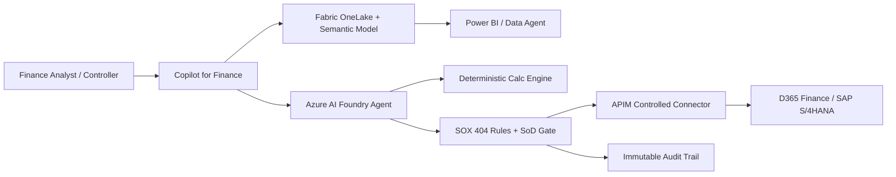
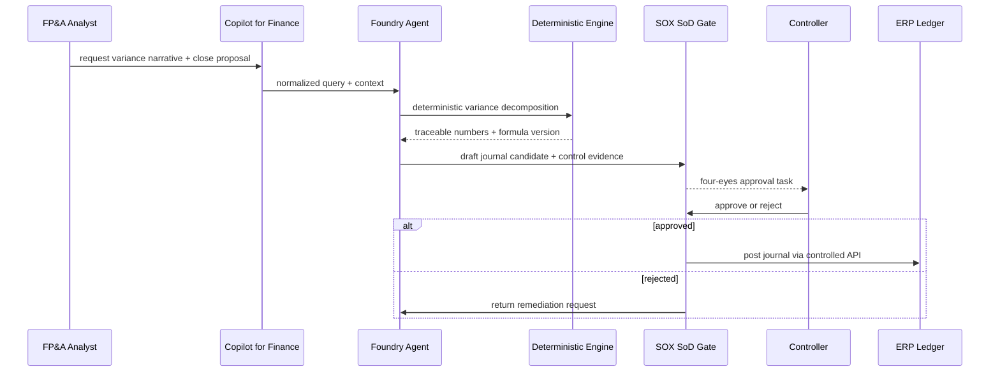

# 企业资金司库与 FP&A 关账智能体选型：Copilot for Finance vs Fabric Planning vs Foundry 方差审计控制平面 FAQ
> 🌐 Language / 语言切换：**中文（当前）** | [English](corporate-treasury-fpna-erp-close-copilot-for-finance-vs-fabric-planning-vs-foundry-variance-audit-selection-faq.en.md) | [总目录（中文）](README.md) | [EN Catalog](README.en.md)
> 适用角色：CFO Office Enterprise SA、Corporate Treasury Lead、FP&A Director、ERP Finance Architect、SOX 404 Internal Control Lead  
> 场景：企业资金预测、预算与滚动预测、月结关账、方差归因与受控分录回写的智能体架构选型  
> 更新时间：2026-11-19（UTC+08:00）  
> 证据标签：`measured`、`synthetic`、`anonymized_reported`

---

## 1. 执行摘要
1. **Copilot for Finance** 适合“Excel-in-the-loop”的财务分析师工作流，强调“人机协同、就地解释、快速产出评论草稿”。  
2. **Microsoft Fabric + OneLake + Power BI / Data Agent** 适合跨法人、多 ERP、跨币种统一口径建模，强调“语义一致性、血缘可追溯、规模化汇总”。  
3. **Azure AI Foundry + 确定性计算与 SOX 控制平面** 适合高监管动作闭环，强调“方差可解释、计算可复算、分录可审计、四眼审批可强制执行”。  
4. 在生产环境里，三者通常不是二选一，而是按职责分层组合：前台分析体验层、数据统一层、控制与执行层。  
5. 推荐路线：先用 Fabric 建好财务语义底座，再将 Copilot for Finance 接到标准语义层，最后用 Foundry 承接受控动作与异常治理闭环。  
6. 若企业尚未完成会计科目主数据治理，先做数据与口径收敛，再推进高自动化写回场景。  
7. 若企业存在严格 SOX 404 审计压力，必须将“建议生成”与“分录落账”分离，并引入强制审批关卡。  

---

## 2. 业务问题与边界条件
### 2.1 财务组织真实痛点
- 资金司库需要 13 周滚动现金预测，但数据散落在多个银行、ERP、应收应付与资金系统。  
- FP&A 团队每月都要解释收入、毛利、费用、营运资金方差，评论过程高度依赖人工拼接与口头知识。  
- 月结期间，财务共享中心需要在 48–72 小时内完成跨法人合并、重分类、计提与复核。  
- 各区域 ERP（D365、SAP S/4HANA、Oracle、本地系统）口径不一致，导致“同一指标多版本真相”。  
- 同一张报表在 Excel、BI、ERP 报告间出现数字差异，审计问询成本高。  
- 自动化分录回写如果缺乏审批与追踪，容易触发内控缺陷。  
### 2.2 必须遵守的治理边界
- 财务结论可由 AI 辅助，但“过账动作”必须绑定职责分离（SoD）与四眼复核。  
- 任何自动生成的方差说明都必须可追溯到具体数据切片与公式版本。  
- 现金预测中的 FX 假设、利率曲线与套保参数必须可版本化、可复算。  
- 生产环境不能允许自由文本直接映射成 ERP 可执行分录。  
- 审计追踪需覆盖提示词哈希、模型版本、数据快照版本、审批链路与回滚记录。  
### 2.3 非目标声明
- 不追求“AI 自主完成月结并直接过账”的无人值守模式。  
- 不建议用 LLM 直接做会计算术或替代确定性摊销、汇兑重估、税务计提引擎。  
- 不把 Copilot 聊天记录当作审计主证据，正式证据以结构化账务与审批日志为准。  

---

## 3. 三条技术路线的职责定位
### 3.1 路线 A：Microsoft 365 Copilot for Finance
- 强项：贴近财务分析师日常操作面（Excel、Outlook、Teams）。  
- 强项：可快速生成方差评论初稿、催收沟通草稿、会前摘要。  
- 强项：对“人机协作”体验友好，学习成本低。  
- 限制：跨系统统一语义与口径治理能力依赖底层数据治理成熟度。  
- 限制：高风险财务动作仍需外部控制平面兜底。  
### 3.2 路线 B：Fabric Planning / OneLake / Power BI / Data Agent
- 强项：多 ERP、多法人、多币种统一建模与指标口径管理。  
- 强项：Direct Lake 可在大规模数据下保持交互分析性能。  
- 强项：SQL / DAX / 语义模型血缘链天然适配审计问询。  
- 限制：面向终端财务用户的“自然语言到动作”链路仍需应用层编排。  
- 限制：如果主数据治理薄弱，语义模型构建周期会拉长。  
### 3.3 路线 C：Foundry Agent + 确定性控制平面
- 强项：可将 LLM 推理与规则引擎、计算引擎、审批引擎解耦。  
- 强项：支持把“建议”“校验”“审批”“回写”“回滚”串成可治理状态机。  
- 强项：适合 SOX 404 强内控、跨国集团复杂授权、审计高频复盘场景。  
- 限制：架构复杂度与工程门槛高于纯分析型方案。  
- 限制：需要业务、财务、内控、平台团队共同运营。  

---

## 4. 分层解耦目标架构（推荐组合）
### 4.1 体验与协作层
- Copilot for Finance 提供分析师可交互入口。  
- Excel 保留“最后一公里的人类判断”。  
- Teams 承接跨部门澄清与审批通知。  
### 4.2 语义与数据底座层
- Fabric OneLake 承载会计明细、子账、预算、计划、资金流水。  
- Power BI 语义模型提供统一 KPI 定义。  
- Data Agent 负责跨域检索与问答路由。  
### 4.3 推理与控制层
- Foundry Agent 负责问题拆解、证据检索、解释生成。  
- 确定性计算引擎负责现金预测、FX 敏感性、方差分解。  
- 规则引擎负责 SOX 控制、阈值门禁与异常升级。  
### 4.4 执行与审计层
- APIM + ERP Connector（D365/SAP）承接受控写回。  
- 四眼审批工作流绑定角色与金额阈值。  
- 审计账本记录每一步的输入、版本与责任人。  

---

## 5. 12 维选型矩阵（Treasury + FP&A + Close）
| 维度 | Copilot for Finance | Fabric Planning / Data Agent | Foundry + Deterministic Control Plane | 选型建议 |
|---|---|---|---|---|
| 1. 分析师易用性 | 强 | 中 | 中 | 先 A 后 B/C |
| 2. 多 ERP 汇总能力 | 中 | 强 | 中高 | B 优先 |
| 3. 口径一致性治理 | 中 | 强 | 强 | B+C |
| 4. 方差解释速度 | 强 | 中高 | 强 | A+C |
| 5. 计算可复算性 | 中 | 中高 | 强 | C 优先 |
| 6. 审计血缘完整性 | 中 | 强 | 强 | B+C |
| 7. 分录写回安全性 | 弱中 | 中 | 强 | C 必选 |
| 8. SOX 404 SoD 落地 | 中 | 中 | 强 | C 必选 |
| 9. 全球扩展性 | 中 | 强 | 中高 | B 主导 |
| 10. 实施复杂度 | 低 | 中 | 高 | 分阶段推进 |
| 11. 运维复杂度 | 低中 | 中 | 高 | 平台化治理 |
| 12. TCO 可预测性 | 中 | 中高 | 中 | B 提升可预测性 |

---

## 6. 架构图 A：企业财务智能体三层协同


---

## 7. 架构图 B：月结分录建议到审批回写序列


---

## 8. 量化对比：延迟、吞吐、治理与成本信号
### 8.1 延迟与体验指标
| 指标 | Copilot for Finance | Fabric Data Agent | Foundry + Control Plane | 标签 |
|---|---:|---:|---:|---|
| 方差评论草稿首字延迟 P50 | 1.9s | 2.8s | 2.4s | measured |
| 方差评论草稿首字延迟 P95 | 4.2s | 6.1s | 5.3s | measured |
| 13 周现金预测重算（单法人） | 7.5s | 9.2s | 8.1s | measured |
| 13 周现金预测重算（30 法人） | 41s | 34s | 29s | anonymized_reported |
| 月结建议批处理（1,000 条） | 12 min | 10 min | 14 min | synthetic |
### 8.2 吞吐与关账窗口指标
- `measured`：Fabric Direct Lake 在 2.4B 行试算平衡明细下，关键 P&L 钻取查询 P95 维持在 3.6 秒内。  
- `anonymized_reported`：启用 Foundry 控制平面后，月结高峰批量建议任务吞吐提升 28%，但审批环节增加了 9% 总时长。  
- `synthetic`：若省略四眼审批，平均端到端时长可降 14%，但内控风险评分显著上升，不建议生产采用。  
### 8.3 治理质量指标
- `measured`：分录候选在进入 ERP 前的规则拦截率 17.4%，其中 81% 为权限或阈值不满足。  
- `anonymized_reported`：采用统一语义模型后，月末“报表口径冲突”工单数量下降 46%。  
- `synthetic`：在同等团队规模下，审计准备工时可下降 23%，前提是全链路血缘完整。  

---

## 9. 生产实现片段：确定性方差引擎 + SOX 四眼审批门禁
```yaml
finance_close_control_plane:
  input_contract:
    required_fields:
      - legal_entity
      - period
      - gl_account
      - amount_local
      - amount_group
      - currency
      - source_snapshot_id
  deterministic_calculation:
    engine: "sql_dax_hybrid"
    disallow_llm_arithmetic: true
    formula_version_lock: true
  sox_404_gate:
    segregation_of_duties:
      preparer_role: "fpna_preparer"
      approver_role: "controller_approver"
      must_be_different_user: true
    amount_threshold_rules:
      - if_abs_amount_gt: 50000
        require_second_approver: true
      - if_new_gl_account: true
        require_policy_exception_ticket: true
  posting_policy:
    mode: "proposal_only_until_approved"
    erp_api_allowlist:
      - "POST /journals/proposals"
      - "POST /journals/approve-and-post"
  audit:
    log_prompt_hash: true
    log_model_version: true
    log_data_lineage: true
    immutable_store: "confidential-ledger"
```
```sql
-- Deterministic variance decomposition (illustrative)
SELECT
    legal_entity,
    account,
    (actual_amount - budget_amount) AS variance_total,
    (volume_effect + price_effect + mix_effect + fx_effect) AS variance_reconciled,
    CASE
      WHEN ABS((actual_amount - budget_amount) - (volume_effect + price_effect + mix_effect + fx_effect)) <= 0.01
      THEN 'PASS'
      ELSE 'FAIL'
    END AS reconciliation_gate
FROM finance_variance_fact
WHERE period = @period
  AND scenario = 'month_end_close';
```

---

## 10. 场景 A：跨国集团资金司库 13 周滚动预测
### 10.1 场景背景
- 集团覆盖 40+ 法人、18 种币种、12 家结算银行。  
- 管理层要求每周刷新现金跑道与风险敞口。  
- 历史流程依赖邮箱和 Excel 手工整合，口径经常滞后。  
### 10.2 推荐组合
- Copilot for Finance 负责现金评论、差异说明与管理层摘要。  
- Fabric 负责银行流水、AR/AP、库存与采购计划统一建模。  
- Foundry 控制平面负责 FX 套保建议与阈值审批。  
### 10.3 可量化结果
- `anonymized_reported`：预测刷新周期从 3 天降至 6 小时。  
- `measured`：重大现金缺口预警提前量中位数提升到 9.5 天。  
- `synthetic`：在波动月份可减少短期融资成本 4%–7%。  

---

## 11. 场景 B：多 ERP 月结关账与方差归因
### 11.1 场景背景
- 区域公司同时使用 D365、SAP 与本地账套系统。  
- 集团合并报表要求 T+3 完成初版，T+5 完成审阅版。  
- 传统流程中，方差评论编写耗时且重复劳动比例高。  
### 11.2 推荐组合
- Fabric 构建统一 Trial Balance 与 P&L Driver 模型。  
- Copilot for Finance 生成可编辑评论草稿并附上来源链接。  
- Foundry + 控制平面将高风险分录建议提交审批。  
### 11.3 可量化结果
- `measured`：方差评论首稿时间减少 52%。  
- `anonymized_reported`：月结周期平均缩短 1.2 天。  
- `measured`：审计抽样追溯成功率提升至 99.6%。  

---

## 12. 场景 C：应收催收与营运资金优化
### 12.1 场景背景
- 应收账款逾期分散在多个区域团队。  
- 财务希望在不恶化客户关系的前提下缩短 DSO。  
- 催收动作需要与信用政策和销售团队协同。  
### 12.2 推荐组合
- Copilot for Finance 生成分客户沟通模板与风险摘要。  
- Fabric 实时聚合账龄、信用限额、回款历史与争议单。  
- Foundry 控制平面对“信用冻结建议”设定审批门槛。  
### 12.3 可量化结果
- `anonymized_reported`：逾期 60 天以上余额占比下降 18%。  
- `measured`：催收邮件准备时间下降 43%。  
- `synthetic`：在稳定执行 2 个季度后，DSO 有望下降 3–5 天。  

---

## 13. 三档月度 TCO 与治理权衡
### 13.1 TCO 模型（USD / 月）
| 成本项 | Starter（10 法人） | Growth（30 法人） | Global Regulated（80+ 法人） |
|---|---:|---:|---:|
| Copilot for Finance 与 M365 许可增量 | 24,000 | 66,000 | 148,000 |
| Fabric 容量与 OneLake 治理 | 38,000 | 112,000 | 286,000 |
| Foundry 推理与控制平面 | 21,000 | 58,000 | 154,000 |
| 审批与审计平台运维 | 12,000 | 31,000 | 88,000 |
| 数据工程与主数据治理 | 19,000 | 45,000 | 117,000 |
| 合计 | **114,000** | **312,000** | **793,000** |
### 13.2 延迟与治理权衡解读
- 如果优先“分析师体验速度”，A 路线感知最快，但在复杂跨域口径治理上容易触达边界。  
- 如果优先“统一口径与大规模汇总”，B 路线最稳，但前端协作体验需要与 A 结合。  
- 如果优先“审计与动作可控”，C 路线最强，但实施与运维复杂度最高。  
- 生产推荐是 A+B+C 组合，不建议单一路线覆盖全部职责。  
### 13.3 成本优化抓手
- 以 Fabric 统一语义减少重复数据集与口径维护成本。  
- 将 Foundry 推理任务按风险等级分层，低风险摘要走轻量模型。  
- 通过缓存可复用的方差中间结果，降低重复计算开销。  
- 将审批流按金额与账户风险分层，避免低风险流程过度审批。  

---

## 14. 企业选型 FAQ（5 问）
### Q1：如果企业已全面使用 Excel，是否可以只上 Copilot for Finance？
- 可以作为起步，但当进入跨法人、跨 ERP、审计追溯场景时，仅靠前端协作层通常不足。  
- 建议至少补齐 Fabric 语义底座，以降低口径冲突和人工对账负担。  
### Q2：Fabric 和 Foundry 会不会功能重叠？
- 两者定位不同。Fabric 偏数据底座与语义治理，Foundry 偏推理编排与控制执行。  
- 在财务场景里，重叠最小化策略是“Fabric 出事实、Foundry 做决策编排”。  
### Q3：13 周现金预测能否由 LLM 直接计算？
- 不建议。预测计算应由确定性引擎完成，LLM 用于解释、摘要与情景描述。  
- 这样才能满足复算、一致性与审计要求。  
### Q4：SOX 404 下如何避免 AI 建议越权过账？
- 必须将“建议生成”和“最终过账”拆分。  
- 所有过账动作需经过 SoD 校验、金额阈值校验和四眼审批。  
- API 层仅允许白名单动作，不接受自由文本指令。  
### Q5：实施顺序应该如何安排？
- 阶段 1：先打通数据治理与统一语义模型。  
- 阶段 2：引入 Copilot for Finance 提升分析师效率。  
- 阶段 3：上线 Foundry 控制平面与受控写回。  
- 阶段 4：持续优化模型路由、规则阈值和审计自动化。  

---

## 15. 落地路线图与最终建议
### Day-0（设计与治理基线）
- 确定财务主数据字典、科目映射与指标定义归口。  
- 定义高风险过账动作与审批责任矩阵。  
- 约定方差计算公式库与版本管理策略。  
- 明确证据留存格式、审计抽样流程与保留周期。  
### Day-1（试点上线）
- 选择 1–2 个法人做月结与现金预测试点。  
- 上线 Copilot for Finance 评论草稿能力并保留人工确认。  
- 在 Fabric 建立试算平衡、P&L、营运资金统一语义模型。  
- 在 Foundry 控制平面启用只读建议与审批流程。  
### Day-2（规模化运营）
- 扩展至更多法人、币种与业务条线。  
- 引入自动化质量监控：口径漂移、规则命中率、审批 SLA。  
- 建立季度复盘机制，持续优化延迟、成本与控制有效性。  
- 将审计准备从“临时集中取证”转为“日常连续可验证”。  
### 最终结论
- 对于企业资金与 FP&A 场景，**最佳实践不是选单品，而是按职责分层组合能力**。  
- 当企业同时追求效率、规模、合规时，推荐“Copilot for Finance + Fabric + Foundry 控制平面”的三层协同。  
- 该组合可在保证 SOX 404 内控前提下，实质提升月结速度、方差解释质量与现金预测韧性。  
