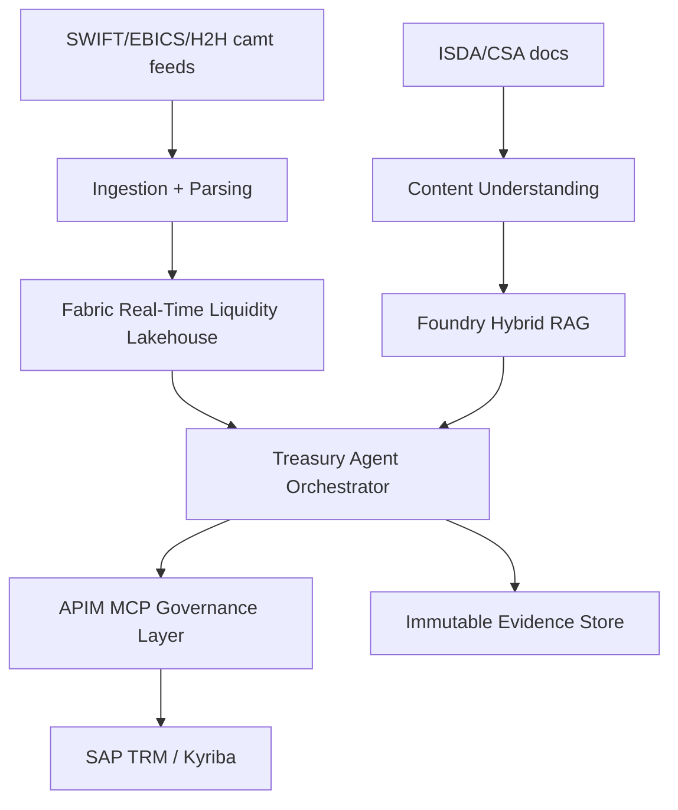
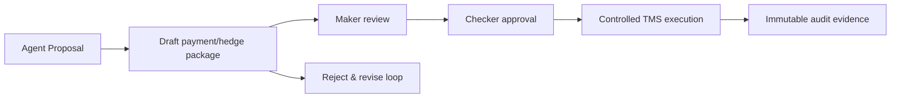

# Corporate Treasury Agent Selection FAQ: TMS-Native AI (Kyriba/SAP TRM) vs Fabric Liquidity Lakehouse + Foundry ISDA/CSA RAG (with APIM SOX Maker-Checker MCP Guardrails)

> Audience: Cloud & AI Solution Architects, corporate treasury leaders, cash operations teams, risk/control officers, audit/compliance, and platform engineering.  
> Decision scope: intraday liquidity positioning from `ISO 20022 camt.052/053/054`, FX hedge proposal support, and ISDA/CSA variation-margin dispute triage.  
> Red line: autonomous wire release or autonomous speculative trade execution is prohibited; high-risk actions must remain under SOX 404 maker-checker controls.

## 1. Executive summary: treasury agents are governed decision-support systems, not autonomous trading bots

Corporate treasury architecture differs from retail AML and actuarial ALM contexts.

The priority is controlled liquidity and hedge decision support under strict internal control.

Architecture success requires balancing:

- operational speed,
- policy traceability,
- and sustainable unit economics.

This guide compares three practical options:

- **Option A**: embedded AI capabilities in Kyriba/SAP S/4HANA TRM.
- **Option B**: Fabric real-time liquidity lakehouse + Foundry document understanding and hybrid RAG + APIM read/draft-only MCP connectors.
- **Option C**: bespoke autonomous multi-agent treasury bot directly integrated with SWIFT/FX venues (and why this is usually non-compliant).

Recommendation summary:

Option A is usually fastest when TMS operating maturity is already high.

Option B is typically strongest where cross-system data unification and evidence-centric workflows are required.

Option C is generally unsuitable as a production default under SOX 404 treasury-control expectations.

## 2. Domain boundary: what makes corporate treasury architecture distinct

This domain is not primarily anti-money-laundering pattern detection.

It is not pension actuarial balance-sheet optimization either.

Core treasury-agent tasks include:

1. consolidating intraday liquidity across hundreds of bank accounts,
2. preparing pre-cutoff cash sweep recommendations,
3. generating hedge proposal drafts for FX exposure,
4. triaging VM margin-call disputes with contract evidence.

Governance constraints include:

- strict role separation,
- dual-control approval workflows,
- complete decision evidence lineage.

Therefore, architecture should optimize “automation of analysis” while preserving “human-controlled execution”.

## 3. Option definitions: control and accountability boundaries

### 3.1 Option A: TMS-native embedded intelligence

Strengths:

- close fit with existing treasury operating flows,
- native control workflow alignment,
- lower organizational change risk.

Constraints:

- less flexible cross-system semantic synthesis,
- slower extensibility for complex document-evidence extraction.

### 3.2 Option B: Fabric + Foundry + APIM composable control plane

Strengths:

- unifies heterogeneous liquidity signals in a real-time lakehouse,
- enables structured ISDA/CSA evidence extraction,
- enforces read/draft-only integration boundaries into SAP TRM/Kyriba through APIM.

Constraints:

- requires stronger platform engineering and data-governance maturity,
- demands explicit separation between recommendations and execution rights.

### 3.3 Option C: bespoke autonomous execution bot

Potentially high automation depth.

But under most corporate treasury policies, auditability and control separation are insufficient for unrestricted production execution.

Typical risk includes bypassed approvals, weak non-repudiation, and policy drift exposure.

## 4. Data-plane architecture: ISO 20022 intraday flows and semantic layering

A common practical model:

- `camt.052` as intraday event backbone,
- `camt.053` as end-of-day reconciliation baseline,
- `camt.054` as debit/credit notification enrichment.

Recommended layered design:

- ingestion layer for normalized event capture,
- detail layer retaining both raw payload and parsed fields,
- semantic layer keyed by legal entity, account, currency, and region.

Retain source payloads for audit replay.

Version parse logic to preserve historical comparability through rule updates.

## 5. Evidence-plane architecture: ISDA/CSA clause extraction and RAG safety

ISDA/CSA packs often include annexes and side letters with threshold exceptions.

Pure vector retrieval without structure constraints can misread critical terms.

A robust pattern:

- Content Understanding extracts structured clause candidates first,
- hybrid RAG supports question answering and explanation,
- outputs must include paragraph-level citation and confidence metadata.

Important boundary:

evidence extraction is recommendation support, not execution authorization.

Margin movement or trade actions require separate human-controlled approval flow.

## 6. Governance plane: SOX maker-checker and MCP least-privilege segmentation

Corporate treasury agents should classify tools into three capability tiers:

1. read-only inquiry,
2. draft proposal generation,
3. execution submission.

Production autonomous agents should be constrained to tiers 1 and 2.

Tier 3 should remain human-approved and executed via controlled business systems.

This architecture reduces the chance of accidental or unauthorized execution.

## 7. Twelve-dimension comparison matrix

| Dimension | Option A TMS-Native | Option B Fabric+Foundry+APIM | Option C Autonomous Bot |
|---|---:|---:|---:|
| Time-to-value | 5 | 3 | 2 |
| Auditability | 5 | 5 | 2 |
| Cross-system integration depth | 3 | 5 | 4 |
| Unstructured clause intelligence | 3 | 5 | 4 |
| SOX role-separation fit | 5 | 5 | 1 |
| Multi-currency scalability | 4 | 5 | 4 |
| Peak-event scaling | 4 | 5 | 4 |
| Ops complexity (lower is better) | 4 | 3 | 2 |
| Execution-risk containment | 4 | 4 | 1 |
| Cost predictability | 4 | 4 | 2 |
| Long-term adaptability | 3 | 5 | 4 |
| Dispute-resolution efficiency | 4 | 5 | 2 |

Interpretation:

Option A is governance-stable and operationally pragmatic.

Option B is strongest for complex enterprise unification and evidence-driven controls.

Option C has structural control weaknesses for regulated production use.

## 8. Reference architecture I: liquidity data + contract evidence + governed integration



This pattern decouples data, evidence, and action governance planes.

Agents produce governed recommendations without direct privileged execution.

## 9. Reference architecture II: maker-checker execution separation



This separation is a practical foundation for SOX-auditable operational controls.

It also supports policy evolution without redesigning core data and recommendation flows.

## 10. APIM policy example: block autonomous execution and enforce read/draft mode

```xml
<policies>
  <inbound>
    <base />
    <set-variable name="actionType" value="@(context.Request.Headers.GetValueOrDefault(&quot;x-mcp-action&quot;,&quot;read&quot;))" />
    <choose>
      <when condition="@((string)context.Variables[&quot;actionType&quot;] == &quot;execute_trade&quot; || (string)context.Variables[&quot;actionType&quot;] == &quot;release_payment&quot;)">
        <return-response>
          <set-status code="403" reason="Autonomous execution blocked by SOX policy" />
        </return-response>
      </when>
    </choose>
    <set-header name="x-mode" exists-action="override">
      <value>read_or_draft_only</value>
    </set-header>
  </inbound>
  <backend><base /></backend>
  <outbound><base /></outbound>
  <on-error><base /></on-error>
</policies>
```

Policy outcomes:

- explicit denial for execution actions,
- deterministic read/draft-only contract,
- consistent gateway-level evidence of blocked operations.

## 11. Azure sizing and 3-year TCO (`$k/month`)

### 11.1 Baseline assumptions

- 312 accounts across 42 currencies,
- 280 million intraday events per month,
- 850k contract-clause Q&A operations per month,
- 2,200 concurrent peak sessions.

### 11.2 Option A estimate

- Monthly average: `$198k`
- 3-year total: `$7.13M`
- Strong stability and governance with moderate extensibility.

### 11.3 Option B estimate

- Monthly average: `$186k`
- 3-year total: `$6.70M`
- Better long-run economics when platform capability is mature.

### 11.4 Option C estimate

- Monthly average: `$205k`
- 3-year total: `$7.38M`
- Hidden governance-control overhead reduces practical economics.

### 11.5 Inflection guidance

When cross-system evidence complexity increases, Option B tends to improve marginal economics.

When governance operating maturity is low, Option A usually minimizes overall delivery risk.

## 12. Scenario A: global industrial conglomerate intraday cash sweep + hedge support

Context:

Cash is distributed across global subsidiaries and banking partners.

Treasury must optimize sweep proposals before regional cutoffs.

Required capabilities:

- low-latency intraday visibility,
- hedge proposal traceability to policy thresholds,
- controlled draft handoff into treasury systems.

Recommended shape:

Option B as data/evidence unification plane with Option A-style controlled execution boundaries.

## 13. Scenario B: global energy firm CSA margin-dispute triage

Context:

High-volatility markets increase VM disputes and response pressure.

Manual clause tracing across complex CSA annexes is time-consuming and error-prone.

Required capabilities:

- clause-level citation with confidence metadata,
- standardized dispute routing and escalation,
- strict prevention of autonomous collateral movement.

Recommended shape:

Foundry evidence extraction + hybrid RAG advisory outputs feeding controlled human review workflows.

## 14. Quantitative deep Q&A

### 14.1 Q1: when should A be prioritized over B?

If current TMS process coverage exceeds 80% and control maturity is high, A often delivers fastest safe value.

### 14.2 Q2: when does B produce positive ROI?

B usually turns favorable when cross-system integration burden and evidence-processing volume remain structurally high.

### 14.3 Q3: how do we prevent privilege drift into execution paths?

Enforce action-level policy at APIM and re-check role matrix within TMS execution workflows.

### 14.4 Q4: what is the primary risk of poor RAG evidence quality?

Incorrect recommendation support.

Mitigate with citation requirements, confidence thresholds, and mandatory human validation before action.

### 14.5 Q5: which outcome metrics matter most?

Track:

- intraday visibility latency,
- hedge proposal preparation time,
- margin-dispute resolution cycle time,
- cost per governed session.

### 14.6 Q6: why is C generally not a production default?

Because autonomous execution paths usually fail long-term SOX role-separation and audit defensibility requirements.

## 15. Five-step rollout and final recommendation (Good fit vs Not for)

**Step 1: codify non-autonomous execution boundaries**

Explicitly classify payment release and trade execution as human-controlled-only operations.

**Step 2: build dual planes**

Use Fabric for liquidity data unification and Foundry for contract evidence intelligence.

**Step 3: centralize governance at APIM**

Enforce identity, quotas, action-permission boundaries, and auditable policy outcomes at gateway entry.

**Step 4: integrate with draft-first treasury workflows**

Agent outputs should be proposal drafts, not final execution commands.

**Step 5: run quarterly TCO-risk rebalance**

Continuously tune A/B composition by volume, evidence complexity, and control findings.

**Good fit**:

- multinational treasury operations with strong compliance obligations and high data complexity.

**Not for**:

- ad hoc teams without formal approval, identity, and audit baselines.

Final recommendation:

Most enterprises benefit from A or B as governed core, with C-style automation limited to auxiliary orchestration and user-experience acceleration.

The durable control principle remains: automate analysis, govern execution.

### 15.7 Q7: how should recommendation priority be ranked across regional cutoff conflicts?

Use a composite score across cutoff urgency, liquidity shortfall magnitude, and control risk class.

Ranking logic should be explainable and auditable.

Amount-only ranking can miss critical timing and policy constraints.

### 15.8 Q8: how can FX hedge proposals avoid over-trading?

Apply minimum trade thresholds and rebalance bands.

Trigger proposals only when exposures breach policy bands.

Include “risk if no action” and “cost if action” ranges in each recommendation.

This limits fee drag from excessive micro-adjustments.

### 15.9 Q9: how should delayed bank statement feeds be handled?

Treat data freshness as a first-class confidence signal.

Lower recommendation weight for stale accounts and request targeted human verification.

Surface explicit data timestamp provenance with every recommendation.

Freshness transparency is essential for treasury trust.

### 15.10 Q10: should ISDA/CSA clause conflicts be auto-resolved?

No for production high-risk decisions.

The system should detect conflicts and surface evidence context.

Final adjudication should remain with legal/risk roles.

Cross-jurisdiction contract variance makes autonomous resolution risky.

### 15.11 Q11: how should cross-jurisdiction data residency be designed?

Segment data processing and storage by legal region.

Prefer summary-level cross-region outputs over full-detail replication.

Model-serving pathways should respect the same residency controls.

Policy lineage should be versioned with legal sign-off mapping.

### 15.12 Q12: how can policy changes propagate safely into agent behavior?

Externalize policy parameters into managed configuration.

Read thresholds, MTA limits, and tolerance bands from controlled policy stores.

Require regression checks and staged rollout before full production activation.

Avoid global policy flips without validation windows.

### 15.13 Q13: how do we measure recommendation quality, not volume?

Track acceptance rate, post-action deviation, and policy-hit precision.

High acceptance with poor post-action outcomes suggests pressured or blind adoption.

Quality loops should include outcome-based retrospective calibration.

Recommendation quality should be part of quarterly platform KPIs.

### 15.14 Q14: when should Monte Carlo stress overlays be introduced?

Introduce when market volatility and cashflow uncertainty materially increase.

Stress overlays complement deterministic recommendation pipelines.

Expose confidence intervals rather than single-point certainty.

Stress outputs should still remain advisory, not execution triggers.

### 15.15 Q15: how should board risk appetite map into agent controls?

Translate appetite into computable thresholds.

Examples include net exposure caps, minimum liquidity buffers, and currency concentration limits.

Each recommendation should indicate proximity to those boundaries.

This reduces governance ambiguity across organizational layers.

### 15.16 Q16: how can hallucination risk be constrained in treasury workflows?

Enforce evidence-first generation and confidence gating.

No-evidence outputs should never enter draft proposal lanes.

Low-confidence outputs should route to mandatory human verification queues.

Continuously retrain prompts and extraction rules from error corpora.

### 15.17 Q17: why should recommendation artifacts carry explicit version IDs?

Recommendations evolve as data updates arrive.

Without version IDs, audit replay cannot reliably reconstruct decision context.

Bind version IDs to snapshot timestamp and policy version.

This is essential for dispute response and regulator examination.

### 15.18 Q18: what operating cadence should treasury-agent resilience drills follow?

Run end-to-end drills at least quarterly.

Cover data lag, FX shock, approval delay, and controlled-degradation paths.

Capture findings into tracked remediation plans with closure targets.

Drill cadence is more valuable than one-time acceptance tests.

### 15.19 Q19: what cross-functional operating model works best?

A four-role pod is common: treasury SME, platform architect, risk/compliance lead, and product owner.

This prevents single-discipline optimization bias.

Cross-functional ownership improves requirement clarity and release quality.

It is usually a prerequisite for sustainable scale.

### 15.20 Closing extension: establish trusted recommendation rails before expanding automation depth

Treasury first principles are capital protection and auditable compliance.

Automation depth should grow only after those controls are stable.

Reversing that sequence often trades short-term speed for long-term risk cost.

### 15.21 Q20: how should cutoff-miss risk be operationalized in alerts?

Model regional cutoff calendars as executable policy rules.

If predicted action completion falls beyond window limits, emit high-severity alerts automatically.

Route those alerts directly to accountable maker/checker roles.

This is materially better than discovering misses only in end-of-day reconciliation.

### 15.22 Q21: how can connector version drift across banks be controlled?

Use contract-version allowlists for connector endpoints.

Replay historical payload suites in simulation tenants before production rollout.

Promote to production only after deterministic consistency gates pass.

This reduces recommendation distortion risk from silent interface changes.

### 15.23 Q22: how can ESG constraints be integrated into treasury recommendations?

Expose sustainability constraints as policy parameters.

Examples include green-funding ratios and carbon-linked exposure boundaries.

Recommendations should show ESG trade-off impact alongside liquidity objectives.

This supports explainable balancing between treasury efficiency and sustainability commitments.

### 15.24 Final operating principle: every recommendation should be traceable to data, policy, evidence, and accountable role

That is the minimum standard for durable treasury-agent trust.

If any element is missing, platform value degrades rapidly under audit or stress events.

Maintaining this principle turns agent capability into sustainable financial-governance leverage.

It is also a practical benchmark for demonstrating operating maturity during regulator and auditor reviews.

That anchor helps organizations convert technical capability into durable governance capability.
