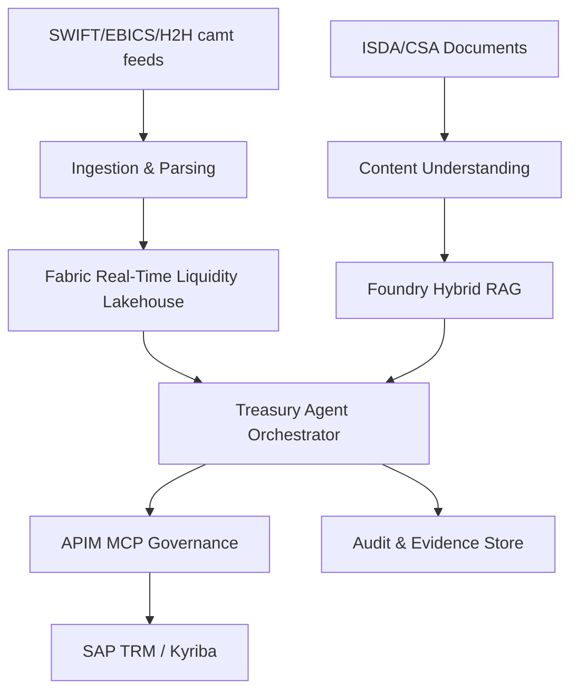
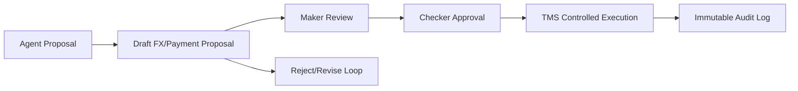

# 跨国企业司库智能体选型 FAQ：Kyriba/SAP TRM 内嵌 AI vs Fabric 流动性湖仓 + Foundry ISDA/CSA RAG（含 APIM SOX 双人复核 MCP 闸门）

> 面向角色：Cloud & AI Solution Architect、企业司库、资金运营、风险管理、审计合规、平台工程。  
> 业务问题：在 `ISO 20022 camt.052/053/054` 日内流动性定位、FX 套保建议与 ISDA/CSA 保证金争议处理中，如何做可审计、可控风险、可量化成本的智能体架构选型。  
> 风险底线：严禁自治智能体直接放款、直接电汇、直接下单交易；所有高风险动作必须 SOX 404 maker-checker 四眼复核。

## 1. 执行摘要：司库智能体平台不是“自动交易机器人”，而是“受控决策辅助系统”

企业司库场景与零售风控场景不同。

它关注的是跨币种现金头寸、结算截止窗口、对冲比例和保证金调拨。

关键目标是减少人工汇总延迟与误差，而不是放弃治理链路。

本指南比较三条主路径：

- **方案 A**：Kyriba / SAP S/4HANA TRM 内嵌智能能力优先。
- **方案 B**：Fabric 日内流动性湖仓 + Foundry 文档理解与 RAG + APIM 只读/草稿 MCP。
- **方案 C**：自建多智能体直连 SWIFT/FX 场馆的“全自动交易机器人”（并解释为何通常不合规）。

结论先行：

方案 A 在成熟 TMS 组织中落地最快、治理阻力最小。

方案 B 在跨系统异构、数据孤岛明显的大型集团中最具架构弹性。

方案 C 在多数 SOX 404 与司库政策下不可作为生产主路径。

## 2. 业务边界与监管约束：与 AML/欺诈和精算 ALM 的根本差异

该主题不同于零售银行 AML 模式识别。

也不同于养老金长期负债精算。

跨国企业司库核心任务包括：

1. 汇总 300+ 银行账户日内头寸。
2. 在区域截止时间前完成现金归集或调拨建议。
3. 根据风险政策生成 FX 远期/掉期建议草案。
4. 对衍生品 VM margin call 做条款核对与争议分流。

监管与内控约束包括：

- SOX 404 职责分离与双人复核。
- 授权矩阵与支付审批链完整留痕。
- 文档依据可回溯（ISDA Master / CSA / Side Letter）。

因此系统定位应是“决策支持 + 草案生成 + 风险提示”，而非“无人值守自动执行”。

## 3. 方案定义：A/B/C 三路径能力边界

### 3.1 方案 A：TMS 内嵌能力优先（Kyriba / SAP TRM）

优点：

- 流程贴合现有司库作业。
- 审批链、职责分离、权限边界通常已内建。
- 业务连续性风险较低。

局限：

- 跨系统语义融合能力受产品边界限制。
- 对非结构化条款文档理解能力扩展较慢。

### 3.2 方案 B：Fabric + Foundry + APIM 组合控制平面

优点：

- 可把多银行多格式资金数据统一到实时湖仓。
- 可用 Foundry/Content Understanding 提取 ISDA/CSA 条款。
- 可通过 APIM 把 TMS 集成限定在只读与草稿写入。

局限：

- 需要平台工程能力与数据治理协同。
- 需要明确定义“建议”与“执行”边界。

### 3.3 方案 C：自建自治交易机器人直连场馆

理论上自动化程度最高。

但在绝大多数企业治理模型下风险不可接受。

常见问题是职责分离被绕过、审计证据薄弱、策略漂移难以及时发现。

因此通常仅可用于实验或仿真环境，不宜直接生产执行。

## 4. 数据面设计：ISO 20022 日内现金流信号如何入湖与分层

推荐把 `camt.052` 作为日内信号主线。

`camt.053` 可作为日终对账基线。

`camt.054` 用于借贷通知补充。

落地策略：

- 实时层：事件流接入与轻量标准化。
- 明细层：原始报文与解析字段并存。
- 语义层：按实体（账户、币种、法人、地区）建模。

设计重点：

- 保留原文以便审计与争议复核。
- 解析字段做版本化，避免规则升级造成历史不可比。

## 5. 文档证据面：ISDA/CSA 条款提取与 RAG 风险

ISDA/CSA 文档常有附件、侧函、阈值例外条款。

仅靠向量召回直接回答，容易在关键阈值字段上误判。

推荐模式：

- Content Understanding 先做结构化抽取。
- 再进入混合 RAG 做问答与解释。
- 输出必须附段落级证据引用与置信度。

必须强调：

条款抽取是“建议证据”，不是自动执行授权。

任何保证金划拨或交易建议都要走人工确认。

## 6. 治理面：SOX 404 maker-checker 与 APIM MCP 最小权限边界

司库智能体必须遵守职责分离。

推荐把 MCP 工具分三层：

1. 只读查询（账户、头寸、历史交易）。
2. 草案生成（支付批次草稿、套保建议草稿）。
3. 执行提交（仅人工审批后由受控系统完成）。

在生产中，智能体默认只允许前两层。

执行提交应由独立审批链和受控系统触发。

该设计可显著降低“建议误触发执行”的系统性风险。

## 7. 12 维选型矩阵：A/B/C 横向量化比较

| 维度 | 方案 A TMS 内嵌 AI | 方案 B Fabric+Foundry+APIM | 方案 C 自治交易机器人 |
|---|---:|---:|---:|
| 上线速度 | 5 | 3 | 2 |
| 治理可审计性 | 5 | 5 | 2 |
| 跨系统整合能力 | 3 | 5 | 4 |
| 非结构化条款理解 | 3 | 5 | 4 |
| SOX 职责分离适配 | 5 | 5 | 1 |
| 多币种扩展弹性 | 4 | 5 | 4 |
| 流量峰值可扩展 | 4 | 5 | 4 |
| 平台运维复杂度（低更优） | 4 | 3 | 2 |
| 交易执行风险暴露 | 4 | 4 | 1 |
| 成本可预测性 | 4 | 4 | 2 |
| 长期演进弹性 | 3 | 5 | 4 |
| 审计争议处置效率 | 4 | 5 | 2 |

矩阵结论：

A 适合“现有 TMS 成熟且以稳健治理优先”的企业。

B 适合“跨系统复杂、需要统一数据与证据平面”的集团。

C 在治理风险上明显短板，不建议作为主生产路径。

## 8. 架构图（一）：Fabric 流动性湖仓 + Foundry 条款证据 + APIM 闸门



该拓扑把数据、证据、治理三层解耦。

智能体不直接接触高风险执行接口。

## 9. 架构图（二）：maker-checker 四眼审批与草案执行分离



该流程确保“建议”与“执行”在制度和系统上同时分离。

这是 SOX 审计可通过的关键设计。

## 10. 生产策略片段：APIM 限制 MCP 为只读/草稿能力

```xml
<policies>
  <inbound>
    <base />
    <set-variable name="actionType" value="@(context.Request.Headers.GetValueOrDefault(&quot;x-mcp-action&quot;,&quot;read&quot;))" />
    <choose>
      <when condition="@((string)context.Variables[&quot;actionType&quot;] == &quot;execute_trade&quot; || (string)context.Variables[&quot;actionType&quot;] == &quot;release_payment&quot;)">
        <return-response>
          <set-status code="403" reason="Autonomous execution blocked by SOX policy" />
        </return-response>
      </when>
    </choose>
    <set-header name="x-mode" exists-action="override">
      <value>read_or_draft_only</value>
    </set-header>
  </inbound>
  <backend><base /></backend>
  <outbound><base /></outbound>
  <on-error><base /></on-error>
</policies>
```

策略要点：

- 明确拒绝交易执行与付款释放动作。
- 智能体仅输出建议与草案。
- 审批与执行仍由受控业务系统承担。

## 11. Azure SKU 与 3 年 TCO：流动性智能体的成本拐点

### 11.1 假设条件

- 42 币种、312 银行账户。
- 日内流输入 2.8 亿条事件/月。
- 月均条款问答 85 万次。
- 高峰期会话并发 2,200。

### 11.2 方案 A 成本

- 月均 `$198k`
- 3 年 `$7.13M`
- 优势在于治理与稳定交付。

### 11.3 方案 B 成本

- 月均 `$186k`
- 3 年 `$6.70M`
- 前提是组织能承担平台工程运维。

### 11.4 方案 C 成本

- 月均 `$205k`
- 3 年 `$7.38M`
- 自动执行风险控制成本高，审计补偿成本不可忽视。

### 11.5 拐点观察

当条款解析与跨系统整合复杂度升高时，B 相对 A 的成本效率会改善。

但若治理团队能力不足，B 的隐性运营成本会快速上升。

## 12. 场景一：全球工业集团 42 币种日内归集与 FX 套保建议

背景：

集团覆盖欧、美、亚多区域，资金分散在 300+ 账户。

目标是在各区域截止前优化归集与套保草案。

关键要求：

- 日内头寸可视化实时更新。
- 套保建议需引用政策阈值与历史波动区间。
- 建议结果必须可追溯并可人工修订。

建议：

采用 B 作为数据与证据主平面，结合 A 的 TMS 执行治理能力。

## 13. 场景二：能源企业 ISDA/CSA VM 争议分流与证据检索

背景：

能源与大宗商品企业面对高波动市场，VM 争议频发。

人工逐份查条款耗时高，且易遗漏例外条款。

关键要求：

- 条款抽取必须有证据段落定位。
- 争议工单需要标准化分类与升级路径。
- 结论只能作为建议，不得自动触发资金划拨。

建议：

采用 Foundry 条款理解 + RAG 证据链路，输出争议分流建议给人工风控处理。

## 14. 深度问答：评审会最常问的 6 个量化问题

### 14.1 Q1：什么时候应优先 A 而非 B？

当现有 TMS 已覆盖 80% 流程且内控体系成熟时，A 通常更快产生业务价值。

### 14.2 Q2：B 的 ROI 何时显现？

当跨系统数据整合复杂度高，且月度条款问答量持续上升时，B 的边际收益更明显。

### 14.3 Q3：如何防止智能体越权触发执行？

通过 APIM 策略硬阻断执行类 MCP 动作，并在 TMS 侧再次校验角色与审批。

### 14.4 Q4：RAG 输出错误会导致什么风险？

主要是错误建议风险。

因此必须有证据引用、置信度阈值和人工复核，不可直连执行。

### 14.5 Q5：如何衡量落地后成效？

建议指标：

- 头寸可见性时延。
- 套保建议准备时长。
- VM 争议工单处理时长。
- 单会话成本。

### 14.6 Q6：为什么 C 不推荐主生产？

因为在 SOX 404 与司库政策下，自治执行链路难以通过长期审计与职责分离要求。

## 15. 五步落地与最终建议（Good fit vs Not for）

**Step 1：定义不可自动执行清单**

明确交易执行、付款释放等动作必须人工链路完成。

**Step 2：建立数据与证据双平面**

Fabric 管日内流动性数据，Foundry 管条款证据理解与问答。

**Step 3：网关前置治理**

APIM 统一认证、配额、动作级权限与审计入口。

**Step 4：接入 TMS 草案流**

让智能体产出草案，不产出最终执行指令。

**Step 5：季度回顾 TCO 与风险**

按会话量、争议率、治理事件复盘 A/B 配比。

**Good fit**：

- 跨国多币种、多账户、强合规司库组织。

**Not for**：

- 无正式审批与审计基础的临时试验团队。

最终建议：

以 A 或 B 构建受控主平面，以 C 作为补充协作层是最稳妥的企业路径。

在任何情况下，都应坚持“建议自动化、执行人工化”的治理红线。

### 15.7 Q7：区域截止窗口冲突时，智能体应如何排序建议？

建议以“截止时间紧迫度 + 现金缺口规模 + 合规风险等级”三因素排序。

排序逻辑应可解释并可复盘。

不可只按金额大小排序，否则可能忽略关键合规时限。

### 15.8 Q8：FX 套保建议如何避免过度交易？

应引入最小交易门槛与再平衡带宽。

只有偏离区间超过阈值才触发建议。

建议结果应附带“若不动作的风险区间”与“动作后的成本区间”。

这样可避免频繁小额操作导致交易成本侵蚀。

### 15.9 Q9：如何处理银行回单延迟导致的头寸误差？

建议把数据新鲜度纳入信号质量评分。

对低新鲜度账户降低建议权重，优先提示人工复核。

系统应显示“当前建议基于何时数据”。

可解释新鲜度是司库信任的核心前提。

### 15.10 Q10：ISDA/CSA 条款冲突时是否允许自动裁决？

不建议自动裁决。

系统可做冲突检测与证据定位。

最终裁决应由法务或风险角色确认。

自动裁决在跨法域合同体系下风险过高。

### 15.11 Q11：如何设计跨法域数据驻留策略？

应把欧盟、美国、亚太等区域数据分域存储与处理。

跨域查询输出应优先传递摘要与必要字段，而非全量明细。

模型调用路径也要遵守数据驻留策略。

治理策略应与法务清单同步版本化。

### 15.12 Q12：如何把司库策略变化快速反映到智能体？

建议策略参数外置化。

例如阈值、MTA、可接受偏离区间都从配置中心读取。

策略变更应触发回归测试与小流量验证。

避免策略突变直接影响全量生产建议。

### 15.13 Q13：如何定义“建议质量”而非仅“建议数量”？

可建立命中率、采纳率、偏差率三类指标。

采纳率高但偏差率也高时，说明人可能在高压下机械接受建议。

需要结合后验结果做质量闭环。

建议质量应进入平台季度 KPI。

### 15.14 Q14：何时应引入 Monte Carlo 现金流压力测试？

当汇率与商品价格波动显著上升时应引入。

压力测试用于补充 deterministic 建议视角。

结果可作为“建议置信区间”的一部分展示。

但压力测试输出仍不应直连执行。

### 15.15 Q15：司库智能体如何与董事会风险偏好对齐？

应把风险偏好映射成可计算阈值。

例如最大净敞口、最小流动性缓冲、单币种上限。

智能体所有建议都应标注是否触碰风险偏好边界。

这可减少跨层级沟通歧义。

### 15.16 Q16：如何降低模型幻觉对决策链影响？

关键方法是证据优先与置信度门控。

无证据回答不得进入草案流。

低置信度回答自动转人工核对队列。

并持续积累误判样本做提示词与抽取规则优化。

### 15.17 Q17：为什么需要“建议版本号”机制？

建议会随数据刷新而变化。

若无版本号，审计时很难解释“当时依据是什么”。

建议版本号应绑定数据快照时间与策略版本。

这是争议复盘与审计答复的关键抓手。

### 15.18 Q18：如何构建司库智能体演练制度？

建议每季度进行一次全链路演练。

覆盖数据延迟、汇率突变、审批延迟、系统降级四类场景。

演练后形成整改清单并跟踪关闭率。

演练制度比一次性验收更能保障长期可靠性。

### 15.19 Q19：平台组织模型应如何配置？

推荐“业务产品经理 + 司库专家 + 平台架构师 + 风控合规”四方小队。

避免由单一技术团队孤立推进。

跨职能小队可显著提升需求澄清速度与上线质量。

该组织模型也是规模化迭代的前提。

### 15.20 收官补充：先构建可信建议，再谈自动化深度

司库场景的第一性原理是资本安全与合规可证。

在此基础上提升分析自动化，才能形成稳健价值。

如果顺序颠倒，短期效率收益常会被长期风险成本抵消。

### 15.21 Q20：如何把 cut-off miss 风险纳入平台告警？

建议把各区域截止时间建成可计算规则。

当预测现金动作无法在窗口前完成时，自动触发红色告警。

并把该告警直接推送给 maker/checker 责任角色。

这比事后对账发现问题更有治理价值。

### 15.22 Q21：如何控制多银行连接器版本漂移？

建议连接器契约做版本白名单管理。

任何版本升级先在仿真租户回放历史样本。

通过一致性门禁后再灰度进入生产。

此流程能降低“接口变更导致建议失真”的风险。

### 15.23 Q22：如何把 ESG/可持续融资约束纳入建议？

可将绿色融资比例、碳相关敞口指标加入策略参数。

智能体建议时同步显示 ESG 约束影响。

这样司库可在流动性目标与可持续目标之间做可解释权衡。

企业治理报告也更容易形成闭环证据。

### 15.24 终极落地原则：每条建议都应可追溯到“数据、策略、证据、责任人”

这是企业司库智能体走向长期可信运营的最低标准。

若缺失其中任一环节，平台价值会在审计或风险事件中快速折损。

坚持该原则，才能真正把智能体能力转化为可持续财务治理能力。

它同样是跨国企业在监管审查中证明体系成熟度的核心依据。

也是组织把“技术能力”稳定沉淀为“治理能力”的长期锚点。

这一步往往决定平台能否跨周期稳定创造价值。
