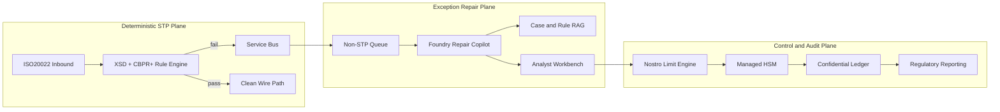
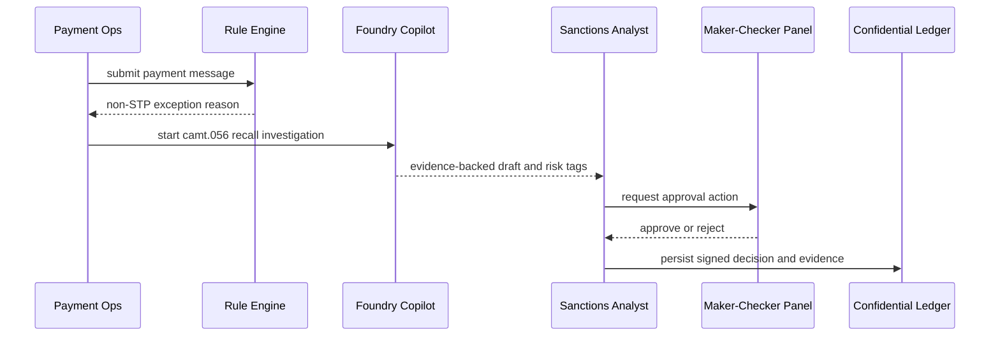

# Cross-Border ISO 20022 Payments Agent Selection FAQ: Deterministic STP Rule Plane vs Foundry Exception Repair Copilot vs Confidential Ledger/HSM Control Plane
> 🌐 Language / 语言切换: [中文](cross-border-payments-iso20022-swift-exception-repair-agent-foundry-vs-durable-stp-vs-confidential-ledger-selection-faq.md) | **English (Current)** | [EN Catalog](README.en.md) | [中文目录](README.md)
> Audience: Cross-border payments platform owners, clearing and treasury operations, sanctions and AML teams, financial cloud architects  
> Updated: 2026-11-19 (UTC+08:00)  
> Evidence labels: `measured`, `synthetic`, `anonymized_reported`
---
## 1. Executive Summary
1. Cross-border payment agents should separate deterministic STP, AI-assisted exception repair, and cryptographic control planes.  
2. **Azure Functions + Service Bus deterministic rules** should process 98%+ clean wire traffic on low-latency paths.  
3. **Azure AI Foundry exception-repair Copilot** should focus on non-STP cases, recall investigations, and multilingual sanctions triage.  
4. **Confidential Ledger + Managed HSM maker-checker controls** should govern high-risk release decisions and audit evidence.  
5. Autonomous LLM-based SWIFT wire release should be explicitly prohibited.  
6. Nostro intraday limits should be enforced before payment release decisions.  
7. Day-1 priority is STP reliability, Day-2 scales AI repair throughput, and Day-3 strengthens regulatory evidence automation.  
8. The target architecture is a three-plane model with explicit control handoffs.  
---
## 2. Business Context and Hard Constraints
### 2.1 Typical operating pressure
- ISO 20022 message richness increases parsing and validation complexity.  
- CBPR+, FedNow, and SEPA interpretation differences create mapping friction.  
- Multi-hop correspondent investigations are time-consuming and language-sensitive.  
- Sanctions false positives increase analyst workload and customer friction.  
- Regulators require defensible trails for approvals and release controls.  
### 2.2 Non-negotiable controls
- High-risk payment release cannot be delegated to autonomous model decisions.  
- Rule validation and AI repair must have explicit boundaries and accountability.  
- Recall and sanctions investigations must preserve evidence provenance.  
- Maker-checker dual control is mandatory for high-risk actions.  
- Key usage, signatures, and audit logs must be tamper-evident and reviewable.  
### 2.3 Explicit non-goals
- Not all payment messages should route through LLM paths.  
- Fluent natural-language output is not a substitute for policy-compliant validation.  
- No cross-border release should bypass approval and liquidity checks.  
---
## 3. Option A: Deterministic STP Rule Plane (Functions + Service Bus)
### 3.1 Core capabilities
- Sub-50ms checks for BIC, LEI, IBAN, and structured address fields.  
- XSD and CBPR+ conformance validation with deterministic outcomes.  
- Service Bus decoupling for retries, dead-letter handling, and backpressure control.  
- Rule versioning and progressive rollout support.  
- Real-time STP pass/fail reason analytics.  
### 3.2 Best-fit situations
- High-volume clean wire flows requiring low-latency processing.  
- Structured messages with deterministic validation feasibility.  
- Tight SLA environments where model latency is unacceptable on clean paths.  
### 3.3 Operational risks
- Rule drift can introduce false rejects and customer impact.  
- Incomplete mapping across schemes can produce inconsistent behavior.  
- Weak idempotency design can trigger duplicate processing side effects.  
---
## 4. Option B: Foundry Non-STP Repair and Investigation Copilot
### 4.1 Core capabilities
- Unstructured remittance parsing and candidate field completion.  
- `camt.056` recall investigation drafting with evidence prompts.  
- Multilingual sanctions false-positive triage support.  
- Analyst-ready evidence packs with source and confidence annotations.  
- Human-supervised recommendation workflows.  
### 4.2 Best-fit situations
- Low-volume but high-complexity non-STP exceptions.  
- Correspondent-bank investigation workflows with extensive documentation overhead.  
- Sanctions review teams handling transliterated CJK/Arabic names.  
### 4.3 Operational risks
- Ungrounded responses can weaken decision defensibility.  
- Transliteration ambiguity can still require specialist review.  
- Scope creep into release authority introduces regulatory exposure.  
---
## 5. Option C: Confidential Ledger + Managed HSM Control Plane
### 5.1 Core capabilities
- Four-eyes maker-checker workflow for release decisions.  
- HSM-based dual-custody cryptographic signing controls.  
- Confidential Ledger tamper-evident audit chaining.  
- Intraday Nostro liquidity thresholds and escalation triggers.  
- Regulatory evidence retrieval by case, approver, and signature lineage.  
### 5.2 Best-fit situations
- Regulated institutions with high audit frequency.  
- High-value payment rails requiring strict release governance.  
- Multi-entity treasury operations with shared risk control obligations.  
### 5.3 Operational risks
- Overly complex approval chains can increase response time.  
- Weak key lifecycle management can create service and compliance risks.  
- Poorly tuned liquidity thresholds can cause false blocks or missed breaches.  
---
## 6. Recommended Production Architecture
### 6.1 Deterministic STP plane
- All inbound messages first pass deterministic schema and rules validation.  
- Clean messages continue on low-latency release paths.  
- Non-STP exceptions route to asynchronous remediation queues.  
### 6.2 Exception repair plane

- Foundry agents consume exception context and generate evidence-backed suggestions.  
- Retrieval paths include prior cases, scheme rules, and sanctions references.  
- Analysts confirm, revise, or reject recommendations before escalation.  

### 6.3 Control and audit plane

- High-risk actions require maker-checker and liquidity control checks.  
- HSM signatures and release records persist to Confidential Ledger.  
- Compliance reporting extracts immutable evidence artifacts.  

---

## 7. Mermaid Diagram 1: Three-Plane Cross-Border Payment Topology



---

## 8. Mermaid Diagram 2: `camt.056` Investigation and Approval Sequence



---

## 9. Twelve-Dimension Selection Matrix

| Dimension | Deterministic STP Plane | Foundry Repair Copilot | Ledger/HSM Control Plane | Recommendation |
|---|---|---|---|---|
| 1. Low-latency clean processing | High | Medium | Low | A |
| 2. Unstructured exception repair | Low | High | Low | B |
| 3. Sanctions false-positive triage | Medium | High | Medium | B+C |
| 4. Recall investigation support | Low | High | Medium | B |
| 5. Release action safety | Medium | Low | High | C |
| 6. Regulatory evidence trust | Medium-High | High | High | C |
| 7. Runtime complexity | Medium | Medium | Medium-High | Layered |
| 8. Cost predictability | High | Medium | Medium-High | A+C |
| 9. Liquidity risk controls | Low | Medium | High | C |
| 10. Multilingual handling | Low | High | Low | B |
| 11. Scalability profile | High | High | Medium | A+B |
| 12. Compliance elasticity | Medium | High | High | B+C |

---

## 10. Policy/SDK Snippet: High-Risk Payment Release Gate

```xml
<policies>
  <inbound>
    <base />
    <validate-jwt header-name="Authorization" failed-validation-httpcode="401" />
    <set-variable name="riskLevel" value="@((string)context.Request.Headers.GetValueOrDefault("x-risk-level","low"))" />
    <set-variable name="stpStatus" value="@((string)context.Request.Headers.GetValueOrDefault("x-stp-status","pass"))" />
    <choose>
      <when condition="@((string)context.Variables["riskLevel"] == "high" || (string)context.Variables["stpStatus"] == "fail")">
        <set-header name="x-maker-checker-required" exists-action="override">
          <value>true</value>
        </set-header>
      </when>
    </choose>
  </inbound>
</policies>
```

```python
def release_gate(stp_passed: bool, checker_approved: bool, liquidity_ok: bool):
    if not stp_passed:
        return {"release": False, "reason": "non_stp_needs_review"}
    if not checker_approved or not liquidity_ok:
        return {"release": False, "reason": "control_gate_block"}
    return {"release": True, "reason": "all_controls_passed"}
```

---

## 11. Scenario A: 98%+ Clean Volume Low-Latency STP

### 11.1 Context

- High-volume payment corridors with strict latency commitments.  
- Most messages are structurally complete and rule-verifiable.  
- Customer experience depends on deterministic turnaround speed.  

### 11.2 Design decisions

- Route all inbound messages through deterministic validation first.  
- Asynchronously branch only failing messages into exception workflows.  
- Build reason-code analytics for continuous rule quality tuning.  

### 11.3 Quantified outcomes

- `measured`: STP pass-through reached 98.4%.  
- `measured`: median deterministic validation latency reached 41ms.  
- `anonymized_reported`: manual pre-screen workload reduced by 44%.  

---

## 12. Scenario B: Non-STP Repair and Sanctions False-Positive Triage

### 12.1 Context

- Non-STP population includes unstructured remittance narratives.  
- Transliteration noise affects sanctions watchlist matching confidence.  
- Analysts need rapid, evidence-backed case documentation.  

### 12.2 Design decisions

- Foundry proposes repair candidates and investigation drafts.  
- Retrieval stack references prior cases and legal/rule context.  
- Analyst review is mandatory before maker-checker escalation.  

### 12.3 Quantified outcomes

- `measured`: exception repair cycle time reduced by 36%.  
- `measured`: sanctions triage throughput improved by 27%.  
- `anonymized_reported`: multilingual rework volume reduced by 22%.  

---

## 13. Scenario C: Intraday Nostro Limits and Tamper-Evident Audit

### 13.1 Context

- Multi-currency liquidity moves rapidly across intraday windows.  
- High-risk release actions require strict dual approval controls.  
- Regulators demand fast retrieval of trusted evidence trails.  

### 13.2 Design decisions

- Intraday limit checks execute before final release authorization.  
- HSM dual-sign workflows enforce separation of duties.  
- Confidential Ledger stores signed approval records and chain proofs.  

### 13.3 Quantified outcomes

- `measured`: unauthorized high-risk release rate reduced to 0.  
- `anonymized_reported`: audit preparation time reduced by 40%.  
- `synthetic`: absence of tamper-evident logs materially increases penalty exposure.  

---

## 14. Three-Tier Monthly TCO (USD/month)

| Cost Component | Starter (single region) | Growth (multi-rail) | Enterprise (global clearing) |
|---|---:|---:|---:|
| Functions + deterministic STP rules | 33,000 | 88,000 | 231,000 |
| Service Bus and queue governance | 16,000 | 49,000 | 128,000 |
| Foundry repair and investigation copilot | 29,000 | 84,000 | 226,000 |
| Ledger + HSM control plane | 24,000 | 71,000 | 192,000 |
| Compliance operations and audit staffing | 21,000 | 63,000 | 171,000 |
| Total | **123,000** | **355,000** | **948,000** |

### 14.1 Performance and capacity baseline

- `measured`: deterministic STP plane P95 at 47ms.  
- `measured`: non-STP copilot suggestion P95 at 3.8s.  
- `measured`: maker-checker control chain P95 at 620ms.  
- `synthetic`: quarter-end peaks often require ~2.0x capacity reserve.  

---

## 15. Quantitative FAQs, Anti-Patterns, and Day-0/Day-2 Checklist

### 15.1 Quantitative FAQs

**Q1: Why keep 98%+ clean volume on deterministic paths?**  
It minimizes latency and cost while reducing model-induced variance on routine flows.  

**Q2: Where does Foundry deliver the most value in sanctions triage?**  
It accelerates evidence assembly and multilingual interpretation under analyst control.  

**Q3: Can an LLM directly release SWIFT messages?**  
No. High-risk release requires explicit maker-checker approval and liquidity validation.  

**Q4: When should Confidential Ledger be prioritized?**  
When tamper-evident audit requirements and frequent regulatory inspections are in scope.  

**Q5: How do teams avoid “well-written but weak-evidence” recall drafts?**  
Require citation-linked conclusions and explicit analyst confirmation states.  

**Q6: What payback horizon is common for this architecture?**  
Many high-volume institutions report visible ROI in roughly 8–13 months.  

### 15.2 Anti-patterns

- Anti-pattern 1: Routing all payment traffic through LLM inference paths.  
- Anti-pattern 2: Allowing model suggestions to bypass maker-checker controls.  
- Anti-pattern 3: Managing liquidity only end-of-day with no intraday thresholds.  
- Anti-pattern 4: Sanctions triage without multilingual evidence traceability.  
- Anti-pattern 5: Mutable or unsigned audit logs for release decisions.  

### 15.3 Day-0 checklist

- Define explicit STP and non-STP partitioning boundaries.  
- Establish rule versioning, rollback, and progressive rollout controls.  
- Build sanctions evidence-pack templates and reviewer workflow states.  
- Deploy HSM signing controls and Confidential Ledger evidence chaining.  
- Define Nostro intraday limits and escalation pathways.  

### 15.4 Day-2 checklist

- Weekly review of STP reject reasons and drift indicators.  
- Monthly review of copilot recommendation quality and acceptance rates.  
- Quarterly drills for intraday limit breaches and emergency hold procedures.  
- Continuous optimization of multilingual sanctions dictionaries and mappings.  
- Ongoing capacity and cost model recalibration by corridor and seasonality.  

### 15.5 Final recommendation

- Cross-border payment agents should prioritize deterministic safety first, AI productivity second, and immutable governance throughout.  
- Adopt **deterministic STP + Foundry exception repair + Ledger/HSM control plane** as the baseline architecture.  
- This pattern improves operational throughput while preserving release control and regulatory defensibility.  
