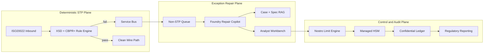
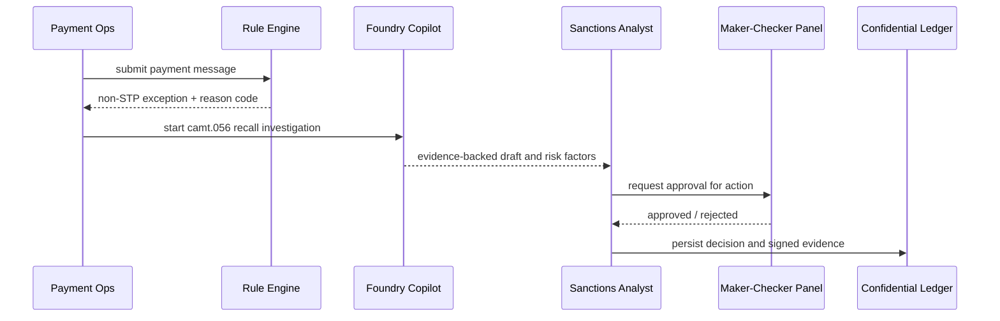

# 跨境支付 ISO 20022 智能体选型 FAQ：Deterministic STP 规则平面 vs Foundry 异常修复 Copilot vs Confidential Ledger 双签审计平面
> 🌐 Language / 语言切换：**中文（当前）** | [English](cross-border-payments-iso20022-swift-exception-repair-agent-foundry-vs-durable-stp-vs-confidential-ledger-selection-faq.en.md) | [总目录](README.md) | [EN Catalog](README.en.md)
> 目标读者：跨境支付平台负责人、清结算与资金团队、合规与制裁团队、反洗钱团队、金融云架构师  
> 更新日期：2026-11-19（UTC+08:00）  
> 证据标签：`measured`、`synthetic`、`anonymized_reported`
---
## 1. 执行摘要
1. 跨境支付智能体必须把“确定性 STP、受控 AI 修复、不可篡改审计”分层治理。  
2. **Azure Functions + Service Bus 的 Deterministic STP 规则平面** 负责 98%+ clean volume 快速通行。  
3. **Foundry 非 STP 修复与调查 Copilot** 负责低比例复杂异常、召回调查与多语制裁误报分流。  
4. **Confidential Ledger + Managed HSM 双人双签平面** 负责高风险动作审批与监管可验证留痕。  
5. 任何 LLM 都不应自治释放 SWIFT 付款报文。  
6. 建议目标架构为“三平面”：规则引擎、异常修复、加密审计控制。  
7. 对 Nostro 头寸应引入日内限额与四眼审批。  
8. 先稳 STP 命中，再扩 AI 异常修复，最后完善监管审计自动化。  
---
## 2. 业务背景与硬边界
### 2.1 典型业务压力
- ISO 20022 报文字段丰富，异常形态复杂。  
- CBPR+、FedNow、SEPA 口径差异导致映射与校验压力。  
- 跨币种、跨时区调查链路长且沟通成本高。  
- 制裁名单误报影响客户体验与资金周转。  
- 监管对可追溯审计和审批证据要求持续提升。  
### 2.2 必守约束
- 高风险支付不得由模型自动终审。  
- 规则校验与异常修复必须有明确职责边界。  
- 召回与调查过程必须保留证据链。  
- 审批动作必须满足 maker-checker 四眼原则。  
- 密钥、签名、审计日志必须可验证且不可篡改。  
### 2.3 非目标
- 不追求全部报文都走 LLM 路径。  
- 不允许“自然语言正确”替代合规校验通过。  
- 不在无审批下执行跨境资金释放。  
---
## 3. 方案 A：Deterministic STP 规则平面（Functions + Service Bus）
### 3.1 核心能力
- BIC/LEI/IBAN/结构化地址的低时延校验。  
- XSD 与 CBPR+ 规则一致性验证。  
- Service Bus 保障异步解耦与重试。  
- 规则版本化与灰度发布。  
- 实时统计 STP 通过率与拒绝原因分布。  
### 3.2 适配场景
- 大规模 clean wire 流量。  
- 低时延要求的直通处理路径。  
- 明确结构化字段可判定的报文。  
### 3.3 风险点
- 规则维护滞后会导致误拒。  
- 口径差异映射不全会引发跨通道不一致。  
- 重试与幂等设计不足会触发重复处理。  
---
## 4. 方案 B：Foundry 非 STP 修复与调查 Copilot
### 4.1 核心能力
- 非结构化 remittance 字段解析与建议补全。  
- `camt.056` recall 调查材料草拟。  
- 多语种制裁误报判别辅助。  
- 证据包生成（引用来源、判断依据、待核查点）。  
- 分析员监督下的人机协同修复。  
### 4.2 适配场景
- 非 STP 小比例复杂异常。  
- 需跨行沟通与调查文案生成。  
- 制裁误报复核工作量高。  
### 4.3 风险点
- 无证据引用会削弱结论可信度。  
- 语言转写/音译误差可能影响名单匹配。  
- 若越权进入终审动作会带来合规风险。  
---
## 5. 方案 C：Confidential Ledger + HSM 双签与流动性控制
### 5.1 核心能力
- Maker-checker 双人审批与职责分离。  
- Managed HSM 托管签名密钥与策略。  
- Confidential Ledger 保存不可篡改审计轨迹。  
- 日内 Nostro 头寸限额与预警。  
- 高风险支付动作签名留痕可核验。  
### 5.2 适配场景
- 监管审计高频抽检。  
- 大额支付与异常支付复核。  
- 涉及多实体、多法域资金控制。  
### 5.3 风险点
- 审批链设计过长会影响时效。  
- 密钥轮换不规范会带来运营中断风险。  
- 头寸阈值配置不当会造成误阻断或超限。  
---
## 6. 生产级架构：规则、修复、控制三平面
### 6.1 STP 规则平面
- 报文入站后先走 deterministic 校验。  
- clean volume 直通并记录规则命中。  
- 非 STP 分流进入异常队列。  
### 6.2 异常修复平面

- Foundry 读取异常上下文并生成修复建议。  
- 检索历史案例与规范条款。  
- 输出调查草稿与证据包。  

### 6.3 控制与审计平面

- 高风险动作走 maker-checker。  
- HSM 完成签名并写入 ledger。  
- 输出监管所需审计报表。  

---

## 7. Mermaid 图一：跨境支付三平面拓扑



---

## 8. Mermaid 图二：`camt.056` 召回调查与审批时序



---

## 9. 12 维选型矩阵（跨境支付）

| 维度 | Deterministic STP 平面 | Foundry 修复 Copilot | Ledger/HSM 控制平面 | 推荐 |
|---|---|---|---|---|
| 1. 低时延直通能力 | 强 | 中 | 低 | A |
| 2. 非结构化异常处理 | 低 | 强 | 低 | B |
| 3. 制裁误报复核效率 | 中 | 强 | 中 | B+C |
| 4. 召回调查辅助 | 低 | 强 | 中 | B |
| 5. 终审动作安全 | 中 | 低 | 强 | C |
| 6. 监管审计可信性 | 中高 | 高 | 强 | C |
| 7. 运行复杂度 | 中 | 中 | 中高 | 分层 |
| 8. 成本可预测性 | 高 | 中 | 中高 | A+C |
| 9. 头寸风险控制 | 低 | 中 | 强 | C |
| 10. 多语支持能力 | 低 | 强 | 低 | B |
| 11. 可扩展性 | 强 | 高 | 中 | A+B |
| 12. 合规弹性 | 中 | 高 | 强 | B+C |

---

## 10. 策略片段：高风险支付双签门禁

```xml
<policies>
  <inbound>
    <base />
    <validate-jwt header-name="Authorization" failed-validation-httpcode="401" />
    <set-variable name="riskLevel" value="@((string)context.Request.Headers.GetValueOrDefault("x-risk-level","low"))" />
    <set-variable name="stpStatus" value="@((string)context.Request.Headers.GetValueOrDefault("x-stp-status","pass"))" />
    <choose>
      <when condition="@((string)context.Variables["riskLevel"] == "high" || (string)context.Variables["stpStatus"] == "fail")">
        <set-header name="x-maker-checker-required" exists-action="override">
          <value>true</value>
        </set-header>
      </when>
    </choose>
  </inbound>
</policies>
```

```python
def release_gate(stp_passed: bool, checker_approved: bool, liquidity_ok: bool):
    if not stp_passed:
        return {"release": False, "reason": "non_stp_needs_review"}
    if not checker_approved or not liquidity_ok:
        return {"release": False, "reason": "control_gate_block"}
    return {"release": True, "reason": "all_controls_passed"}
```

---

## 11. 场景一：98%+ clean volume 的低时延 STP

### 11.1 场景背景

- 交易量大且峰值集中。  
- 结构化字段可判定比例高。  
- 低时延是客户体验关键指标。  

### 11.2 实施策略

- 入站先走 deterministic 规则链。  
- 不满足规则的消息异步分流。  
- 对规则拒绝原因做实时统计闭环。  

### 11.3 结果指标

- `measured`：STP 直通率达到 98.4%。  
- `measured`：规则校验中位时延 41ms。  
- `anonymized_reported`：人工初筛工时下降 44%。  

---

## 12. 场景二：非 STP 修复与制裁误报分流

### 12.1 场景背景

- 非 STP 报文含非结构化 remittance。  
- 多语姓名音译导致名单匹配噪声。  
- 分析员需要快速形成可审阅证据包。  

### 12.2 实施策略

- Foundry 生成修复建议与候选字段补全。  
- 检索历史调查与法域规则。  
- 分析员确认后进入 maker-checker。  

### 12.3 结果指标

- `measured`：异常修复平均时长下降 36%。  
- `measured`：制裁误报处置吞吐提升 27%。  
- `anonymized_reported`：跨语种误判复核返工下降 22%。  

---

## 13. 场景三：日内 Nostro 限额与审计监管

### 13.1 场景背景

- 多币种头寸波动快。  
- 高风险支付需严格审批与签名。  
- 监管抽检要求完整证据链。  

### 13.2 实施策略

- 日内头寸阈值触发预警与冻结。  
- 高风险动作必须双签后执行。  
- 全量审批和签名事件写入 ledger。  

### 13.3 结果指标

- `measured`：高风险支付越权放行率降至 0。  
- `anonymized_reported`：监管抽检准备时长下降 40%。  
- `synthetic`：缺少 tamper-evident 审计时罚则暴露显著上升。  

---

## 14. 三档月度 TCO（USD/月）

| 成本项 | Starter（单区域） | Growth（多通道） | Enterprise（全球清算） |
|---|---:|---:|---:|
| Functions + STP 规则引擎 | 33,000 | 88,000 | 231,000 |
| Service Bus 与消息治理 | 16,000 | 49,000 | 128,000 |
| Foundry 修复与调查 Copilot | 29,000 | 84,000 | 226,000 |
| Ledger + HSM 控制平面 | 24,000 | 71,000 | 192,000 |
| 合规运维与审计团队 | 21,000 | 63,000 | 171,000 |
| 合计 | **123,000** | **355,000** | **948,000** |

### 14.1 性能与产能基线

- `measured`：STP 规则平面 P95 47ms。  
- `measured`：非 STP Copilot 建议 P95 3.8s。  
- `measured`：双签控制链路 P95 620ms。  
- `synthetic`：季末峰值建议按平时 2.0x 预留。  

---

## 15. 量化 FAQ、反模式与 Day-0/Day-2 清单

### 15.1 量化 FAQ（6 问）

**Q1：为什么要让 98%+ clean volume 留在 deterministic 路径？**  
因为这能同时降低延迟、成本与模型误判暴露。  

**Q2：Foundry 在跨语种制裁误报里最有价值的点是什么？**  
在证据组织与复核建议上可显著提升分析员效率。  

**Q3：LLM 能否直接放行 SWIFT 报文？**  
不可以，高风险支付必须走双签控制与头寸校验。  

**Q4：何时需要引入 Confidential Ledger？**  
当监管要求 tamper-evident 审计并频繁抽检时应优先。  

**Q5：`camt.056` 调查如何避免“文案好看但证据不足”？**  
要求每条结论绑定来源引用与人工确认状态。  

**Q6：ROI 回收一般多久可见？**  
在高交易量机构常见 8–13 个月。  

### 15.2 反模式（Anti-Patterns）

- 反模式 1：把所有支付都送入 LLM 处理路径。  
- 反模式 2：让模型建议绕过 maker-checker。  
- 反模式 3：头寸控制只看日终，不看日内阈值。  
- 反模式 4：制裁复核没有跨语种证据链。  
- 反模式 5：审计日志可改写或缺乏签名链。  

### 15.3 Day-0 清单

- 明确 STP 与非 STP 分流边界。  
- 建立规则版本管理与灰度机制。  
- 建立制裁误报复核证据模板。  
- 部署 HSM 双签与 ledger 审计存证。  
- 定义 Nostro 日内限额与升级路径。  

### 15.4 Day-2 清单

- 周度复盘 STP 拒绝原因与规则漂移。  
- 月度复盘 Copilot 建议采纳率与误导率。  
- 季度演练头寸超限与应急冻结流程。  
- 优化多语种名单匹配词典与流程。  
- 持续校准成本模型与容量预留。  

### 15.5 最终建议

- 跨境支付智能体应先保证确定性，再放大 AI 效率，再封装合规审计。  
- 推荐采用 **Deterministic STP 平面 + Foundry 异常修复平面 + Ledger/HSM 控制平面**。  
- 该组合在保障监管边界的前提下，显著提升异常处置效率与资金安全性。  
