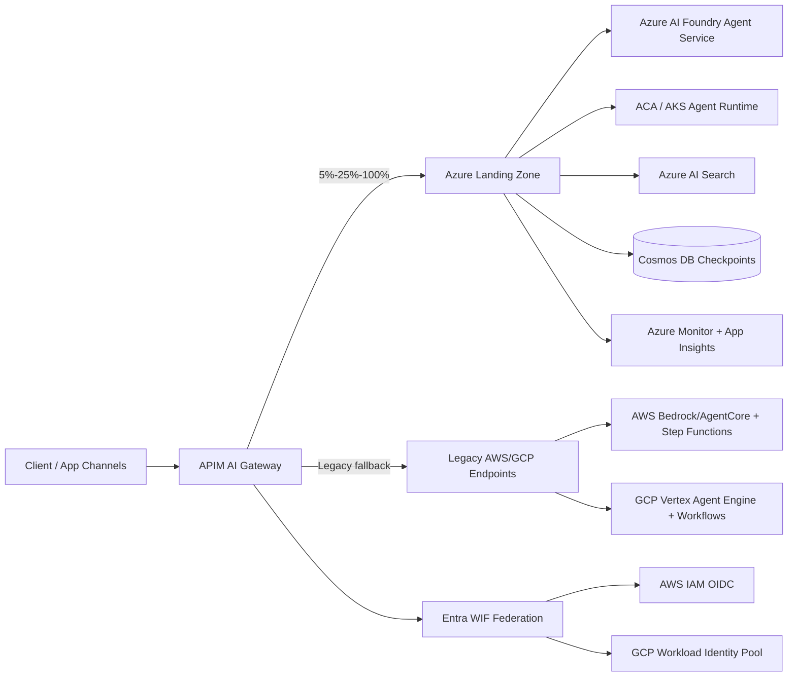
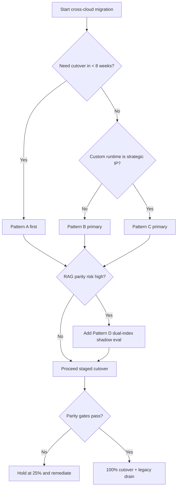

# Enterprise Cross-Cloud Agent Migration Selection FAQ: AWS Bedrock / GCP Vertex to Azure Foundry + ACA/AKS + AI Search with Strangler Cutover

## 1. Migration scope and target outcomes
This guide is for enterprise Cloud & AI Solution Architects.  
The mission is production migration of agent workloads from AWS and GCP to Azure AI landing zones.  
The goal is not a big-bang rewrite.  
The goal is staged cutover with bounded business risk.  
Continuity, security posture, and cost trajectory must stay controllable during transition.  

Typical source estate.  
AWS: Bedrock Agents / AgentCore, Step Functions, Lambda, OpenSearch Serverless.  
GCP: Vertex AI Agent Engine, Cloud Run, Workflows, Vertex AI Search.  

Target Azure estate.  
Azure AI Foundry, ACA/AKS runtimes, Azure AI Search, Cosmos DB, APIM AI Gateway.  
Governance overlays include Entra identity, Azure Monitor, Prompt Shields, and AI Content Safety.  

This document compares four migration patterns.  
It includes service mapping, parity gates, and TCO math.  
Recommendation is a layered combination strategy rather than one-pattern replacement.  

## 2. Service-mapping blueprint from AWS/GCP to Azure
Mapping set one.  
Bedrock Agents / Vertex Agent Engine map to Foundry Agent Service or MAF on ACA/AKS.  

Mapping set two.  
Step Functions / Workflows map to Durable Functions and Durable Task.  

Mapping set three.  
OpenSearch Serverless / Vertex AI Search map to Azure AI Search with optional Fabric OneLake semantic enrichment.  

Mapping set four.  
AWS IAM and Google Workspace entitlements map to Entra ID plus search security trimming and app-level RBAC/ABAC.  

Mapping set five.  
CloudWatch / Cloud Logging map to Azure Monitor, App Insights, and Eventhouse.  

Execution principle.  
Migrate control contracts first.  
Then migrate model and retrieval planes.  
Finally migrate long-tail tools and custom runtimes.  

## 3. Four migration patterns and when to combine them
Pattern A: APIM AI Gateway strangler cutover with secretless federated identity.  
Best for unifying ingress and progressive traffic steering.  
Recommended stages are `5% -> 25% -> 100%`.  

Pattern B: managed PaaS re-platforming.  
Re-map Bedrock/Vertex managed capabilities onto Foundry + Durable + AI Search.  
Best for organizations optimizing for speed and lower platform ops burden.  

Pattern C: portable container and open-framework modernization.  
Move ECS/EKS/Cloud Run workloads to ACA/AKS + MAF + Dapr/Cosmos state.  
Best for teams with strategic custom Python/TypeScript agent kernels.  

Pattern D: zero-regression RAG re-embedding and state cutover.  
Use dual-index shadow evaluation for vector and ACL parity before full cutover.  
Best for retrieval-heavy enterprise agents with compliance sensitivity.  

Recommended blend.  
Start with A to normalize control points.  
Run B and C per domain in parallel.  
Use D to guarantee retrieval and checkpoint parity before final switch.  

## 4. End-to-end migration architecture across dual-run phases


Architecture priorities.  
APIM is the single ingress truth during migration.  
Source and target platforms remain backend pools behind one policy plane.  

Identity priorities.  
Use federated short-lived tokens to call legacy APIs.  
Avoid static IAM keys and long-lived service secrets.  

Observability priorities.  
Separate parity-shadow telemetry from production-serving telemetry.  
Prevent evaluation traffic from distorting production SLO signals.  

## 5. Pattern A: APIM strangler cutover with Entra federation
Cutover phases.  
Phase 1 uses shadow comparisons without customer-visible response ownership changes.  
Phase 2 routes 5% real traffic to Azure.  
Phase 3 expands to 25% by business cohort.  
Phase 4 reaches 100% with guarded rollback switch retained.  

Identity federation model.  
Entra Workload Identity Federation issues constrained trust to AWS IAM OIDC and GCP Workload Identity Pools.  
APIM obtains short-lived credentials for legacy backend calls.  
No long-term secret material is stored in policy artifacts.  

Network model.  
Prefer ExpressRoute and Partner Interconnect paths.  
Use private DNS and controlled egress.  
Set explicit cross-cloud egress budget guardrails by stage.  

Strengths.  
Lowest operational cutover risk.  
Fastest path to centralized governance and traceability.  
Low intrusion into existing application code paths.  

Constraints.  
Dual-run periods add temporary cost and latency overhead.  
Exit criteria must be objective and enforced by gates.  
Without strict discipline, dual-run windows can overstay and erode savings.  

## 6. Pattern B: managed PaaS re-platforming to Azure-native services
Capability mapping.  
Bedrock Action Groups and Vertex Extensions map to Foundry MCP/OpenAPI tools.  
Bedrock Guardrails and Vertex Safety map to Prompt Shields, groundedness, and AI Content Safety controls.  
Step Functions and Workflows map to Durable Functions orchestration patterns.  

Retrieval mapping.  
OpenSearch Serverless and Vertex AI Search map to Azure AI Search with semantic ranking and ACL trimming.  
Optional Fabric OneLake integration supports downstream analytics alignment.  

Expected gains.  
You can remove OpenSearch Serverless minimum OCU floor costs.  
Operational responsibility shifts from multi-cloud fragmentation to one managed control plane.  
MACC utilization and commitment realization become easier to optimize.  

Adoption caveat.  
Contract alignment must precede prompt tuning changes.  
Changing contracts and prompt logic simultaneously hides root causes during parity testing.  

## 7. Pattern C: portable container migration and framework modernization
Best-fit profile.  
You own differentiated custom runtime behavior in LangGraph/AutoGen style systems.  
You need container-level portability and deep plugin extensibility.  

Migration path.  
Move ECS Fargate/EKS/Cloud Run services to ACA or AKS.  
Standardize orchestration layers with Microsoft Agent Framework.  
Use Dapr sidecars and Cosmos DB for resilient state and workflow coordination.  

Governance benefits.  
Unified Entra RBAC model.  
Unified Azure Monitor OpenTelemetry pipeline.  
Unified policy and audit controls across environments.  

Engineering trade-offs.  
Higher upfront migration complexity than managed PaaS swaps.  
Requires strong IaC discipline and release engineering maturity.  
Usually justified when runtime behavior itself is strategic IP.  

## 8. Pattern D: zero-regression RAG re-embedding and state drain
Risk one.  
`Titan Embeddings` and `text-embedding-3-large` are not vector-space compatible.  
Direct mixed-index reuse causes retrieval drift.  

Risk two.  
IAM/Google Workspace ACL semantics differ from Entra group and app-role semantics.  
Blind ACL translation can create silent under-permission or over-permission errors.  

Risk three.  
Legacy checkpoint metadata may reference old index IDs and old document keys.  
Session continuity can break if retrieval backends are swapped mid-run.  

Recommended approach.  
Run dual-index shadow evaluation with Foundry eval harnesses.  
Compare Recall@k, nDCG, answer accuracy, refusal rate, and policy-violation rate on identical query sets.  
Promote only when parity thresholds are met for sustained windows.  

State drain rule.  
Legacy sessions complete on legacy retrieval/index context.  
New sessions start on new embeddings and new indexes.  
Never hot-switch retrieval index in the middle of one stateful conversation.  

## 9. Config block #1: APIM strangler routing policy with staged steering
```bicep
resource apim 'Microsoft.ApiManagement/service@2023-05-01-preview' existing = {
  name: 'ai-gw-prod'
}

resource api 'Microsoft.ApiManagement/service/apis@2023-05-01-preview' = {
  name: '${apim.name}/agent-runtime'
  properties: {
    path: 'agent/runtime'
    protocols: [
      'https'
    ]
  }
}

resource policy 'Microsoft.ApiManagement/service/apis/policies@2023-05-01-preview' = {
  name: '${apim.name}/${api.name}/policy'
  properties: {
    format: 'xml'
    value: '''
<policies>
  <inbound>
    <base />
    <set-variable name="ring" value="@(context.Request.Headers.GetValueOrDefault("x-migration-ring","legacy"))" />
    <set-header name="x-cutover-stage" exists-action="override">
      <value>canary-25</value>
    </set-header>
  </inbound>
  <backend>
    <choose>
      <when condition="@(context.Variables.GetValueOrDefault<string>("ring") == "azure")">
        <set-backend-service base-url="https://azure-agent-runtime.internal" />
      </when>
      <otherwise>
        <set-backend-service base-url="https://legacy-aws-gcp-runtime.internal" />
      </otherwise>
    </choose>
  </backend>
  <outbound>
    <base />
  </outbound>
</policies>
'''
  }
}
```

Operational guidance.  
Stage values must be parameterized and source-controlled.  
Avoid manual emergency edits outside GitOps governance unless break-glass is formally approved.  

## 10. Config block #2: Entra federated identity to AWS and GCP
```yaml
federation:
  azure:
    workloadIdentity:
      tenantId: "contoso-entra-tenant"
      appId: "api://agent-gateway"
      audience: "api://AzureADTokenExchange"
  aws:
    iamRoleArn: "arn:aws:iam::123456789012:role/bedrock-migration-role"
    oidcProvider: "https://login.microsoftonline.com/<tenant>/v2.0"
    sessionDurationSeconds: 3600
    condition:
      StringEquals:
        "token.actions.githubusercontent.com:aud": "sts.amazonaws.com"
  gcp:
    workloadIdentityPool: "projects/123456/locations/global/workloadIdentityPools/entra-pool"
    provider: "entra-oidc-provider"
    serviceAccount: "agent-migration@project.iam.gserviceaccount.com"
    attributeMapping:
      "google.subject": "assertion.sub"
      "attribute.aud": "assertion.aud"
tokenPolicy:
  maxLifetimeMinutes: 60
  rotateBeforeExpiryMinutes: 10
  prohibitStaticAccessKeys: true
```

Security practices.  
Prefer shortest practical token lifetimes.  
Scope federated roles to exact backend actions needed for migration windows.  
Require elevated approval trails for high-risk cross-cloud operations.  

## 11. 12-dimension migration matrix and decision tree
| Dimension | Pattern A Strangler | Pattern B Managed PaaS | Pattern C Portable Containers | Pattern D RAG Re-Embedding |
|---|---|---|---|---|
| 1. Cutover risk | Very low | Medium | Medium-high | Medium |
| 2. Time-to-first-value | Very high | High | Medium | Medium |
| 3. Business interruption probability | Very low | Low-medium | Low-medium | Low |
| 4. Ops complexity | Medium | Low-medium | High | Medium-high |
| 5. Runtime portability | Medium | Medium | Very high | Medium |
| 6. MACC realization efficiency | High | Very high | High | High |
| 7. Cross-cloud egress control | Very high | High | Medium-high | Medium |
| 8. RAG quality controllability | Medium | High | Medium | Very high |
| 9. ACL migration difficulty | Medium | Medium | Medium | High |
| 10. Long-term TCO optimization | High | Very high | High | High |
| 11. Organizational change impact | Low | Medium | High | Medium |
| 12. Audit traceability | High | Very high | High | Very high |



## 12. Quantitative TCO and egress math for dual-run migration
> Baseline: 40 agent flows, 180M monthly requests, average 10KB response and 6KB tool-request payload  
> Dual-run window: 45 days with staged cutover at 5% and 25% before full migration

| Option | Cross-cloud egress cost / month | Dual-run overhead / month | Post-migration monthly run cost | Annualized TCO |
|---|---:|---:|---:|---:|
| Keep AWS/GCP baseline | \$142,000 | \$0 | \$142,000 | \$1,704,000 |
| Pattern A only | \$89,000 | \$36,000 | \$118,000 | \$1,416,000 |
| Pattern A+B | \$54,000 | \$31,000 | \$103,000 | \$1,236,000 |
| Pattern A+C | \$61,000 | \$34,000 | \$109,000 | \$1,308,000 |
| Pattern A+B+D (recommended) | \$47,000 | \$33,000 | \$96,000 | \$1,152,000 |

Parity cutover gates before 100%.  
Task-level parity pass rate should stay `>=98%`.  
Critical workflow success-rate delta should stay `<=1.5%`.  
Critical path p95 latency regression should stay `<=8%`.  

MACC optimization logic.  
Place stable migrated load onto commitment-eligible Azure services first.  
Keep burst variance on elastic services.  
Avoid prolonged overlap of old-cloud reservations and new-cloud buffer pools.  

## 13. Scenario A: post-M&A B2B SaaS consolidating 40 Bedrock agents
Business context.  
After M&A, customer operations run on two cloud stacks.  
Most legacy automation is Bedrock + Step Functions based.  
The target is one Azure MACC landing zone with unified governance.  

Migration plan.  
Phase 1 deploys APIM strangler and federated identity.  
Phase 2 re-platforms managed agents onto Foundry and Durable orchestration.  
Phase 3 runs dual-index RAG parity until gating thresholds are stable.  

Target outcomes.  
100% cutover in 60 days.  
Critical ticket interruption rate `<=0.2%` during migration.  
Annual run-cost reduction target `>=28%`.  

## 14. Scenario B: global retailer moving Vertex merchandising agents to Azure
Business context.  
Merchandising and replenishment agents currently run on Vertex.  
The enterprise data gravity has shifted to Fabric OneLake on Azure.  
Cross-cloud retrieval and ETL are now major cost drivers.  

Migration plan.  
Use Pattern B for managed service parity.  
Use Pattern C for custom ranking/rules containers.  
Use Pattern D for embedding-space and ACL translation shadow validation.  
Roll out region by region with gated `5% -> 25% -> 100%` progression.  

Target outcomes.  
Cross-cloud egress reduction `>=40%`.  
Peak promotional period recommendation stability no worse than baseline.  
ACL translation false-allow rate reduced to zero.  

## 15. Day-0 / Day-2 checklist and quantitative FAQs
### Day-0 checklist
- Complete service and responsibility mapping by domain.  
- Parameterize APIM staged cutover controls.  
- Configure Entra federation to AWS/GCP and disable static key usage.  
- Define parity gates for accuracy, latency, refusal, and cost.  
- Plan dual-index and dual-write windows for retrieval cutover.  
- Implement DNS/APIM rollback switches with tested runbooks.  
- Set budget alerts for cross-cloud egress and dual-run overhead.  
- Execute at least one end-to-end migration rehearsal.  

### Day-2 checklist
- Review staged cohort metrics weekly.  
- Review federated-token failure and authorization drift weekly.  
- Review dual-index retrieval deltas weekly.  
- Reconcile MACC realization and commitment coverage monthly.  
- Remove stranded legacy-cloud resources monthly.  
- Audit ACL translation quality monthly.  
- Reassess simplification opportunities quarterly.  
- Run one cross-region failover drill quarterly.  

**Q1: When can we move from 25% to 100% cutover safely?**  
A1: After parity gates pass for at least two consecutive weekly windows and no P1 regressions appear in peak traffic days.  

**Q2: How large is cross-cloud egress during dual-run phases?**  
A2: It often lands between `8%` and `18%` of migration-period cloud spend, depending on payload profile and caching maturity.  

**Q3: Why is re-embedding mandatory for migration in many RAG estates?**  
A3: Embedding models have incompatible vector geometry, so direct index reuse can materially degrade recall and rank fidelity.  

**Q4: What is a common MACC optimization mistake after migration?**  
A4: Keeping old-cloud reservations while also over-buffering new-cloud elastic capacity, which creates overlapping idle commitments.  

**Q5: How should ACL translation be validated before full cutover?**  
A5: Use bidirectional visibility tests (`must-see` and `must-not-see`) on representative user cohorts and gate promotion on failures.  

**Q6: How long should legacy control planes remain after 100% cutover?**  
A6: Most enterprises keep a `2–6` week read-only observation window before domain-by-domain decommissioning.  
