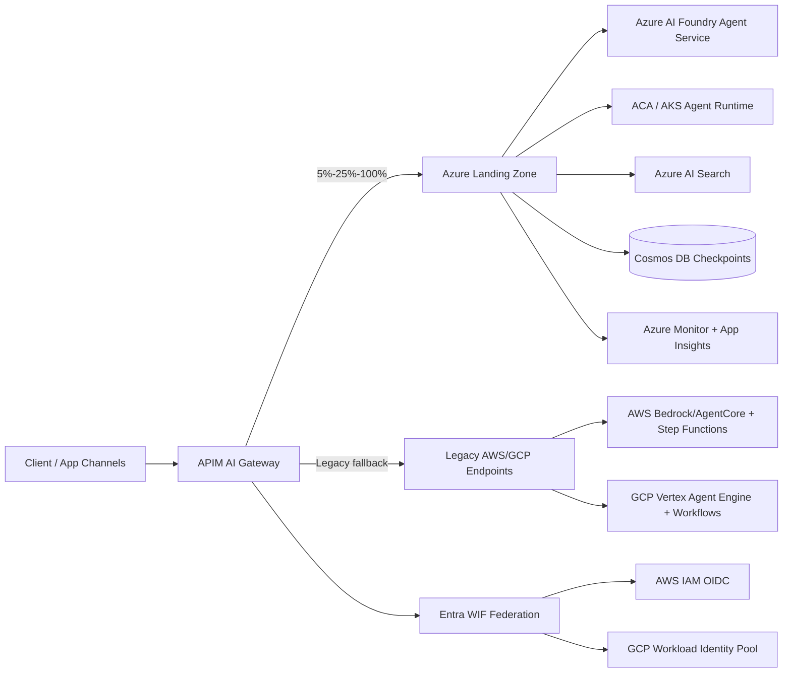
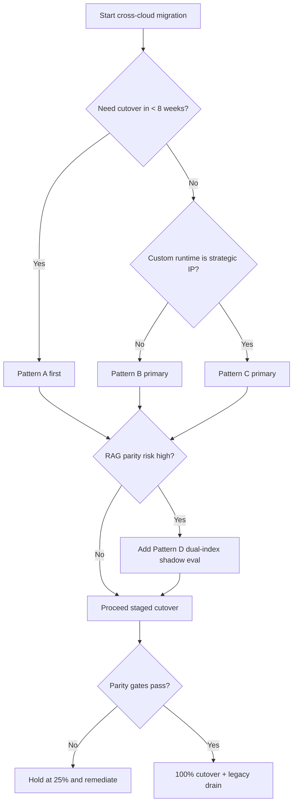

# 企业跨云 Agent 迁移选型 FAQ：从 AWS Bedrock / GCP Vertex 迁移到 Azure Foundry + ACA/AKS + AI Search 的 Strangler 切换路径

## 1. 迁移背景与目标边界
本指南面向企业 Cloud & AI Solution Architect。  
目标是把生产 Agent 负载从 AWS 与 GCP 迁移到 Azure AI Landing Zone。  
重点不是“重写一次上线”。  
重点是低风险分阶段切换。  
并在切换期间保持业务连续性与成本可控。  

典型源端构成为。  
AWS：Bedrock Agents / AgentCore、Step Functions、Lambda、OpenSearch Serverless。  
GCP：Vertex AI Agent Engine、Cloud Run、Workflows、Vertex AI Search。  

目标端构成为。  
Azure：Azure AI Foundry、ACA/AKS、Azure AI Search、Cosmos DB、APIM AI Gateway。  
治理层补齐 Entra、Azure Monitor、Prompt Shields、AI Content Safety。  

本篇比较四种迁移模式。  
并给出服务映射、切换门禁与 TCO 计算。  
最终推荐“分层组合而非单一替换”。  

## 2. 服务映射蓝图：源平台到 Azure 目标平台
核心映射一。  
Bedrock Agents / Vertex Agent Engine。  
映射到 Foundry Agent Service 或 MAF on ACA/AKS。  

核心映射二。  
Step Functions / Workflows。  
映射到 Durable Functions / Durable Task。  

核心映射三。  
OpenSearch Serverless / Vertex AI Search。  
映射到 Azure AI Search + 可选 Fabric OneLake 语义层。  

核心映射四。  
IAM / GCP IAM + Workspace ACL。  
映射到 Entra ID + Search 安全裁剪 + 应用层 ABAC/RBAC。  

核心映射五。  
CloudWatch / Cloud Logging。  
映射到 Azure Monitor + App Insights + Eventhouse。  

迁移原则。  
先映射控制面与契约。  
再映射模型与检索。  
最后迁移长尾工具与运行时。  

## 3. 四种迁移模式总览与组合建议
模式 A：APIM Strangler Cutover + 无密钥跨云身份联邦。  
适合先统一入口与流量治理。  
以 `5% -> 25% -> 100%` 阶段切换。  

模式 B：托管 PaaS 重平台化。  
把 Bedrock/Vertex 托管能力重映射到 Foundry + Durable + AI Search。  
适合希望降低平台运维负担的团队。  

模式 C：可移植容器与开源框架现代化。  
把 ECS/EKS/Cloud Run 上自定义 LangGraph/AutoGen 迁移到 ACA/AKS + MAF + Dapr。  
适合已有自研代理内核与插件体系。  

模式 D：RAG 重嵌入与状态零回归切换。  
针对向量空间不兼容与 ACL 差异做双索引影子评测。  
适合知识驱动型 Agent。  

组合建议。  
先 A 建统一闸门。  
中期按域并行推进 B 与 C。  
检索与记忆链路通过 D 保证零回归。  

## 4. 端到端参考架构：跨云并行期与 Azure 收敛期


设计重点一。  
入口统一在 APIM。  
源端和目标端都作为后端池。  

设计重点二。  
跨云访问用联邦令牌。  
不落地长期静态 AK/SK。  

设计重点三。  
迁移期把“评测流量”和“生产流量”分开。  
避免评测流量污染生产指标。  

## 5. 模式 A：APIM Strangler + Entra 联邦身份的渐进切流
切流阶段。  
阶段 1：影子流量只比对不影响生产。  
阶段 2：5% canary 真实响应。  
阶段 3：25% 业务分组迁移。  
阶段 4：100% 切换并保留回退开关。  

身份治理。  
Entra Workload Identity Federation 对接 AWS IAM OIDC。  
同样对接 GCP Workload Identity Pool。  
APIM 到源端调用用短期令牌。  
不在配置中保存长期密钥。  

网络路径。  
优先 ExpressRoute / Partner Interconnect。  
辅以私网 DNS 与出站策略。  
对跨云出站流量设置预算上限。  

优势。  
切换风险最小。  
可快速形成统一可观测面。  
对既有应用侵入低。  

限制。  
双运行窗口会产生额外成本。  
跨云链路延迟在高峰时会放大。  
需严格设置阶段退出条件。  

## 6. 模式 B：托管 PaaS 重平台化（Bedrock/Vertex -> Foundry）
功能映射。  
Bedrock Action Groups / Vertex Extensions。  
映射到 Foundry MCP 或 OpenAPI Tools。  

安全映射。  
Bedrock Guardrails / Vertex Safety。  
映射到 Prompt Shields + Groundedness + AI Content Safety。  

编排映射。  
Step Functions / Workflows。  
映射到 Durable Functions / Durable Task。  

检索映射。  
OpenSearch Serverless / Vertex Search。  
映射到 Azure AI Search。  
并可叠加语义排序与 ACL trimming。  

成本收益。  
可移除 OpenSearch Serverless 最低 OCU 常驻地板。  
减少多云运维分裂。  
更好利用 MACC 承诺。  

注意事项。  
先做契约层对齐。  
再做行为一致性评测。  
不要在同一迭代同时改契约与提示词。  

## 7. 模式 C：可移植容器与开源框架现代化
适用对象。  
已有自定义 Python/TypeScript Agent runtime。  
深度依赖 LangGraph、AutoGen、工具插件总线。  

迁移路径。  
ECS Fargate / EKS / Cloud Run 工作负载。  
迁移到 ACA 或 AKS。  
框架层收敛到 Microsoft Agent Framework。  
状态层使用 Dapr + Cosmos DB。  

治理收益。  
统一 Entra RBAC。  
统一 Azure Monitor OTel。  
统一策略与审计管道。  

工程代价。  
需要容器镜像、sidecar、配置中心统一。  
需要建立跨环境一致的 IaC。  
需要补齐发布与回滚 SRE runbook。  

适用判断。  
当自研能力是核心差异化时优先 C。  
当业务更重交付速度时优先 B。  

## 8. 模式 D：RAG 重嵌入与状态零回归切换
关键难点一。  
`Titan Embeddings` 与 `text-embedding-3-large` 不在同向量空间。  
不能直接混用同索引。  

关键难点二。  
IAM / Google Workspace ACL 与 Entra ACL 语义不同。  
必须做权限翻译与抽样验证。  

关键难点三。  
历史 checkpoint 中引用旧文档 ID 与旧索引分片。  
切换时要保证可重放。  

推荐做法。  
构建双索引影子评测。  
同查询分别走旧索引与新索引。  
比较 Recall@k、nDCG、回答正确率与拒答率。  
达到阈值后再做主切。  

状态排空策略。  
旧状态继续读取旧索引直到会话自然结束。  
新会话写入新索引与新 embedding。  
禁止在会话中途跨索引重绑定。  

## 9. 配置块 1：APIM Strangler 切流与后端权重（Bicep + Policy）
```bicep
resource apim 'Microsoft.ApiManagement/service@2023-05-01-preview' existing = {
  name: 'ai-gw-prod'
}

resource api 'Microsoft.ApiManagement/service/apis@2023-05-01-preview' = {
  name: '${apim.name}/agent-runtime'
  properties: {
    path: 'agent/runtime'
    protocols: [
      'https'
    ]
  }
}

resource policy 'Microsoft.ApiManagement/service/apis/policies@2023-05-01-preview' = {
  name: '${apim.name}/${api.name}/policy'
  properties: {
    format: 'xml'
    value: '''
<policies>
  <inbound>
    <base />
    <set-variable name="ring" value="@(context.Request.Headers.GetValueOrDefault("x-migration-ring","legacy"))" />
    <set-header name="x-cutover-stage" exists-action="override">
      <value>canary-25</value>
    </set-header>
  </inbound>
  <backend>
    <choose>
      <when condition="@(context.Variables.GetValueOrDefault<string>("ring") == "azure")">
        <set-backend-service base-url="https://azure-agent-runtime.internal" />
      </when>
      <otherwise>
        <set-backend-service base-url="https://legacy-aws-gcp-runtime.internal" />
      </otherwise>
    </choose>
  </backend>
  <outbound>
    <base />
  </outbound>
</policies>
'''
  }
}
```

实施建议。  
切流阶段参数化。  
禁止人工临时改权重。  
所有变更经 GitOps 审批。  

## 10. 配置块 2：Entra 到 AWS/GCP 联邦身份（无静态密钥）
```yaml
federation:
  azure:
    workloadIdentity:
      tenantId: "contoso-entra-tenant"
      appId: "api://agent-gateway"
      audience: "api://AzureADTokenExchange"
  aws:
    iamRoleArn: "arn:aws:iam::123456789012:role/bedrock-migration-role"
    oidcProvider: "https://login.microsoftonline.com/<tenant>/v2.0"
    sessionDurationSeconds: 3600
    condition:
      StringEquals:
        "token.actions.githubusercontent.com:aud": "sts.amazonaws.com"
  gcp:
    workloadIdentityPool: "projects/123456/locations/global/workloadIdentityPools/entra-pool"
    provider: "entra-oidc-provider"
    serviceAccount: "agent-migration@project.iam.gserviceaccount.com"
    attributeMapping:
      "google.subject": "assertion.sub"
      "attribute.aud": "assertion.aud"
tokenPolicy:
  maxLifetimeMinutes: 60
  rotateBeforeExpiryMinutes: 10
  prohibitStaticAccessKeys: true
```

安全注意。  
令牌生命周期越短越好。  
跨云权限最小化到 API 级。  
对高风险操作增加审批与审计标签。  

## 11. 12 维迁移选型矩阵与决策树
| 维度 | 模式 A Strangler | 模式 B PaaS 重平台 | 模式 C 可移植容器 | 模式 D RAG 重嵌入 |
|---|---|---|---|---|
| 1. 切换风险 | 很低 | 中 | 中高 | 中 |
| 2. 上线速度 | 很高 | 高 | 中 | 中 |
| 3. 业务中断概率 | 很低 | 低中 | 低中 | 低 |
| 4. 运维复杂度 | 中 | 低中 | 高 | 中高 |
| 5. 框架可移植性 | 中 | 中 | 很高 | 中 |
| 6. MACC 兑现效率 | 高 | 很高 | 高 | 高 |
| 7. 跨云出站控制 | 很高 | 高 | 中高 | 中 |
| 8. RAG 质量可控性 | 中 | 高 | 中 | 很高 |
| 9. ACL 迁移难度 | 中 | 中 | 中 | 高 |
| 10. 长期 TCO 优化空间 | 高 | 很高 | 高 | 高 |
| 11. 组织变更冲击 | 低 | 中 | 高 | 中 |
| 12. 审计与合规可追溯 | 高 | 很高 | 高 | 很高 |



## 12. 定量测算：跨云出站、双运行成本与 MACC 优化
> 基线：40 条 Agent 业务流，月请求 1.8 亿，平均每次 10KB 响应与 6KB 工具请求  
> 双运行窗口：45 天；切换阶段为 5% / 25% / 100%

| 方案 | 跨云出站成本/月 | 双运行额外成本/月 | 迁移后月度运行成本 | 年化 TCO |
|---|---:|---:|---:|---:|
| 保持 AWS/GCP 现状 | \$142,000 | \$0 | \$142,000 | \$1,704,000 |
| 模式 A 仅网关切流 | \$89,000 | \$36,000 | \$118,000 | \$1,416,000 |
| 模式 A+B | \$54,000 | \$31,000 | \$103,000 | \$1,236,000 |
| 模式 A+C | \$61,000 | \$34,000 | \$109,000 | \$1,308,000 |
| 模式 A+B+D（推荐） | \$47,000 | \$33,000 | \$96,000 | \$1,152,000 |

补充指标。  
100% 切换前 parity gate 通过率需 `>=98%`。  
关键任务成功率差值需 `<=1.5%`。  
关键链路 p95 延迟回归需 `<=8%`。  

MACC 优化逻辑。  
将迁移后稳定负载优先落在可计入承诺的服务。  
把尖峰流量留给弹性层。  
避免长期双平台闲置预留。  

## 13. 场景 A：并购后 B2B SaaS 合并 40 条 Bedrock 运营 Agent
业务背景。  
并购后存在两套客服与运营 Agent。  
源端多数运行在 Bedrock + Step Functions。  
目标是统一到 Azure MACC Landing Zone。  

迁移策略。  
先启用 APIM Strangler 收拢入口。  
再把托管 Agent 迁移到 Foundry。  
工作流由 Durable Functions 接管。  
知识检索通过 D 双索引做零回归验证。  

量化结果目标。  
60 天内完成 100% 切换。  
迁移期关键工单中断率 `<=0.2%`。  
12 个月成本下降目标 `>=28%`。  

## 14. 场景 B：全球零售商将 Vertex Merchandising Agents 迁移到 Azure
业务背景。  
商品推荐与补货 Agent 在 GCP Vertex 运行。  
企业已在 Azure 建立 Fabric OneLake 与数据主湖。  
希望减少跨云数据搬运。  

迁移策略。  
模式 B 做托管能力对齐。  
模式 C 承接少量自定义推理容器。  
模式 D 做 embedding 与 ACL 翻译双影子评测。  
分区域逐步执行 `5% -> 25% -> 100%`。  

量化结果目标。  
跨云数据出站费用下降 `>=40%`。  
促销季峰值期间推荐稳定性不低于迁移前。  
监管区域 ACL 误配率降到 `0`。  

## 15. Day-0 / Day-2 清单与定量 FAQ
### Day-0（上线前）
- 完成服务映射表与责任边界。  
- 建立 APIM 分阶段切流参数。  
- 配置 Entra 到 AWS/GCP 联邦身份并禁用静态密钥。  
- 定义 parity gate：准确率、延迟、成本、拒答率。  
- 规划双索引与双写窗口。  
- 规划回退路径与 DNS/APIM 快速回切。  
- 为跨云出站设置预算告警。  
- 完成至少一次全链路演练。  

### Day-2（运营期）
- 每周复盘切流分组指标。  
- 每周审查联邦令牌失败率与权限异常。  
- 每周复盘 RAG 双索引偏差。  
- 每月核算 MACC 覆盖率与兑现率。  
- 每月清理遗留云闲置资源。  
- 每月审计 ACL 翻译正确性。  
- 每季度复盘目标架构是否继续简化。  
- 每季度执行一次跨区域故障演练。  

**Q1：何时能从 25% 提升到 100% 切换？**  
A1：当核心 parity 指标连续两周满足阈值，且高峰日无 P1 回归事件时。  

**Q2：跨云出站费通常在迁移中占多大比例？**  
A2：双运行窗口常见占迁移期云账单 `8%–18%`，需通过本地化缓存与分区切流压降。  

**Q3：为什么必须做重嵌入而不是直接复用旧向量？**  
A3：不同 embedding 模型向量空间不一致，直接混用会导致召回漂移与排序失真。  

**Q4：MACC 优化最常见失误是什么？**  
A4：迁移完成后仍保留原云预留与 Azure 弹性双重冗余，造成承诺与现金成本同时偏高。  

**Q5：ACL 翻译如何验证不越权？**  
A5：通过抽样用户集做“应可见/应不可见”双向验证，并将失败样本阻断到 100% 切换门禁。  

**Q6：迁移后多久可以下线旧云控制面？**  
A6：通常在 100% 切换后保持 `2–6` 周只读观察窗口，再按服务域分批下线。  
