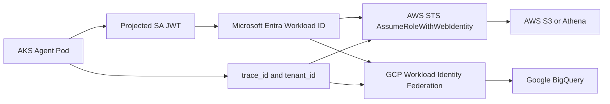
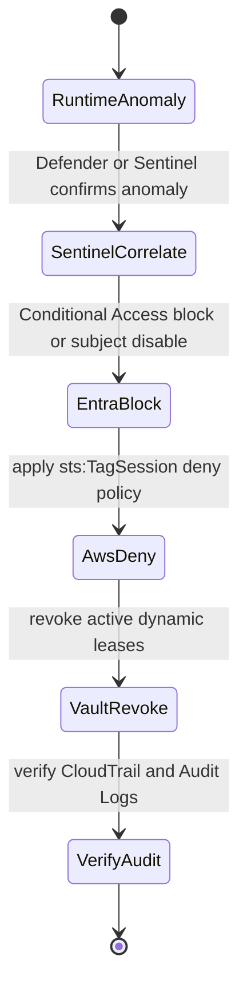

# Enterprise Cross-Cloud Secretless Agent Workload Identity Federation Selection FAQ (Entra OIDC to AWS STS or GCP WIF vs SPIFFE/SPIRE vs Vault Dynamic Leases)
> Topic ID: #458
> Domain: 3.6 Zero-Trust identity, private networking, and regulated data compliance
> Objective: define a production-grade identity control plane for AI agents running multi-cloud and hybrid tool calls without static credentials
> Scope: `AKS`, `ACA`, `EKS`, `GKE`, on-prem Linux clusters, cloud data services, and legacy database targets

## 1) Production problem: static credentials create catastrophic cross-cloud blast radius
Enterprise agents hosted on Azure frequently execute tools outside Azure boundaries.
Typical flows include reading `Amazon S3`, querying `Athena`, running `BigQuery`, and calling on-prem gRPC or PostgreSQL services.
If `AWS_SECRET_ACCESS_KEY` or GCP service account JSON files are stored in env vars or Kubernetes secrets, compromise impact is extreme.
Prompt injection, code execution abuse, dependency compromise, or `/proc/self/environ` leakage can expose long-lived keys quickly.
In multi-tenant agent platforms, static keys also break principal-level auditing and tenant isolation guarantees.
Therefore short-lived secretless federation is not optional; it is a core production safety requirement.

## 2) Target capabilities: security, latency, operability, and auditability together
The architecture must optimize more than simple authentication success.
Security requires short TTL credentials, deterministic revocation, and scoped principals.
Performance requires predictable exchange latency under burst and cold-start pressure.
Operations requires scalable control planes that remain supportable as tenant count grows.
Compliance requires cross-cloud trace stitching with consistent identity metadata.
A design that fails one of these dimensions usually fails in real production incidents.

## 3) Four architecture paths and practical fit boundaries
Pattern A focuses on cloud-to-cloud OIDC federation.
The chain is `AKS OIDC Issuer -> Entra Workload ID -> AWS STS / GCP WIF`.
Pattern B focuses on hybrid and bare-metal workload trust.
Its foundation is `SPIFFE/SPIRE` federated trust bundles with short `X.509-SVID` rotation.
Pattern C focuses on legacy non-OIDC systems.
`Vault/OpenBao` dynamic secret engines bridge databases and older auth endpoints.
Pattern D is the anti-pattern.
It includes long-lived access keys, shared node roles, and namespace-agnostic high-privilege principals.

## 4) Twelve-dimension quantified architecture matrix
| Dimension | Pattern A (Entra OIDC Federation) | Pattern B (SPIFFE/SPIRE) | Pattern C (Vault Dynamic Leases) | Pattern D (Static Credential Anti-Pattern) |
|---|---|---|---|---|
| Credential TTL and blast window | `15–60min` | `5–15min` | `5–60min` | `30–365d` |
| Initial exchange latency P95 | `85–160ms` | `40–120ms` | `110–260ms` | Fast start, high risk |
| Entra conditional access coverage | High | Medium | Medium | Low |
| FIC scale management complexity | Medium | Medium-high | Medium | Low but unsafe |
| Cross-cloud audit correlation quality | High (session tags) | Medium-high | High (lease metadata) | Low |
| Native workload mTLS support | Medium | High | Medium | Low |
| Legacy non-OIDC target support | Medium | Medium | High | Superficially high |
| HA control-plane burden | Medium | Medium-high | High | Low |
| Active revocation capability | Medium-high | High | High | Low |
| Tenant ABAC expressiveness | High | High | Medium-high | Low |
| Replayable forensic quality | High | High | High | Low |
| Recommendation status | Primary path | Hybrid enhancer | Legacy bridge | Prohibited |

## 5) Mermaid: two-stage secretless exchange control and data plane

This path eliminates long-lived cloud keys inside agent runtime contexts.
Session tags flow through the chain for tenant and trace-level attribution.
If one agent session is compromised, the damage window remains bounded by TTL and policy scope.

## 6) Mermaid: compromised session containment and revocation lifecycle

Containment must include block, revoke, and verify.
Skipping any stage leaves residual access paths that attackers can still exploit.

## 7) Q1: how to estimate and optimize two-hop OIDC exchange latency
Use `T_total = T_oidc + T_sts + T_network + T_cache_miss`.
Typical production P95 lands around `85–160 ms` when region placement is aligned.
Cross-region identity endpoints can dominate the latency budget.
Co-locate Azure, AWS, and GCP federation endpoints when possible.
For high-frequency tools, add short-lived cache layers to avoid unnecessary full exchanges.
Set timeout policies around `P95*1.6` to reduce false positives during transient jitter.

## 8) Q2: how to handle the 20-FIC limit and identity growth pressure
Large enterprises often map many namespaces and service accounts to one identity.
Naive one-to-one FIC expansion quickly hits quota boundaries and governance complexity.
Recommended pattern is UAMI partitioning by security domain, not by arbitrary service count.
Where available, Flexible FIC subject patterns can reduce object sprawl safely.
Publish an identity-domain design contract before mass onboarding.
Review each new principal against tenancy boundaries and auditability constraints.

## 9) Q3: OIDC rate-limit math for cold-start surges
A simple estimate is `R = N_pod_coldstart / Δt`.
If `N=2000` and `Δt=30s`, initial federation request rate is about `66.7 rps`.
Introduce randomized startup jitter to avoid synchronized token storms.
Use proactive refresh policy `T_refresh = 0.8*TTL - Uniform(0,120s)`.
This spreads renewal waves and protects identity backends.
Apply bounded exponential backoff for retries to prevent self-amplifying spikes.

## 10) Q4: SPIRE rotation windows, clock skew, and mTLS reliability
`X.509-SVID` lifetimes are commonly configured in the `5–15 minute` range.
Too-short rotation increases control-plane churn and operational risk.
Too-long rotation expands compromise windows and replay exposure.
Set clock-skew tolerance to `>=60s` for mixed-region and hybrid deployments.
Standardize NTP discipline across cloud and on-prem nodes.
For rotation failures, predefine degraded read-only operation modes for critical agents.

## 11) Q5: preventing confused deputy and cross-tenant escalation
Bind session tags and resource policy checks in both identity and data planes.
In AWS, inject `tenant_id` and `trace_id` using `sts:TagSession`.
Enforce resource constraints such as `s3:ExistingObjectTag/tenant_id == ${aws:PrincipalTag/tenant_id}`.
Equivalent attribute-based constraints should be enabled for GCP federation targets.
Denied events must be streamed into a unified audit store for pattern analysis.
This is the practical control that turns short credentials into safe credentials.

## 12) Q6: IdP regional outage survival and controlled degradation
During IdP degradation, prioritize still-valid cached short-lived tokens.
Survival window can be estimated as `W_survive = TTL_remaining - SafetyMargin`.
If the remaining window drops below threshold, auto-switch to restricted tool profiles.
Preserve low-risk read operations and pause high-risk write actions.
After recovery, force token refresh and revoke suspicious sessions from outage windows.
Drills must validate cache-hit, degrade, and restore paths as one continuous flow.

## 13) Production code blocks (real multiline, no escaped newline literals)
### 13.1 Bicep: UAMI and federated identity credential binding
```bicep
param location string = resourceGroup().location
param uamiName string = 'uami-agent-fin-analytics'
param oidcIssuer string

resource uami 'Microsoft.ManagedIdentity/userAssignedIdentities@2023-01-31' = {
  name: uamiName
  location: location
}

resource fic 'Microsoft.ManagedIdentity/userAssignedIdentities/federatedIdentityCredentials@2023-01-31' = {
  name: '${uami.name}/fin-analytics-sa-fic'
  properties: {
    issuer: oidcIssuer
    subject: 'system:serviceaccount:agent-prod:fin-analytics-sa'
    audiences: [
      'api://AzureADTokenExchange'
    ]
  }
}
```
### 13.2 Terraform IAM trust policy: enforce aud, sub, and tag controls
```hcl
data "aws_iam_policy_document" "entra_oidc_trust" {
  statement {
    actions = ["sts:AssumeRoleWithWebIdentity", "sts:TagSession"]
    principals {
      type        = "Federated"
      identifiers = [aws_iam_openid_connect_provider.entra_oidc.arn]
    }
    condition {
      test     = "StringEquals"
      variable = "login.microsoftonline.com/${var.tenant_id}/v2.0:aud"
      values   = ["api://AzureADTokenExchange"]
    }
    condition {
      test     = "StringEquals"
      variable = "login.microsoftonline.com/${var.tenant_id}/v2.0:sub"
      values   = ["system:serviceaccount:agent-prod:fin-analytics-sa"]
    }
    condition {
      test     = "ForAllValues:StringLike"
      variable = "aws:TagKeys"
      values   = ["tenant_id", "trace_id", "agent_namespace"]
    }
  }
}
```
### 13.3 Python async provider: ManagedIdentityCredential to STS with jitter refresh
```python
import asyncio
import os
import random
import time
from azure.identity.aio import ManagedIdentityCredential
import boto3

class FederatedAwsTokenCache:
    def __init__(self, role_arn: str, token_ttl: int = 3600) -> None:
        self.role_arn = role_arn
        self.token_ttl = token_ttl
        self.cache = None
        self.expire_at = 0

    def _refresh_deadline(self) -> float:
        base = 0.8 * self.token_ttl
        jitter = random.uniform(0, 120)
        return time.time() + base - jitter

    async def get_credentials(self, tenant_id: str, trace_id: str):
        if self.cache and time.time() < self.expire_at:
            return self.cache

        mi = ManagedIdentityCredential()
        token = await mi.get_token("api://AzureADTokenExchange/.default")
        await mi.close()

        sts = boto3.client("sts", region_name=os.getenv("AWS_REGION", "us-east-1"))
        resp = sts.assume_role_with_web_identity(
            RoleArn=self.role_arn,
            RoleSessionName=f"agent-{tenant_id}-{int(time.time())}",
            WebIdentityToken=token.token,
            DurationSeconds=self.token_ttl,
            Tags=[
                {"Key": "tenant_id", "Value": tenant_id},
                {"Key": "trace_id", "Value": trace_id},
                {"Key": "agent_namespace", "Value": "agent-prod"},
            ],
            TransitiveTagKeys=["tenant_id", "trace_id", "agent_namespace"],
        )
        self.cache = resp["Credentials"]
        self.expire_at = self._refresh_deadline()
        return self.cache

async def main():
    cache = FederatedAwsTokenCache(role_arn="arn:aws:iam::111122223333:role/agent-reader")
    creds = await cache.get_credentials(tenant_id="brand-042", trace_id="trc-9f2d")
    print("issued", creds["AccessKeyId"][:8], "...")

if __name__ == "__main__":
    asyncio.run(main())
```

## 14) Enterprise scenarios and three-tier three-year TCO
### 14.1 Scenario A: multi-cloud retail analytics agent on Azure AKS
The platform serves `120` brand tenants with cross-cloud data access.
A single request can span `S3 Iceberg`, `Athena`, and `BigQuery`.
The dominant risk is cross-tenant data-path confusion under shared runtime pressure.
Pattern A is the primary recommendation with strict session-tag ABAC enforcement.
Token caching and jitter refresh reduce exchange storms during report windows.
Audit pipelines must reconstruct `tenant_id -> role_session -> data object` deterministically.

### 14.2 Scenario B: global bank hybrid agent platform
Workloads bridge Azure AKS and on-prem Linux/database systems.
The environment requires short-lived mTLS identities and rejects static cloud keys.
Pattern B becomes the trust backbone for workload-to-workload identity.
Pattern C augments legacy endpoints that cannot consume OIDC federation natively.
Compliance evidence must include revocation logs and lease-reclaim traces.
High-risk write tools should require dual approval and explicit operation intent confirmation.

### 14.3 Three-year TCO (`20 / 100 / 500` agent workloads)
| Scale tier | Agent workload count | Pattern A | Pattern B | Pattern C |
|---|---:|---:|---:|---:|
| Department | 20 | `$0.42M` | `$0.55M` | `$0.61M` |
| Regional | 100 | `$1.78M` | `$2.31M` | `$2.74M` |
| Enterprise | 500 | `$7.46M` | `$9.88M` | `$11.35M` |
Cost driver one is exchange-request volume versus cache hit quality.
Cost driver two is high-availability design depth for the identity control plane.
Cost driver three is long-term audit retention and cross-cloud query load.
Cost driver four is adapter overhead for non-OIDC legacy systems.

## 15) Day-0 / Day-1 / Day-2 action plan (15 distinct actions)
Day-0 action: define security-domain boundaries across tenant, namespace, and service account layers.
Day-0 action: inventory every cross-cloud tool call and classify data sensitivity and write risk.
Day-0 action: build UAMI and FIC naming standards with quota observability dashboards.
Day-0 action: standardize audit fields (`tenant_id`, `trace_id`, `workload_subject`) across clouds.
Day-0 action: publish static-credential eradication plan with migration and rollback checkpoints.
Day-1 action: deploy Pattern A federation path and validate behavior on canary tenants.
Day-1 action: enforce `sts:TagSession` plus ABAC resource constraints and test deny paths.
Day-1 action: enable jittered proactive refresh for high-concurrency exchange-heavy workloads.
Day-1 action: deploy SPIRE pilot on hybrid nodes and verify mTLS and rotation stability.
Day-1 action: connect Vault dynamic leases for non-OIDC legacy database and broker targets.
Day-2 action: review weekly anomaly sessions and cross-tenant deny attempts with root-cause tags.
Day-2 action: profile monthly exchange-latency distributions and optimize region placement.
Day-2 action: run quarterly drills for IdP outage, bulk revocation, and degraded-mode survival.
Day-2 action: continuously prune over-provisioned identities and stale federation bindings.
Day-2 action: hold cross-team postmortems to align platform, network, and application controls.

Adoption guidance: use Pattern A as default cloud-to-cloud path, add Pattern B for hybrid mTLS trust, and apply Pattern C only where protocol constraints require it.
Risk guidance: any residual long-lived static credential should be treated as a highest-priority risk item with explicit closure SLA.

Official references (fetched 2026-11-27):
- Microsoft Entra Workload ID for AKS: https://learn.microsoft.com/azure/aks/workload-identity-overview
- AWS STS AssumeRoleWithWebIdentity: https://docs.aws.amazon.com/STS/latest/APIReference/API_AssumeRoleWithWebIdentity.html
- Google Cloud Workload Identity Federation: https://cloud.google.com/iam/docs/workload-identity-federation
- SPIFFE and SPIRE: https://spiffe.io/docs/latest/ and https://spiffe.io/spire/
- HashiCorp Vault Dynamic Secrets: https://developer.hashicorp.com/vault/docs/secrets
