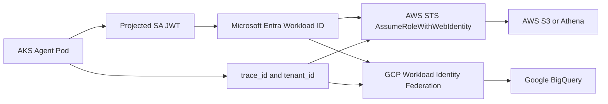
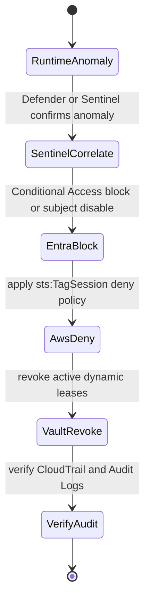

# 企业多云无密钥智能体工作负载身份联合选型 FAQ（Entra OIDC→AWS STS/GCP WIF vs SPIFFE/SPIRE vs Vault Dynamic Leases）
> 主题编号：#458
> 章节归属：3.6 零信任身份、私有网络隔离与强监管数据合规
> 文档目标：为企业 AI Agent 提供跨云无密钥身份交换、审计追踪与最小爆炸半径的生产级决策基线
> 适用范围：`AKS`、`ACA`、`EKS`、`GKE`、本地 Linux 集群、混合云数据库与消息中间件

## 1) 生产问题：静态密钥导致跨云爆炸半径不可控
企业 Agent 常在 Azure 上执行跨云工具调用。
典型动作包括读取 `Amazon S3`、执行 `Athena` 查询、调用 `BigQuery`、访问本地 gRPC 服务。
若把 `AWS_SECRET_ACCESS_KEY` 或 GCP Service Account JSON 放在环境变量或 K8s Secret 中，泄露后风险极高。
攻击者可利用提示注入、RCE、依赖投毒、`/proc/self/environ` 暴露快速横向扩散。
在多租户 Agent 平台中，静态密钥还会破坏租户级审计边界与最小权限原则。
因此“无密钥短令牌 + 联邦身份 + 可回收会话”成为主流生产路线。

## 2) 目标能力：安全、时延、可运维与合规同时达标
架构目标不是只解决“能登录”，而是要平衡四类约束。
第一类是安全约束：令牌短寿命、可吊销、可绑定主体与租户。
第二类是性能约束：跨云身份交换链路 P95 时延可预测。
第三类是运维约束：控制面规模增长时不会把平台团队拖垮。
第四类是审计约束：跨云日志可对齐 `trace_id`、`tenant_id`、`workload_subject`。
当四类约束同时满足时，平台才可在高并发 Agent 生产环境稳定运行。

## 3) 四种架构路径：从云到云、云到本地、遗留系统到反模式
Pattern A 主打云到云 OIDC 联邦。
链路是 `AKS OIDC Issuer -> Entra Workload ID -> AWS STS / GCP WIF`。
Pattern B 主打混合云与本地 mTLS 身份互信。
核心组件是 `SPIFFE/SPIRE` 联邦信任包与短周期 `X.509-SVID`。
Pattern C 主打遗留非 OIDC 目标系统。
通过 `Vault/OpenBao` 动态租约对接数据库、消息队列、旧版 API 认证。
Pattern D 是反模式。
表现为长期 Access Key、共享节点角色、跨命名空间复用同一高权限主体。

## 4) 十二维量化决策矩阵
| 评估维度 | Pattern A（Entra OIDC 联邦） | Pattern B（SPIFFE/SPIRE） | Pattern C（Vault 动态租约） | Pattern D（静态密钥反模式） |
|---|---|---|---|---|
| 凭据 TTL 与爆炸半径窗口 | `15–60min` | `5–15min` | `5–60min` | `30–365d` |
| 首次交换 P95 时延 | `85–160ms` | `40–120ms` | `110–260ms` | 初始快但风险高 |
| Entra 条件访问覆盖 | 高 | 中 | 中 | 低 |
| FIC 规模治理复杂度 | 中（需分域） | 中高 | 中 | 低但不可审计 |
| 跨云审计关联能力 | 高（Session Tags） | 中高 | 高（lease metadata） | 低 |
| mTLS 工作负载互认 | 中 | 高 | 中 | 低 |
| 非 OIDC 目标适配 | 中 | 中 | 高 | 表面高、实则高风险 |
| 控制面 HA 运维负担 | 中 | 中高 | 高 | 低 |
| 令牌主动吊销能力 | 中高 | 高 | 高 | 低 |
| 租户隔离 ABAC 表达力 | 高 | 高 | 中高 | 低 |
| 审计可复盘性 | 高 | 高 | 高 | 低 |
| 企业推荐等级 | 主路径 | 混合增强 | 遗留补位 | 禁用 |

## 5) Mermaid：两阶段无密钥跨云交换控制面与数据面

该链路避免在 Pod 内存储长期密钥。
会话标签贯穿交换链，便于跨云日志关联与租户责任追踪。
当单个 Agent 会话被攻破时，攻击窗口受 TTL 限制，不会无限扩张。

## 6) Mermaid：受损会话围堵与吊销状态机

关键不是单次封禁，而是“封禁 + 吊销 + 审计确认”闭环。
若缺失任一步骤，攻击者仍可能利用残存令牌执行横向访问。

## 7) Q1：两跳 OIDC 交换时延如何估算与控制
可用公式 `T_total = T_oidc + T_sts + T_network + T_cache_miss`。
在正常网络下，P95 常见区间是 `85–160 ms`。
若跨区域访问身份端点，网络项会显著放大。
建议在 Azure 与 AWS/GCP 的就近区域建立身份交换路径。
建议对重度调用工具引入会话缓存，减少重复交换。
建议把超时门槛设为 `P95*1.6`，避免过度敏感误报。

## 8) Q2：如何处理 20 个 FIC 限制与大规模主体增长
企业常遇到单个身份绑定多个 namespace 和 serviceaccount 的需求。
若直接一对一创建 FIC，容易触达配额上限并带来运维碎片化。
推荐策略是 UAMI 按安全域分片，而不是按单服务无限堆叠。
在支持 Flexible FIC 的场景可使用受控表达式减少对象数量。
建议建立“身份域设计文档”，先定义边界，再落地对象创建。
每次新增主体应评估对审计、隔离和轮换的影响。

## 9) Q3：冷启动并发下 OIDC 端点限流如何计算
估算可用 `R = N_pod_coldstart / Δt`。
若 `N=2000` 且 `Δt=30s`，瞬时请求速率约 `66.7 rps`。
应在调度层引入随机抖动启动，避免齐步冷启动冲击身份端点。
推荐刷新策略 `T_refresh = 0.8*TTL - Uniform(0,120s)`。
该策略能把刷新峰值分散，降低刷新雪崩。
并应对失败重试设置指数退避和上限。

## 10) Q4：SPIRE 轮换窗口、时钟漂移与 mTLS 稳定性
`X.509-SVID` 常配置 `5–15 分钟` 生命周期。
轮换过短会增加控制面负担，过长会扩大泄露窗口。
推荐将时钟漂移容忍度设置为 `>=60s`。
在跨地域与本地 IDC 混合场景中，应统一 NTP 基线。
mTLS 失败排障需区分证书过期、信任包不同步、时钟偏差三类根因。
生产环境应对轮换失败设置“降级到只读工具模式”的保护动作。

## 11) Q5：如何防止 Confused Deputy 与跨租户越权
关键在会话标签与资源策略双向绑定。
例如在 AWS 使用 `sts:TagSession` 注入 `tenant_id`、`trace_id`。
资源侧策略要求 `s3:ExistingObjectTag/tenant_id == ${aws:PrincipalTag/tenant_id}`。
这样即使角色被短时盗用，也难跨租户访问不匹配数据。
GCP 侧应使用等价属性约束策略与审计标签。
所有拒绝事件都应回写统一审计仓，形成越权尝试画像。

## 12) Q6：身份提供方区域故障时如何做生存与降级
若 IdP 出现区域级故障，平台应优先依赖已签发且未过期的短令牌缓存。
可估算生存窗口 `W_survive = TTL_remaining - SafetyMargin`。
当 `W_survive` 小于阈值时，应自动降级到受限工具集。
降级策略应优先保留只读查询路径，暂停高风险写操作。
恢复后应强制刷新并吊销故障窗口内的可疑会话。
演练中应验证“令牌缓存命中 + 降级切换 + 恢复回正”全链路。

## 13) 生产代码片段（无转义字符串，真实多行）
### 13.1 Bicep：UAMI 与 Federated Identity Credential
```bicep
param location string = resourceGroup().location
param uamiName string = 'uami-agent-fin-analytics'
param oidcIssuer string

resource uami 'Microsoft.ManagedIdentity/userAssignedIdentities@2023-01-31' = {
  name: uamiName
  location: location
}

resource fic 'Microsoft.ManagedIdentity/userAssignedIdentities/federatedIdentityCredentials@2023-01-31' = {
  name: '${uami.name}/fin-analytics-sa-fic'
  properties: {
    issuer: oidcIssuer
    subject: 'system:serviceaccount:agent-prod:fin-analytics-sa'
    audiences: [
      'api://AzureADTokenExchange'
    ]
  }
}
```
### 13.2 Terraform/AWS Trust Policy：限定 aud、sub 与 Session Tags
```hcl
data "aws_iam_policy_document" "entra_oidc_trust" {
  statement {
    actions = ["sts:AssumeRoleWithWebIdentity", "sts:TagSession"]
    principals {
      type        = "Federated"
      identifiers = [aws_iam_openid_connect_provider.entra_oidc.arn]
    }
    condition {
      test     = "StringEquals"
      variable = "login.microsoftonline.com/${var.tenant_id}/v2.0:aud"
      values   = ["api://AzureADTokenExchange"]
    }
    condition {
      test     = "StringEquals"
      variable = "login.microsoftonline.com/${var.tenant_id}/v2.0:sub"
      values   = ["system:serviceaccount:agent-prod:fin-analytics-sa"]
    }
    condition {
      test     = "ForAllValues:StringLike"
      variable = "aws:TagKeys"
      values   = ["tenant_id", "trace_id", "agent_namespace"]
    }
  }
}
```
### 13.3 Python：ManagedIdentityCredential 到 AWS STS 的抖动刷新缓存
```python
import asyncio
import os
import random
import time
from azure.identity.aio import ManagedIdentityCredential
import boto3

class FederatedAwsTokenCache:
    def __init__(self, role_arn: str, token_ttl: int = 3600) -> None:
        self.role_arn = role_arn
        self.token_ttl = token_ttl
        self.cache = None
        self.expire_at = 0

    def _refresh_deadline(self) -> float:
        base = 0.8 * self.token_ttl
        jitter = random.uniform(0, 120)
        return time.time() + base - jitter

    async def get_credentials(self, tenant_id: str, trace_id: str):
        if self.cache and time.time() < self.expire_at:
            return self.cache

        mi = ManagedIdentityCredential()
        token = await mi.get_token("api://AzureADTokenExchange/.default")
        await mi.close()

        sts = boto3.client("sts", region_name=os.getenv("AWS_REGION", "us-east-1"))
        resp = sts.assume_role_with_web_identity(
            RoleArn=self.role_arn,
            RoleSessionName=f"agent-{tenant_id}-{int(time.time())}",
            WebIdentityToken=token.token,
            DurationSeconds=self.token_ttl,
            Tags=[
                {"Key": "tenant_id", "Value": tenant_id},
                {"Key": "trace_id", "Value": trace_id},
                {"Key": "agent_namespace", "Value": "agent-prod"},
            ],
            TransitiveTagKeys=["tenant_id", "trace_id", "agent_namespace"],
        )
        self.cache = resp["Credentials"]
        self.expire_at = self._refresh_deadline()
        return self.cache

async def main():
    cache = FederatedAwsTokenCache(role_arn="arn:aws:iam::111122223333:role/agent-reader")
    creds = await cache.get_credentials(tenant_id="brand-042", trace_id="trc-9f2d")
    print("issued", creds["AccessKeyId"][:8], "...")

if __name__ == "__main__":
    asyncio.run(main())
```

## 14) 企业场景与三档三年 TCO
### 14.1 场景 A：零售多租户分析 Agent（Azure AKS 跨 AWS/GCP）
平台服务 `120` 个品牌租户，查询链路同时访问 `S3 Iceberg` 与 `BigQuery`。
核心风险是跨租户错配访问与共享角色滥用。
推荐主路径为 Pattern A，并强制会话标签 ABAC。
在高峰查询窗口，采用短令牌缓存与抖动刷新降低交换风暴。
审计平台必须在单条事件内还原 `tenant_id -> role_session -> data_object`。

### 14.2 场景 B：全球银行混合平台（AKS + 本地主机）
平台需要连接本地 Linux 主机上的核心数据库和 gRPC 网关。
本地环境对 mTLS 和短证书要求严格，且不接受长期云密钥落地。
推荐 Pattern B 作为本地互信基座，Pattern C 对接遗留非 OIDC 数据源。
在合规审查中，提供会话吊销记录与租约回收证据可显著降低审计争议。
建议把关键写路径绑定双重审批与高风险操作二次确认。

### 14.3 三档三年 TCO（20 / 100 / 500 Agent Workloads）
| 规模层级 | Agent Workload 数 | Pattern A | Pattern B | Pattern C |
|---|---:|---:|---:|---:|
| 部门级 | 20 | `$0.42M` | `$0.55M` | `$0.61M` |
| 区域级 | 100 | `$1.78M` | `$2.31M` | `$2.74M` |
| 集团级 | 500 | `$7.46M` | `$9.88M` | `$11.35M` |
成本驱动一：身份交换请求量与缓存命中率。
成本驱动二：控制面高可用与跨区域冗余要求。
成本驱动三：审计留存周期与日志检索频率。
成本驱动四：遗留协议适配与额外代理层开销。

## 15) Day-0 / Day-1 / Day-2（15 项执行动作）
Day-0：定义身份安全域模型，明确租户、命名空间、服务账号边界。
Day-0：梳理跨云工具调用清单，标注读写权限与数据敏感等级。
Day-0：建立 FIC/UAMI 命名规范与配额看板，避免后期对象失控。
Day-0：设计统一审计字段（`tenant_id`、`trace_id`、`workload_subject`）并固化。
Day-0：制定静态密钥清退计划，明确迁移窗口与风险回滚方案。
Day-1：上线 Pattern A 主链路，在灰度租户验证跨云交换稳定性。
Day-1：接入 `sts:TagSession` 与 ABAC 资源策略，验证拒绝与放行边界。
Day-1：对高并发场景启用抖动刷新，压制令牌集中续租峰值。
Day-1：在混合云节点部署 SPIRE 试点，验证 mTLS 握手与证书轮换稳定性。
Day-1：为非 OIDC 遗留系统接入 Vault 动态租约并验证自动回收。
Day-2：每周审计异常会话与跨租户拒绝事件，输出根因分类报告。
Day-2：每月复盘身份交换时延分布，持续优化区域与缓存策略。
Day-2：每季度演练 IdP 区域故障与会话批量吊销流程。
Day-2：持续收敛多余身份对象，避免“对象增长快于治理能力”。
Day-2：建立跨团队复盘机制，确保平台、网络、应用三方口径一致。
### 15.1 补充治理细则（面向大规模多租户落地）
细则一：所有身份映射关系必须进入统一配置基线仓，禁止在运行时脚本中临时拼接角色与租户绑定关系。
细则二：所有跨云令牌交换动作必须带 `trace_id`、`tenant_id`、`workload_subject`，缺失任一字段即视为不合规调用并拒绝执行。
细则三：禁止将调试令牌输出到应用日志或标准输出，平台应自动扫描并拦截疑似令牌片段外泄事件。
细则四：对于高敏场景，要求每次跨云写操作在策略层附加业务目的码，便于后续审计核对“为什么访问”而非只记录“谁访问”。
细则五：身份对象生命周期必须与业务系统生命周期解耦，业务下线不等于身份自动清理，必须执行显式清退工作流。
细则六：制定“紧急封禁优先级矩阵”，明确租户级、命名空间级、工作负载级的封禁顺序和回滚条件，避免故障期误封扩大影响面。
细则七：在蓝绿发布期间，旧版本与新版本身份策略必须并行验证，防止因策略漂移造成生产流量瞬时中断。
细则八：建立跨云审计时钟一致性治理，要求所有审计节点满足统一时间同步误差范围，避免多云日志对齐出现证据歧义。
细则九：将“跨租户拒绝率”“令牌刷新失败率”“会话吊销传播时延”纳入季度治理 KPI，并绑定平台团队改进目标。
细则十：对外部供应商或第三方托管工具调用实行最小权限模板化发放，禁止人工特批高权限长期保留。
细则十一：在攻击演练中引入“令牌重放”“标签篡改”“角色错配”三类场景，验证策略在异常输入下仍能稳定拒绝越权路径。
细则十二：对 Vault 动态租约配置最短可行 TTL 与最大续租次数，防止租约被长期续命而退化为事实长期凭据。
细则十三：在本地数据中心与云端混合互联链路中，要求双向证书链路都可独立轮换，避免单点证书链冻结全局变更窗口。
细则十四：将身份策略变更与数据权限变更绑定审批，避免“身份放行但数据侧未收敛”形成控制空窗。
细则十五：每次重大版本升级后执行回归审计，确认旧策略未残留、临时豁免已收回、应急策略已回到稳态配置。
细则十六：在面向监管报告时输出统一证据包，至少包括策略快照、交换日志、拒绝事件、吊销记录与恢复确认。
细则十七：为跨云身份链路建立容量上限红线，当交换失败率或时延超阈值时自动降级到只读查询模式。
细则十八：对于跨区域容灾演练，必须验证身份系统在主区域不可用时仍可维持最小可用业务路径。
细则十九：将所有身份治理规则转化为机器可执行策略测试，纳入 CI 以防手工文档与真实策略长期漂移。
细则二十：通过持续审计和自动化回收机制，确保“无密钥”不仅是上线口号，而是可持续运行的工程现实。

适配建议：云到云主场景优先 Pattern A，混合与本地强互信叠加 Pattern B，遗留系统补 Pattern C。
风险提示：任何静态密钥残留都可能绕过治理闭环，应作为最高优先级技术债清零。

官方参考（抓取 2026-11-27）：
- Microsoft Entra Workload ID for AKS: https://learn.microsoft.com/azure/aks/workload-identity-overview
- AWS STS AssumeRoleWithWebIdentity: https://docs.aws.amazon.com/STS/latest/APIReference/API_AssumeRoleWithWebIdentity.html
- Google Cloud Workload Identity Federation: https://cloud.google.com/iam/docs/workload-identity-federation
- SPIFFE/SPIRE: https://spiffe.io/docs/latest/ and https://spiffe.io/spire/
- HashiCorp Vault Dynamic Secrets: https://developer.hashicorp.com/vault/docs/secrets
