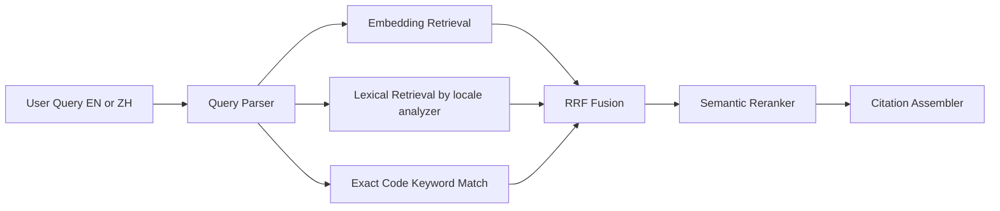
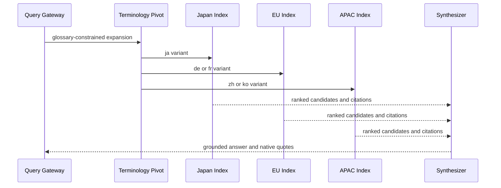

# Enterprise Cross-Lingual Multi-Script RAG Data Plane Selection FAQ: Tri-Modal Indexing vs Query-Time Glossary Pivot Fan-Out vs Index-Time Shadow Fields vs Sovereign Regional Mesh

> **Audience**: Cloud and AI Solution Architects, enterprise search platform teams, knowledge-engineering leaders, legal and regulatory intelligence groups, and global data-governance owners.
> **Core question**: How should enterprise RAG platforms support English and Chinese users who query untranslated Japanese `JIS` SOPs, German `DIN` engineering manuals, Korean semiconductor specs, and Arabic regulatory filings without losing recall, citation authority, latency targets, or sovereignty controls?

---

## 1. Executive summary

Cross-lingual enterprise RAG fails most often in retrieval, not generation.

Typical production symptom pattern:

- lexical `BM25` scores collapse close to zero across script boundaries;
- generic analyzers mis-tokenize CJK text and German compound nouns;
- dense-only retrieval can miss exact compliance identifiers (`DIN`, `CAS`, SKU, clause IDs);
- translation-only pipelines reduce legal confidence because native authoritative quoting is lost.

Four architecture routes solve different parts of the problem:

- **Route A**: multilingual dense plus learned sparse plus exact-code tri-modal indexing.
- **Route B**: query-time glossary-pinned multi-locale pivot expansion and parallel fan-out.
- **Route C**: index-time dual-field canonical shadowing with native text plus pivot text plus entities.
- **Route D**: sovereign per-region federated index mesh with language-subquery routing.

Recommended baseline strategy:

1. Start with **Route A** to establish robust mixed lexical/semantic retrieval.
2. Add **Route C** when low-latency high-QPS operations justify higher indexing complexity.
3. Use **Route B** as a rapid bridge when large historical corpora cannot be batch-translated immediately.
4. Apply **Route D** where strict regional residency and legal sovereignty are mandatory.

---

## 2. Problem boundary and failure taxonomy

### 2.1 Why cross-script lexical retrieval collapses

When English queries target Japanese or Chinese documents:

- term overlap in inverted indexes is near-zero,
- language-specific stemming and segmentation assumptions diverge,
- hybrid rank fusion cannot recover if lexical branch contributes no meaningful candidates.

### 2.2 Why standard analyzers are not enough

Default analyzers frequently fail on:

- Japanese morphological segmentation boundaries,
- German technical compounds where one token semantically encodes multiple units,
- Arabic and Hebrew shape forms and script-direction interactions.

### 2.3 Why dense-only retrieval is insufficient in enterprise settings

Dense retrieval helps semantic language transfer, but enterprise tasks often require:

- exact legal article references,
- exact part and material identifiers,
- exact process-code or standard-number anchoring.

Without dedicated exact-code fields, high-similarity passages can still be operationally wrong.

### 2.4 Out-of-scope clarifications

This guide does not focus on:

- OCR engine benchmark selection,
- machine-translation model training procedures,
- purely academic multilingual leaderboard comparisons.

---

## 3. Route definitions

### Route A — Tri-modal multilingual retrieval index

Core design:

1. Dense vectors from multilingual embeddings (`Cohere Embed v3` or `BGE-M3`).
2. Learned sparse or lexical fields with language-aware analyzers.
3. Dedicated exact-code keyword fields for identifiers (`DIN`, `JIS`, `CAS`, SKU, part numbers).

Primary strengths:

- strong baseline recall across language/script boundaries,
- robust support for identifier-driven retrieval,
- stable compromise between quality and operational complexity.

Primary trade-offs:

- index schema complexity is higher than single-field architectures,
- tuning sparse+dense weighting requires disciplined relevance evaluation.

### Route B — Query-time glossary-constrained pivot fan-out

Core design:

1. Expand user query with terminology-constrained variants by locale.
2. Run parallel hybrid retrieval per locale field.
3. Apply cross-lingual L2 reranking and fusion.

Primary strengths:

- no need to immediately translate or rewrite all historical corpora,
- fast adoption path for global organizations with fragmented document estates.

Primary trade-offs:

- query latency increases under fan-out,
- inference and search cost scale with expansion breadth,
- terminology governance quality directly affects recall and precision.

### Route C — Index-time dual-field canonical shadowing

Core design:

- For each source document store:
  - `content_native`,
  - `content_pivot_en`,
  - `domain_entities`.

Primary strengths:

- avoids query-time translation in hot paths,
- produces lower and more stable retrieval latency,
- supports grounded synthesis while preserving authoritative native-language citation spans.

Primary trade-offs:

- ingestion pipeline complexity and batch cost increase,
- backfill and re-index processes require stronger operational controls.

### Route D — Federated sovereign per-region language index mesh

Core design:

- regional index shards (EU, Japan, APAC, etc.),
- in-region retrieval by policy default,
- governed cross-region synthesis through language-subquery orchestration.

Primary strengths:

- strongest residency and sovereignty alignment,
- natural region-by-region scale and policy segmentation.

Primary trade-offs:

- highest orchestration complexity,
- requires mature cross-region observability and policy evidence.

---

## 4. Twelve-dimension comparison matrix

| Dimension | Route A tri-modal | Route B query pivot fan-out | Route C index shadowing | Route D sovereign mesh |
|---|---|---|---|---|
| Cross-lingual recall stability | High | Medium-high | High | High |
| Exact identifier retrieval | High | Medium | High | High |
| Query latency under load | Medium | Medium-low | High | Medium |
| Index build complexity | Medium-high | Low | High | High |
| Initial rollout speed | Medium | High | Medium-low | Low |
| Cost efficiency at high QPS | Medium-high | Medium-low | High | Medium |
| Native citation authority | High | Medium-high | High | High |
| Residency compliance fit | Medium | Medium | Medium | Very high |
| Language onboarding flexibility | High | High | Medium | Medium-high |
| Troubleshooting simplicity | Medium | Medium | Medium-low | Low |
| Platform operations burden | Medium | Medium | High | Very high |
| Recommended role | default enterprise baseline | rapid bridge strategy | low-latency steady state | strict sovereignty programs |

---

## 5. Metric model and baseline protocol

Minimum retrieval quality metrics:

1. `Recall@10` by query-language/document-language pair.
2. `nDCG@10` by intent class.
3. `exact_code_hit_rate` for part and clause identifiers.
4. `citation_native_match_rate` for quote authority.
5. `retrieval_p95_ms`.
6. `cost_per_1k_queries`.

Baseline dataset protocol:

- language pairs: `EN->JA`, `EN->DE`, `ZH->JA`, `ZH->AR`,
- query classes: legal clause, engineering procedure, material safety, incident diagnosis,
- short-form and long-form query buckets evaluated independently.

---

## 6. Q1 — Why cross-script BM25 collapse can reduce Recall@10 from 89% to 48%, and how RRF can recover

Failure mechanism:

- lexical overlap disappears across scripts,
- analyzer mismatch amplifies token loss,
- top-k candidate pool quality falls before reranking starts.

Illustrative recovery sequence:

1. Baseline same-language lexical hybrid: `Recall@10 = 0.89`.
2. Cross-script lexical-only drop: `Recall@10 = 0.48`.
3. Add dense branch and exact-code fields (Route A): recovery to `0.78~0.84`.
4. Add semantic reranker after RRF: often reaches `0.85+` in well-governed corpora.

Architectural interpretation:

RRF cannot compensate if all branches are weak. It works best when at least one branch contributes high-quality candidates for each query class.

---

## 7. Q2 — Cross-lingual embedding alignment: `text-embedding-3-large` vs `Cohere v3` vs `BGE-M3`

Evaluation dimensions:

1. multilingual subspace alignment consistency,
2. asymmetry degradation in short query vs long passage settings,
3. robustness on mixed prose plus exact-code intents.

Observed engineering pattern:

- `Cohere v3` is typically strong for multilingual enterprise retrieval balance.
- `BGE-M3` is flexible in mixed dense+sparse strategies.
- `text-embedding-3-large` is strong semantically but should be paired with explicit exact-code fields for deterministic identifier retrieval.

Selection guidance:

- avoid single-metric optimization;
- evaluate with unified scorecards covering semantic relevance, code-hit precision, and authoritative citation fidelity.

---

## 8. Q3 — FinOps break-even: index-time shadow translation vs query-time pivot fan-out

Let:

- `D` = document volume,
- `Q` = daily query count,
- `C_qt` = query-time expansion and translation cost per query,
- `C_it` = one-time or periodic index-time batch shadowing cost.

Break-even condition over period `T`:

`Q * C_qt * T > C_it + C_storage_delta + C_ingest_ops`

Interpretation:

- low-QPS pilot often favors Route B;
- medium-to-high-QPS steady-state often favors Route C due to lower hot-path compute and lower p95 latency.

---

## 9. Q4 — Code-switch queries mixing English or Chinese prose with German or Japanese terms and part numbers

Pipeline recommendations:

1. split query into natural-language fragments and exact-code fragments,
2. route exact fragments to `keyword` fields without stemming,
3. route prose fragments to multilingual embedding and locale-aware lexical branches,
4. fuse with RRF and enforce exact-code minimum relevance constraints.

This prevents semantically similar but identifier-mismatched passages from displacing legally or operationally required references.

---

## 10. Q5 — Preserving authoritative native quotes while generating user-locale synthesis

Governance-safe answer pattern:

1. generate explanatory synthesis in user locale,
2. keep native authoritative quote spans for citations,
3. attach source page, clause, and bounding-box anchors,
4. apply glossary-constrained term rendering rather than unconstrained free translation.

Business effect:

- legal and engineering reviewers can independently verify source truth,
- translation hallucination disputes are materially reduced.

---

## 11. Q6 — RTL Arabic and vertical Japanese layout pitfalls in chunking and retrieval

Typical failure classes:

- right-to-left order corruption,
- vertical table row/column inversion,
- chunk boundaries splitting legal identifiers from interpretation context.

Mitigations:

1. detect script direction before normalization,
2. apply structured layout extraction for tables and forms,
3. segment with clause-aware and table-aware chunking strategy,
4. track `layout_integrity_score` as a first-class quality signal.

---

## 12. Mermaid — Tri-modal multilingual retrieval fusion architecture



---

## 13. Mermaid — Query-time pivot fan-out plus sovereign region routing



---

## 14. Production block 1 — Azure AI Search schema with multi-analyzer and exact-code fields (JSON)

```json
{
  "name": "global-docs-index",
  "fields": [
    { "name": "doc_id", "type": "Edm.String", "key": true, "searchable": false },
    { "name": "content_native", "type": "Edm.String", "searchable": true, "analyzer": "ja.microsoft" },
    { "name": "content_pivot_en", "type": "Edm.String", "searchable": true, "analyzer": "en.microsoft" },
    { "name": "content_de", "type": "Edm.String", "searchable": true, "analyzer": "de.microsoft" },
    { "name": "content_zh", "type": "Edm.String", "searchable": true, "analyzer": "zh-Hans.microsoft" },
    { "name": "part_code", "type": "Edm.String", "searchable": true, "analyzer": "keyword" },
    { "name": "din_code", "type": "Edm.String", "searchable": true, "analyzer": "keyword" },
    { "name": "cas_code", "type": "Edm.String", "searchable": true, "analyzer": "keyword" }
  ],
  "vectorSearch": {
    "profiles": [{ "name": "multilingual-profile", "algorithm": "hnsw" }]
  }
}
```

---

## 15. Production block 2 — Glossary-constrained expansion and fused retrieval pipeline (Python)

```python
def expand_query_with_glossary(query: str, glossary: dict[str, list[str]]) -> dict[str, str]:
    expanded = {"base": query}
    for locale, terms in glossary.items():
        expanded[locale] = query + " " + " ".join(terms)
    return expanded


def fused_retrieval(search_client, expanded_queries: dict[str, str], code_terms: list[str]):
    results = []
    for locale, q in expanded_queries.items():
        results.extend(search_client.hybrid_search(query=q, locale=locale, top_k=20))
    for code in code_terms:
        results.extend(search_client.keyword_search(field="part_code", query=code, top_k=10))
    return rrf_fuse(results)
```

---

## 16. Enterprise scenario A — German/Japanese/US automotive and robotics Tier-1 field-service and FMEA knowledge agent

Context:

- German process manuals, Japanese quality SOPs, and English service incidents coexist.
- Field teams ask in English or Chinese.
- Retrieval must resolve exact part identifiers and failure-mode clauses.

Recommended architecture:

- Route A as default retrieval foundation,
- Route C for high-throughput low-latency plants,
- Route D for strict jurisdiction-specific document residency boundaries.

Target outcomes:

- `Recall@10` increase by `25+` points over baseline,
- `exact_code_hit_rate` above `97%`,
- native citation authority above `99%`.

---

## 17. Enterprise scenario B — Multinational pharmaceutical regulatory affairs across PMDA, EMA, and NMPA

Context:

- PMDA Japanese dossiers, EMA German/French records, NMPA Chinese filings.
- Analysts need multilingual synthesis with native authoritative references.
- Regulatory response timelines require predictable retrieval latency.

Recommended architecture:

- Route C to preserve native and pivot fields simultaneously,
- Route B for controlled query expansion where dossier coverage is uneven,
- Route D for residency-safe cross-region orchestration.

Target outcomes:

- regulatory clause retrieval precision above `90%`,
- page- and clause-level citation consistency above `98%`,
- compliance evidence assembly time reduced by `40%`.

---

## 18. Three-year TCO illustration

| Cost category (3 years) | Route A | Route B | Route C | Route D |
|---|---:|---:|---:|---:|
| Retrieval and vector compute | $1.12M | $0.94M | $1.05M | $1.26M |
| Query-time translation and expansion | $0.33M | $0.78M | $0.19M | $0.41M |
| Index build and refresh operations | $0.52M | $0.27M | $0.88M | $0.96M |
| Governance and residency controls | $0.21M | $0.19M | $0.24M | $0.73M |
| Operations and support | $0.46M | $0.42M | $0.57M | $0.89M |
| **Total (3 years)** | **$2.64M** | **$2.60M** | **$2.93M** | **$4.25M** |

Interpretation:

- Route B can be economical early, but query fan-out costs rise quickly at scale.
- Route C has higher ingestion overhead but often lower hot-path latency and more predictable high-QPS economics.
- Route D is highest cost but strongest for sovereignty-driven risk controls.

---

## 19. Day-0 / Day-1 / Day-2 checklist

### Day-0 (architecture design)

- define language and script coverage map,
- design field model and analyzer policy,
- define authoritative citation contract (native quote plus page and bbox).

### Day-1 (pilot rollout)

- deploy multilingual evaluation suite,
- validate `Recall@10`, `nDCG@10`, and identifier-hit metrics,
- run mixed-script load tests with representative code-switch queries.

### Day-2 (scaled operations)

- integrate regional sovereignty routing controls,
- implement index version rollback and replay mechanisms,
- enforce retrieval quality gates in release pipelines.

---

## 20. Five-step decision guide (Good fit vs Not for)

1. **Start with retrieval observability by language pair**, not aggregate score only.
2. **Treat exact identifiers as first-class retrieval entities** with dedicated keyword fields.
3. **Preserve native citation authority** even when answer language differs from source language.
4. **Choose query-time expansion or index-time shadowing by QPS and latency economics**.
5. **Apply sovereign regional routing where legal residency requires hard boundaries**.

**Good fit**:

- global manufacturing, pharma, legal, and regulated policy knowledge systems,
- mixed-script corpora with strict citation requirements,
- operations requiring both semantic relevance and deterministic identifier grounding.

**Not for**:

- single-language lightweight FAQ bots,
- environments with no citation accountability,
- teams unable to operate language-aware index governance.

---

## 21. Risk register and control mapping

| Risk | Trigger signal | Control response | Owner |
|---|---|---|---|
| Cross-script recall collapse | `Recall@10` drop by language pair | Route A analyzer plus tri-modal weighting retune | Search platform |
| Identifier miss regressions | `exact_code_hit_rate` drift | keyword-field boost and exact-branch fail-safe | Domain application |
| Terminology drift | glossary mismatch growth | glossary versioning and regression tests | Knowledge governance |
| Residency policy violation | cross-region access alert | Route D policy-router hard enforcement | Security and compliance |

---

## 22. Twelve-week implementation cadence

### Weeks 1-2

- corpus inventory and language labeling,
- analyzer and field schema design,
- baseline evaluation benchmark assembly.

### Weeks 3-5

- deploy Route A minimum viable architecture,
- run mixed-script benchmark and stress scenarios,
- calibrate lexical/dense/code branch fusion weights.

### Weeks 6-8

- add Route B controlled pivot expansion,
- compare latency and cost trajectories,
- validate citation authority under multilingual synthesis.

### Weeks 9-10

- pilot Route C shadow fields for priority domains,
- optimize ingest throughput and re-index strategy,
- test rollback and index-version migration safety.

### Weeks 11-12

- run Route D regional mesh proof for sovereignty scope,
- complete compliance evidence drill,
- finalize operations runbook and release gate policies.

---

## 23. Anti-patterns to avoid

1. single translated field only with no native quote retention,
2. dense-only retrieval without exact-code safeguard,
3. no language-pair stratified evaluation,
4. free translation in citations for legal-grade responses,
5. cross-border synthesis without policy-aware routing,
6. no index-version rollback strategy.

---

## 24. Minimum observability fields

At minimum persist:

- `query_locale`, `doc_locale`, `script_type`,
- `recall_at_10`, `ndcg_at_10`,
- `exact_code_hit_rate`,
- `citation_native_match_rate`,
- `retrieval_p95_ms`,
- `cost_per_1k_queries`,
- `region_route`,
- `residency_policy_decision`.

Without this field set, teams can observe symptoms but cannot prove cause, containment quality, or compliance posture.

---

## 25. Suggested threshold policy (tune to domain risk)

- `Recall@10 >= 0.80` per critical language pair.
- `exact_code_hit_rate >= 0.95` for identifier-sensitive domains.
- `citation_native_match_rate >= 0.98` for legal and regulated workflows.
- `retrieval_p95_ms <= 180` for steady-state hot paths (generation excluded).
- `cross_region_policy_violation = 0`.

---

## 26. Final recommendation

For most enterprise programs, **Route A** is the right engineering starting point.
When query volume and latency SLO pressure increase, prioritize **Route C** for predictable hot-path performance.
When legacy corpus translation backlog is large, apply **Route B** as a controlled transition pattern.
When sovereignty boundaries are hard requirements, implement **Route D** and treat cross-region synthesis as an audited policy action.

---

## 27. Sources and data labels

> This document is an architecture-selection playbook. Numerical values are representative engineering estimates and must be recalibrated with organization-specific benchmark and billing data.

- Azure AI Search analyzer and hybrid retrieval documentation, retrieved `2026-11-26`.
- Azure AI Translator and custom terminology references, retrieved `2026-11-26`.
- Azure Document Intelligence layout extraction references, retrieved `2026-11-26`.
- Cohere Embed v3, BGE-M3, and multilingual retrieval engineering references, retrieved `2026-11-26`.
- Public engineering references on RRF fusion and semantic reranking in multilingual retrieval, retrieved `2026-11-26`.

Quantitative examples in this FAQ are labeled as: `anonymized_reported`.

