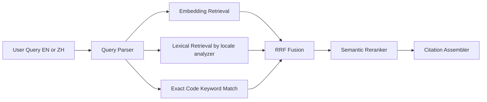
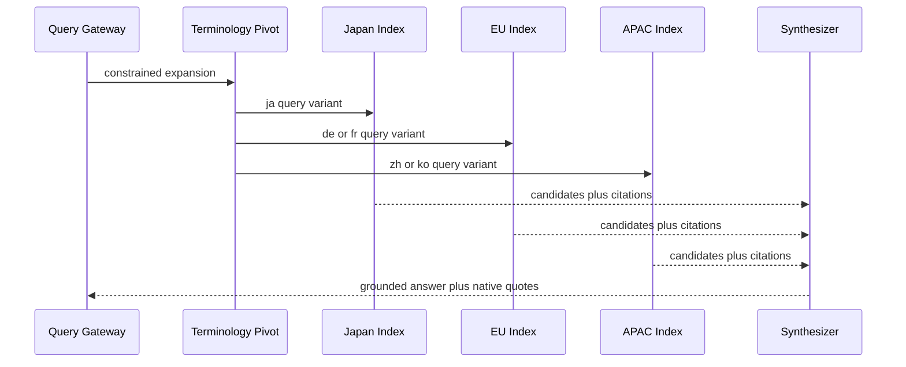

# 企业跨语言多脚本 RAG 数据平面选型 FAQ：多模索引 vs 查询时术语枢轴扩展 vs 索引时影子字段 vs 主权区域网格

> **适用对象**：Cloud & AI Solution Architect、企业知识平台架构师、搜索与检索工程团队、全球法务/合规知识治理团队。
> **核心问题**：当英语/中文用户要检索未翻译的日文 `JIS`、德文 `DIN`、韩文技术规范和阿拉伯监管文件时，如何在召回率、精确引用、时延、成本与数据主权之间平衡。

---

## 1. 执行摘要

跨语言企业 RAG 最常见失败点不是模型回答能力，而是检索层先“找不到”：

- 纯 `BM25` 跨脚本检索时分词错配，`Recall@10` 可从 `89%` 降到 `48%`；
- 德语复合词与日语形态切分错误导致关键词命中坍塌；
- 纯 dense 向量召回会漏掉 `DIN/ISO/CAS/SKU` 等精确代码；
- 仅做统一翻译又会牺牲原文可追溯引用。

四条路线：

- **Route A**：多语言 dense + learned sparse + 精确代码字段三模索引。
- **Route B**：查询时术语固定的多语枢轴 fan-out 并行检索。
- **Route C**：索引时双字段影子（原文 + 枢轴语）与实体域字段。
- **Route D**：按主权区域分片索引并由语言子查询路由汇总。

建议：

1. 默认先上 **A** 作为通用底座；
2. 低延迟高 QPS 场景叠加 **C**；
3. 无法批量翻译海量历史文档时用 **B** 过渡；
4. 强主权与跨境合规要求使用 **D**。

---

## 2. 典型失效模式与边界

### 2.1 跨脚本 `BM25` 失效

英语 query 检索日文/中文正文时：

- token 不共享，倒排词项重叠接近零；
- 词形变化与复合词拆分不一致；
- 导致 lexical 层分数趋近于零。

### 2.2 语言分析器不匹配

若统一使用标准 analyzer：

- 日语长词切分失败；
- 德语复合名词被错误拆分；
- 阿拉伯语形态变化归一不足。

### 2.3 纯向量路径的盲点

纯向量虽然跨语种更稳，但会出现：

- 精确代码召回缺失；
- 条款号、页码、部件号定位不稳定；
- 审计场景难给出“原文精确引用”。

### 2.4 非目标

本指南不覆盖：

- 文档翻译质量评估体系；
- OCR 引擎选型深度比较；
- 小语种训练数据构建流程。

---

## 3. 四路线定义

### Route A：三模索引（dense + sparse + exact code）

实现要点：

1. 向量层：`Cohere Embed v3 Multilingual` 或 `BGE-M3`；
2. lexical 层：`ja.microsoft` / `de.microsoft` / `zh-Hans.microsoft`；
3. 精确层：`keyword` 分析器专门承载 `DIN/CAS/SKU`。

优点：

- 兼顾语义与精确标识；
- 对跨语言 query 有稳定基础召回；
- 对工程/法规代码类检索友好。

挑战：

- 索引 schema 复杂度较高；
- embedding 与 analyzer 协同需要调参。

### Route B：查询时术语枢轴 fan-out

实现要点：

1. 用户 query 先做术语词表约束扩展；
2. 并行在多语言字段做 hybrid 检索；
3. 在 L2 做语义重排与融合。

优点：

- 不需要先翻译全部历史语料；
- 可快速验证跨语言召回提升。

挑战：

- 查询路径更长，P95 时延上升；
- 并发放大导致成本敏感。

### Route C：索引时影子字段

实现要点：

- 文档入库阶段生成：
  - `content_native`
  - `content_pivot_en`
  - `domain_entities`

优点：

- 查询时无需实时翻译；
- 检索延迟低且稳定；
- 原文与枢轴语可并存引用。

挑战：

- 索引构建成本高；
- 语料更新链路更复杂。

### Route D：主权区域语言索引网格

实现要点：

- EU、Japan、APAC 分区索引；
- 区域内检索、跨区汇总；
- 通过语言子查询路由器组装答案。

优点：

- 满足数据驻留与跨境合规；
- 区域独立扩缩容。

挑战：

- 跨区聚合链路复杂；
- 统一观测与一致性门禁要求高。

---

## 4. 十二维对比矩阵

| 维度 | Route A 三模索引 | Route B 查询枢轴 | Route C 索引影子 | Route D 主权网格 |
|---|---|---|---|---|
| 跨语种召回稳定性 | 高 | 中高 | 高 | 高 |
| 精确代码命中能力 | 高 | 中 | 高 | 高 |
| 查询时延 | 中 | 中低 | 高 | 中 |
| 索引构建复杂度 | 中高 | 低 | 高 | 高 |
| 初始上线速度 | 中 | 高 | 中低 | 低 |
| QPS 成本效率 | 中高 | 中低 | 高 | 中 |
| 原文引用可追溯性 | 高 | 中高 | 高 | 高 |
| 合规主权支持 | 中 | 中 | 中 | 极高 |
| 语言扩展弹性 | 高 | 高 | 中 | 中高 |
| 观测与排障复杂度 | 中 | 中高 | 高 | 极高 |
| 运维复杂度 | 中 | 中 | 高 | 极高 |
| 推荐定位 | 默认基线 | 过渡增强 | 高吞吐低时延 | 强主权监管 |

---

## 5. 指标体系与基线

建议至少跟踪：

1. `Recall@10`（按语言对分桶）；
2. `nDCG@10`；
3. `exact_code_hit_rate`；
4. `citation_native_match_rate`；
5. `retrieval_p95_ms`；
6. `cost_per_1k_queries`。

基线样本设计：

- 语言对：`EN->JA`、`EN->DE`、`ZH->JA`、`ZH->AR`；
- 查询类型：法规条款、工程手册、物料编码、投诉案例；
- 长度区间：短 query（<12 token）与长 query（>40 token）分开统计。

---

## 6. Q1：为什么跨脚本 BM25 会坍塌，如何恢复

问题机制：

- 词项空间不重叠；
- 分词边界与词形还原规则不一致；
- 复合词/术语无法匹配。

量化示例：

- 基线 `Recall@10 = 89%`（同语种）；
- 跨脚本降到 `48%`；
- 加入 Route A 三模索引后恢复到 `78~84%`；
- 再叠加语义重排可到 `85%+`。

---

## 7. Q2：`text-embedding-3-large`、`Cohere v3`、`BGE-M3` 的跨语种取舍

关注点：

1. 跨语子空间对齐稳定性；
2. query-passages 长度不对称时衰减曲线；
3. 对代码标识和术语 token 的敏感度。

经验趋势（示意）：

- `Cohere v3` 在多语检索任务表现均衡；
- `BGE-M3` 在多功能模式（dense+sparse）组合灵活；
- `text-embedding-3-large` 在通用语义任务表现强，但需与 exact-code 字段配合。

架构建议：

- 不要只看单指标；
- 必须做“跨语 + 精确代码 + 引用质量”联合评分。

---

## 8. Q3：索引时影子翻译与查询时 fan-out 的成本拐点

设：

- 文档量 `D`；
- 日查询量 `Q`；
- 查询时翻译单价 `C_qt`；
- 索引时批翻译总成本 `C_it`。

当满足：

`Q * C_qt * T > C_it + Δstorage + Δingest_ops`

其中 `T` 是时间窗口（月或季度），则索引时影子更经济。

经验：

- 小规模试点：Route B 更轻；
- 中高 QPS 稳态：Route C 常见更省。

---

## 9. Q4：中英 query 混合德语/日语术语与部件号如何保证检索可靠

关键策略：

1. query 预处理先拆“自然语言片段”和“精确代码片段”；
2. 代码片段直走 `keyword` 字段；
3. 术语片段做受控术语扩展；
4. 自然语片段走 embedding + lexical 混合。

融合建议：

- 使用 RRF 或加权融合；
- 对代码命中设置最小保底权重；
- 防止高相似但无代码命中的段落挤掉关键条款。

---

## 10. Q5：如何同时保留原文权威引用与用户语言回答

做法：

1. 回答生成可用用户语言；
2. 证据引用必须保留原文片段；
3. 引用中附带页码、段号、bbox；
4. 可附“受控术语对照”而非自由翻译。

收益：

- 法务与工程审计可复核；
- 降低“翻译幻觉”导致的争议。

---

## 11. Q6：阿拉伯/希伯来 RTL 与日文竖排 PDF 分块陷阱

常见问题：

- RTL 文本顺序错乱；
- 竖排表格 OCR 输出顺序颠倒；
- chunk 边界打断条款号与附录标识。

控制措施：

1. 文档版面解析前先识别脚本方向；
2. 对表格使用结构化抽取，不仅做纯文本拼接；
3. chunk 策略按“条款 + 表格单元 + 注释”多粒度切分；
4. 建立专门的 `layout_integrity_score` 监控。

---

## 12. Mermaid：跨语言检索三模融合拓扑



---

## 13. Mermaid：查询时枢轴 fan-out 与主权区域路由



---

## 14. 生产代码片段 1：Azure AI Search 多分析器 schema（JSON）

```json
{
  "name": "global-docs-index",
  "fields": [
    { "name": "doc_id", "type": "Edm.String", "key": true, "searchable": false },
    { "name": "content_native", "type": "Edm.String", "searchable": true, "analyzer": "ja.microsoft" },
    { "name": "content_pivot_en", "type": "Edm.String", "searchable": true, "analyzer": "en.microsoft" },
    { "name": "content_de", "type": "Edm.String", "searchable": true, "analyzer": "de.microsoft" },
    { "name": "content_zh", "type": "Edm.String", "searchable": true, "analyzer": "zh-Hans.microsoft" },
    { "name": "part_code", "type": "Edm.String", "searchable": true, "analyzer": "keyword" },
    { "name": "din_code", "type": "Edm.String", "searchable": true, "analyzer": "keyword" },
    { "name": "cas_code", "type": "Edm.String", "searchable": true, "analyzer": "keyword" }
  ],
  "vectorSearch": {
    "profiles": [{ "name": "multilingual-profile", "algorithm": "hnsw" }]
  }
}
```

---

## 15. 生产代码片段 2：术语约束 fan-out + 融合检索（Python）

```python
def expand_query_with_glossary(query: str, glossary: dict[str, list[str]]) -> dict[str, str]:
    expanded = {"base": query}
    for locale, terms in glossary.items():
        expanded[locale] = query + " " + " ".join(terms)
    return expanded


def fused_retrieval(search_client, expanded_queries: dict[str, str], code_terms: list[str]):
    results = []
    for locale, q in expanded_queries.items():
        results.extend(search_client.hybrid_search(query=q, locale=locale, top_k=20))
    for code in code_terms:
        results.extend(search_client.keyword_search(field="part_code", query=code, top_k=10))
    return rrf_fuse(results)
```

---

## 16. 企业场景 A：德日美汽车 Tier-1 供应商 FMEA 知识助手

背景：

- 德文工艺规范、日文质量 SOP、英文现场案例并存；
- 现场工程师使用英语/中文提问；
- 必须命中精确零件号与失效模式条款。

推荐：

- Route A 作为统一检索底座；
- 高频区域叠加 Route C 降低查询时延；
- 对跨境数据采用 Route D 区域索引。

结果目标：

- `Recall@10` 提升 `25pp+`；
- 关键部件号命中率提升到 `>97%`；
- 引用可审计率 `>99%`。

---

## 17. 企业场景 B：跨国药企法规事务多语卷宗检索

背景：

- PMDA（日文）、EMA（德/法）、NMPA（中文）卷宗并存；
- 回答需要原文条款与页码；
- 法规问答不能只给“翻译摘要”。

推荐：

- Route C 保留原文与枢轴语双字段；
- Route B 做受控查询扩展；
- Route D 确保区域驻留与跨区汇总合规。

结果目标：

- 法规条款检索准确率稳定 `>90%`；
- 引用页码一致率 `>98%`；
- 合规审计响应时间缩短 `40%`。

---

## 18. 三年 TCO（示例）

| 成本项（3 年） | Route A | Route B | Route C | Route D |
|---|---:|---:|---:|---:|
| 检索与向量计算 | $1.12M | $0.94M | $1.05M | $1.26M |
| 查询时翻译/扩展 | $0.33M | $0.78M | $0.19M | $0.41M |
| 索引构建与更新 | $0.52M | $0.27M | $0.88M | $0.96M |
| 合规与区域治理 | $0.21M | $0.19M | $0.24M | $0.73M |
| 运维与值班 | $0.46M | $0.42M | $0.57M | $0.89M |
| **总计（3 年）** | **$2.64M** | **$2.60M** | **$2.93M** | **$4.25M** |

解读：

- B 初期成本低，但高 QPS 时查询扩展成本上升快；
- C 前期投入高，但稳态低时延和低查询成本优势明显；
- D 成本最高，但主权合规能力最强。

---

## 19. Day-0 / Day-1 / Day-2 落地清单

### Day-0（设计）

- 明确语言覆盖与脚本类型清单；
- 定义 analyzer 与字段策略；
- 设计引用标准（原文、页码、bbox、条款号）。

### Day-1（试点）

- 建立双语或三语评测集；
- 验证 `Recall@10` 与 `exact_code_hit_rate`；
- 运行跨脚本混合 query 压测。

### Day-2（规模化）

- 引入主权区域路由；
- 建立索引更新与回滚策略；
- 将检索质量纳入发布门禁。

---

## 20. Good fit vs Not for

### Good fit

- 全球制造、医药、法律、能源等多语知识场景；
- 需要原文引用与审计可追溯；
- 需要代码/条款号精确命中。

### Not for

- 单语种文档库；
- 对引用精度要求低的轻问答场景；
- 无法维护语言字段治理与评测流程的团队。

---

## 21. 风险登记表

| 风险 | 触发信号 | 控制措施 | 责任团队 |
|---|---|---|---|
| 跨脚本召回坍塌 | `Recall@10` 下降 | Route A 三模字段 + analyzer 调优 | 搜索平台 |
| 代码命中缺失 | `exact_code_hit_rate` 下降 | `keyword` 字段保底召回 | 领域应用 |
| 术语翻译漂移 | 术语命中率波动 | 术语库版本化 + 回归测试 | 知识治理 |
| 主权违规访问 | 跨区访问告警 | Route D 区域路由与审计 | 安全合规 |

---

## 22. 实施节奏（12 周）

### 第 1-2 周

- 语料盘点与语言标注；
- analyzer 与 schema 设计；
- 评测基线数据准备。

### 第 3-5 周

- 上线 Route A 最小闭环；
- 建立混合 query 压测；
- 观察召回与精确代码命中指标。

### 第 6-8 周

- 增加 Route B 查询扩展；
- 比较查询时延与成本；
- 引入引用一致性评测。

### 第 9-10 周

- 试点 Route C 索引影子字段；
- 优化 ingest pipeline；
- 压测高并发与回滚流程。

### 第 11-12 周

- 主权区域路由 PoC（Route D）；
- 完成合规演练；
- 固化运维 runbook 与审计报表。

---

## 23. 架构反模式

1. 只做统一翻译后单字段索引；
2. 只做 dense 不做 exact-code 字段；
3. 忽略语言分桶评测；
4. 不保留原文引用；
5. 把跨境汇总当作默认行为；
6. 无索引版本回滚策略。

---

## 24. 最小可观测字段建议

必须落盘：

- `query_locale`、`doc_locale`、`script_type`；
- `recall_at_10`、`ndcg_at_10`；
- `exact_code_hit_rate`；
- `citation_native_match_rate`；
- `retrieval_p95_ms`；
- `cost_per_1k_queries`；
- `region_route`、`residency_policy_decision`。

---

## 25. 关键阈值建议（可按业务调整）

- `Recall@10` 生产阈值：`>= 0.80`；
- `exact_code_hit_rate`：`>= 0.95`；
- `citation_native_match_rate`：`>= 0.98`；
- `retrieval_p95_ms`：稳定在 `<= 180ms`（不含生成）；
- `cross_region_policy_violation`：必须为 `0`。

---

## 26. 最终建议

在多数企业里，**Route A** 是跨语言 RAG 的工程化起点。
当查询量增长、时延目标收紧时，优先引入 **Route C**。
当历史文档量巨大且翻译预算受限时，用 **Route B** 过渡并逐步迁移。
若存在强主权边界，必须采用 **Route D** 并把跨区汇总纳入审计门禁。

---

## 27. 来源与数据标签

> 本文为架构选型方法文档，量化示例用于估算与工程决策，需结合企业实测与账单复核。

- Azure AI Search 分析器与混合检索官方文档，访问日期：`2026-11-26`。
- Azure AI Translator 与术语自定义能力文档，访问日期：`2026-11-26`。
- Azure Document Intelligence 文档解析与布局抽取文档，访问日期：`2026-11-26`。
- Cohere Embed v3、BGE-M3、多语 embedding 工程资料，访问日期：`2026-11-26`。
- 多语检索评测与 RRF/语义重排公开工程资料，访问日期：`2026-11-26`。

本文中示例量化标签：`anonymized_reported`。

