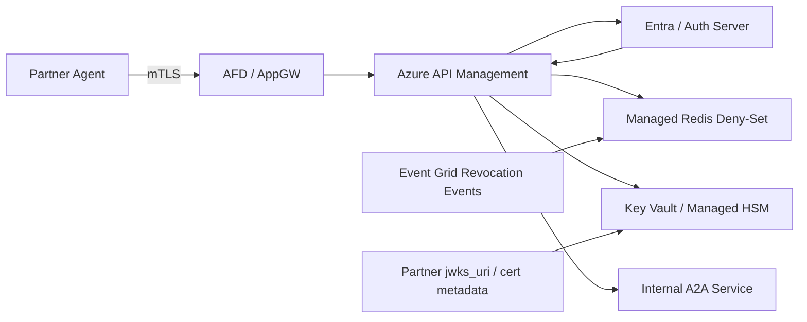
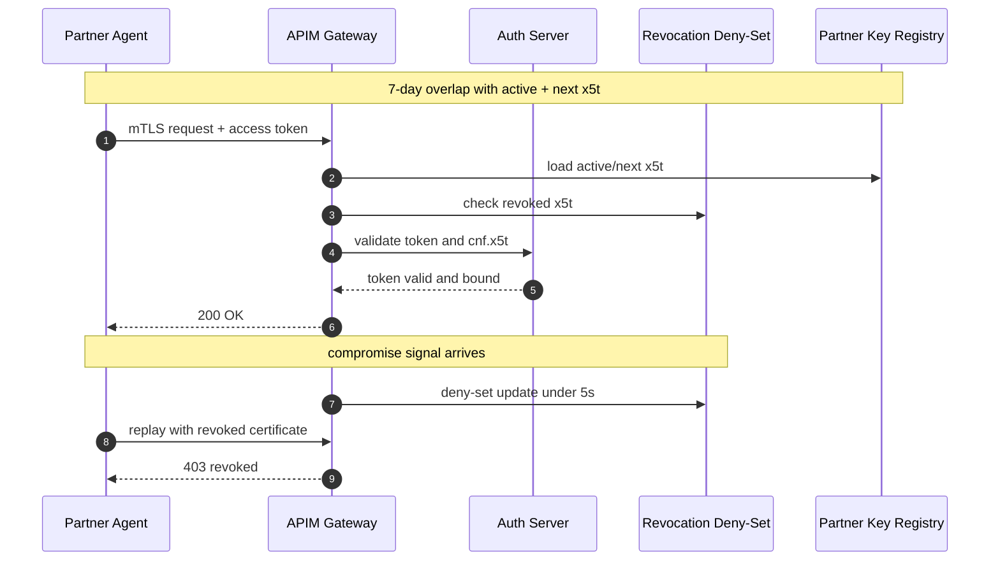

# Cross-Org A2A mTLS Rotation and Revocation Selection FAQ

## 1. Executive summary

Cross-organization Agent-to-Agent gateways are entering
a high-frequency certificate rotation era.
When leaf lifetimes move from `398d`
to `90d` and even `47d`,
static thumbprint pinning collapses quickly.

In regulated environments,
the target is not only connectivity.
The platform must deliver
continuous availability,
auditable controls,
fast emergency revocation,
and sender-constrained token binding.

This guide centers on
`APIM + Key Vault/Managed HSM`
and compares four patterns.
Pattern A is the primary recommendation.
It combines dual-slot partner keys,
`RFC 8705` certificate-bound tokens,
and sub-`5s` hot-push revocation deny-sets.

Pattern B fits private interconnect partners
with mature identity ops.
Pattern C fits broad SaaS ecosystems
that lack strong client PKI operations.
Pattern D is explicitly prohibited.

## 2. Production problem statement

Failure one is hard-cutover outage.
If APIM allows one static thumbprint only,
early renewal or intermediate CA changes
can break `100%` of partner traffic.

Failure two is stolen bearer replay.
If mTLS is checked only at transport level
without verifying `cnf.x5t#S256`,
a leaked bearer token can be replayed
from outside the original certificate session.

Failure three is OCSP/CRL stall trade-off.
During responder incidents,
hard-fail creates broad downtime,
while soft-fail can admit compromised keys.
A `24h` CRL window is too wide
for active compromise response.

## 3. Pattern overview

### Pattern A (primary recommendation)

APIM enforces issuer-chain and SAN checks,
then verifies partner dual-slot keys:
`active_x5t` and `next_x5t`.
Token validation enforces
`RFC 8705 cnf.x5t#S256` PoP binding.
Emergency revocation is pushed through
`Event Grid + Managed Redis` deny-sets.

This pattern balances
zero-downtime rotation,
fast compromise response,
and regulator-grade evidence trails.

### Pattern B (private interconnect)

For ExpressRoute/Private Link ecosystems,
use `SPIFFE/SPIRE` trust-bundle exchange
with `1-4h` short-lived `X509-SVID`.
Rotation is frequent and automated,
with no hard dependency on public OCSP.

### Pattern C (partner PKI capability gap)

Use standard `TLS 1.3`,
plus `RFC 7523 private_key_jwt`
and `RFC 9449 DPoP`
for application-layer sender constraints.
This pattern improves onboarding reach,
but shifts complexity to client signing hygiene.

### Pattern D (anti-pattern, prohibit)

Single-leaf thumbprint pinning only,
or unbound bearer JWTs behind TLS termination.
Under compressed cert lifecycles
and adversarial replay pressure,
this pattern is unsustainable.

## 4. 12-dimension quantitative matrix

| Dimension | Pattern A | Pattern B | Pattern C | Pattern D |
|---|---|---|---|---|
| Rotation continuity | High | High | Medium | Low |
| Emergency revocation speed | High | Medium-high | Medium | Low |
| PoP anti-replay strength | High | Medium-high | Medium-high | Low |
| Partner onboarding friction | Medium | High | Low-medium | Low |
| OCSP dependency | Low | Low | Medium | High |
| Ops complexity | Medium-high | High | Medium | Low |
| APIM policy complexity | Medium | Medium | Medium | Low |
| Audit readiness | High | High | Medium | Low |
| Multi-partner scale | High | Medium | High | Low |
| Observability depth | High | Medium-high | Medium | Low |
| 3-year risk-adjusted TCO | Low | Medium | Medium | High |
| Recommendation level | Primary | Conditional | Conditional | Prohibited |

## 5. Architecture: mTLS + PoP + hot revocation





## 6. Q1–Q6 worked formulas

### Q1 Rotation amplification

With `47d` cert life
and `7d` overlap buffer:

`R_partner = 365 / (47 - 7) = 9.1 rotations/year`

For `250` partners:

`R_total = 250 * 9.1 = 2275 rotations/year`

Manual cutovers do not scale at this density.

### Q2 Safe overlap lower bound

`T_overlap >= 2 * (TTL_jwks + TTL_token + T_skew)`

Example:
`TTL_jwks=10m`,
`TTL_token=30m`,
`T_skew=2m`,
so `T_overlap >= 84m`.

Regulated programs often choose `7d`
to absorb timezone and change-window variance.

### Q3 Compromise exposure window

Target:
`Exposure = min(TTL_token, T_revoke_push)`

CRL-only mode with `24h` cadence
keeps exposure near day-level windows.
Event-driven hot-push can keep
`T_revoke_push < 5s`,
dropping exposure to seconds.

### Q4 x5t PoP check latency

`Cost_pop ~= SHA256(der) + compare_digest`

In typical x64 runtime,
the check can stay under `0.2 ms`.
It is negligible versus
network and token-validation latency.

### Q5 OCSP tail-latency amplification

`L_total_p95 = L_gateway + L_auth + L_ocsp_p95`

If `L_ocsp_p95` spikes
from `80ms` to `900ms`,
tail latency and timeout risk rise sharply.
Hence local deny-set fallback
is mandatory for resilience.

### Q6 3-year risk-adjusted TCO

`TCO_3y = C_ops + C_outage + C_incident + C_audit`

Pattern A may increase `C_ops`,
yet reduces outage and incident exposure.
For open banking and supply-chain gateways,
it usually wins on total risk-adjusted cost.

## 7. Design invariants

First,
PoP binding must be a gateway hard gate,
not optional backend logic.

Second,
dual-slot key state must be partner-scoped,
not global,
to avoid blast-radius coupling.

Third,
revocation deny-sets require
versioning,
TTL governance,
and regional replication.

Fourth,
certificate overlap windows
must align with token TTL
and partner change windows.

## 8. Failure boundaries and degradations

During OCSP responder incidents,
avoid blanket hard-fail behavior.
Use bounded, risk-aware soft-fail
only for non-revoked low-risk partners,
with explicit audit logs.

When `cnf` is missing or mismatched,
return `401/403` deterministically
and emit `x5t_pop_mismatch`.
Apply automatic isolation
for repeated replay signatures.

## 9. APIM inbound policy sample

```xml
<policies>
  <inbound>
    <base />
    <choose>
      <when condition='@(context.Request.Certificate == null)'>
        <return-response>
          <set-status code="401" reason="Client certificate required" />
        </return-response>
      </when>
    </choose>

    <validate-jwt header-name="Authorization"
                  failed-validation-httpcode="401"
                  failed-validation-error-message="invalid_token"
                  output-token-variable-name="jwtToken">
      <openid-config url="https://login.microsoftonline.com/{tenant}/v2.0/.well-known/openid-configuration" />
      <required-claims>
        <claim name="cnf" match="all" />
      </required-claims>
    </validate-jwt>

    <set-variable name="certX5t" value='@{
      var raw = context.Request.Certificate.RawData;
      byte[] digest;
      using (var sha = System.Security.Cryptography.SHA256.Create())
      {
        digest = sha.ComputeHash(raw);
      }
      var b64 = System.Convert.ToBase64String(digest);
      while (b64.EndsWith("="))
      {
        b64 = b64.Substring(0, b64.Length - 1);
      }
      return b64.Replace("+","-").Replace("/","_");
    }' />

    <cache-lookup-value key='@($"revoked:{context.Variables["certX5t"]}")'
                        variable-name="revokedMarker" />
    <choose>
      <when condition='@(!string.IsNullOrEmpty((string)context.Variables.GetValueOrDefault("revokedMarker", "")))'>
        <return-response>
          <set-status code="403" reason="certificate_revoked" />
        </return-response>
      </when>
    </choose>

    <set-variable name="cnfX5t" value='@{
      var jwt = (Jwt)context.Variables["jwtToken"];
      var cnf = jwt.Claims.GetValueOrDefault("cnf", "");
      var m = System.Text.RegularExpressions.Regex.Match(cnf, "\"x5t#S256\"\\s*:\\s*\"([^\"]+)\"");
      return m.Success ? m.Groups[1].Value : "";
    }' />

    <choose>
      <when condition='@(!string.Equals((string)context.Variables["certX5t"], (string)context.Variables["cnfX5t"], System.StringComparison.Ordinal))'>
        <return-response>
          <set-status code="403" reason="x5t_pop_mismatch" />
        </return-response>
      </when>
    </choose>
  </inbound>
  <backend><base /></backend>
  <outbound><base /></outbound>
  <on-error><base /></on-error>
</policies>
```

## 10. Python: `Rfc8705PartnerVerifier`

```python
from __future__ import annotations

import base64
import hashlib
import hmac
from dataclasses import dataclass
from datetime import datetime, timedelta, timezone
from typing import Dict, Optional, Set


def b64url_sha256(der_bytes: bytes) -> str:
    digest = hashlib.sha256(der_bytes).digest()
    return base64.urlsafe_b64encode(digest).rstrip(b"=").decode("ascii")


@dataclass
class PartnerSlot:
    active_x5t: str
    next_x5t: Optional[str]
    overlap_end_utc: datetime


class Rfc8705PartnerVerifier:
    def __init__(self, slots: Dict[str, PartnerSlot], deny_set: Set[str]) -> None:
        self.slots = slots
        self.deny_set = deny_set

    def _claim_x5t(self, token_claims: dict) -> str:
        cnf = token_claims.get("cnf", {})
        val = cnf.get("x5t#S256", "")
        if not isinstance(val, str) or not val:
            raise ValueError("missing cnf.x5t#S256")
        return val

    def _allowed_slot(self, partner_id: str, presented_x5t: str, now: datetime) -> bool:
        slot = self.slots[partner_id]
        if hmac.compare_digest(presented_x5t, slot.active_x5t):
            return True
        if slot.next_x5t and now <= slot.overlap_end_utc:
            return hmac.compare_digest(presented_x5t, slot.next_x5t)
        return False

    def verify(self, partner_id: str, der_bytes: bytes, token_claims: dict, now: datetime) -> bool:
        presented_x5t = b64url_sha256(der_bytes)
        if presented_x5t in self.deny_set:
            raise ValueError("certificate revoked")
        claim_x5t = self._claim_x5t(token_claims)
        if not hmac.compare_digest(presented_x5t, claim_x5t):
            raise ValueError("x5t PoP mismatch")
        if partner_id not in self.slots:
            raise ValueError("unknown partner")
        if not self._allowed_slot(partner_id, presented_x5t, now):
            raise ValueError("x5t not in active/next slot")
        return True


if __name__ == "__main__":
    now = datetime.now(timezone.utc)
    cert = b"partner-der-cert"
    x5t = b64url_sha256(cert)
    slots = {
        "p1": PartnerSlot(
            active_x5t=x5t,
            next_x5t="next-placeholder",
            overlap_end_utc=now + timedelta(days=7),
        )
    }
    verifier = Rfc8705PartnerVerifier(slots=slots, deny_set=set())
    ok = verifier.verify(
        partner_id="p1",
        der_bytes=cert,
        token_claims={"cnf": {"x5t#S256": x5t}},
        now=now,
    )
    assert ok
```

## 11. KQL: expiry, mismatch, and slot-drain

```kql
let win = 5m;
let expiry = AppTraces
| where Message has "partner_cert_expiry"
| extend days_remaining = todouble(extract(@"days_remaining=(\d+(\.\d+)?)", 1, Message))
| where days_remaining < 14
| summarize partners_expiring = dcount(tostring(CustomDimensions.partner_id))
  by bin(TimeGenerated, win), partner=tostring(CustomDimensions.partner_id);
let mismatch = AppTraces
| where Message has "x5t_pop_mismatch"
| summarize pop_mismatch = count() by bin(TimeGenerated, win), partner=tostring(CustomDimensions.partner_id);
let drain = AppTraces
| where Message has "slot_drain"
| extend old_x5t = tostring(CustomDimensions.old_x5t)
| extend new_x5t = tostring(CustomDimensions.new_x5t)
| extend presented_x5t = tostring(CustomDimensions.presented_x5t)
| summarize old_hits = countif(presented_x5t == old_x5t),
            new_hits = countif(presented_x5t == new_x5t)
  by bin(TimeGenerated, win), partner=tostring(CustomDimensions.partner_id), old_x5t, new_x5t;
expiry
| join kind=fullouter mismatch on TimeGenerated, partner
| extend TimeGenerated = coalesce(TimeGenerated, TimeGenerated1),
         partner = coalesce(partner, partner1)
| project-away TimeGenerated1, partner1
| join kind=fullouter drain on TimeGenerated, partner
| extend TimeGenerated = coalesce(TimeGenerated, TimeGenerated1),
         partner = coalesce(partner, partner1)
| project TimeGenerated, partner, partners_expiring, pop_mismatch, old_hits, new_hits
| order by TimeGenerated desc
```

## 12. Operating metrics and SLOs

Track at least five classes:
`x5t_pop_mismatch`,
cert expiry countdown,
revocation push latency,
dual-slot traffic drain,
and partner-scoped failure rate.

Suggested SLOs:
revocation push `P95 < 5s`,
PoP false-reject rate `<0.01%`,
and rotation-window availability `>=99.95%`.

## 13. Decision tree: good fit vs not for

**Good fit (Pattern A)**

- regulated cross-org traffic;
- partner count above `50`;
- strict audit and emergency revocation goals.

**Good fit (Pattern B)**

- stable private interconnect;
- mature partner identity operations;
- tolerance for SPIRE control-plane complexity.

**Good fit (Pattern C)**

- broad heterogeneous partner ecosystem;
- weak client certificate operations;
- willingness to enforce app-layer signing.

**Not for**

- static single-thumbprint pinning;
- TLS-only without `cnf.x5t#S256`;
- no hot deny-set but claiming second-level blocking.

## 14. Five-step rollout

1. Inventory partner cert lifetimes and rotation cadence.
2. Stand up partner dual-slot registry and overlap policy.
3. Enforce PoP and deny-set checks in APIM inbound policies.
4. Wire Event Grid hot revocation push paths.
5. Build expiry, mismatch, drain, and quarantine dashboards.

## 15. Enterprise scenarios, TCO, and runbook

### 15.1 Scenario A: FAPI 2.0 / open banking

The gateway serves `180` regulated institutions
and fintech agents for treasury and payment-initiation.
Regulators require complete evidence chains
and near-immediate certificate compromise containment.

Pattern A replaced manual night cutovers
with partner-scoped automated dual-slot rollovers.
PoP binding blocked cross-tunnel token replay
and reduced emergency response windows to seconds.

### 15.2 Scenario B: global automotive Tier-1 supply chain

This gateway connects `320` external supplier agents
for quote, planning, delivery, and quality events.
Partner PKI maturity varies widely,
so layered onboarding controls are mandatory.

Core suppliers use Pattern A first.
Long-tail suppliers can start on Pattern C
and migrate under shared telemetry governance.

### 15.3 Three-tier 3-year TCO (USD)

| Tier | Scale assumption | Pattern A | Pattern B | Pattern C | Pattern D |
|---|---|---:|---:|---:|---:|
| Tier-1 | `60` partners / `400M` calls per year | `2.3M` | `2.7M` | `2.6M` | `3.8M*` |
| Tier-2 | `180` partners / `1.2B` calls per year | `6.8M` | `7.9M` | `7.4M` | `11.6M*` |
| Tier-3 | `320` partners / `2.8B` calls per year | `14.9M` | `17.2M` | `16.4M` | `25.5M*` |

`*` Pattern D appears simple at first,
but outage and incident costs dominate
under compressed cert lifecycles.

Model rotation-window business impact separately.
Also model revocation-latency compliance penalties
as explicit risk-cost inputs.

## 15.4 D0 / D1 / D2 runbook (18 items)

**D0 (same-day containment)**

1. Block new static single-thumbprint pinning.
2. Reject traffic with missing `cnf`.
3. Deploy emergency revocation deny-set.
4. Enable secondary checks for high-risk partners.
5. Alert on `x5t_pop_mismatch`.
6. Alert on `days_remaining < 14`.

**D1 (1-2 week hardening)**

7. Implement partner dual-slot registry schema.
8. Sync partner `jwks_uri` and cert metadata feeds.
9. Wire Event Grid revocation push automation.
10. Enforce PoP checks in APIM inbound path.
11. Build old/new slot drain dashboards.
12. Add partner-level failure-budget quarantine rules.

**D2 (1-2 month optimization)**

13. Automate rollover drills for top partners.
14. Run quarterly compromise and revocation exercises.
15. Define Pattern C to A migration playbooks.
16. Add cross-region deny-set replication controls.
17. Align SLA tiers with risk and onboarding model.
18. Automate audit evidence archival and sampling.

## 16. Extended field Q&A (Q7–Q12)

### Q7 Should partner key registries live in one subscription

Avoid one-subscription consolidation for all partner registries.
Segment by region or regulatory domain,
then aggregate through a management-plane index.

This reduces blast radius for misconfiguration and incident scope.
It also enables region-specific retention and legal controls.

### Q8 When should active and next slots be switched

Use stable traffic share as the primary switch trigger.
For example,
require `new_x5t` to sustain `>95%` traffic for `24h`
with no error-rate regression.

Before switching,
confirm deny-set does not contain the new certificate.
After switching,
preserve a rollback window
to absorb temporary partner-side reversions.

### Q9 How to reduce false rejects from clock skew

Use UTC as the canonical validation time base
and apply bounded timestamp skew tolerance.
Also track partner-level clock health
and alert on sustained drift.

In practice,
many production incidents are timing hygiene failures,
not cryptography failures.
Treat clock quality as a formal onboarding control.

### Q10 How to size revocation hot-push channels

Estimate capacity by:
peak event rate × replica factor × retention window.
Example:
`200 events/s × 3 replicas × 300s`
requires at least `180,000` records.

Reserve extra capacity for replay and version rollover.
For multi-region setups,
include cross-region propagation and retry amplification budgets.

### Q11 What is the minimum audit evidence set

At minimum include:
`partner_id`,
`cert_x5t`,
`token_jti`,
`decision`,
`policy_version`,
`denyset_version`,
and `trace_id`.

Standardized evidence fields
make cross-system incident stitching feasible.
Avoid relying on unstructured free-text logs
for critical forensic evidence.

### Q12 How to align security controls with business SLA

Build a triad map:
risk tier,
policy intensity,
and availability budget.
High-risk partners should use stricter PoP
and shorter token TTL with stronger redundancy.

Lower-risk long-tail partners may start with lighter onboarding,
but explicit upgrade triggers are mandatory.
When anomaly rates rise,
policy level should auto-escalate.

## 17. Regulatory mapping and acceptance checklist

To avoid the common gap
between deployed policy and auditable assurance,
ship a control-mapping workbook with each rollout.
The workbook should include
control objective,
technical implementation,
evidence location,
and drill cadence.

For open banking programs,
map FAPI controls into four buckets:
token-binding enforcement,
certificate lifecycle governance,
revocation propagation speed,
and abnormal-access containment.

Token-binding controls should map to
hard `cnf.x5t#S256` enforcement,
deterministic reject codes,
and normalized trace fields.
Evidence must link to
policy version,
request trace id,
and partner identity.

Lifecycle controls should map to
dual-slot registries,
overlap window policies,
switch criteria,
and rollback flows.
Acceptance tests should include
normal rotation,
early renewal,
and intermediate CA transition drills.

Revocation propagation controls should map to
Event Grid triggers,
Redis deny-set updates,
cross-region replication latency,
and cache invalidation policy.
Track `P50/P95/P99`,
not only averages,
to avoid tail-risk blind spots.

Abnormal-access containment should map to
`x5t_pop_mismatch` detection,
automatic quarantine rules,
manual adjudication workflow,
and re-admission criteria.
Without re-admission standards,
temporary blocks can silently become long outages.

Run acceptance in three layers:
static policy conformance,
dynamic integration verification,
and failure-mode exercise validation.
All three layers are needed
to claim production readiness credibly.

Maintain results in a structured ledger.
Required fields should include
check id,
owner,
execution time,
result status,
issue notes,
remediation due date,
and re-validation outcome.

For multi-jurisdiction operations,
add a region-difference column.
Some regions require shorter data-minimization windows,
while others require longer audit-retention windows.
Make those differences explicit,
not implicit assumptions.

For final handoff,
publish both an executive brief
and an engineering execution dossier.
The dual-track package reduces audit friction
and shortens cross-team decision loops.

## 18. Sources (retrieved on 2026-11-27)

Azure API Management mutual certificate authentication  
https://learn.microsoft.com/azure/api-management/api-management-howto-mutual-certificates-for-clients

Azure API Management policy expressions  
https://learn.microsoft.com/azure/api-management/api-management-policy-expressions

Azure Key Vault certificates overview  
https://learn.microsoft.com/azure/key-vault/certificates/about-certificates

RFC 8705 OAuth 2.0 Mutual-TLS Client Authentication and Certificate-Bound Access Tokens  
https://www.rfc-editor.org/rfc/rfc8705

RFC 7523 JWT Profile for OAuth 2.0 Client Authentication and Authorization Grants  
https://www.rfc-editor.org/rfc/rfc7523

RFC 9449 OAuth 2.0 Demonstrating Proof-of-Possession (DPoP)  
https://www.rfc-editor.org/rfc/rfc9449

SPIFFE/SPIRE documentation  
https://spiffe.io/docs/latest/

OpenID Financial-grade API 2.0 Security Profile  
https://openid.net/specs/fapi-security-profile-2_0.html
