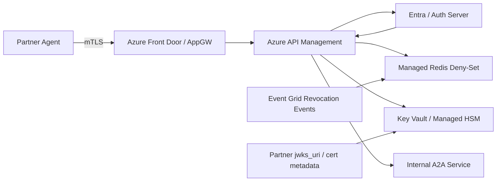
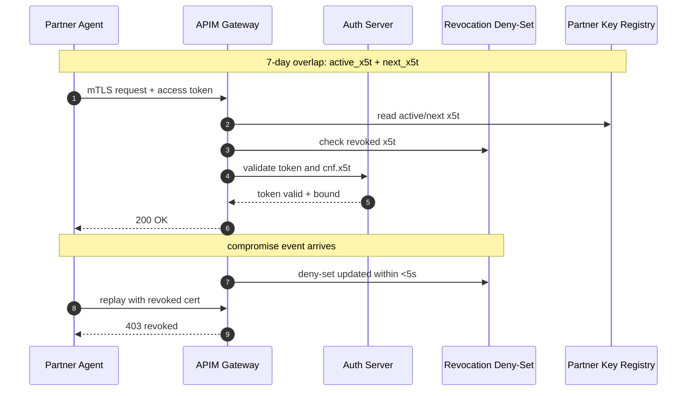

# 跨组织 A2A mTLS 证书轮换与撤销选型 FAQ

## 1. 执行摘要

跨组织 Agent-to-Agent 网关正在进入证书高频轮换时代。
当叶子证书生命周期从 `398` 天压缩到 `90` 天甚至 `47` 天后，
原先“静态 thumbprint 固化”的做法会快速失效。

对受监管行业而言，
问题不再只是“连得上”。
还必须同时满足连续可用、
可审计、
可紧急撤销、
以及令牌持有者绑定（PoP）防重放。

本指南聚焦 `APIM + Key Vault/Managed HSM` 主线，
对比四种模式。
Pattern A 是主推荐，
实现双槽轮换、
`RFC 8705` 证书绑定令牌、
以及亚 `5s` 热推送撤销拒绝集。

Pattern B 面向私有互联高频伙伴，
采用 `SPIFFE/SPIRE` 短证书信任包交换。
Pattern C 面向无客户端 PKI 运维能力的广域 B2B 伙伴，
采用 `private_key_jwt + DPoP`。
Pattern D 标记为禁止反模式。

## 2. 生产问题定义

问题一是硬切换轮换导致的全量中断。
如果 APIM 仅允许单指纹，
伙伴提前换证或中间 CA 更新时，
会出现 `100%` 调用失败。

问题二是 Bearer 令牌可跨隧道重放。
仅做传输层 mTLS 校验，
但不校验 `cnf.x5t#S256` 时，
被窃取令牌可在外部通道复用。

问题三是 `OCSP/CRL` 在故障与攻防中的两难。
OCSP 断连时 hard-fail 会放大全站可用性风险，
soft-fail 又可能放行已失陷证书。
仅依赖 `24h` CRL 周期，
暴露窗口不可接受。

## 3. 四种模式概览

### Pattern A（主推荐）

`APIM` 做颁发者链与 SAN 校验，
同时维护伙伴双槽键位：
`active_x5t` 与 `next_x5t`。
令牌层强制 `RFC 8705 cnf.x5t#S256` 绑定，
同时接入 `Event Grid + Managed Redis` 热推送撤销拒绝集。

该模式兼顾连续轮换与紧急撤销。
对开放银行、
跨组织供应链、
以及 B2B MCP 工具协作最稳健。

### Pattern B（私有互联）

在 ExpressRoute/Private Link 私网域，
采用 `SPIFFE/SPIRE` 信任包交换与短周期 `X509-SVID`。
轮换周期可压缩到 `1-4h`，
且不依赖公共 OCSP 可达性。

### Pattern C（伙伴 PKI 能力弱）

采用标准 `TLS 1.3`，
在应用层使用 `RFC 7523 private_key_jwt`
与 `RFC 9449 DPoP` 限制令牌可转移性。
该模式便于大规模伙伴接入，
但对客户端签名实现一致性要求更高。

### Pattern D（反模式，禁止）

仅用单叶子指纹钉扎，
或在 TLS 终止后继续使用未绑定 Bearer JWT。
这类做法在轮换密度上升和攻防压力场景下，
风险不可接受。

## 4. 12 维量化矩阵

| 维度 | Pattern A | Pattern B | Pattern C | Pattern D |
|---|---|---|---|---|
| 轮换连续性 | 高 | 高 | 中 | 低 |
| 紧急撤销速度 | 高 | 中高 | 中 | 低 |
| PoP 防重放 | 高 | 中高 | 中高 | 低 |
| 伙伴接入门槛 | 中 | 高 | 低中 | 低 |
| OCSP 依赖 | 低 | 低 | 中 | 高 |
| 运维复杂度 | 中高 | 高 | 中 | 低 |
| APIM 策略复杂度 | 中 | 中 | 中 | 低 |
| 监管可审计性 | 高 | 高 | 中 | 低 |
| 多伙伴规模弹性 | 高 | 中 | 高 | 低 |
| 可观测性落地 | 高 | 中高 | 中 | 低 |
| 三年风险调整 TCO | 低 | 中 | 中 | 高 |
| 推荐级别 | 主推荐 | 条件推荐 | 条件推荐 | 禁止 |

## 5. 架构图：跨组织 A2A mTLS + PoP + 热撤销





## 6. Q1–Q6 量化推导

### Q1 轮换频次放大

当生命周期压缩到 `47` 天，
同时预留 `7` 天重叠窗口时：

`R_partner = 365 / (47 - 7) = 9.1 次/年`

若 `250` 个伙伴：

`R_total = 250 * 9.1 = 2275 次/年`

结论是手工硬切换不可持续，
必须自动化双槽轮换。

### Q2 安全重叠窗口下界

`T_overlap >= 2 * (TTL_jwks + TTL_token + T_skew)`

示例：
`TTL_jwks=10m`、
`TTL_token=30m`、
`T_skew=2m`，
则 `T_overlap >= 84m`。

监管场景常取 `7d`，
可覆盖跨时区与运营窗口不一致。

### Q3 失陷暴露窗口

目标：
`Exposure = min(TTL_token, T_revoke_push)`

若仅靠 CRL `24h`：
`Exposure <= 24h`。

若事件驱动热推送：
`T_revoke_push < 5s`，
则暴露窗口可降到秒级。

### Q4 x5t 绑定校验开销

`Cost_pop ~= SHA256(der) + compare_digest`

在常见 x64 环境，
单次开销可控制在 `<0.2 ms`。
相对于上游网络与 OAuth 校验开销，
该成本可忽略。

### Q5 OCSP 尾延迟放大

`L_total_p95 = L_gateway + L_auth + L_ocsp_p95`

当 `L_ocsp_p95` 偶发从 `80ms` 飙到 `900ms`，
高并发链路会显著抬高尾延迟。
因此生产链路必须有
本地撤销拒绝集与降级策略。

### Q6 三年风险调整成本

`TCO_3y = C_ops + C_outage + C_incident + C_audit`

Pattern A 在 `C_ops` 上略高，
但 `C_outage` 与 `C_incident` 显著更低。
对金融与供应链场景，
综合后通常最低。

## 7. 关键设计细节

第一，
PoP 绑定必须在网关层强制执行，
不可下放到后端可选逻辑。

第二，
双槽注册表应是“伙伴维度”而非“全局维度”，
避免单伙伴异常影响全体。

第三，
撤销拒绝集要支持亚秒到秒级推送，
同时支持 TTL 与版本号。

第四，
证书轮换策略要与令牌 TTL 协同，
同时对旧证书流量设置可观测 drain 曲线。

## 8. 失败边界与降级策略

OCSP 供应商故障时，
不要直接全局 hard-fail。
可启用短时受控 soft-fail，
但仅对未命中 deny-set 且风险评分低的伙伴放行。

当 `cnf` 缺失或不匹配，
必须返回 `401/403`，
同时记录 `x5t_pop_mismatch` 指标。
对连续异常源可触发自动封禁。

## 9. APIM inbound 策略示例（PoP + 撤销）

```xml
<policies>
  <inbound>
    <base />
    <choose>
      <when condition='@(context.Request.Certificate == null)'>
        <return-response>
          <set-status code="401" reason="Client certificate required" />
        </return-response>
      </when>
    </choose>

    <validate-jwt header-name="Authorization"
                  failed-validation-httpcode="401"
                  failed-validation-error-message="invalid_token"
                  output-token-variable-name="jwtToken">
      <openid-config url="https://login.microsoftonline.com/{tenant}/v2.0/.well-known/openid-configuration" />
      <required-claims>
        <claim name="cnf" match="all" />
      </required-claims>
    </validate-jwt>

    <set-variable name="certX5t" value='@{
      var raw = context.Request.Certificate.RawData;
      byte[] digest;
      using (var sha = System.Security.Cryptography.SHA256.Create())
      {
        digest = sha.ComputeHash(raw);
      }
      var b64 = System.Convert.ToBase64String(digest);
      while (b64.EndsWith("="))
      {
        b64 = b64.Substring(0, b64.Length - 1);
      }
      return b64.Replace("+","-").Replace("/","_");
    }' />

    <cache-lookup-value key='@($"revoked:{context.Variables["certX5t"]}")'
                        variable-name="revokedMarker" />
    <choose>
      <when condition='@(!string.IsNullOrEmpty((string)context.Variables.GetValueOrDefault("revokedMarker", "")))'>
        <return-response>
          <set-status code="403" reason="certificate_revoked" />
        </return-response>
      </when>
    </choose>

    <set-variable name="cnfX5t" value='@{
      var jwt = (Jwt)context.Variables["jwtToken"];
      var cnf = jwt.Claims.GetValueOrDefault("cnf", "");
      var m = System.Text.RegularExpressions.Regex.Match(cnf, "\"x5t#S256\"\\s*:\\s*\"([^\"]+)\"");
      return m.Success ? m.Groups[1].Value : "";
    }' />

    <choose>
      <when condition='@(!string.Equals((string)context.Variables["certX5t"], (string)context.Variables["cnfX5t"], System.StringComparison.Ordinal))'>
        <return-response>
          <set-status code="403" reason="x5t_pop_mismatch" />
        </return-response>
      </when>
    </choose>
  </inbound>
  <backend><base /></backend>
  <outbound><base /></outbound>
  <on-error><base /></on-error>
</policies>
```

## 10. Python：`Rfc8705PartnerVerifier`

```python
from __future__ import annotations

import base64
import hashlib
import hmac
from dataclasses import dataclass
from datetime import datetime, timedelta, timezone
from typing import Dict, Optional, Set


def b64url_sha256(der_bytes: bytes) -> str:
    digest = hashlib.sha256(der_bytes).digest()
    return base64.urlsafe_b64encode(digest).rstrip(b"=").decode("ascii")


@dataclass
class PartnerSlot:
    active_x5t: str
    next_x5t: Optional[str]
    overlap_end_utc: datetime


class Rfc8705PartnerVerifier:
    def __init__(self, slots: Dict[str, PartnerSlot], deny_set: Set[str]) -> None:
        self.slots = slots
        self.deny_set = deny_set

    def _claim_x5t(self, token_claims: dict) -> str:
        cnf = token_claims.get("cnf", {})
        val = cnf.get("x5t#S256", "")
        if not isinstance(val, str) or not val:
            raise ValueError("missing cnf.x5t#S256")
        return val

    def _allowed_slot(self, partner_id: str, presented_x5t: str, now: datetime) -> bool:
        slot = self.slots[partner_id]
        if hmac.compare_digest(presented_x5t, slot.active_x5t):
            return True
        if slot.next_x5t and now <= slot.overlap_end_utc:
            return hmac.compare_digest(presented_x5t, slot.next_x5t)
        return False

    def verify(self, partner_id: str, der_bytes: bytes, token_claims: dict, now: datetime) -> bool:
        presented_x5t = b64url_sha256(der_bytes)
        if presented_x5t in self.deny_set:
            raise ValueError("certificate revoked")
        claim_x5t = self._claim_x5t(token_claims)
        if not hmac.compare_digest(presented_x5t, claim_x5t):
            raise ValueError("x5t PoP mismatch")
        if partner_id not in self.slots:
            raise ValueError("unknown partner")
        if not self._allowed_slot(partner_id, presented_x5t, now):
            raise ValueError("x5t not in active/next slot")
        return True


if __name__ == "__main__":
    now = datetime.now(timezone.utc)
    cert = b"partner-der-cert"
    x5t = b64url_sha256(cert)
    slots = {
        "p1": PartnerSlot(
            active_x5t=x5t,
            next_x5t="next-placeholder",
            overlap_end_utc=now + timedelta(days=7),
        )
    }
    verifier = Rfc8705PartnerVerifier(slots=slots, deny_set=set())
    ok = verifier.verify(
        partner_id="p1",
        der_bytes=cert,
        token_claims={"cnf": {"x5t#S256": x5t}},
        now=now,
    )
    assert ok
```

## 11. KQL：到期、PoP 失配与双槽排水

```kql
let win = 5m;
let expiry = AppTraces
| where Message has "partner_cert_expiry"
| extend days_remaining = todouble(extract(@"days_remaining=(\d+(\.\d+)?)", 1, Message))
| where days_remaining < 14
| summarize partners_expiring = dcount(tostring(CustomDimensions.partner_id))
  by bin(TimeGenerated, win), partner=tostring(CustomDimensions.partner_id);
let mismatch = AppTraces
| where Message has "x5t_pop_mismatch"
| summarize pop_mismatch = count() by bin(TimeGenerated, win), partner=tostring(CustomDimensions.partner_id);
let drain = AppTraces
| where Message has "slot_drain"
| extend old_x5t = tostring(CustomDimensions.old_x5t)
| extend new_x5t = tostring(CustomDimensions.new_x5t)
| extend presented_x5t = tostring(CustomDimensions.presented_x5t)
| summarize old_hits = countif(presented_x5t == old_x5t),
            new_hits = countif(presented_x5t == new_x5t)
  by bin(TimeGenerated, win), partner=tostring(CustomDimensions.partner_id), old_x5t, new_x5t;
expiry
| join kind=fullouter mismatch on TimeGenerated, partner
| extend TimeGenerated = coalesce(TimeGenerated, TimeGenerated1),
         partner = coalesce(partner, partner1)
| project-away TimeGenerated1, partner1
| join kind=fullouter drain on TimeGenerated, partner
| extend TimeGenerated = coalesce(TimeGenerated, TimeGenerated1),
         partner = coalesce(partner, partner1)
| project TimeGenerated, partner, partners_expiring, pop_mismatch, old_hits, new_hits
| order by TimeGenerated desc
```

## 12. 运营指标与 SLO

建议至少维护五类指标：
`x5t_pop_mismatch`、
证书到期倒计时、
撤销热推送时延、
双槽排水比例、
伙伴级失败率。

SLO 建议：
撤销推送 `P95 < 5s`，
PoP 校验误拒绝率 `< 0.01%`，
轮换窗口内可用性 `>= 99.95%`。

## 13. 决策树：Good fit vs Not for

**Good fit（Pattern A）**

- 金融与高合规跨组织调用；
- 伙伴数量大于 `50`；
- 需要强审计与紧急撤销能力。

**Good fit（Pattern B）**

- 私有互联稳定；
- 伙伴 PKI 能力成熟；
- 能承受 SPIRE 运维复杂度。

**Good fit（Pattern C）**

- 伙伴分布广且异构；
- 客户端证书治理能力薄弱；
- 可接受应用层签名接入成本。

**Not for**

- 单 thumbprint 静态钉扎；
- 仅 TLS 不做 `cnf.x5t#S256`；
- 无热撤销拒绝集仍宣称秒级阻断。

## 14. 实施步骤（五步）

1. 盘点伙伴证书生命周期与轮换频次。
2. 落地双槽注册表与重叠窗口治理。
3. 在 APIM 强制 PoP 校验与 deny-set 查询。
4. 接入 Event Grid 热推送撤销通道。
5. 建立到期、失配、排水与异常封禁看板。

## 15. 企业案例、TCO 与 D0/D1/D2

### 15.1 场景 A：FAPI 2.0 / Open Banking

该场景服务 `180` 家机构与金融科技伙伴，
处理司库与支付发起 A2A 调用。
监管要求证据链完整，
且要求失陷证书秒级阻断。

采用 Pattern A 后，
轮换从“夜间人工变更”
转为“按伙伴自动双槽推进”。
PoP 绑定阻断了跨隧道重放，
同时将突发事件处理窗口压缩到秒级。

### 15.2 场景 B：全球汽车 Tier-1 供应链

该网关连接 `320` 外部供应商代理，
覆盖报价、排产、交付与质量通报。
伙伴 PKI 成熟度差异极大，
必须支持分层接入策略。

核心供应商走 Pattern A，
部分长尾供应商先走 Pattern C。
统一观测后再逐步迁移，
可在风险与落地速度之间取平衡。

### 15.3 三档三年 TCO（USD）

| 档位 | 规模假设 | Pattern A | Pattern B | Pattern C | Pattern D |
|---|---|---:|---:|---:|---:|
| Tier-1 | `60` 伙伴 / `400M` 调用/年 | `2.3M` | `2.7M` | `2.6M` | `3.8M*` |
| Tier-2 | `180` 伙伴 / `1.2B` 调用/年 | `6.8M` | `7.9M` | `7.4M` | `11.6M*` |
| Tier-3 | `320` 伙伴 / `2.8B` 调用/年 | `14.9M` | `17.2M` | `16.4M` | `25.5M*` |

`*` Pattern D 在高频轮换与应急事件中，
中断成本与审计成本会急剧放大。

建议把“轮换失败导致的业务窗口损失”单独入账。
同时把“撤销响应时延超标导致的合规罚责风险”纳入风险成本。

## 15.4 D0 / D1 / D2（18 项）

**D0（当日止血）**

1. 禁止新增单指纹静态钉扎。
2. 对缺失 `cnf` 的流量强制拒绝。
3. 建立临时撤销 deny-set。
4. 对高风险伙伴启用强制二次验证。
5. 打开 `x5t_pop_mismatch` 告警。
6. 启用到期 `14` 天倒计时告警。

**D1（1-2 周固化）**

7. 建立伙伴双槽注册表数据模型。
8. 接入 `jwks_uri` / 证书元数据同步。
9. 打通 Event Grid 撤销热推送。
10. 在 APIM 落地 PoP 强校验策略。
11. 建立旧证书排水看板与阈值。
12. 建立伙伴级失败预算与自动封禁规则。

**D2（1-2 月优化）**

13. 对核心伙伴推进自动化轮换演练。
14. 形成季度攻防与撤销演练机制。
15. 对长尾伙伴制定 Pattern C 迁移路线。
16. 建立跨区域 deny-set 冗余复制。
17. 引入风险分层定价与接入 SLA 分级。
18. 完成审计证据自动归档与抽检闭环。

## 16. 实战补充问答（Q7-Q12）

### Q7 伙伴密钥注册表是否要放在同一订阅

不建议把全部伙伴注册表放在单订阅单资源组。
推荐按监管域或地区拆分命名空间，
同时在管理平面做跨域聚合索引。

这样可以把运维事故与权限误配的爆炸半径显著缩小。
同时便于按地区合规要求执行差异化保留策略。

### Q8 什么时候触发 active 与 next 的角色切换

建议以“新证书稳定流量占比”作为切换主条件。
例如在连续 `24h` 内，
`new_x5t` 流量占比高于 `95%` 且失败率无异常。

切换前要二次确认 deny-set 未命中新证书。
切换后仍应保留回滚窗口，
防止伙伴侧临时回退造成双边不一致。

### Q9 如何降低伙伴时钟漂移导致的误拒绝

首先在 PoP 校验中统一采用 UTC 时间基准，
同时对签名时间戳设置可配置的偏移容忍。
其次建立伙伴级时间健康监测，
超过阈值时主动告警并触发沟通。

生产中常见问题不是算法错误，
而是伙伴网关 NTP 漂移被忽略。
把时钟质量纳入接入准入检查，
可显著降低首周误报率。

### Q10 热撤销通道如何做容量规划

可按“峰值事件速率 × 副本因子 × 保留窗口”估算。
示例为 `200 events/s × 3 replicas × 300s`，
则最小缓存容量需覆盖 `180,000` 条撤销记录。

同时预留版本滚动与回放冗余空间。
若采用多区域部署，
还需叠加跨区传播延迟预算与重试放大系数。

### Q11 伙伴审计证据最小集合包含哪些字段

最小集合建议包含 `partner_id`、
`cert_x5t`、
`token_jti`、
`decision`、
`policy_version`、
`denyset_version` 和 `trace_id`。

字段越标准化，
越容易在事件响应中完成跨系统拼接。
避免把关键证据散落在非结构化日志文本中。

### Q12 如何把安全策略与业务 SLA 对齐

建议建立“风险等级—策略强度—可用性预算”三元映射。
高风险伙伴走更严格 PoP 与更短 token TTL，
同时分配更高可用性冗余。

低风险长尾伙伴可先采用较低接入门槛，
但必须定义升级触发器，
在异常增长时自动提升策略级别。

## 17. 监管映射与验收核对清单

为避免“策略已上线但审计不可验”的常见问题，
建议在交付阶段同步产出监管映射表。
映射表至少要覆盖控制目标、
技术实现、
证据位置、
以及演练频率。

针对开放银行场景，
可把 `FAPI 2.0` 控制项映射到四类能力：
令牌绑定控制、
证书生命周期治理、
撤销传播时效、
异常访问阻断闭环。

令牌绑定控制应对应
`cnf.x5t#S256` 强校验策略、
失配拒绝码、
以及追踪字段标准。
证据需要可追溯到
策略版本、
请求追踪号、
与伙伴标识。

证书生命周期治理应对应
双槽注册表、
重叠窗口配置、
自动切换门槛、
和回滚流程。
验收时应至少覆盖
正常切换、
提前换证、
以及中间证书更新三类演练。

撤销传播时效应对应
Event Grid 推送、
Redis 拒绝集更新、
多区域复制延迟、
和缓存失效策略。
建议把 `P50/P95/P99` 都纳入报告，
避免只看平均值掩盖尾部风险。

异常访问阻断闭环应对应
`x5t_pop_mismatch` 告警、
自动封禁策略、
人工复核流程、
与恢复准入条件。
如果没有恢复准入标准，
封禁策略容易演变为长期业务中断。

验收核对建议分三层执行。
第一层是策略静态检查，
确认网关策略与代码仓模板一致。
第二层是联调动态检查，
确认在真实证书与真实令牌下行为正确。
第三层是故障演练检查，
确认 OCSP 异常与撤销事件下仍满足业务连续性目标。

建议把核对结果写入统一台账。
台账字段至少包括
检查项编号、
执行人、
执行时间、
结果状态、
问题描述、
整改期限、
复验结论。

如果组织需要跨法域运营，
还应增加“地区差异化策略”核对列。
例如某些地区要求更短日志保留最小化窗口，
另一些地区要求更长审计追溯窗口。
策略差异要显式建模，
避免单一模板误用到所有区域。

最终交付时，
建议同步输出“管理层摘要版”与“工程执行版”。
摘要版用于说明风险收敛与业务影响，
执行版用于明确每个控制项的技术动作和证据路径。
双版本并行可显著减少审计沟通摩擦。
该机制还能降低跨团队交接时的信息损耗。

## 18. Sources（抓取日期：2026-11-27）

Azure API Management mutual certificate authentication  
https://learn.microsoft.com/azure/api-management/api-management-howto-mutual-certificates-for-clients

Azure API Management policy expressions  
https://learn.microsoft.com/azure/api-management/api-management-policy-expressions

Azure Key Vault certificates overview  
https://learn.microsoft.com/azure/key-vault/certificates/about-certificates

RFC 8705 OAuth 2.0 Mutual-TLS Client Authentication and Certificate-Bound Access Tokens  
https://www.rfc-editor.org/rfc/rfc8705

RFC 7523 JWT Profile for OAuth 2.0 Client Authentication and Authorization Grants  
https://www.rfc-editor.org/rfc/rfc7523

RFC 9449 OAuth 2.0 Demonstrating Proof-of-Possession (DPoP)  
https://www.rfc-editor.org/rfc/rfc9449

SPIFFE/SPIRE documentation  
https://spiffe.io/docs/latest/

OpenID Financial-grade API 2.0 Security Profile  
https://openid.net/specs/fapi-security-profile-2_0.html
