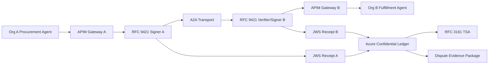
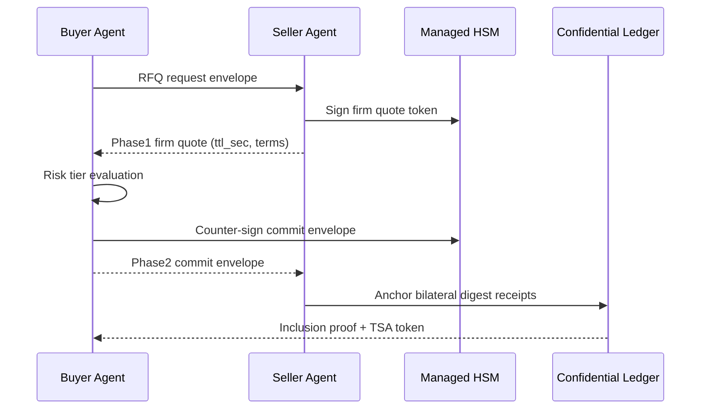
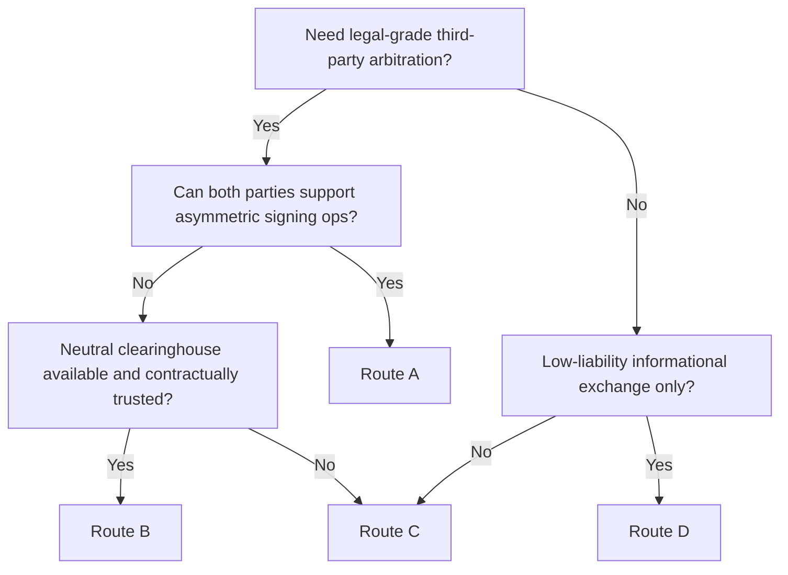

# Cross-Organization A2A Non-Repudiation and Bilateral Liability Receipt Selection FAQ: RFC 9421 Signatures + Confidential Ledger Anchors vs Neutral Notary Clearinghouse vs Two-Phase Quote Locks vs mTLS-Only Baseline

> **Audience**: Cloud and AI Solution Architects, B2B transaction platform teams, legal and compliance owners, gateway engineers, and incident arbitration operators.
> **Decision problem**: how to make cross-organization A2A transactions third-party verifiable in legal disputes where Org A and Org B disagree about price, currency, incoterms, execution scope, or partial settlement state.

---

## 1) Executive summary: transport security is not legal non-repudiation

`TLS 1.3` and `mTLS` provide confidentiality and channel authentication for a session.
They do **not** by themselves provide independent legal proof of who signed which business payload under what canonical representation and timestamp.

Recommended route posture:

- **Route A** for high-liability bilateral transactions requiring strongest arbitration readiness.
- **Route B** for consortium ecosystems that need neutral notary or clearinghouse operation.
- **Route C** for quote-to-commit workflows that require explicit cryptographic phase transitions.
- **Route D** only for low-liability informational calls and intra-group baseline traffic.

Target control thresholds:

- bilateral receipt closure ratio `>= 99.99%`,
- signature verification false-accept rate `< 0.01%`,
- dispute package assembly time `P95 < 15 minutes`,
- mandatory step-up signing for risk tiers above notional thresholds.

---

## 2) Why mTLS plus unilateral logs fail third-party arbitration

Common assumptions fail under legal scrutiny:

1. **mTLS proves secure transport, not payload intent**
   Session keys are symmetric and ephemeral; they do not produce per-message non-repudiable business signatures.

2. **Unilateral gateway logs are not neutral evidence**
   Counterparties can dispute ordering, truncation, replay, or missing semantic context.

3. **Clock drift and serialization ambiguity undermine claims**
   Without canonical payload representation and trusted timestamping, equivalent messages may hash differently.

4. **Partial execution is legally hazardous**
   One side may execute while the other side claims missing or invalid commit proof.

---

## 3) Route definitions (A/B/C/D)

### Route A — Bilateral RFC 9421 HTTP Message Signatures + RFC 8785 JCS JWS receipts anchored in Azure Confidential Ledger

Core design:

- Canonicalize message payloads using RFC 8785 JSON Canonicalization Scheme.
- Sign request and response semantic envelopes using RFC 9421 inputs.
- Exchange counter-signed JWS receipts containing digest, identifiers, and legal attributes.
- Anchor receipt digests into Azure Confidential Ledger with CCF evidence and RFC 3161 timestamp tokens.

Strengths:

- strongest independent verifiability,
- robust legal defensibility,
- deterministic chain-of-custody reconstruction.

Trade-offs:

- highest implementation and governance complexity,
- strict key lifecycle and signing policy requirements.

### Route B — Neutral clearinghouse or federated notary gateway

Core design:

- APIM-based escrow proxy records sequenced digests of request/response envelopes.
- WORM immutable storage retains neutral audit feed.
- Consortium members can retrieve common arbitration bundles from neutral operator.

Strengths:

- lower bilateral engineering burden,
- strong multi-party ecosystem fit.

Trade-offs:

- requires trust in neutral operator governance,
- legal contracts must codify evidence obligations and service boundaries.

### Route C — Two-phase quote-lock and value-tiered commit with HSM or human quorum

Core design:

- Phase 1: supplier issues cryptographically signed firm quote token with `ttl_sec`.
- Phase 2: buyer issues counter-signed commit envelope.
- Risk tiers route high-notional commits to HSM quorum or human co-sign path.

Strengths:

- explicit intent transitions for financially meaningful actions,
- strong control over quote validity windows and commitment semantics.

Trade-offs:

- additional state machine complexity,
- longer end-to-end negotiation path.

### Route D — Transport-only mTLS and unilateral gateway logs

Characteristics:

- useful for low-risk discovery traffic,
- weak for external legal disputes,
- vulnerable to ordering and evidence interpretation conflicts.

Use only as a bounded baseline, not as arbitration-grade architecture.

---

## 4) Quantitative principles and legal-grade invariants

### 4.1 Fair-exchange crash window

If execution completes before bilateral receipt anchoring:

`W_fair = T_execution_commit - T_receipt_anchor`

Goal: reduce `W_fair` with outbox durability and bounded replay.

### 4.2 End-to-end signature chain confidence

For verification success probabilities `p_i` across `n` critical steps:

`P_chain = ∏(p_i), i=1..n`

Route policy should enforce minimum `P_chain` by design and monitoring.

### 4.3 Ledger throughput sizing

Given transactions per second `TPS`, anchor entries per transaction `k`, average bytes per entry `s`:

`Throughput_bytes = TPS * k * s`

Use this to size ledger write capacity and retention planning.

### 4.4 HSM latency budget

`L_total = L_hash + L_hsm_sign + L_network + L_verify`

Tail latency budgets should target deterministic p99 under peak signing QPS.

### 4.5 Key compromise and historical validity

Historical signature validity depends on signing time relative to revocation effectiveness:

`Valid_hist = sign_time < revocation_effective_time`

RFC 3161 timestamps preserve proof of signing chronology.

### 4.6 Streaming hash-chain finalization for SSE A2A events

For event stream `e1..en`:

`H_n = Hash(H_{n-1} || e_n)`

Final event carries `H_n` and close marker; missing or modified events break chain verification.

---

## 5) Mermaid diagram: arbitration-grade cross-org A2A architecture



---

## 6) Mermaid diagram: two-phase quote-lock and commit



---

## 7) Mermaid diagram: route selection decision tree



---

## 8) Twelve-dimension comparison matrix

| Dimension | Route A Bilateral Signatures + ACL | Route B Neutral Clearinghouse | Route C Two-Phase Quote Lock | Route D mTLS + Unilateral Logs |
|---|---|---|---|---|
| Third-party verifiability | Very high | High | Medium-high | Low |
| Legal dispute strength | Very high | High | Medium-high | Low |
| Implementation complexity | High | Medium | Medium-high | Low |
| Runtime latency impact | Medium | Medium | Medium-high | Low |
| Key governance burden | High | Medium | High | Low |
| Evidence reproducibility | High | High | Medium-high | Low |
| Partial execution handling | High | Medium-high | High | Low |
| Ecosystem scalability | Medium-high | High | Medium | High but weak assurance |
| High-notional risk control | High | Medium | High | Low |
| Operational cost | Medium-high | Medium | Medium-high | Low direct, high legal exposure |
| Contract alignment effort | Medium-high | High | Medium-high | Low |
| Recommended use | Primary regulated route | Consortium route | High-value staged commit route | Baseline-only |

---

## 9) Quantitative deep-dive Q1..Q6

### Q1 — How do HSM signing QPS and p99 latency affect throughput?

If transaction rate is `TPS` and signatures per transaction are `m`:

`QPS_sign = TPS * m`

Capacity policy:

`Utilization = QPS_sign / QPS_cap <= 0.7`

Keeping utilization below 70% protects p99 during burst periods.

### Q2 — What JCS canonicalization pitfalls most often break signature verification?

Critical failure classes:

- JSON key order inconsistencies,
- floating number textual representation mismatch (`1` vs `1.0`),
- Unicode normalization differences.

Mitigation:

- canonicalize once before digest and signature,
- sign canonical payload digest plus selected deterministic headers.

### Q3 — How do you recover from fair-exchange crash windows when execution succeeds but receipt path drops?

Recovery pattern:

1. persist execution intent in durable outbox,
2. retry receipt generation and anchoring with idempotent transaction id,
3. flag pending state for bounded-time arbitration escalation.

Recovery time:

`T_recover = T_detect + T_replay + T_anchor`

### Q4 — How do you size Confidential Ledger anchor throughput and storage?

Example:

- `TPS = 250`,
- `k = 2` anchors per transaction,
- `s = 1.5KB` per anchor record.

Then:

`Throughput ≈ 250 * 2 * 1.5KB = 750KB/s`

Daily footprint is approximately `64.8GB` before compression and retention controls.

### Q5 — How does key compromise affect historical validity?

Historical evidence remains stronger when signed payloads include trusted timestamp attestation proving signing occurred before revocation.

Validation rule:

- if `sign_time` is trusted and precedes revocation, historical signature can remain valid,
- if timestamp trust is absent, evidentiary confidence drops sharply.

### Q6 — How do you finalize SSE `tasks/sendSubscribe` streams for dispute-proof replay?

Maintain rolling hash:

`H_i = Hash(H_{i-1} || event_i)`

Emit final close frame with `H_final`, sequence bounds, and signature.
Arbitration replay verifies sequence continuity, integrity, and closure.

---

## 10) Production implementation block A: Python JCS + RFC 9421/JWS bilateral receipt verifier

```python
import json
import hashlib
from jwcrypto import jwk, jws

def canonical_jcs(data: dict) -> bytes:
    # Demo-grade simplification; production must implement full RFC 8785 compliance.
    return json.dumps(data, ensure_ascii=False, separators=(",", ":"), sort_keys=True).encode("utf-8")

def sha256_hex(payload: bytes) -> str:
    return hashlib.sha256(payload).hexdigest()

def verify_compact_jws(token_compact: str, public_jwk_json: str) -> dict:
    key = jwk.JWK.from_json(public_jwk_json)
    token = jws.JWS()
    token.deserialize(token_compact)
    token.verify(key)
    return json.loads(token.payload.decode("utf-8"))

def verify_bilateral_receipt(payload_obj: dict, jws_a: str, jws_b: str, pub_a: str, pub_b: str) -> bool:
    digest = sha256_hex(canonical_jcs(payload_obj))
    pa = verify_compact_jws(jws_a, pub_a)
    pb = verify_compact_jws(jws_b, pub_b)
    return pa.get("payload_sha256") == digest and pb.get("payload_sha256") == digest
```

---

## 11) Production implementation block B: APIM inbound policy sketch for signature gate and ledger anchor metadata

```xml
<policies>
  <inbound>
    <base />
    <set-variable name="sig_input" value="@(context.Request.Headers.GetValueOrDefault(\"Signature-Input\", \"\"))" />
    <set-variable name="signature" value="@(context.Request.Headers.GetValueOrDefault(\"Signature\", \"\"))" />
    <choose>
      <when condition="@(string.IsNullOrEmpty((string)context.Variables[\"sig_input\"]) || string.IsNullOrEmpty((string)context.Variables[\"signature\"]))">
        <return-response>
          <set-status code="401" reason="Missing RFC9421 Signature" />
        </return-response>
      </when>
    </choose>
    <!-- Production: call verifier service, compare JCS digest, enforce key-id trust policy -->
  </inbound>
  <backend>
    <base />
  </backend>
  <outbound>
    <base />
  </outbound>
</policies>
```

Ledger anchor metadata recommendations:

- `transaction_id`,
- `payload_digest`,
- `counterparty_id`,
- `signature_key_id`,
- `tsa_token_ref`,
- `ccf_merkle_proof_ref`.

---

## 12) Enterprise scenario A: automotive tier-1 just-in-time parts procurement arbitration

Business profile:

- high-frequency spot procurement under volatile pricing,
- strict delivery windows tied to production line continuity,
- expensive downtime and penalty exposure.

Recommended approach:

- Route A for binding quote-to-order actions,
- Route C for high-notional or exceptional commits requiring phase-locked controls,
- Route D only for exploratory, non-binding availability checks.

Outcome targets:

- arbitration packet assembly under 10 minutes,
- quote/term mismatch incidents reduced below 0.2%,
- 100% of high-risk commits with bilateral receipts and ledger anchors.

---

## 13) Enterprise scenario B: wholesale reinsurance or syndicated loan allocation settlement

Business profile:

- multiple institutions, layered obligations, strict allocation controls,
- regulator scrutiny and contractual precision requirements.

Recommended approach:

- Route B as consortium notary rail,
- Route A overlays for high-value bilateral obligations,
- Route C for staged commitments crossing value thresholds.

Outcome targets:

- dispute closure cycle time reduced by more than 40%,
- reconciliation discrepancies materially reduced,
- audit pass-through improved with independent verification chain.

---

## 14) Three-year TCO model (illustrative)

| Cost category (USD) | Route A | Route B | Route C | Route D |
|---|---:|---:|---:|---:|
| Key and signing infrastructure | 640,000 | 390,000 | 570,000 | 130,000 |
| Gateway and protocol engineering | 560,000 | 470,000 | 540,000 | 220,000 |
| Audit and arbitration operations | 320,000 | 350,000 | 310,000 | 710,000 |
| Incident and claim reserve | 130,000 | 190,000 | 150,000 | 1,080,000 |
| Total 3-year TCO | 1,650,000 | 1,400,000 | 1,570,000 | 2,140,000 |

Interpretation:

- Route D appears simple but concentrates legal and financial exposure.
- Route B is cost-effective for federated ecosystems with trusted neutral governance.
- Route A provides strongest legal assurance for high-liability transaction rails.

---

## 15) Day-0 / Day-1 / Day-2 implementation checklist

### Day-0: governance and contract prerequisites

- define canonical message envelope and legal fields,
- define bilateral receipt schema and acceptance rules,
- define key governance and timestamp trust chain,
- define arbitration package obligations in partner contracts.

### Day-1: engineering rollout

- implement RFC 9421 signing and verification services,
- implement RFC 8785 canonicalization gates before signing,
- integrate APIM policy checks and signature metadata propagation,
- anchor bilateral receipt digests into Confidential Ledger,
- deploy idempotent replay and outbox compensation flows.

### Day-2: operations and assurance

- monitor receipt closure ratio, signature failures, and anchor consistency,
- run monthly fair-exchange failure drills,
- rotate signing keys with historical verification regression tests,
- audit SSE hash-chain finalization integrity for streaming workflows.

---

## Good fit vs not for

### Good fit

- cross-organization B2B transactions with meaningful liability,
- regulated sectors needing third-party verifiable evidence,
- ecosystems where dispute arbitration readiness is a board-level requirement.

### Not for

- purely internal, low-liability informational exchanges,
- PoC programs without legal or contract accountability requirements,
- teams unable to sustain key lifecycle and evidence operations.

---

## Authoritative references

- RFC 9421 HTTP Message Signatures: https://www.rfc-editor.org/rfc/rfc9421
- RFC 8785 JSON Canonicalization Scheme: https://www.rfc-editor.org/rfc/rfc8785
- RFC 3161 Time-Stamp Protocol: https://www.rfc-editor.org/rfc/rfc3161
- Azure Confidential Ledger overview: https://learn.microsoft.com/azure/confidential-ledger/overview
- Azure API Management: https://learn.microsoft.com/azure/api-management/
- Azure Key Vault Managed HSM: https://learn.microsoft.com/azure/key-vault/managed-hsm/overview
- CCF and ledger architecture background: https://learn.microsoft.com/azure/confidential-ledger/architecture

