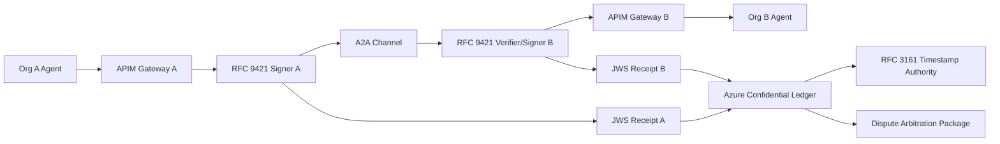
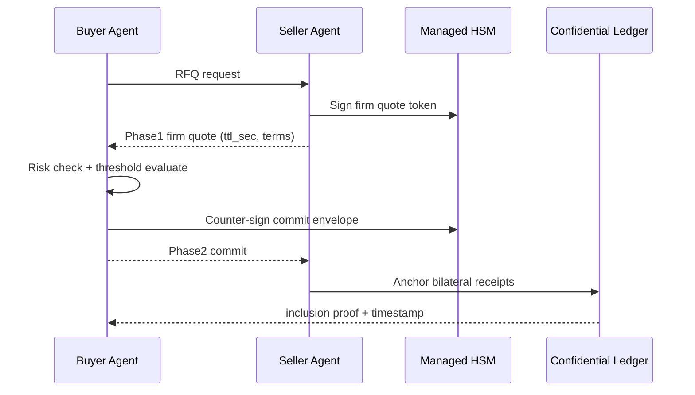
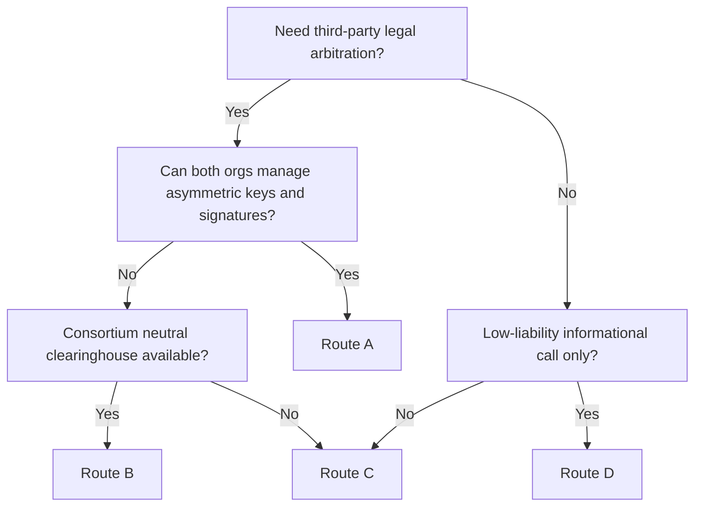

# 跨组织 A2A 不可抵赖与双边责任回执选型 FAQ：RFC 9421 消息签名 + 机密账本锚定 vs 中立清算网关 vs 两阶段锁价承诺 vs 仅 mTLS 传输日志基线

> **适用对象**：Cloud & AI Solution Architect、B2B 平台架构师、法务与合规、交易风控、网关与安全工程团队。
> **核心问题**：当 Org A 与 Org B 的智能体对报价、币种、贸易条款或部分执行状态产生争议时，如何提供可被第三方仲裁机构验证的不可抵赖证据，而不是停留在“双方各说各话”的网关日志层面。

---

## 1. 执行摘要（法律可采信优先于传输安全幻觉）

`TLS 1.3 / mTLS` 只能证明“传输通道在会话期内加密”，不能提供面向第三方仲裁的双边不可抵赖证据。
跨组织 A2A 交易一旦涉及金额、库存或责任边界，必须在应用层引入可验证签名与回执链。

建议选型：

- **Route A**：高价值交易默认路线，法律可采信最强。
- **Route B**：联盟/行业清算场景适配度高。
- **Route C**：报价锁定与分级审批场景效果最佳。
- **Route D**：仅用于低责任信息查询，不适合争议敏感交易。

关键门槛：

- 双边回执闭环率 `>= 99.99%`。
- 签名验证失败漏检率 `< 0.01%`。
- 争议工单证据准备时长 `P95 < 15min`。
- 高风险金额交易必须触发 HSM 或人工升阶签核。

---

## 2. 为什么“mTLS + 单边日志”无法支撑第三方仲裁

常见误区：

1. 认为 mTLS 已经“不可抵赖”。
2. 认为 APIM 访问日志足以证明合同语义。
3. 认为同一组织内审计证据可被外部直接采信。

问题本质：

- mTLS 使用对称会话密钥，无法证明“谁签了哪条业务语义消息”。
- 单边日志可被对方质疑“缺失上下文或顺序重排”。
- 无 RFC 3161 时间戳与不可变账本锚定时，历史证据抗争议能力不足。

---

## 3. 四条架构路线定义（A/B/C/D）

### Route A：RFC 9421 非对称签名 + RFC 8785 JCS + 双边 JWS 回执 + Azure Confidential Ledger

核心机制：

- 请求与响应均按 RFC 9421 生成签名输入。
- Payload 使用 RFC 8785（JCS）规范化，避免 JSON 顺序与浮点歧义。
- 双方互签 JWS 回执，形成 bilateral receipt。
- 回执摘要锚定到 Azure Confidential Ledger（CCF）并附 RFC 3161 TSA 时间戳。

优势：

- 第三方可独立验证证据完整链。
- 法律争议场景可复验性最强。

代价：

- 实现复杂度高，签名密钥治理要求严格。

### Route B：中立清算/公证网关（联盟托管）

核心机制：

- APIM 作为双方托管代理，序列化记录请求/响应摘要。
- 摘要写入不可变 WORM Blob，并向联盟成员发布审计流。
- 清算方提供 dispute package 导出服务。

优势：

- 对接成本低于双边全栈签名。
- 适合多方生态与联盟治理模型。

代价：

- 对中立方信任依赖更高。
- 法律责任边界需合同明确。

### Route C：两阶段加密锁价 + 分级风险签核

核心机制：

- Phase 1：供应方签发 firm quote token（含 `ttl_sec`、incoterms、currency）。
- Phase 2：采购方对 commit envelope 反签确认。
- 超过金额阈值自动触发 HSM quorum 或人工复核。

优势：

- 能精细化管理“报价承诺”与“执行承诺”。
- 适合高金额、高波动交易。

代价：

- 交易流程变长，需要状态机和超时补偿。

### Route D：仅 mTLS + 单边网关日志（低责任基线）

特点：

- 传输安全可达标，但业务语义不可第三方证明。
- 对时钟漂移、日志缺失、部分执行争议敏感。
- 只适合信息查询或内部低责任调用。

---

## 4. 量化原则与核心公式

### 4.1 双边公平交换失败窗口

若 Org B 完成执行但回执丢失，则公平交换风险窗口：

`W_fair = T_exec_commit - T_receipt_anchor`

目标是使 `W_fair` 接近 0，通常通过事务外盒 + 重放补偿缩短。

### 4.2 签名链完整性

若每一步签名验证成功概率为 `p_i`，n 步链路完整概率：

`P_chain = ∏(p_i), i=1..n`

需保证关键路径 `P_chain` 高于业务门槛。

### 4.3 机密账本写入容量估算

每笔交易写入 `k` 条锚点、平均大小 `s`：

`Throughput_bytes = TPS * k * s`

用于规划 CCF 节点与存储预算。

### 4.4 HSM 签名延迟预算

`L_total = L_hash + L_hsm_sign + L_network + L_verify`

高并发时需关注 `L_hsm_sign` 的 p99 尾延迟与队列排队。

### 4.5 历史签名有效性与撤销窗口

在密钥泄露后，历史证据是否有效取决于：

`Valid_hist = signature_time < revocation_effective_time`

RFC 3161 时间戳可用于证明签署时点先于泄露生效。

### 4.6 流式 SSE 哈希链终局性

对 `tasks/sendSubscribe` 流事件 `e1..en`：

`H_n = Hash(H_{n-1} || e_n)`

final event 附带 `H_n`，可验证中途事件未被篡改或重排。

---

## 5. Mermaid：跨组织 A2A 不可抵赖总体架构



---

## 6. Mermaid：Route C 两阶段锁价与承诺序列



---

## 7. Mermaid：Route 选择决策树



---

## 8. 12 维度对比矩阵（A/B/C/D）

| 维度 | Route A 双边签名 + ACL | Route B 中立清算网关 | Route C 两阶段锁价承诺 | Route D mTLS+单边日志 |
|---|---|---|---|---|
| 第三方可验证性 | 极高 | 高 | 中高 | 低 |
| 法律抗争议能力 | 极高 | 高 | 中高 | 低 |
| 接入复杂度 | 高 | 中 | 中高 | 低 |
| 运行时延迟 | 中 | 中 | 中高 | 低 |
| 密钥治理难度 | 高 | 中 | 高 | 低 |
| 审计可复验性 | 高 | 高 | 中高 | 低 |
| 交易状态清晰度 | 高 | 中高 | 高 | 低 |
| 联盟生态适配 | 中 | 高 | 中 | 低 |
| 高金额风险控制 | 高 | 中 | 高 | 低 |
| 运维成本 | 中高 | 中 | 中高 | 低 |
| 扩展性 | 中高 | 高 | 中 | 高（但风险高） |
| 推荐等级 | 强推荐 | 推荐 | 场景推荐 | 仅基线 |

---

## 9. 定量深挖 Q1..Q6

### Q1：HSM 签名 QPS 与 p99 延迟如何评估？

设每秒交易数 `TPS`，每交易签名次数 `m`：

`QPS_sign = TPS * m`

若 HSM 单分区可承载 `QPS_cap`，需满足：

`QPS_sign / QPS_cap <= 0.7`

为峰值预留 headroom，避免 p99 突刺。

### Q2：JCS 规范化有哪些坑？

关键风险：

- JSON key 顺序不一致。
- 浮点格式化差异（`1` vs `1.0`）。
- Unicode 归一化不一致。

建议：

- 必须在签名前做 RFC 8785 规范化。
- 禁止“先序列化后再补字段”。

### Q3：Org B 执行成功但回执丢失，如何恢复公平交换？

采用补偿协议：

1. 执行事件先写本地 outbox。
2. 回执写锚失败则重试并上报 `pending_dispute`。
3. 超时触发仲裁包导出。

恢复时间估算：

`T_recover = T_detect + T_replay + T_anchor`

### Q4：Confidential Ledger 的存储与吞吐怎么估算？

若每交易 2 条锚点，每条 1.2KB，`TPS=300`：

`Throughput ≈ 300 * 2 * 1.2KB = 720KB/s`

日写入约 `60GB`，用于容量与成本规划。

### Q5：密钥泄露后历史签名是否仍可采信？

只要能证明签署时间早于吊销生效时间，且时间戳可信，历史证据可保持效力。
因此必须保留：

- RFC 3161 TSA token。
- 键版本与吊销时间线。
- 回执锚点证明。

### Q6：SSE 流式 A2A 如何做最终一致的证据终局？

对每个事件维护哈希链，结束帧附最终根哈希。
若任一中间事件丢失或篡改，终局校验失败。
适合 `tasks/sendSubscribe` 多片段结果与长连接中断恢复。

---

## 10. 生产实现示例 A：Python JCS + RFC 9421/JWS 双边回执验证器

```python
import json
import hashlib
from jwcrypto import jwk, jws

def jcs_canonical(obj: dict) -> bytes:
    # 简化示例：实际应严格符合 RFC 8785 浮点与 Unicode 规则
    return json.dumps(obj, ensure_ascii=False, separators=(",", ":"), sort_keys=True).encode("utf-8")

def digest_sha256(payload: bytes) -> str:
    return hashlib.sha256(payload).hexdigest()

def verify_jws(compact: str, public_jwk_json: str) -> dict:
    key = jwk.JWK.from_json(public_jwk_json)
    token = jws.JWS()
    token.deserialize(compact)
    token.verify(key)
    return json.loads(token.payload.decode("utf-8"))

def verify_bilateral_receipts(req_obj: dict, receipt_a: str, receipt_b: str, pub_a: str, pub_b: str) -> bool:
    canonical = jcs_canonical(req_obj)
    d = digest_sha256(canonical)
    pa = verify_jws(receipt_a, pub_a)
    pb = verify_jws(receipt_b, pub_b)
    return pa.get("payload_sha256") == d and pb.get("payload_sha256") == d
```

---

## 11. 生产实现示例 B：APIM 入站签名校验策略与 ACL 锚定流程

```xml
<policies>
  <inbound>
    <base />
    <set-variable name="sig-input" value="@(context.Request.Headers.GetValueOrDefault(\"Signature-Input\",\"\"))" />
    <set-variable name="sig" value="@(context.Request.Headers.GetValueOrDefault(\"Signature\",\"\"))" />
    <choose>
      <when condition="@(string.IsNullOrEmpty((string)context.Variables[\"sig-input\"]) || string.IsNullOrEmpty((string)context.Variables[\"sig\"]))">
        <return-response>
          <set-status code="401" reason="Missing Signature" />
        </return-response>
      </when>
    </choose>
    <!-- 真实环境应调用签名验证服务，并对 JCS digest 进行一致性校验 -->
  </inbound>
  <backend>
    <base />
  </backend>
  <outbound>
    <base />
  </outbound>
</policies>
```

ACL 锚定建议：

- 只写摘要与关键元数据，避免泄露业务明文。
- 对每条锚点保留 `tx_id`、`merkle_proof_ref`、`tsa_token_ref`。
- 争议导出时打包验证链而非原始日志片段。

---

## 12. 企业场景一：汽车 Tier-1 零部件 JIT 现货采购仲裁

背景：

- 价格与交付窗口分钟级波动。
- 采购 Agent 与供应 Agent 高频协商。
- 任何条款误解都可能导致停线损失。

推荐：

- Route A 作为核心交易路径。
- 低价值询价可走 Route D，但禁止直接转订单。
- 供应异常时切换 Route C 两阶段锁价承诺。

指标目标：

- 争议证据准备 `P95 < 10min`。
- 合同条款不一致率下降到 `<0.2%`。
- 高金额单据 100% 具备双边回执与账本锚点。

---

## 13. 企业场景二：再保险/银团分配跨组织结算

背景：

- 多方参与，责任边界复杂。
- 报价、份额、生效时间点敏感。
- 监管要求可追溯且可复验。

推荐：

- Route B 作为联盟级中立清算通道。
- 关键交易再叠加 Route A 双边签名。
- 大额单据启用 Route C 升阶签核。

指标目标：

- 清算争议闭环周期缩短 40% 以上。
- 账务对账差异率显著下降。
- 审计抽样一次通过率提升。

---

## 14. 三年 TCO 模型（示例）

| 成本项（USD） | Route A | Route B | Route C | Route D |
|---|---:|---:|---:|---:|
| 密钥与签名基础设施 | 620,000 | 380,000 | 560,000 | 120,000 |
| 网关与协议工程 | 540,000 | 460,000 | 520,000 | 210,000 |
| 审计与争议处理运营 | 310,000 | 340,000 | 300,000 | 690,000 |
| 事故与索赔风险预留 | 120,000 | 180,000 | 140,000 | 1,050,000 |
| 总计 | 1,590,000 | 1,360,000 | 1,520,000 | 2,070,000 |

解读：

- Route D 初始投入低，但争议与索赔成本最高。
- Route B 成本均衡，适合联盟生态。
- Route A 法律强度最高，适合高价值交易主路径。

---

## 15. Day-0 / Day-1 / Day-2 落地清单

### Day-0：治理与契约准备

- 定义交易消息规范、签名字段、回执模型。
- 明确双方责任边界与争议仲裁流程。
- 选定时间戳可信源与证据保全策略。

### Day-1：工程上线

- 实现 RFC 9421 签名与验证服务。
- 引入 JCS 规范化与 schema 版本治理。
- 打通 APIM 校验策略与 ACL 锚点写入。
- 建立回执重试与补偿机制。

### Day-2：运营与演练

- 每周验证签名成功率、回执闭环率与锚点一致性。
- 每月演练“执行成功回执丢失”恢复流程。
- 每季度轮换密钥并验证历史证据可复验性。

---

## Good Fit / Not For

### Good Fit

- 跨组织 B2B 交易与责任敏感场景。
- 需要第三方仲裁可采信证据链的行业。
- 高金额、高法律风险交易网络。

### Not For

- 纯内部低责任查询型流量。
- 无法建立密钥治理与审计运营能力的团队。
- 仅追求最小实现、无争议处理诉求的 PoC。

---

## 参考资料（标准与官方）

- RFC 9421 HTTP Message Signatures: https://www.rfc-editor.org/rfc/rfc9421
- RFC 8785 JSON Canonicalization Scheme (JCS): https://www.rfc-editor.org/rfc/rfc8785
- RFC 3161 Time-Stamp Protocol: https://www.rfc-editor.org/rfc/rfc3161
- Azure Confidential Ledger: https://learn.microsoft.com/azure/confidential-ledger/overview
- Azure API Management: https://learn.microsoft.com/azure/api-management/
- Azure Key Vault Managed HSM: https://learn.microsoft.com/azure/key-vault/managed-hsm/overview
- Cloudflare/CCF background (for architecture context): https://learn.microsoft.com/azure/confidential-ledger/architecture

