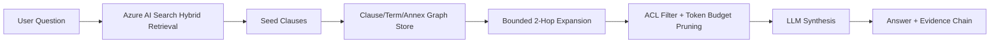
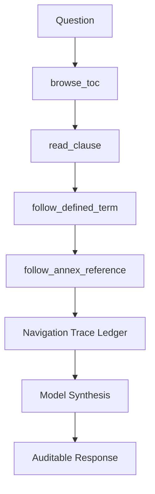

# Cross-Referenced Long-Document RAG Selection FAQ: Clause-Graph Expansion vs Hierarchical ToC Navigation vs Cached Long Context

> **Audience**: Cloud & AI Solution Architects, enterprise knowledge-platform owners, legal-tech and compliance automation teams, and engineering-specification digitalization leaders.
> **Decision scope**: Prevent omission and liability hallucinations in `200-2,000` page corpora where meaning depends on non-local references, defined-term dictionaries, annex overrides, and cross-file incorporation clauses.
> **Primary objective**: Move from flat-chunk omission zones (`35%-50%` missing-critical-context risk) to auditable, bounded, reproducible structural completeness for high-stakes decisions.

---

## 1. Executive summary

In enterprise legal, regulatory, and systems-engineering workloads, the user question often names only a visible clause.
However, the true answer is distributed across:

- non-adjacent defined terms,
- carve-out exceptions far away in the document tree,
- schedule/annex override language,
- and cross-document incorporation by reference.

This is fundamentally a **structural closure** problem, not just a vector-retrieval recall problem.
Increasing local chunk size alone does not solve non-local dependency resolution.

This guide compares four routes:

- **Route A**: Azure AI Search hybrid retrieval plus deterministic clause/term graph expansion (bounded 2-hop context assembly).
- **Route B**: Vector-light hierarchical ToC/Clause-AST navigation with tool-driven reasoning (`browse_toc`, `read_clause`, `follow_reference`).
- **Route C**: Full-dossier long-context prefix stuffing with prompt caching for concentrated deep-dive sessions.
- **Route D**: Flat chunk or local parent-child anti-pattern.

**Recommended default**:

1. Use Route A as enterprise baseline for scale, control, and consistency.
2. Add Route B for highly auditable review tracks and explainable navigation traces.
3. Use Route C selectively for high-frequency single-dossier due diligence sessions.
4. Treat Route D as a governance anti-pattern for high-liability decision paths.

---

## 2. Problem boundary and architecture constraints

### 2.1 Typical failure signatures

Common enterprise failures include:

- retrieving `Section 14.2(b)` but missing `Section 18.4` exceptions,
- answering liability questions without reading `Annex C` pricing/SLA clauses,
- missing defined-term semantics because lexical overlap with the question is near-zero,
- failing to close references across `MSA + SOW + DPA` document sets.

### 2.2 Required quality envelope

- Structural completeness `P_complete >= 0.95` on benchmark sets requiring multi-hop closure.
- Predictable interactive latency at production query volume.
- Cost behavior that remains bounded at enterprise corpus scale.
- Auditable explanation of why each referenced clause was included or excluded.

### 2.3 Non-goals

- This guide does not design OCR model training pipelines.
- It does not replace enterprise master-data governance.
- It does not prescribe multi-cloud indexing migration strategy.

---

## 3. Route definitions

### Route A — Hybrid retrieval plus deterministic reference-graph closure

Route A separates concerns:

1. retrieve seed clauses by semantic + lexical relevance,
2. expand non-local dependencies via typed graph edges,
3. prune by ACL and token budget,
4. generate answer with explicit evidence bundle.

Core building blocks:

- `Document Intelligence v4 Layout` + `Foundry Content Understanding` for anchor extraction,
- Azure AI Search for seed retrieval,
- Cosmos DB or Fabric Graph for clause/term/schedule adjacency,
- bounded BFS (`max_hop=2`) with cycle safety and priority pruning.

### Route B — Hierarchical ToC/Clause-AST navigation

Route B treats document hierarchy as first-class structure:

- `Part -> Chapter -> Section -> Sub-clause -> Footnote`,
- tool loop navigates down and across references,
- answer is synthesized only after explicit path traversal.

Strength:

- strongest human-review explainability.

Trade-off:

- multiple navigation turns increase latency and cost per answer.

### Route C — Full-dossier long-context cached prefix

Route C keeps a large dossier bundle in cached prefix memory:

- effective for repeated deep questions over a single dossier,
- can reduce retrieval misses for isolated deep-dive workflows,
- benefits from prompt caching discounts on repeated inputs.

Limits:

- weak scalability across tens of thousands of dossiers,
- attention dilution for many-needle retrieval in very large contexts,
- higher operational sensitivity to prompt prefix canonicalization quality.

### Route D — Flat chunk / local parent-child anti-pattern

Route D assumes that larger local windows solve non-local dependency.
In practice:

- increasing parent chunk from `512` to `2,048` tokens does not retrieve clauses 180 pages away,
- context noise grows,
- confidence can rise while factual completeness falls.

Route D should not be used for high-liability enterprise decisions.

---

## 4. Twelve-dimension comparison matrix

| Dimension | Route A | Route B | Route C | Route D |
|---|---|---|---|---|
| 1) Primary mechanism | Hybrid retrieval + graph closure | Hierarchical tool navigation | Cached long-context dossier | Flat/local chunking |
| 2) Non-local defined-term recall | **High** | High | Medium-high | Low |
| 3) Annex/schedule override capture | High | Medium-high | Medium | Low |
| 4) Audit trace quality | High | **Highest** | Medium | Low |
| 5) Latency stability | High | Medium | Medium-high | High but misleading |
| 6) Corpus-scale scalability | **High** | Medium | Low | Medium |
| 7) Cost predictability | High | Medium | Medium-low | Medium |
| 8) Engineering complexity | Medium-high | Medium-high | Medium | Low |
| 9) ACL precision handling | High | High | Medium | Low |
| 10) Hallucination suppression | High | High | Medium | Low |
| 11) Best-fit usage | Enterprise baseline | Audit-heavy reviews | Single-dossier deep dives | Low-risk notes only |
| 12) Recommendation | **A** | A- | B+ | Prohibited |

---

## 5. Quantitative Q1 — Multi-hop completeness probability collapse

Let:

- `R_seed` = seed-clause retrieval recall,
- `R_ref_j` = recall of each required referenced dependency,
- `m` = number of required non-local references.

Then:

`P_complete = R_seed × Π_{j=1..m} R_ref_j`

Illustrative comparison:

- flat retrieval: `R_seed=0.92`, `R_ref≈0.75`, `m=3` -> `P_complete≈0.39`
- deterministic closure: `R_seed=0.92`, `R_ref≈0.98`, `m=3` -> `P_complete≈0.86`

With improved extraction and structural constraints, production `P_complete` can exceed `0.95` on targeted benchmark classes.

---

## 6. Quantitative Q2 — Cycle safety and degree-explosion control

High-frequency terms such as `"Affiliate"` or `"Confidential Information"` can appear hundreds of times.
Unbounded traversal causes graph explosion and context bloat.

Control policy:

- edge-type allowlist (`defined_term`, `section_ref`, `annex_ref`, `incorporates_ref`),
- node-priority scoring (legal scope, recency, hierarchy depth),
- cycle detection with visited signatures,
- hard constraints on hop count and token budget.

Complexity intuition:

- unconstrained expansion approximates `O(b^d)`,
- constrained expansion yields `O(b'^d)` with `b' << b`.

---

## 7. Quantitative Q3 — Route A vs Route C cost-latency crossover

Definitions:

- `N_queries_per_dossier` = expected question count per dossier session,
- `C_expand` = Route A per-query retrieval + expansion + synthesis cost,
- `C_prefix` = Route C cached-prefix setup cost,
- `C_delta` = Route C incremental per-query cost after cache reuse.

Route C becomes economically favorable for a single dossier when:

`N_queries_per_dossier * C_expand > C_prefix + N_queries_per_dossier * C_delta`

However, at enterprise corpus scale (`N_docs` large), Route A usually dominates due to lower global maintenance and less attention dilution risk.

---

## 8. Quantitative Q4 — Broken OCR anchors and nested schedule handling

Common parsing breaks:

- `Section 14.2(b)` misread as `14.2(6)`,
- inconsistent annex identifiers (`Annex C`, `Schedule C-1`, `Exhibit C`),
- header/footer artifacts polluting body text.

Mitigation pattern:

1. anchor normalization layer (regex + layout-position rules),
2. edge confidence scoring with page-coordinate provenance,
3. low-confidence edge quarantine workflow,
4. dual-parser reconciliation for high-liability contracts.

This turns extraction quality from opaque failure into measurable pipeline quality.

---

## 9. Quantitative Q5 — Route B latency vs Route A auditability trade-off

Typical operating envelope:

- Route A: one retrieval call + one graph assembly pass + one synthesis call.
- Route B: `3-5` tool-navigation turns + synthesis.

Implication:

- Route A usually wins on median and tail latency.
- Route B often wins on path-level explainability for legal/compliance reviewers.

Recommended operating mode:

- default production answering on Route A,
- dispute-analysis or regulatory review mode on Route B with explicit navigation transcript export.

---

## 10. Quantitative Q6 — ACL-aware closure when annex visibility differs

Scenario:

- main agreement broadly visible,
- annex with executive pricing or carve-outs restricted to narrower Entra groups.

Safe behavior:

1. ACL-filter candidate references before synthesis,
2. detect missing critical references due to access restrictions,
3. return constrained answer with explicit completeness warning,
4. avoid deterministic conclusions when required evidence is inaccessible.

This is safer than silently ignoring invisible annexes and returning confident but incomplete answers.

---

## 11. Reference architecture diagram A — Route A retrieval + graph closure



---

## 12. Reference architecture diagram B — Route B hierarchical navigation loop



---

## 13. Production snippet A — Ingestion parser for defined terms and clause edges

```python
import re
from dataclasses import dataclass
from typing import List

SECTION_REF = re.compile(r"(Section|§|Article)\s+([0-9]+(\.[0-9]+)*(\([a-z]\))?)", re.I)
ANNEX_REF = re.compile(r"(Annex|Schedule|Exhibit)\s+([A-Z0-9\-]+)", re.I)
DEFINED_TERM = re.compile(r"\"([A-Z][A-Za-z0-9\s\-]{2,60})\"")

@dataclass
class Edge:
    src: str
    dst: str
    kind: str
    confidence: float

def extract_edges(clause_id: str, text: str) -> List[Edge]:
    edges: List[Edge] = []
    for m in SECTION_REF.finditer(text):
        edges.append(Edge(clause_id, f"section:{m.group(2)}", "section_ref", 0.95))
    for m in ANNEX_REF.finditer(text):
        edges.append(Edge(clause_id, f"annex:{m.group(2)}", "annex_ref", 0.93))
    for m in DEFINED_TERM.finditer(text):
        edges.append(Edge(clause_id, f"term:{m.group(1).lower()}", "defined_term", 0.90))
    return edges
```

Implementation notes:

- extraction stores typed edges with confidence,
- edge confidence supports quarantine routing,
- typed edges support deterministic bounded expansion at query time.

---

## 14. Production snippet B — ACL-aware bounded BFS context assembler

```python
from collections import deque

def assemble_context(seed_nodes, graph, acl_checker, token_budget=6000, max_hop=2):
    q = deque([(n, 0) for n in seed_nodes])
    visited = set(seed_nodes)
    assembled = []
    used_tokens = 0

    while q:
        node, hop = q.popleft()
        if hop > max_hop:
            continue
        if not acl_checker(node):
            continue

        chunk = graph.get_chunk(node)
        t = graph.estimate_tokens(chunk)
        if used_tokens + t > token_budget:
            continue

        assembled.append((node, chunk, hop))
        used_tokens += t

        for e in graph.out_edges(node):
            if e.kind not in {"defined_term", "section_ref", "annex_ref", "incorporates_ref"}:
                continue
            nxt = e.dst
            if nxt in visited:
                continue
            visited.add(nxt)
            q.append((nxt, hop + 1))

    return assembled
```

Operational notes:

- ACL check happens before synthesis assembly,
- hop and token budgets enforce bounded behavior,
- output trace can be emitted for audit and replay.

---

## 15. Enterprise scenario A — Global investment-bank M&A due diligence platform

Scale profile:

- `12,000+` credit agreements, indentures, amendments, and side letters,
- dense cross-references between base agreements and schedules,
- high liability around omission of carve-outs and pricing exceptions.

Recommended architecture:

- production path: Route A,
- high-stakes legal review: Route B evidence mode,
- concentrated deep-deal sessions: selective Route C.

Expected value:

- reduced omission risk,
- stronger defensible citation chain,
- lower rework from post-review contradiction findings.

---

## 16. Enterprise scenario B — Aerospace / medical-device standards assistant

Scale profile:

- cross-referenced `DO-178C`, `ISO 13485`, and internal design-control procedures,
- strict traceability requirements across hierarchical documents,
- frequent audit requests requiring explanation of rationale lineage.

Recommended architecture:

- Route A + Route B combination,
- mandatory completeness indicator in final answers,
- explicit ACL-aware degradation when required annexes are not visible.

Expected value:

- lower compliance review cycle time,
- better repeatability in design-control interpretation,
- less hidden-risk drift in requirements traceability decisions.

---

## 17. Three-year TCO comparison (illustrative, synthetic, USD)

| Option | Year 1 | Year 2 | Year 3 | 3-Year Total | Notes |
|---|---:|---:|---:|---:|---|
| Route A | 2,120,000 | 2,180,000 | 2,250,000 | 6,550,000 | Higher setup cost, best enterprise-scale efficiency |
| Route B | 2,280,000 | 2,340,000 | 2,420,000 | 7,040,000 | Strong audit path, higher multi-turn runtime cost |
| Route C | 1,980,000 | 2,260,000 | 2,560,000 | 6,800,000 | Excellent for single-dossier depth, weaker global scale |
| Route D | 2,450,000 | 2,620,000 | 2,810,000 | 7,880,000 | Lowest governance effort, highest omission/rework risk |

Interpretation:

- Route A is generally the most balanced enterprise baseline.
- Route B is best for audit-heavy investigative workflows.
- Route C is a tactical optimization for repeated deep dives on limited dossier sets.
- Route D is not acceptable for high-risk production decision flows.

---

## 18. Day-0 / Day-1 / Day-2 rollout checklist

### Day-0 (architecture baseline)

- Define anchor normalization standard for section/article/annex references.
- Define graph edge taxonomy and closure constraints (hop, budget, edge priority).
- Map Entra group ACL rules to clause-level and annex-level retrieval surfaces.
- Define benchmark sets with known non-local dependency answers.

### Day-1 (go-live controls)

- Deploy ingestion pipeline from layout extraction to graph edge store.
- Turn on completeness telemetry (`P_complete`, `missing_critical_ref_rate`).
- Log seed clauses, expansion path, ACL filtering reasons, and pruning decisions.
- Run controlled load tests on latency and closure completeness gates.

### Day-2 (continuous optimization)

- Weekly false-negative review and extraction-rule tuning.
- Monthly route-mix review (`A/B/C`) against cost and audit demands.
- Quarterly ACL policy audit and access exception analysis.

---

## 19. Data provenance and reproducibility labels

All numeric values should be tagged as:

- **measured**: observed in production or controlled validation,
- **synthetic**: assumption-driven architecture scenario values,
- **anonymized_reported**: aggregated anonymized field-reported metrics.

Formal review packs should include:

1. sampling windows and timestamps,
2. metric definitions and denominators,
3. outlier handling rules,
4. reproducible query IDs or scripts.

---

## 20. Final recommendation

For high-liability long-document RAG workloads with non-local dependencies:

- use **Route A** as the default enterprise production baseline,
- use **Route B** when audit-path explainability is mandatory,
- use **Route C** selectively for concentrated single-dossier deep work,
- prohibit **Route D** for decision-critical scenarios.

The winning architecture is not the one with the shortest local chunk path.
It is the one that jointly optimizes:

1. structural completeness,
2. auditable traceability,
3. and sustainable enterprise-scale cost control.
