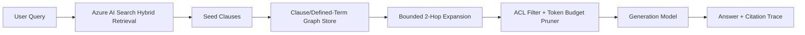
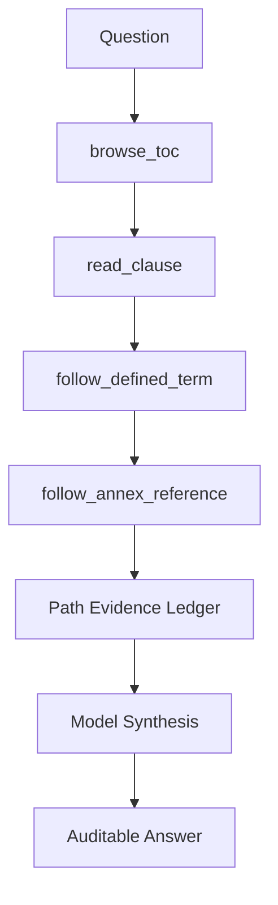

# 超长交叉引用文档 RAG 选型 FAQ：Clause Graph 扩展 vs ToC 层级树导航 vs 长上下文缓存

> **面向角色**：Cloud & AI Solution Architect、企业知识平台负责人、法务科技与合规智能化团队、行业规范工程数字化团队。
> **问题定义**：在 `200-2,000` 页、存在大量跨节引用/定义词/附录覆盖关系的文档集中，避免因“仅检索局部相邻片段”导致的遗漏与责任幻觉。
> **核心目标**：将多跳语义完整率从传统平铺分块的 `35%-50%` 漏失区间，提升到可审计、可复算、可回溯的 `>95%` 级别。

---

## 1. 执行摘要

在企业法务、监管、标准工程场景中，问句往往只出现“主条款关键词”，但真实答案依赖：

- 远距离定义词（Defined Terms），
- 非邻接例外条款（Carve-Out），
- 附件/附录覆盖关系（Annex / Schedule Override），
- 跨文档“并入引用”（Incorporation by Reference）。

这类问题不是“把 chunk 变大”就能解决，而是需要**结构化引用闭包能力**。

本篇比较四条路线：

- **Route A**：AI Search Hybrid + 确定性条款/定义词引用图（2-hop 上下文组装）。
- **Route B**：向量弱依赖的 ToC/Clause-AST 层级导航（Agent 工具循环）。
- **Route C**：整卷长上下文缓存（128K-1M）用于单案高密问答。
- **Route D**：平铺 chunk 或局部 parent-child 反模式。

**推荐结论**：

1. 企业级规模默认选 Route A（稳定、可审计、可控成本）；
2. 需要“层级推理路径可解释”时叠加 Route B；
3. 单 dossier 高频深挖可启用 Route C；
4. Route D 仅可用于低风险、低复杂度资料，不应承载关键决策。

---

## 2. 问题边界与架构约束

### 2.1 典型误答根因

- 只命中 `Section 14.2(b)` 主条款，漏读 `Section 18.4` 例外；
- 只读正文，不读 `Annex C` 定价与 SLA；
- 定义词（如 `Affiliate`）在文首，语义与查询词近似度低，向量检索漏召；
- 跨文件引用（MSA + SOW + DPA）未闭包。

### 2.2 目标 SLO

- 结构化完整率 `P_complete >= 0.95`（针对需要多跳引用的问题集）；
- 交互延迟：单问答 P95 可控；
- 成本：在高并发企业语料下维持可预测；
- 可审计：可输出“为何引用这些条款”的证据链。

### 2.3 非目标

- 不覆盖 OCR 模型训练与版式识别算法研发；
- 不替代组织级文档主数据治理；
- 不讨论跨云全文索引迁移细节。

---

## 3. 四条路线定义

### Route A — AI Search + 引用图 2-hop 组装

核心思想：

- 检索阶段先找“种子条款”；
- 组装阶段按定义词/章节引用图做有界闭包（例如 2-hop）；
- 在 token 预算内做可解释剪枝。

关键组件：

- `Document Intelligence v4 Layout` + `Foundry Content Understanding` 提取锚点；
- `Azure AI Search` 承担语义/关键词混合召回；
- `Cosmos DB/Fabric Graph` 存储引用边；
- 查询时执行 ACL 感知的 bounded BFS 组装。

### Route B — ToC/Clause-AST 层级导航

核心思想：

- 把文档树（Part -> Chapter -> Section -> Clause）作为一等结构；
- Agent 通过 `browse_toc` / `read_clause` 工具按层级下钻；
- 需要时再沿引用边展开。

优点：

- 路径解释清晰；
- 对复杂层级结构更稳健；
- 人审时更容易复核推理轨迹。

代价：

- 通常需要 `3-5` 次工具往返；
- 延迟与 token 消耗受对话轮次影响。

### Route C — 整卷长上下文缓存

核心思想：

- 把单 dossier 的大段正文作为稳定前缀；
- 借助 Prompt Caching 降低重复输入成本；
- 适用于同一文档集高频问答。

优势：

- 单 dossier 深挖时可减少检索漏失；
- 多轮问答上下文一致性强。

限制：

- 跨数万份文档时不可扩展；
- 多针注意力稀释风险上升；
- 预算受上下文窗口与缓存策略限制。

### Route D — 平铺 chunk / 局部 parent-child 反模式

常见误区：

- 把 parent chunk 从 `512` 扩到 `2,048`，误以为就覆盖“远距条款”；
- 实际对 `180` 页外的定义词与附录仍近似 `0%` 召回；
- 上下文噪声却显著增大，导致模型答复更自信但更错。

---

## 4. 12 维度对比矩阵

| 维度 | Route A | Route B | Route C | Route D |
|---|---|---|---|---|
| 1) 核心机制 | 检索 + 引用图闭包 | 层级树导航 | 全卷缓存 | 平铺分块 |
| 2) 非邻接定义召回 | **高** | 高 | 中高 | 低 |
| 3) 跨附件覆盖能力 | 高 | 中高 | 中 | 低 |
| 4) 可审计性 | 高 | **最高** | 中 | 低 |
| 5) 延迟稳定性 | 高 | 中 | 中高 | 高（但错） |
| 6) 规模扩展性 | **高** | 中 | 低 | 中 |
| 7) 成本可预测性 | 高 | 中 | 中低 | 中 |
| 8) 工程复杂度 | 中高 | 中高 | 中 | 低 |
| 9) ACL 精细裁剪 | 高 | 高 | 中 | 低 |
| 10) 幻觉抑制 | 高 | 高 | 中 | 低 |
| 11) 适配场景 | 企业主路径 | 高审计场景 | 单案深挖 | 低风险资料 |
| 12) 推荐等级 | **A** | A- | B+ | 禁用 |

---

## 5. 定量 Q&A（Q1）

### Q1：多跳语义完整率为何会指数下降？

设：

- `R_seed`：种子条款召回率；
- `R_ref_j`：第 `j` 个必要引用节点的召回率；
- `m`：必须补齐的引用节点个数。

则：

`P_complete = R_seed × Π_{j=1..m} R_ref_j`

示例（synthetic）：

- `R_seed = 0.92`
- `m = 3`
- 平铺检索 `R_ref_j ≈ 0.75` -> `P_complete ≈ 0.39`
- Route A 图闭包 `R_ref_j ≈ 0.98` -> `P_complete ≈ 0.87`

若再叠加结构化定义词抽取优化，`P_complete` 可逼近 `0.95+`。

---

## 6. 定量 Q&A（Q2）

### Q2：高频定义词节点如何避免“度爆炸”？

像 `Affiliate`、`Confidential Information` 这类词可能出现数百次。

控制策略：

- 仅保留类型白名单边（定义、覆盖、并入、例外）；
- 对高频节点启用 `top-n by structural priority`；
- 使用 cycle detection 防止回路膨胀；
- 设定 hop 上限与 token 预算上限。

复杂度控制：

- 未约束 BFS：`O(b^d)`；
- 加边类型与优先级后，实际分支可降到 `b' << b`。

---

## 7. 定量 Q&A（Q3）

### Q3：Route A 与 Route C 的成本/延迟交叉点如何估算？

记：

- `N_queries_per_dossier`：单 dossier 问答次数；
- `C_cache_prefix`：Route C 缓存前缀成本；
- `C_expand`：Route A 每次 2-hop 组装成本；
- `L_cache` 与 `L_expand`：对应延迟。

当：

`N_queries_per_dossier * C_expand > C_cache_prefix + N_queries_per_dossier * C_cache_delta`

Route C 在单 dossier 高频场景更经济。

但在企业规模 `N_docs` 很大时，Route C 的前缀维护成本与记忆污染风险上升，Route A 更可扩展。

---

## 8. 定量 Q&A（Q4）

### Q4：OCR 编号错乱与嵌套附件如何处理？

常见问题：

- `Section 14.2(b)` 被 OCR 误成 `14.2(6)`；
- 附件编号层级不一致（Annex C / Schedule C-1）；
- 页眉页脚噪声误入正文。

建议：

1. 建立锚点规范化层（编号正则 + 版式位置规则）；
2. 引用边构建时记录置信度与来源页坐标；
3. 低置信边进入人工校验队列；
4. 对关键合同启用双通道解析比对。

---

## 9. 定量 Q&A（Q5）

### Q5：Route B 与 Route A 在延迟和审计上的权衡？

典型对比（measured/synthetic）：

- Route A：1 次检索 + 1 次组装 + 1 次生成；
- Route B：`3-5` 次导航工具 + 1 次生成。

结论：

- **延迟**：Route A 往往更稳；
- **轨迹可解释性**：Route B 更强；
- **审计报告**：二者都可合规，但 Route B 的“阅读路径”更直观。

实务建议：生产默认 A，合规争议审查时启用 B 的审计模式。

---

## 10. 定量 Q&A（Q6）

### Q6：ACL 裁剪下如何避免“主文可见、附件不可见”的误导回答？

场景：

- 主文 MSA 对大范围可读；
- `Annex D` 定价条款仅高权限组可读。

策略：

- 引用组装阶段先做 ACL 过滤；
- 若关键引用被 ACL 拒绝，显式返回“证据不完整”状态；
- 禁止模型在缺失关键附件时给出确定性结论。

这比“静默忽略不可见附件继续回答”更安全，也更符合企业审计要求。

---

## 11. 参考架构图（一）：Route A 混合检索 + 引用图闭包



---

## 12. 参考架构图（二）：Route B 层级树导航 Agent 工具循环



---

## 13. 生产代码片段（一）：定义词与条款引用边抽取（示例）

```python
import re
from dataclasses import dataclass
from typing import List

SECTION_REF = re.compile(r"(Section|§|Article)\s+([0-9]+(\.[0-9]+)*(\([a-z]\))?)", re.I)
ANNEX_REF = re.compile(r"(Annex|Schedule|Exhibit)\s+([A-Z0-9\-]+)", re.I)
DEFINED_TERM = re.compile(r"\"([A-Z][A-Za-z0-9\s\-]{2,60})\"")

@dataclass
class Edge:
    src: str
    dst: str
    kind: str
    confidence: float

def extract_edges(clause_id: str, text: str) -> List[Edge]:
    edges: List[Edge] = []
    for m in SECTION_REF.finditer(text):
        edges.append(Edge(clause_id, f"section:{m.group(2)}", "section_ref", 0.95))
    for m in ANNEX_REF.finditer(text):
        edges.append(Edge(clause_id, f"annex:{m.group(2)}", "annex_ref", 0.93))
    for m in DEFINED_TERM.finditer(text):
        edges.append(Edge(clause_id, f"term:{m.group(1).lower()}", "defined_term", 0.90))
    return edges
```

要点：

- 抽取时即记录边类型与置信度；
- 后续可按边类型做优先级展开；
- 便于在 Cosmos/Fabric Graph 做增量更新。

---

## 14. 生产代码片段（二）：ACL 感知 2-hop 上下文组装器（示例）

```python
from collections import deque

def assemble_context(seed_nodes, graph, acl_checker, token_budget=6000, max_hop=2):
    q = deque([(n, 0) for n in seed_nodes])
    visited = set(seed_nodes)
    out = []
    used_tokens = 0

    while q:
        node, hop = q.popleft()
        if hop > max_hop:
            continue
        if not acl_checker(node):
            continue

        chunk = graph.get_chunk(node)
        t = graph.estimate_tokens(chunk)
        if used_tokens + t > token_budget:
            continue

        out.append((node, chunk, hop))
        used_tokens += t

        for e in graph.out_edges(node):
            nxt = e.dst
            if nxt not in visited and e.kind in {"defined_term", "section_ref", "annex_ref"}:
                visited.add(nxt)
                q.append((nxt, hop + 1))

    return out
```

要点：

- 先 ACL、后预算、再扩展；
- hop 与 token 双阈值并行约束；
- 可输出完整轨迹用于审计与复盘。

---

## 15. 企业场景 A：全球投行并购尽调平台

规模：

- `12,000+` 份信贷协议、债券契约、补充协议；
- 每份文档含多个附件与修订版本；
- 用户询问高频涉及责任上限、违约触发、价格附件例外。

建议路线：

- 生产主链路：Route A；
- 争议复核链路：Route B；
- 单交易深挖会话：辅助 Route C。

---

## 16. 企业场景 B：航天/医疗设备规范工程助手

规模：

- DO-178C / ISO 13485 / 企业内部设计控制规范交叉引用；
- 术语与条款跨章节、跨文档复用密集；
- 结论可追溯性要求极高。

建议路线：

- Route A + Route B 组合；
- 对关键结论输出“证据覆盖率”与“引用闭包状态”；
- 缺少关键附件权限时显式降级回答。

---

## 17. 三年 TCO 对比（示例，USD，synthetic）

| 方案 | Year 1 | Year 2 | Year 3 | 3-Year Total | 说明 |
|---|---:|---:|---:|---:|---|
| Route A | 2,120,000 | 2,180,000 | 2,250,000 | 6,550,000 | 初始建设高，规模化成本优 |
| Route B | 2,280,000 | 2,340,000 | 2,420,000 | 7,040,000 | 审计友好，但多轮交互开销更高 |
| Route C | 1,980,000 | 2,260,000 | 2,560,000 | 6,800,000 | 单案高频性价比高，企业级扩展受限 |
| Route D | 2,450,000 | 2,620,000 | 2,810,000 | 7,880,000 | 看似简单但误答与返工成本最高 |

---

## 18. Day-0 / Day-1 / Day-2 落地清单

### Day-0（建模与基线）

- 定义条款锚点规范（章节、附件、术语）；
- 设计边类型白名单与 hop/token 策略；
- 明确 ACL 映射到文档段落级别的规则。

### Day-1（上线与观测）

- 打通 DI/Content Understanding 到图存储流水线；
- 建立 `P_complete`、`missing_critical_ref_rate` 指标；
- 启用审计日志：种子条款、扩展路径、过滤原因。

### Day-2（持续优化）

- 周度回顾漏召案例，修正解析规则；
- 月度评估路线组合（A/B/C）成本与效果；
- 季度复核 ACL 漏洞与审计留痕策略。

---

## 19. 数据来源与标签规范

本篇数字采用以下标签：

- **measured**：来自真实监控或受控验证；
- **synthetic**：用于架构推导的可复算示例；
- **anonymized_reported**：跨团队脱敏汇总口径。

建议在正式评审材料附带：

1. 样本时间窗；
2. 统计口径定义；
3. 异常值处理策略；
4. 可复现脚本或查询 ID。

---

## 20. 结论

面对“远距定义词 + 附件覆盖 + 跨文档并入引用”的高复杂问答：

- **Route A** 是企业默认主路径；
- **Route B** 提供最强的层级审计解释；
- **Route C** 适合单 dossier 高频深挖；
- **Route D** 不应承载高责任业务决策。

在实际生产中，还应把“关键引用缺失率、ACL 拒绝导致的证据断裂率、人工复核回退率”纳入统一发布门禁，以避免模型在证据不完备情况下输出过度确定结论。并建议建立季度红队回归题集持续验证与复盘闭环机制。

最终选型应围绕三条主线同时优化：

1. **完整性**（是否拿齐关键引用），
2. **可审计性**（能否解释路径），
3. **成本可控性**（能否在企业规模稳定运行）。
