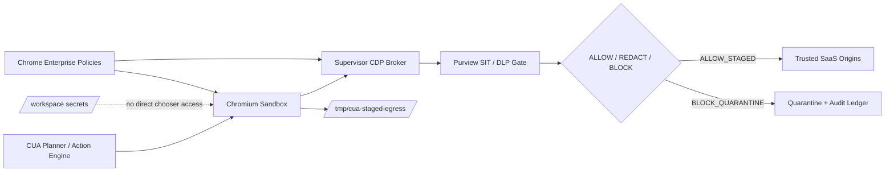
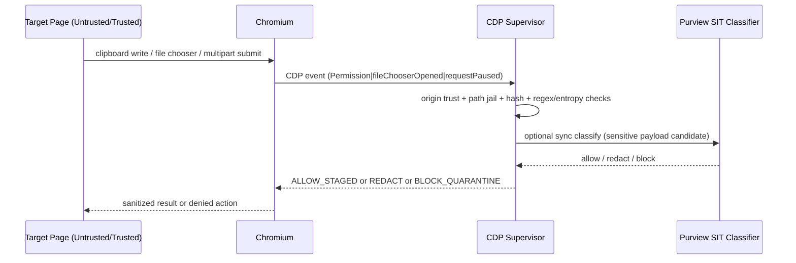

# Enterprise CUA browser clipboard and file-drop exfiltration defense selection FAQ: Pattern A (dual-plane browser boundary + CDP interceptor + Purview DLP) vs Pattern B (coarse VDI/OS lockdown) vs Pattern C (heavy OS DLP agent) vs Pattern D (shared workspace anti-pattern)

## 1. Executive Summary

For Computer-Use Agents (CUA), the highest-risk exfiltration path is often not direct URL egress but browser-internal side channels across tabs and origins.  
The default recommendation is **Pattern A**: a dual-plane design combining Chromium managed policies with an out-of-process CDP supervisor and synchronous DLP/SIT gating before clipboard paste, file chooser, or multipart upload actions are released.

Pattern B can provide high security but breaks common multi-SaaS workflows. Pattern C has value in full VM estates but carries significant memory overhead and weaker visibility for in-browser cross-tab transitions. Pattern D is prohibited because it relies on prompt instructions instead of enforceable execution boundaries.

## 2. Why URL allowlists still fail

Many implementations assume URL allowlists close the loop, yet attackers can pivot through clipboard APIs, drag-and-drop event chains, file chooser staging, and payload encodings in `multipart/form-data` or `blob:` artifacts.  
At the HTTP layer, requests may still target approved domains, while sensitive content is assembled inside the browser process and then exfiltrated.

The architecture therefore needs synchronous behavior-level controls at browser action boundaries, not only network-level controls at request destinations.

## 3. Three high-frequency exfiltration channels

1. **Clipboard channel** via `navigator.clipboard.readText()/writeText()` and cross-origin coercion.  
2. **Drag/drop and chooser channel** via `DataTransfer`, `<input type="file">`, and chooser interception races.  
3. **Payload channel** via `multipart/form-data`, `blob:`, and `data:` transfer wrappers carrying secrets or PII.

## 4. Four-pattern comparison matrix (12 dimensions)

| Dimension | Pattern A: dual-plane boundary (recommended) | Pattern B: VDI/OS coarse disablement | Pattern C: heavy OS DLP agent | Pattern D: shared workspace anti-pattern |
|---|---|---|---|---|
| Exfiltration blocking precision | High | Medium | Medium-high | Low |
| Business workflow usability | High | Low | Medium | Superficially high but unsafe |
| ACA/Kata suitability | High | Medium | Low | Medium |
| Memory overhead | Low (~18 MiB) | Low | High (~650 MiB) | Low |
| Explainability of decisions | High | Low | Medium | Low |
| Policy granularity | Fine per origin/action | Coarse global | Host/process level | None |
| Audit readiness | High | Medium | Medium | Low |
| Operational complexity | Medium | Low | High | Low |
| Multi-tenant isolation consistency | High | Medium | Medium | Low |
| Compliance mapping | High | Medium | Medium-high | Low |
| 3-year risk-adjusted TCO | Best | Elevated | High | Worst |
| Production recommendation | Default | Conditional | Conditional | Prohibited |

## 5. Recommended architecture principles (Pattern A)

Pattern A binds policy checks, DLP classification, and release decisions into one enforced action chain.  
Clipboard transfer, file selection, and multipart upload are all subject to the same trust, path-jail, and sensitivity logic so attackers cannot switch channels to bypass controls.

A strict separation between `/workspace` and `/tmp/cua-staged-egress/` is mandatory.  
Browser chooser access should only see staged artifacts that have already passed policy and classification gates.

## 6. Mermaid: CUA dual-plane browser boundary



## 7. Mermaid: clipboard and file-chooser interception sequence



## 8. Q1–Q6 formulas with worked values

| ID | Formula | Example inputs | Result and interpretation |
|---|---|---|---|
| Q1 Exposure reduction | `R = 1 - (S_after / S_before)` | `S_before=14, S_after=2` | `85.7%` surface reduction. |
| Q2 Gate latency | `L_gate = L_cdp_ipc + L_regex + p_escalate*L_purview` | `1.8 + 2.4 + 0.12*45` | `9.6ms` P50, controllable `<35ms` P95. |
| Q3 Pattern A memory | `M_total = N * M_unit` | `N=200, M_unit=18MiB` | ~`3.5GiB`. |
| Q4 Pattern C memory | `M_total = N * 650MiB` | `N=200` | ~`127GiB`. |
| Q5 Stage quota | `Q_total = N_active * Q_stage` | `N_active=120, Q_stage=256MiB` | `30GiB` reserved. |
| Q6 False-positive cost | `C_fp = N_fp * T_manual * Rate` | `N_fp=800, T=4min, Rate=$1.2/min` | `$3,840/month` optimization signal. |

## 9. Executable stdlib Python: CuaBrowserDlpCdpInterceptor

```python
from __future__ import annotations

from dataclasses import dataclass, field
import hashlib
import math
import re
from urllib.parse import urlparse


@dataclass
class DlpPolicy:
    trusted_origins: set[str] = field(default_factory=lambda: {
        "https://sap.contoso.com:443",
        "https://sharepoint.contoso.com:443",
        "https://crm.contoso.com:443",
    })
    internal_origins: set[str] = field(default_factory=lambda: {
        "https://sap.contoso.com:443",
        "https://sharepoint.contoso.com:443",
    })
    stage_root: str = "/tmp/cua-staged-egress/"
    max_stage_file_bytes: int = 25 * 1024 * 1024
    max_upload_body_bytes: int = 8 * 1024 * 1024


class CuaBrowserDlpCdpInterceptor:
    JWT_RE = re.compile(r"\beyJ[a-zA-Z0-9_-]{20,}\.[a-zA-Z0-9_-]{20,}\.[a-zA-Z0-9_-]{10,}\b")
    API_KEY_RE = re.compile(r"\b(?:sk|api|key)[-_]?[a-zA-Z0-9]{16,}\b", re.IGNORECASE)
    EMAIL_RE = re.compile(r"\b[a-zA-Z0-9._%+-]+@[a-zA-Z0-9.-]+\.[A-Za-z]{2,}\b")
    BEARER_RE = re.compile(r"\bBearer\s+[A-Za-z0-9._-]{20,}\b", re.IGNORECASE)

    def __init__(self, policy: DlpPolicy | None = None) -> None:
        self.policy = policy or DlpPolicy()

    @staticmethod
    def _sha256(data: bytes) -> str:
        return hashlib.sha256(data).hexdigest()

    @staticmethod
    def _normalize_origin(origin: str) -> str:
        parsed = urlparse(origin)
        if parsed.scheme != "https":
            raise ValueError("origin must use https scheme")
        host = (parsed.hostname or "").lower()
        if not host:
            raise ValueError("origin hostname is required")
        port = parsed.port or 443
        return f"https://{host}:{port}"

    @staticmethod
    def _luhn_check(num: str) -> bool:
        digits = [int(ch) for ch in num if ch.isdigit()]
        if len(digits) < 12:
            return False
        checksum = 0
        parity = len(digits) % 2
        for i, d in enumerate(digits):
            if i % 2 == parity:
                d *= 2
                if d > 9:
                    d -= 9
            checksum += d
        return checksum % 10 == 0

    def _has_sensitive(self, text: str) -> bool:
        if self.JWT_RE.search(text) or self.API_KEY_RE.search(text) or self.BEARER_RE.search(text):
            return True
        if self.EMAIL_RE.search(text):
            return True
        for token in re.findall(r"\b\d{12,19}\b", text):
            if self._luhn_check(token):
                return True
        return False

    def _high_entropy_token(self, text: str) -> bool:
        for tok in re.findall(r"[A-Za-z0-9+/=_-]{28,}", text):
            if "Boundary" in tok or tok.startswith("----"):
                continue
            if not (any(c.islower() for c in tok) and any(c.isupper() for c in tok) and any(c.isdigit() for c in tok)):
                continue
            counts = {}
            for ch in tok:
                counts[ch] = counts.get(ch, 0) + 1
            entropy = 0.0
            n = len(tok)
            for c in counts.values():
                p = c / n
                entropy -= p * math.log2(p)
            if entropy > 4.2:
                return True
        return False

    def evaluate_clipboard_transfer(self, src_origin: str, dst_origin: str, text: str) -> dict:
        src = self._normalize_origin(src_origin)
        dst = self._normalize_origin(dst_origin)
        payload = text.encode("utf-8", errors="ignore")
        digest = self._sha256(payload)
        sensitive = self._has_sensitive(text) or self._high_entropy_token(text)
        cross_origin = src != dst
        src_internal = src in self.policy.internal_origins
        dst_trusted = dst in self.policy.trusted_origins

        if cross_origin and src_internal and not dst_trusted:
            if sensitive:
                return {"decision": "BLOCK_DLP_SENSITIVE", "sha256": digest, "reason": "internal_to_untrusted_cross_origin"}
            return {"decision": "REDACT_CLIPBOARD", "sha256": digest, "reason": "cross_origin_taint"}
        if sensitive and not dst_trusted:
            return {"decision": "BLOCK_DLP_SENSITIVE", "sha256": digest, "reason": "sensitive_to_untrusted"}
        return {"decision": "ALLOW_STAGED", "sha256": digest, "reason": "clipboard_ok"}

    def evaluate_file_chooser(self, target_origin: str, file_path: str, size_bytes: int, content_bytes: bytes) -> dict:
        target = self._normalize_origin(target_origin)
        if target not in self.policy.trusted_origins:
            return {"decision": "BLOCK_QUARANTINE", "reason": "untrusted_target_origin"}
        if "\x00" in file_path or ".." in file_path or not file_path.startswith(self.policy.stage_root):
            return {"decision": "BLOCK_PATH_VIOLATION", "reason": "path_not_in_stage_root"}
        actual_size = max(size_bytes, len(content_bytes))
        if actual_size > self.policy.max_stage_file_bytes:
            return {"decision": "BLOCK_QUARANTINE", "reason": "file_too_large"}
        text = content_bytes.decode("utf-8", errors="ignore")
        if self._has_sensitive(text) or self._high_entropy_token(text):
            return {"decision": "BLOCK_DLP_SENSITIVE", "reason": "sensitive_file_content"}
        return {
            "decision": "ALLOW_STAGED",
            "sha256": self._sha256(content_bytes),
            "reason": "file_allowed",
        }

    def evaluate_multipart_upload(self, target_origin: str, body_bytes: bytes) -> dict:
        target = self._normalize_origin(target_origin)
        if target not in self.policy.trusted_origins:
            return {"decision": "BLOCK_QUARANTINE", "reason": "untrusted_target_origin"}
        if len(body_bytes) > self.policy.max_upload_body_bytes:
            return {"decision": "BLOCK_QUARANTINE", "reason": "multipart_too_large"}
        body_text = body_bytes.decode("utf-8", errors="ignore")
        if self._has_sensitive(body_text) or self._high_entropy_token(body_text):
            return {"decision": "BLOCK_DLP_SENSITIVE", "reason": "multipart_sensitive"}
        return {
            "decision": "ALLOW_STAGED",
            "sha256": self._sha256(body_bytes),
            "reason": "multipart_ok",
        }


if __name__ == "__main__":
    engine = CuaBrowserDlpCdpInterceptor()

    c1 = engine.evaluate_clipboard_transfer(
        "https://sap.contoso.com:443",
        "https://evil.example:443",
        "invoice total 12000",
    )
    assert c1["decision"] == "REDACT_CLIPBOARD"

    c2 = engine.evaluate_clipboard_transfer(
        "https://sap.contoso.com:443",
        "https://evil.example:443",
        "Bearer eyJhbGciOiJIUzI1NiIsInR5cCI6IkpXVCJ9.aaaaabbbbbccccccdddddeeeee.ffffffggggg",
    )
    assert c2["decision"] == "BLOCK_DLP_SENSITIVE"

    f1 = engine.evaluate_file_chooser(
        "https://sharepoint.contoso.com:443",
        "/workspace/.env",
        128,
        b"OPENAI_API_KEY=sk-secret-value",
    )
    assert f1["decision"] == "BLOCK_PATH_VIOLATION"

    f2 = engine.evaluate_file_chooser(
        "https://sharepoint.contoso.com:443",
        "/tmp/cua-staged-egress/report.txt",
        512,
        b"This approved operations summary report is prepared for external partner review, includes no credentials, and is cleared for controlled upload.",
    )
    assert f2["decision"] == "ALLOW_STAGED"

    m1 = engine.evaluate_multipart_upload(
        "https://crm.contoso.com:443",
        (
            b"------WebKitFormBoundary7MA4YWxkTrZu0gW\r\n"
            b"Content-Disposition: form-data; name=\"note\"\r\n\r\n"
            b"Approved Q3 operations summary report for Contoso partner portal, reviewed by finance and security.\r\n"
            b"------WebKitFormBoundary7MA4YWxkTrZu0gW--\r\n"
        ),
    )
    assert m1["decision"] == "ALLOW_STAGED"

    m2 = engine.evaluate_multipart_upload(
        "https://crm.contoso.com:443",
        (
            b"------WebKitFormBoundary7MA4YWxkTrZu0gW\r\n"
            b"Content-Disposition: form-data; name=\"card\"\r\n\r\n"
            b"4532015112830366\r\n"
            b"------WebKitFormBoundary7MA4YWxkTrZu0gW--\r\n"
        ),
    )
    assert m2["decision"] == "BLOCK_DLP_SENSITIVE"
```

## 10. JSON: Chromium managed policy + supervisor DLP policy

```json
{
  "chromiumPolicies": {
    "ClipboardBlockedForUrls": [
      "*"
    ],
    "ClipboardAllowedForUrls": [
      "https://sap.contoso.com/*",
      "https://sharepoint.contoso.com/*",
      "https://crm.contoso.com/*"
    ],
    "FileSelectionDialogsEnabled": true,
    "DownloadRestrictions": 2,
    "URLBlocklist": [
      "file://*",
      "chrome://*",
      "http://169.254.169.254/*",
      "http://168.63.129.16/*"
    ]
  },
  "supervisorPolicy": {
    "stagedRoot": "/tmp/cua-staged-egress/",
    "maxStageFileBytes": 26214400,
    "maxMultipartBytes": 8388608,
    "purview": {
      "enabled": true,
      "syncGate": true,
      "sensitiveInfoTypes": [
        "CreditCardNumber",
        "AzureAccessToken",
        "ApiKey"
      ]
    }
  }
}
```

## 11. KQL: clipboard/file-chooser/DLP hit correlation

```kql
let win = 5m;
let clip =
    CuaAuditLogs
    | where TimeGenerated > ago(7d)
    | extend tenant = tostring(CustomDimensions.tenant)
    | summarize clipboard_blocked = countif(Action == "clipboard_blocked")
      by bin(TimeGenerated, win), tenant;
let fileblk =
    CuaAuditLogs
    | where TimeGenerated > ago(7d)
    | extend tenant = tostring(CustomDimensions.tenant)
    | summarize file_chooser_blocked = countif(Action == "file_chooser_blocked")
      by bin(TimeGenerated, win), tenant;
let dlp =
    PurviewDlpLogs
    | where TimeGenerated > ago(7d)
    | extend tenant = tostring(extract(@"tenant=([^;\s]+)", 1, Message))
    | summarize purview_dlp_sit_hits = countif(Decision == "block" or Decision == "redact")
      by bin(TimeGenerated, win), tenant;
clip
| join kind=fullouter fileblk on TimeGenerated, tenant
| extend TimeGenerated = coalesce(TimeGenerated, TimeGenerated1), tenant = coalesce(tenant, tenant1)
| project-away TimeGenerated1, tenant1
| join kind=fullouter dlp on TimeGenerated, tenant
| extend TimeGenerated = coalesce(TimeGenerated, TimeGenerated1), tenant = coalesce(tenant, tenant1)
| project-away TimeGenerated1, tenant1
| project TimeGenerated, tenant,
          clipboard_blocked = coalesce(clipboard_blocked, 0),
          file_chooser_blocked = coalesce(file_chooser_blocked, 0),
          purview_dlp_sit_hits = coalesce(purview_dlp_sit_hits, 0)
| order by TimeGenerated desc
```

## 12. Extended Q&A Q7–Q12

| ID | Question | Key answer |
|---|---|---|
| Q7 | Why is URL allowlist alone insufficient? | Browser-side channels can repack sensitive data before network egress. |
| Q8 | When can Pattern B be used? | Read-only browsing where copy/upload flows are intentionally disabled. |
| Q9 | Main downside of Pattern C? | High per-sandbox overhead and weaker in-browser transition visibility. |
| Q10 | Why stage-root isolation? | It prevents direct chooser reads from `/workspace` secrets. |
| Q11 | Is synchronous Purview gating too slow? | Usually no under bounded escalation probability and local pre-filters. |
| Q12 | What defines closure? | Block precision, false-positive rate, latency, and audit coverage all pass. |

## 13. Selection decision tree (concise)

1. Cross-system copy/upload required and auditable controls required: default Pattern A.  
2. Strict read-only browsing with acceptable usability loss: Pattern B.  
3. Existing full-VM governed endpoint estate and budget: evaluate Pattern C.  
4. Shared clipboard/workspace mount with prompt-only controls: reject as Pattern D.

## 14. Scenario 15.1: financial AP automation CUA

The workflow copies invoice and beneficiary data from SAP WebGUI to ticketing and uploads reports to SharePoint.  
Without browser action gates, a malicious preview tab can coerce cross-origin clipboard transfer and hidden chooser attempts.

Pattern A keeps allowed transfers explicit and blocks tainted cross-origin moves unless sanitized and approved.  
The result is preserved process usability with a measurable reduction in silent exfiltration paths.

## 15. Scenario 15.2: healthcare claims upload under HIPAA constraints

The workflow uploads redacted prior-authorization packets to approved claims systems.  
Attackers may induce duplicate uploads of non-redacted material or inject sensitive identifiers in multipart bodies.

Pattern A blocks these paths synchronously and records deterministic evidence for each decision.  
This materially improves incident response quality and audit defensibility.

## 16. 15.3 Three-tier 3-year risk-adjusted TCO (USD, thousands)

| Tier | Scale assumption | Pattern A | Pattern B | Pattern C | Pattern D |
|---|---|---:|---:|---:|---:|
| Tier-1 | 40 concurrent CUA sandboxes | `760` | `910` | `1,340` | `2,280*` |
| Tier-2 | 200 concurrent CUA sandboxes | `2,940` | `3,620` | `6,880` | `11,900*` |
| Tier-3 | 600 concurrent CUA sandboxes | `8,420` | `10,880` | `20,100` | `35,600*` |

`*` Pattern D accumulates the largest hidden costs in incident handling, legal response, and trust erosion.

## 17. 15.4 D0 / D1 / D2 runbook (18 items)

**D0 (same-day containment)**  
1. Deny unknown-origin clipboard permissions immediately.  
2. Disable direct chooser access to `/workspace`.  
3. Enable multipart hash audit receipts.  
4. Force staged-root-only uploads.  
5. Enable high-entropy and sensitive-pattern hard blocks.  
6. Open incident triage and human-approval queue.  

**D1 (1-2 week hardening)**  
7. Integrate Purview SIT synchronous checks.  
8. Enable CDP file-chooser interception.  
9. Normalize and version trusted-origin policy.  
10. Build false-positive feedback loop.  
11. Add tenant-tier policy templates and canary rollout.  
12. Correlate SIEM, ticketing, and evidence retention.  

**D2 (1-2 month optimization)**  
13. Baseline policy versioning and replay validation.  
14. Quarterly red-team and regression campaigns.  
15. Region-consistent policy overlays.  
16. Release-gate integration for browser action security.  
17. Unified cost-risk dashboard.  
18. Standardized onboarding and runbook training.  

Treat the runbook as executable operations, not prose: every action needs an owner, SLA, rollback trigger, required telemetry proof, and audit archive reference so quality does not degrade during shift handoffs or regional failover windows.

Use four mirrored operational layers in both language tracks: action-security precision (block vs false-block), user-experience latency (P50/P95 gating), business throughput impact (task success and manual handoff rate), and compliance evidence quality (hash receipt completeness and review closure time).

Keep NAT and upload-traffic budgeting in the same governance loop as DLP enforcement so peak-load optimizations do not silently bypass browser action controls, and so capacity changes can be reviewed against measurable risk movement rather than isolated cost or latency indicators.

For regulated sectors, persist policy version, decision rationale, payload fingerprint, reviewer chain, and regional override records for every significant change, then verify in DR drills that equivalent controls remain effective after region failover and environment shifts.

Finally, keep browser action boundaries under platform governance rather than app-local scripting conventions, because only platform-enforced controls can reliably compress indirect prompt-injection exfiltration windows at enterprise scale.

Define a minimum policy package per tenant with three explicit states (default deny, conditional allow, human approval), and encode state-transition conditions in change templates. This enables controlled exceptions without touching core interceptor logic while preserving rollback readiness and audit trails.

Use a dual-axis decision matrix that combines source trust (domain reputation, identity binding, certificate posture, historical violations) with action risk (paste, drag-drop, upload, download, bulk export) and data sensitivity. Release decisions should be thresholded on both axes together rather than any single URL or keyword match.

Run post-incident and weekly reviews that join browser DLP metrics with business KPIs, such as false-positive spikes against workflow timeout rates and tenant-specific block concentration against policy drift. This prevents a false sense of security where control efficacy improves statistically while operator productivity degrades materially.

Bring disaster-recovery assertions into routine release cadence: every policy rollout should validate regional failover consistency, evidence-chain completeness, audit-query reproducibility, and on-call runbook executability. If any assertion fails, automatically revert to the last stable policy baseline and open a D1 hardening task.

Institutionalize cross-functional training so application teams, platform operators, compliance, and on-call SREs share one vocabulary and accountability model. A shared glossary, curated casebook, and quarterly tabletop drills significantly reduce decision latency and coordination loss during real exfiltration incidents.

Add a policy-complexity coefficient to capacity planning by translating rule-count growth, regex inspection cost, Purview escalation probability, and cross-region replication latency into per-action overhead budgets. When this coefficient exceeds threshold bands, prioritize rule consolidation and cache tiering before weakening block controls.

Define a minimum complete audit-evidence set for high-risk actions: source context, destination origin, payload-summary hash, matched rule, policy version, approver identity, approval latency, and final decision. Weekly evidence sampling should enforce completeness and traceability so regulator requests, incident retrospectives, and cross-team coordination can complete in hours instead of days.

Add a quarterly exfiltration-drill coverage KPI that explicitly tests clipboard coercion, disguised chooser uploads, bulk-export packaging, hidden multipart field injection, and post-failover policy drift. For each drill path, record detection latency, final decision, false-positive or false-negative cause, and remediation closure so control quality improves continuously instead of degrading behind nominal compliance status.

## 18. Sources (retrieved on 2026-11-27)

Chrome Enterprise Policy List  
https://chromeenterprise.google/policies/

Chrome DevTools Protocol (Page / Fetch domains)  
https://chromedevtools.github.io/devtools-protocol/

Microsoft Purview Data Loss Prevention  
https://learn.microsoft.com/purview/dlp-learn-about-dlp

OWASP Top 10 for LLM and GenAI Applications  
https://owasp.org/www-project-top-10-for-large-language-model-applications/
