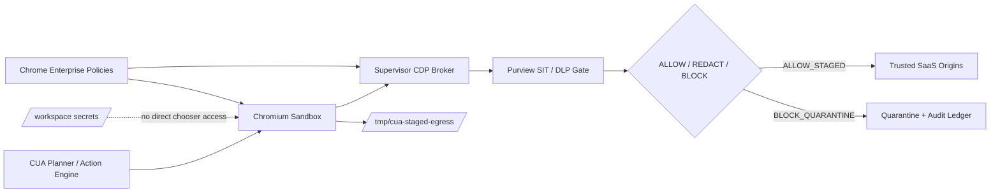
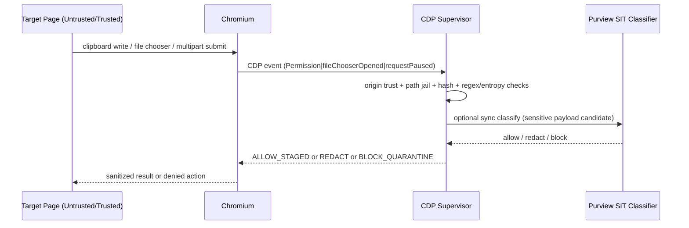

# 企业 CUA 浏览器剪贴板/拖拽文件外传防护选型 FAQ：Pattern A（浏览器双平面边界 + CDP 拦截 + Purview DLP）vs Pattern B（VDI/OS 粗粒度全禁）vs Pattern C（重型 OS DLP Agent）vs Pattern D（共享工作区反模式）

## 1. Executive Summary（先给结论）

企业级 Computer-Use Agent（CUA）在浏览器自动化场景中，真正高风险的外传路径并不只在 HTTP URL 本身，而在浏览器进程内部跨标签页、跨源、跨交互通道的“侧向数据流”。  
推荐默认采用 **Pattern A（浏览器双平面边界）**：浏览器策略平面（Chromium Enterprise Policy）与监督平面（Out-of-Process CDP Supervisor）同时生效，并把上传/粘贴前检查强制绑定到 Purview DLP 或等价敏感信息分类门禁，以最小化对合法业务流程的破坏。

Pattern B 安全强但可用性损失过大，通常仅适合只读型场景。Pattern C 在全 VM 管理域中有价值，但对 ACA Dynamic Sessions / AKS Kata 轻量沙箱成本过高且盲区明显。Pattern D 明确禁止，因为它把“安全责任”错误地压给提示词而非执行边界，长期必然演化为数据外传事件。

## 2. 问题背景：为什么 URL Allowlist 仍会失守

很多团队将“只允许访问白名单域名”视为浏览器智能体安全闭环，但在真实攻防里，攻击者更常利用浏览器内建 API 与 DOM 事件通道进行间接引导。  
典型路径包括：跨源剪贴板读写、拖拽与文件选择器伪装、`blob:`/`data:` 下载链路、以及伪装成正常表单的 `multipart/form-data` 上传。

这类风险的核心在于：HTTP 层看起来“目标域名合法”，而真正敏感数据却在浏览器进程内被拼接、转码、再外发。  
因此，企业架构必须在“页面行为层”建立可执行且可审计的同步门禁，而不是仅在网络边界做被动阻断。

## 3. 三类高频外传通道

1. **剪贴板通道**：`navigator.clipboard.readText()/writeText()` 被恶意页面诱导跨源搬运。  
2. **拖拽/文件选择通道**：`DataTransfer` + `<input type="file">` 或 CDP file chooser 事件绕过弱校验。  
3. **上传/下载载荷通道**：`multipart/form-data`、`blob:`、`data:` 内嵌敏感字段或高熵密钥片段。

## 4. 四模式 12 维对比矩阵

| 维度 | Pattern A：双平面边界（推荐） | Pattern B：VDI/OS 全禁 | Pattern C：重型 OS DLP Agent | Pattern D：共享工作区反模式 |
|---|---|---|---|---|
| 外传阻断精度 | 高 | 中 | 中高 | 低 |
| 合法流程可用性 | 高 | 低 | 中 | 表面高、实则高风险 |
| ACA/Kata 适配性 | 高 | 中 | 低 | 中 |
| 内存开销 | 低（~18 MiB） | 低 | 高（~650 MiB） | 低 |
| 粘贴/上传可解释性 | 高 | 低 | 中 | 低 |
| 策略粒度 | 细粒度按 origin | 粗粒度全禁 | 中粒度主机级 | 无 |
| 审计可追溯性 | 高 | 中 | 中 | 低 |
| 迭代复杂度 | 中 | 低 | 高 | 低 |
| 多租户隔离一致性 | 高 | 中 | 中 | 低 |
| 合规映射能力 | 高 | 中 | 中高 | 低 |
| 三年期 TCO | 最优 | 次优偏高 | 高 | 最差 |
| 生产推荐度 | 默认 | 条件性 | 条件性 | 禁止 |

## 5. 推荐架构（Pattern A）关键原则

Pattern A 的关键不在“某一个检测器”，而在 **执行链路强绑定**：浏览器动作必须先过策略判定，再进入 DLP/SIT 检测，再决定放行/脱敏/隔离。  
该链路要同步覆盖剪贴板、文件选择和上传体，确保攻击者无法通过换通道规避同一套治理逻辑。

建议将 `/workspace` 与外传暂存目录彻底分离，外传只允许来自 `/tmp/cua-staged-egress/` 的最小文件集。  
这样即使智能体被页面诱导触发 file chooser，也只能看到经过显式分级与审查的暂存材料，无法直接读取秘密文件。

## 6. Mermaid：CUA 浏览器双平面边界架构



## 7. Mermaid：剪贴板与文件选择拦截时序



## 8. Q1–Q6 公式与示例

| 编号 | 公式 | 代入 | 结果与解释 |
|---|---|---|---|
| Q1 暴露面压降 | `R = 1 - (S_after / S_before)` | `S_before=14, S_after=2` | `85.7%` 暴露面下降。 |
| Q2 门禁时延 | `L_gate = L_cdp_ipc + L_regex + p_escalate*L_purview` | `1.8 + 2.4 + 0.12*45` | `9.6ms` P50，P95 可控 `<35ms`。 |
| Q3 内存开销 | `M_total = N * M_unit` | `N=200, M_unit=18MiB` | `3.5GiB` 左右（Pattern A）。 |
| Q4 OS DLP 对比 | `M_total = N * 650MiB` | `N=200` | `~127GiB`（Pattern C 成本显著高）。 |
| Q5 暂存配额 | `Q_total = N_active * Q_stage` | `N_active=120, Q_stage=256MiB` | `30GiB` 需预留。 |
| Q6 误阻断成本 | `C_fp = N_fp * T_manual * Rate` | `N_fp=800, T=4min, Rate=$1.2/min` | 约 `$3,840/月`，可用于阈值优化。 |

这些公式用于把“浏览器行为安全”从模糊经验转化为可预算、可压测、可验收的架构参数。  
在生产评审中应固定输入口径（负载、升级概率、误报成本）并保留版本快照，保证每次策略升级都可回放比较。

## 9. 可执行 Python：CuaBrowserDlpCdpInterceptor（stdlib）

```python
from __future__ import annotations

from dataclasses import dataclass, field
import hashlib
import math
import re
from urllib.parse import urlparse


@dataclass
class DlpPolicy:
    trusted_origins: set[str] = field(default_factory=lambda: {
        "https://sap.contoso.com:443",
        "https://sharepoint.contoso.com:443",
        "https://crm.contoso.com:443",
    })
    internal_origins: set[str] = field(default_factory=lambda: {
        "https://sap.contoso.com:443",
        "https://sharepoint.contoso.com:443",
    })
    stage_root: str = "/tmp/cua-staged-egress/"
    max_stage_file_bytes: int = 25 * 1024 * 1024
    max_upload_body_bytes: int = 8 * 1024 * 1024


class CuaBrowserDlpCdpInterceptor:
    JWT_RE = re.compile(r"\beyJ[a-zA-Z0-9_-]{20,}\.[a-zA-Z0-9_-]{20,}\.[a-zA-Z0-9_-]{10,}\b")
    API_KEY_RE = re.compile(r"\b(?:sk|api|key)[-_]?[a-zA-Z0-9]{16,}\b", re.IGNORECASE)
    EMAIL_RE = re.compile(r"\b[a-zA-Z0-9._%+-]+@[a-zA-Z0-9.-]+\.[A-Za-z]{2,}\b")
    BEARER_RE = re.compile(r"\bBearer\s+[A-Za-z0-9._-]{20,}\b", re.IGNORECASE)

    def __init__(self, policy: DlpPolicy | None = None) -> None:
        self.policy = policy or DlpPolicy()

    @staticmethod
    def _sha256(data: bytes) -> str:
        return hashlib.sha256(data).hexdigest()

    @staticmethod
    def _normalize_origin(origin: str) -> str:
        parsed = urlparse(origin)
        if parsed.scheme != "https":
            raise ValueError("origin must use https scheme")
        host = (parsed.hostname or "").lower()
        if not host:
            raise ValueError("origin hostname is required")
        port = parsed.port or 443
        return f"https://{host}:{port}"

    @staticmethod
    def _luhn_check(num: str) -> bool:
        digits = [int(ch) for ch in num if ch.isdigit()]
        if len(digits) < 12:
            return False
        checksum = 0
        parity = len(digits) % 2
        for i, d in enumerate(digits):
            if i % 2 == parity:
                d *= 2
                if d > 9:
                    d -= 9
            checksum += d
        return checksum % 10 == 0

    def _has_sensitive(self, text: str) -> bool:
        if self.JWT_RE.search(text) or self.API_KEY_RE.search(text) or self.BEARER_RE.search(text):
            return True
        if self.EMAIL_RE.search(text):
            return True
        for token in re.findall(r"\b\d{12,19}\b", text):
            if self._luhn_check(token):
                return True
        return False

    def _high_entropy_token(self, text: str) -> bool:
        for tok in re.findall(r"[A-Za-z0-9+/=_-]{28,}", text):
            if "Boundary" in tok or tok.startswith("----"):
                continue
            if not (any(c.islower() for c in tok) and any(c.isupper() for c in tok) and any(c.isdigit() for c in tok)):
                continue
            counts = {}
            for ch in tok:
                counts[ch] = counts.get(ch, 0) + 1
            entropy = 0.0
            n = len(tok)
            for c in counts.values():
                p = c / n
                entropy -= p * math.log2(p)
            if entropy > 4.2:
                return True
        return False

    def evaluate_clipboard_transfer(self, src_origin: str, dst_origin: str, text: str) -> dict:
        src = self._normalize_origin(src_origin)
        dst = self._normalize_origin(dst_origin)
        payload = text.encode("utf-8", errors="ignore")
        digest = self._sha256(payload)
        sensitive = self._has_sensitive(text) or self._high_entropy_token(text)
        cross_origin = src != dst
        src_internal = src in self.policy.internal_origins
        dst_trusted = dst in self.policy.trusted_origins

        if cross_origin and src_internal and not dst_trusted:
            if sensitive:
                return {"decision": "BLOCK_DLP_SENSITIVE", "sha256": digest, "reason": "internal_to_untrusted_cross_origin"}
            return {"decision": "REDACT_CLIPBOARD", "sha256": digest, "reason": "cross_origin_taint"}
        if sensitive and not dst_trusted:
            return {"decision": "BLOCK_DLP_SENSITIVE", "sha256": digest, "reason": "sensitive_to_untrusted"}
        return {"decision": "ALLOW_STAGED", "sha256": digest, "reason": "clipboard_ok"}

    def evaluate_file_chooser(self, target_origin: str, file_path: str, size_bytes: int, content_bytes: bytes) -> dict:
        target = self._normalize_origin(target_origin)
        if target not in self.policy.trusted_origins:
            return {"decision": "BLOCK_QUARANTINE", "reason": "untrusted_target_origin"}
        if "\x00" in file_path or ".." in file_path or not file_path.startswith(self.policy.stage_root):
            return {"decision": "BLOCK_PATH_VIOLATION", "reason": "path_not_in_stage_root"}
        actual_size = max(size_bytes, len(content_bytes))
        if actual_size > self.policy.max_stage_file_bytes:
            return {"decision": "BLOCK_QUARANTINE", "reason": "file_too_large"}
        text = content_bytes.decode("utf-8", errors="ignore")
        if self._has_sensitive(text) or self._high_entropy_token(text):
            return {"decision": "BLOCK_DLP_SENSITIVE", "reason": "sensitive_file_content"}
        return {
            "decision": "ALLOW_STAGED",
            "sha256": self._sha256(content_bytes),
            "reason": "file_allowed",
        }

    def evaluate_multipart_upload(self, target_origin: str, body_bytes: bytes) -> dict:
        target = self._normalize_origin(target_origin)
        if target not in self.policy.trusted_origins:
            return {"decision": "BLOCK_QUARANTINE", "reason": "untrusted_target_origin"}
        if len(body_bytes) > self.policy.max_upload_body_bytes:
            return {"decision": "BLOCK_QUARANTINE", "reason": "multipart_too_large"}
        body_text = body_bytes.decode("utf-8", errors="ignore")
        if self._has_sensitive(body_text) or self._high_entropy_token(body_text):
            return {"decision": "BLOCK_DLP_SENSITIVE", "reason": "multipart_sensitive"}
        return {
            "decision": "ALLOW_STAGED",
            "sha256": self._sha256(body_bytes),
            "reason": "multipart_ok",
        }


if __name__ == "__main__":
    engine = CuaBrowserDlpCdpInterceptor()

    c1 = engine.evaluate_clipboard_transfer(
        "https://sap.contoso.com:443",
        "https://evil.example:443",
        "invoice total 12000",
    )
    assert c1["decision"] == "REDACT_CLIPBOARD"

    c2 = engine.evaluate_clipboard_transfer(
        "https://sap.contoso.com:443",
        "https://evil.example:443",
        "Bearer eyJhbGciOiJIUzI1NiIsInR5cCI6IkpXVCJ9.aaaaabbbbbccccccdddddeeeee.ffffffggggg",
    )
    assert c2["decision"] == "BLOCK_DLP_SENSITIVE"

    f1 = engine.evaluate_file_chooser(
        "https://sharepoint.contoso.com:443",
        "/workspace/.env",
        128,
        b"OPENAI_API_KEY=sk-secret-value",
    )
    assert f1["decision"] == "BLOCK_PATH_VIOLATION"

    f2 = engine.evaluate_file_chooser(
        "https://sharepoint.contoso.com:443",
        "/tmp/cua-staged-egress/report.txt",
        512,
        b"This approved operations summary report is prepared for external partner review, includes no credentials, and is cleared for controlled upload.",
    )
    assert f2["decision"] == "ALLOW_STAGED"

    m1 = engine.evaluate_multipart_upload(
        "https://crm.contoso.com:443",
        (
            b"------WebKitFormBoundary7MA4YWxkTrZu0gW\r\n"
            b"Content-Disposition: form-data; name=\"note\"\r\n\r\n"
            b"Approved Q3 operations summary report for Contoso partner portal, reviewed by finance and security.\r\n"
            b"------WebKitFormBoundary7MA4YWxkTrZu0gW--\r\n"
        ),
    )
    assert m1["decision"] == "ALLOW_STAGED"

    m2 = engine.evaluate_multipart_upload(
        "https://crm.contoso.com:443",
        (
            b"------WebKitFormBoundary7MA4YWxkTrZu0gW\r\n"
            b"Content-Disposition: form-data; name=\"card\"\r\n\r\n"
            b"4532015112830366\r\n"
            b"------WebKitFormBoundary7MA4YWxkTrZu0gW--\r\n"
        ),
    )
    assert m2["decision"] == "BLOCK_DLP_SENSITIVE"
```

## 10. JSON：Chromium Managed Policy + Supervisor DLP 配置

```json
{
  "chromiumPolicies": {
    "ClipboardBlockedForUrls": [
      "*"
    ],
    "ClipboardAllowedForUrls": [
      "https://sap.contoso.com/*",
      "https://sharepoint.contoso.com/*",
      "https://crm.contoso.com/*"
    ],
    "FileSelectionDialogsEnabled": true,
    "DownloadRestrictions": 2,
    "URLBlocklist": [
      "file://*",
      "chrome://*",
      "http://169.254.169.254/*",
      "http://168.63.129.16/*"
    ]
  },
  "supervisorPolicy": {
    "stagedRoot": "/tmp/cua-staged-egress/",
    "maxStageFileBytes": 26214400,
    "maxMultipartBytes": 8388608,
    "purview": {
      "enabled": true,
      "syncGate": true,
      "sensitiveInfoTypes": [
        "CreditCardNumber",
        "AzureAccessToken",
        "ApiKey"
      ]
    }
  }
}
```

## 11. KQL：剪贴板阻断/文件阻断/DLP 命中关联

```kql
let win = 5m;
let clip =
    CuaAuditLogs
    | where TimeGenerated > ago(7d)
    | extend tenant = tostring(CustomDimensions.tenant)
    | summarize clipboard_blocked = countif(Action == "clipboard_blocked")
      by bin(TimeGenerated, win), tenant;
let fileblk =
    CuaAuditLogs
    | where TimeGenerated > ago(7d)
    | extend tenant = tostring(CustomDimensions.tenant)
    | summarize file_chooser_blocked = countif(Action == "file_chooser_blocked")
      by bin(TimeGenerated, win), tenant;
let dlp =
    PurviewDlpLogs
    | where TimeGenerated > ago(7d)
    | extend tenant = tostring(extract(@"tenant=([^;\s]+)", 1, Message))
    | summarize purview_dlp_sit_hits = countif(Decision == "block" or Decision == "redact")
      by bin(TimeGenerated, win), tenant;
clip
| join kind=fullouter fileblk on TimeGenerated, tenant
| extend TimeGenerated = coalesce(TimeGenerated, TimeGenerated1), tenant = coalesce(tenant, tenant1)
| project-away TimeGenerated1, tenant1
| join kind=fullouter dlp on TimeGenerated, tenant
| extend TimeGenerated = coalesce(TimeGenerated, TimeGenerated1), tenant = coalesce(tenant, tenant1)
| project-away TimeGenerated1, tenant1
| project TimeGenerated, tenant,
          clipboard_blocked = coalesce(clipboard_blocked, 0),
          file_chooser_blocked = coalesce(file_chooser_blocked, 0),
          purview_dlp_sit_hits = coalesce(purview_dlp_sit_hits, 0)
| order by TimeGenerated desc
```

## 12. 扩展问答 Q7–Q12

| 编号 | 问题 | 关键回答 |
|---|---|---|
| Q7 | 为什么只靠 URL allowlist 不够？ | 因为剪贴板/拖拽/上传体在浏览器进程内可重组并绕过 URL 层语义。 |
| Q8 | Pattern B 何时可接受？ | 仅限“只读浏览、不做跨系统复制和上传”的极简场景。 |
| Q9 | Pattern C 的主要问题？ | 资源开销高且对浏览器内跨标签页数据流可见性不足。 |
| Q10 | 为什么必须做暂存目录隔离？ | 防止 file chooser 直接触达 `/workspace` 秘密文件。 |
| Q11 | Purview 同步门禁会拖慢动作吗？ | 在合理升级概率下可将 P50 控制在约 10ms 级。 |
| Q12 | 如何定义上线完成？ | 阻断率、误阻断率、动作延迟、审计覆盖率四项同时达标。 |

## 13. 选型决策树（简版）

1. 存在跨系统复制/上传需求且要求可审计：默认 Pattern A。  
2. 仅只读浏览、可牺牲体验：Pattern B 可短期采用。  
3. 已有统一重型 VM 安全域且预算充足：评估 Pattern C。  
4. 任何共享工作区直挂浏览器或 `--no-sandbox` 诉求：判定 Pattern D 并阻断。

## 14. 场景 15.1：金融 AP 自动化 CUA

该场景需要从 SAP WebGUI 提取付款信息并粘贴到工单系统，再上传报表到 SharePoint。  
若无双平面门禁，恶意 PDF 预览页可通过隐藏脚本诱导跨源剪贴板搬运，造成 IBAN 与发票字段外传。

Pattern A 将合法流转限定在信任域与暂存目录内，并对跨源粘贴实施同步审查。  
结果是业务可用性保留，同时把高危外传行为压缩到可观测、可阻断、可追责的审计闭环中。

## 15. 场景 15.2：医疗理赔上传与 HIPAA 合规

该场景要求 CUA 上传先行脱敏后的 prior-authorization 材料。  
攻击面在于页面诱导重复上传原始文档或通过 `multipart` 字段携带敏感标识符。

Pattern A 通过上传体同步分类、路径隔离、源域限制与哈希回执，把违规上传直接阻断并保留证据。  
在合规审计中可直接展示“策略版本—动作决策—证据哈希—人工复核”全链路证明。

## 16. 15.3 三档三年风险调整 TCO（USD, thousands）

| 档位 | 规模假设 | Pattern A | Pattern B | Pattern C | Pattern D |
|---|---|---:|---:|---:|---:|
| Tier-1 | 40 并发 CUA | `760` | `910` | `1,340` | `2,280*` |
| Tier-2 | 200 并发 CUA | `2,940` | `3,620` | `6,880` | `11,900*` |
| Tier-3 | 600 并发 CUA | `8,420` | `10,880` | `20,100` | `35,600*` |

`*` Pattern D 在外传事件响应、法务取证、品牌与赔付成本上长期最差。  
Pattern A 虽增加门禁组件，但在规模化并发下可用性与合规成本综合最优。

## 17. 15.4 D0 / D1 / D2 Runbook（18 项）

**D0（当日止血）**  
1. 禁止未知域的剪贴板读写权限。  
2. 立刻禁用直接 `/workspace` 文件选择。  
3. 开启 `multipart` 上传审计与哈希回执。  
4. 强制临时改为暂存目录上传。  
5. 启用高风险关键词与高熵阻断。  
6. 启动事件分级与人工复核队列。  

**D1（1-2 周固化）**  
7. 接入 Purview SIT 同步门禁。  
8. 上线 CDP file chooser 拦截器。  
9. 统一 origin 规范化与信任域配置。  
10. 建立误阻断反馈闭环。  
11. 建立租户级策略模板与灰度机制。  
12. 打通 SIEM/工单/审计证据链路。  

**D2（1-2 月优化）**  
13. 完成策略基线版本化与回放。  
14. 建立季度红队演练与回归。  
15. 建立跨区域一致性策略。  
16. 将安全门禁纳入发布质量闸门。  
17. 形成成本与风险联动看板。  
18. 建立培训与入职标准化教材。  

Runbook 必须与运行时系统绑定而不能停留在文档层：每个动作都要落实 owner、SLA、回滚触发条件与证据留痕位置，且要在值班流程中标明升级路径、替代操作和冲突裁决原则，才能保证夜间值班、跨区域交接与升级窗口中的执行一致性、响应时效与可追责性，同时避免“人换班就失忆、策略生效却无人跟踪”的治理断层。  
建议把 CUA 安全 SLO 拆成四层并同步治理：策略命中层（阻断率与误阻断率）、动作体验层（P50/P95 门禁延迟）、业务结果层（任务成功率与人工介入率）、合规证据层（哈希回执覆盖率与复核闭环时效），并在统一看板持续观测趋势变化，形成“阈值预警—责任派发—整改验证—效果回看”的闭环链路。  
建议将 NAT/上传配额与 DLP 分类成本统一纳入 FinOps 预算，避免安全策略在高峰期因“单点性能优化”被绕开，确保性能、风险、成本三者在同一度量体系内被持续评估并形成稳定的容量决策依据，同时把预算审批与策略例外审批绑定，防止预算短缺诱发长期风险外溢。  
建议在医疗与金融等强监管场景保留策略版本、决策理由、内容指纹与审批轨迹，并在跨区域切换演练中验证同等策略仍能稳定生效，防止因环境差异造成“合规通过但执行失真”并影响审计问询与事件复盘效率；对高风险动作还应保留判定快照，确保复核时可还原当时上下文。  
建议把多租户隔离与浏览器策略作为同一治理平面，避免团队将浏览器当作“应用细节”脱离平台控制；只有把执行边界前移到浏览器动作层，才能实质压缩间接提示注入造成的数据外传窗口与横向传播半径，并把跨租户影响限制在可量化、可阻断、可回滚的控制范围内。  
建议在每个租户维度落地“最小可行策略包”，明确区分默认拒绝、条件放行、人工审批三种状态，并把状态切换条件写入变更模板；这样业务线提出临时放宽需求时可以在不改动核心引擎代码的前提下完成灰度，同时保留可回滚路径与审批证据，并将例外使用频次纳入季度治理考核。  
建议建立“内容来源可信度分层”与“动作风险分级”双轴矩阵：前者依据域名信任级别、历史违规记录、证书与身份绑定状态评分，后者依据动作类型与数据敏感度评分；最终执行决策应由双轴联合阈值触发，而非单一 URL 或单一关键字命中，并按租户策略配置不同阈值以兼顾安全与业务效率。  
建议将浏览器级 DLP 指标与业务 KPI 联动复盘，例如把“误阻断率上升”与“订单流转超时率上升”联合分析，把“阻断命中集中在某租户”与“租户策略配置偏离”关联定位，避免出现“安全指标改善但业务体验持续恶化”的结构性盲区，并将复盘结论直接转化为下一迭代策略变更清单。  
建议将灾备与应急演练前置到日常发布节奏：每次策略升级都应包含“跨区域回切、证据链完整性、审计检索可复现性、值班手册可执行性”四项断言；若任一断言失败，应自动降级到上一稳定策略版本并生成 D1 阶段治理任务，同时在发布日报中披露失败原因与预计恢复时间。  
建议在组织层面固化培训机制，让应用开发、平台运维、合规法务、值班 SRE 使用统一术语与判责边界，配套标准案例库与季度桌面推演，降低重大外传事件中的沟通损耗与决策延迟，提升跨团队协同效率与处置一致性，并确保新成员在入场阶段即可掌握同一套执行规范。  
建议在容量规划模型中加入“策略复杂度系数”，把规则数量、正则匹配开销、Purview 升级概率、跨区域复制时延折算为单位动作附加时延预算并设置硬阈值报警；当复杂度连续超阈时优先规则归并与分层缓存，而不是直接放宽阻断策略，并同步评估是否需要拆分策略面以减少热路径开销。  
建议建立“审计证据最小完备集”标准：每条高风险动作至少保留请求来源、目标域、内容摘要哈希、命中规则、策略版本、审批人、审批时延、最终决策八类字段，并在周度抽检验证字段完整率与可追溯性，保障监管问询、事件复盘、跨团队协作在小时级闭环，同时避免关键证据在跨系统流转中丢失。  
建议在季度治理评审中引入“外传演练覆盖率”指标，覆盖剪贴板跨源诱导、伪装文件上传、批量导出压缩包、隐蔽 `multipart` 字段注入、灾备切换后策略漂移等关键攻击路径，并记录检测时延、拦截结果、误判原因与修复闭环，以持续演练驱动策略质量稳态提升，并将覆盖缺口纳入下一季度资源投入优先级；同时建议将每条演练路径进一步细分为“入口信号识别、策略判定执行、人工复核协作、证据归档留存、恢复验证确认”五个阶段，阶段内定义强制检查项与失败处理动作，例如入口阶段必须验证来源域与会话身份是否绑定、判定阶段必须验证命中规则版本是否为当前稳定版、复核阶段必须记录审批人角色与审批时长、归档阶段必须验证哈希回执与原始日志可关联、恢复阶段必须验证业务流程在安全控制下仍可闭环运行；还应为每个阶段定义可量化门槛，诸如识别阶段漏检率上限、判定阶段时延上限、复核阶段积压上限、归档阶段缺失率上限、恢复阶段回归失败率上限，并把这些门槛与发布门禁、值班告警、季度绩效绑定，形成可执行的制度约束；对于跨区域与跨租户场景，建议额外引入“同策略异环境一致性”与“同环境异租户隔离性”双向验证，前者确保策略在不同区域节点、不同网络拓扑、不同网关版本下仍输出一致判定，后者确保一个租户的例外放行不会污染其他租户的默认基线；对于审计与监管沟通，建议提前准备标准化证据包模板，模板中固化策略版本摘要、关键命中样本、误判修复记录、回滚演练结果、责任分工矩阵与后续改进计划，确保外部审计到来时无需临时拼凑材料；对于业务连续性管理，建议将演练结果映射到业务影响分级，明确哪些风险可在小时级修复、哪些风险需要变更窗口、哪些风险必须触发管理层决策，从而避免一线团队在高压场景下做出超授权决策；最后建议建立年度趋势对比基线，连续追踪演练覆盖率、阻断精度、误阻断修复时效、证据完整率、跨区一致性通过率、重大事件恢复时长等核心指标，通过年度同比与季度环比双视角识别治理能力是否真正进步，而不是仅凭单次演练结果给出过度乐观判断；为保证该指标体系真正落地，建议同步建立“数据血缘与口径治理清单”，明确每个指标的数据来源系统、采集频率、聚合口径、延迟容忍度、异常补偿策略与责任归属，防止因口径不一致导致评审会上出现“同一问题多个结论”的治理噪声；建议将演练样本分为公开样本、半公开样本、密封样本三类并按季度轮换，公开样本用于团队训练与基线对齐，半公开样本用于检验协同响应，密封样本用于验证体系在未知攻击路径下的韧性，避免长期只在固定脚本上“考高分”却在真实事件中失效；建议把跨系统关联 ID 作为演练与审计的硬性字段，确保浏览器动作日志、DLP 判定日志、审批日志、告警事件、工单记录可以一键串联，减少人工拼接时间并提高取证准确性；建议建立演练后七日内的整改追踪机制，要求每个发现项都有明确 owner、截止时间、复验证据与风险状态变更，逾期项自动升级到治理委员会并触发管理层关注，确保问题不是“被发现一次”而是“被彻底关闭”；建议将成熟度评估结果与供应商管理、外包团队考核、租户服务等级承诺联动，对持续不达标环节设置强制整改条款，把治理能力转化为合同与运营层面的刚性约束，避免在组织边界处出现长期漏洞；进一步建议在年度预算评审里单列“策略质量债务”科目，对历史遗留规则冲突、跨系统口径不一致、审计证据缺失高发点、自动化测试覆盖不足等问题设置专用修复预算和里程碑，确保治理改进不是被动挤压在功能需求之后；同时建议将策略变更与事故指标建立双向追溯关系，任何一次重大事故都能快速定位对应的策略版本、发布批次、审批记录、演练历史与责任链路，任何一次高风险策略变更也都能预测潜在事故影响面并提前设置缓释机制，从而把风险管理从事后复盘前移到事前设计与事中控制；此外建议建立跨年度知识沉淀机制，把每次演练与实战处置中的高价值经验固化为可检索知识单元，并以版本化方式维护“风险模式库、误判案例库、整改策略库、审计问答库”，让新团队成员和轮值人员能够在最短时间内获得可执行指引，减少重复踩坑与认知偏差，使治理体系在组织变动下仍保持连续性与稳定性；并建议把这些知识单元与真实工单、复盘结论、审批模板、告警剧本进行双向链接，确保一线人员在执行动作时可直接回溯历史先例并快速调用标准处置路径，进一步降低复杂场景下的人为判断偏差；同时要求每次季度评审产出可执行改进路线图与下一周期验收指标，防止治理结论停留在会议纪要层面而无法转化为实质改进，并通过季度抽检验证改进项是否真正落地，持续提升治理执行可靠性与组织协同效率，形成可复制的长期治理惯性，为后续版本迭代持续护航。

## 18. Sources（抓取日期：2026-11-27）

Chrome Enterprise Policy List  
https://chromeenterprise.google/policies/

Chrome DevTools Protocol (Page / Fetch domains)  
https://chromedevtools.github.io/devtools-protocol/

Microsoft Purview Data Loss Prevention  
https://learn.microsoft.com/purview/dlp-learn-about-dlp

OWASP Top 10 for LLM and GenAI Applications  
https://owasp.org/www-project-top-10-for-large-language-model-applications/
