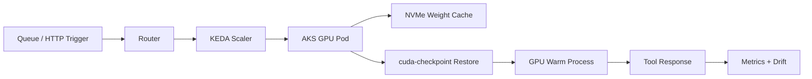
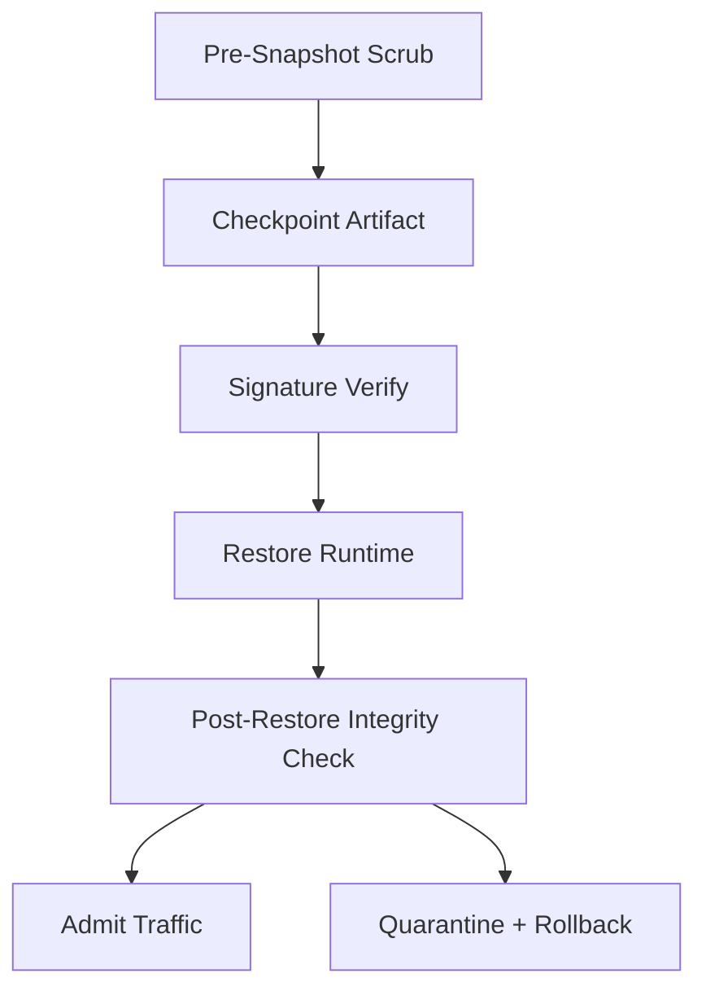

# GPU Cold-Start Elimination Selection FAQ: AKS + CRIUgpu/cuda-checkpoint + NVMe Weight Cache vs ACA Serverless GPU vs Foundry Managed Endpoints

## 1. Problem statement: scale-from-zero bottlenecks are dominated by GPU process warmup chains

Enterprise multimodal agent systems often fail on “first request timeout.”

At the surface, it looks like API timeout.

At runtime, the root issue is long GPU readiness chains.

Typical chain stages:

- image pull,
- container bootstrap,
- Python/runtime import graph load,
- CUDA context creation,
- safetensors deserialization,
- graph capture and kernel warmup.

For 14B–32B specialist models, the chain can take 90s–420s.

If business SLA requires `<8s` tool responses, this is unacceptable.

Teams then face an expensive binary:

- keep warm replicas running continuously,
- or accept timeout-heavy user experience.

This FAQ focuses on escaping that binary.

## 2. Scope clarification: this is not generic hosting and not prefill/decode disaggregation

This problem differs from broad model-hosting comparisons.

The focal workload is low-duty-cycle, bursty specialist GPU tools.

Examples:

- OCR specialists,
- speech transcription models,
- CAD element analyzers,
- chemistry/biology acceleration workers,
- multimodal visual extraction workers.

Each model may be used intermittently.

Yet each invocation needs near-interactive response.

Compared to prefill/decode disaggregation, this topic emphasizes:

- process snapshot and restore,
- local weight cache strategy,
- multi-model GPU pool density under strict latency constraints.

## 3. Option map: A ACA Serverless GPU, B AKS CRIUgpu pooling, C Foundry warm baseline

### Option A: ACA Serverless GPU

Characteristics:

- highly managed operational surface,
- straightforward autoscaling behavior,
- rapid onboarding path.

Advantages:

- lower platform operations burden,
- easier event-driven scaling integration.

Limitations:

- less low-level runtime control,
- constrained flexibility for deep cold-start internals.

### Option B: AKS + NVMe cache + cuda-checkpoint/CRIUgpu

Characteristics:

- highest customization flexibility,
- local weight cache and process snapshot restoration,
- composable MIG/MPS/time-slicing controls.

Advantages:

- strongest cold-start reduction potential,
- improved multi-model pool utilization.

Tradeoffs:

- highest engineering complexity,
- stronger safety and snapshot-governance requirements.

### Option C: Foundry managed endpoints with warm baseline

Characteristics:

- mature governance and operations posture,
- predictable warm-instance behavior.

Advantages:

- stable baseline latency behavior,
- cleaner managed release controls.

Tradeoffs:

- ongoing warm-capacity costs,
- less favorable economics for long-tail low-duty specialist pools.

## 4. 12-dimension selection matrix

| Dimension | Option A: ACA Serverless GPU | Option B: AKS CRIUgpu Pool | Option C: Foundry Warm Baseline |
|---|---|---|---|
| p95 scale-from-zero latency | medium | high | high |
| cold-start optimization ceiling | medium | high | medium |
| multi-model GPU density | medium | high | medium |
| platform operations complexity | low-medium | high | medium |
| security-state clearing control | medium | high | medium-high |
| weight cache strategy control | medium | high | low-medium |
| delivery speed | high | medium | high |
| low-duty-cycle cost floor | high | high | medium |
| auditability posture | medium | high | high |
| rollback flexibility | medium | high | medium |
| 3-year TCO controllability | medium | high | medium |
| recommendation | fast-start path | scale economics leader | steady-core path |

This matrix optimizes for production economics and reliability, not demo convenience.

## 5. Bottleneck decomposition: image layer, weight layer, process layer, GPU state layer

Cold-start reduction requires layer-by-layer strategy.

### Image layer

Artifact streaming techniques (Stargz/OverlayBD patterns) reduce startup transfer delays.

### Weight layer

Local NVMe caching with mmap access avoids repeated remote deserialization penalties.

### Process layer

Checkpoint/restore preserves expensive runtime initialization work.

### GPU state layer

cuda-checkpoint style workflows recover prewarmed CUDA execution state.

Only multi-layer optimization consistently achieves single-digit second startup targets.

## 6. End-to-end AKS architecture for low-cold-start specialist pools



This topology combines event scaling, local cache, and warm-process restore in one control loop.

## 7. Runtime safety controls: pre-snapshot scrub, post-restore integrity checks, tenant isolation

Snapshot acceleration without governance can leak state.

Mandatory controls include:

- pre-snapshot context and cache scrubbing,
- prohibition of sensitive user payload persistence in reusable snapshots,
- restore-time integrity verification,
- tenant-isolated snapshot repositories,
- signed snapshot artifacts and provenance checks.

For multi-tenant systems, performance gains must never override isolation guarantees.

Supplementary control-loop topology for secure snapshot lifecycle



## 8. Production snippets: NVMe cache DaemonSet + cuda-checkpoint workflow + KEDA queue scaler

### 8.1 DaemonSet NVMe cache warmer

```yaml
apiVersion: apps/v1
kind: DaemonSet
metadata:
  name: gpu-weight-cache-warmer
spec:
  selector:
    matchLabels:
      app: gpu-weight-cache-warmer
  template:
    metadata:
      labels:
        app: gpu-weight-cache-warmer
    spec:
      nodeSelector:
        accelerator: nvidia
      containers:
        - name: warmer
          image: mcr.microsoft.com/azurelinux/base:3.0
          command: ["/bin/sh", "-c"]
          args:
            - |
              mkdir -p /nvme/models &&
              azcopy cp "https://storage.example/models/*.safetensors" "/nvme/models/" --recursive=true &&
              sleep 3600
          volumeMounts:
            - name: nvme-cache
              mountPath: /nvme
      volumes:
        - name: nvme-cache
          hostPath:
            path: /mnt/local-nvme
            type: DirectoryOrCreate
```

### 8.2 cuda-checkpoint lifecycle

```bash
# 1) lock process state
cuda-checkpoint --pid $MODEL_PID --action lock

# 2) create checkpoint artifact
cuda-checkpoint --pid $MODEL_PID --action checkpoint --output /snapshots/model.ckpt

# 3) restore on demand
cuda-checkpoint --action restore --input /snapshots/model.ckpt
```

### 8.3 KEDA queue scaler

```yaml
apiVersion: keda.sh/v1alpha1
kind: ScaledObject
metadata:
  name: gpu-worker-queue
spec:
  scaleTargetRef:
    name: gpu-worker
  minReplicaCount: 0
  maxReplicaCount: 30
  triggers:
    - type: azure-queue
      metadata:
        queueName: multimodal-jobs
        queueLength: "5"
```

## 9. Option A deep dive: fast delivery and low ops, with constrained deep-runtime tuning

Option A is strongest when:

- timelines are tight,
- platform teams are small,
- priority is immediate production onboarding.

For many mid-scale teams, ACA Serverless GPU can significantly reduce day-0 friction.

However, in high-model-count low-duty pools, deep runtime and snapshot control ceilings may limit optimization potential.

Therefore Option A is frequently an excellent phase-one architecture, not always phase-three optimum.

## 10. Option B deep dive: best long-run economics with highest engineering burden

Option B enables conversion from “one warm GPU per model” to pooled restore-on-demand behavior.

For 25 low-duty specialist models, this can materially improve utilization.

Typical gains:

- lower idle GPU burn,
- lower cold-start latency,
- higher aggregate pool density.

Required capabilities:

- robust snapshot lifecycle governance,
- compatibility management across driver/runtime versions,
- deterministic rollback and incident playbooks.

Without these, operational overhead can erase performance savings.

## 11. Option C deep dive: warm baseline as a stability-first pattern

Option C offers predictable startup behavior through maintained warm capacity.

It is favorable for strict SLA core models.

Managed endpoint governance and release controls are often operationally attractive.

But for sparse long-tail specialists, always-warm economics can be unfavorable.

Hence Option C is typically best for high-frequency core workloads, not broad low-utilization specialist fleets.

## 12. TCO model: 25 low-duty-cycle specialist GPU tools over 3 years

### 12.1 assumptions

- 25 specialist models, average duty cycle 12%,
- peak concurrency 180,
- 280k daily requests,
- SLA p95 < 8s,
- A100/H100 mixed pool assumptions.

### 12.2 always-on baseline

- warm instance cost: `$425k/month`
- operations and support: `$58k/month`
- total: `$483k/month`
- 3-year: `$17.39M`

### 12.3 Option A (ACA Serverless GPU)

- compute consumption: `$238k/month`
- image/cache optimization overhead: `$21k/month`
- operations: `$34k/month`
- total: `$293k/month`
- 3-year: `$10.55M`

### 12.4 Option B (AKS + NVMe + CRIUgpu)

- shared GPU pool: `$176k/month`
- storage/cache/snapshot infra: `$29k/month`
- platform engineering + SRE: `$47k/month`
- total: `$252k/month`
- 3-year: `$9.07M`

### 12.5 Option C (Foundry warm baseline)

- endpoint warm baseline + elasticity: `$268k/month`
- governance and operations: `$39k/month`
- total: `$307k/month`
- 3-year: `$11.05M`

## 13. Scenario A: global manufacturing vision/OCR specialist pool

Objectives:

- reduce first-response p95 from 142s to under 6s,
- preserve structured tool-call correctness,
- cut idle spend by more than 40%.

Execution sequence:

- image streaming and NVMe cache first,
- process snapshot/restore second,
- routing/fallback policy integration third.

Governance anchors:

- snapshot content audit controls,
- deterministic fallback on restore failure,
- isolated failure queues with bounded retries.

## 14. Scenario B: real-time multimedia customer-service agent stack

Objectives:

- keep p95 under 7.5s during spikes,
- approach scale-to-zero behavior during trough windows,
- launch in three regions within one quarter.

Pattern:

- warm baseline for high-frequency models,
- pooled restore-on-demand for long-tail specialists,
- dual-path redundancy for critical flows.

Outcome focus:

- SLA and cost balanced simultaneously,
- region-specific tuning support,
- straightforward FinOps integration.

## 15. Deep Q&A and five-step implementation guide

Q1: why do image-layer optimizations alone underperform?

Because weight loading and CUDA initialization often dominate total cold-start time.

Q2: do snapshots introduce dirty-state risk?

Yes.

Use pre-snapshot scrubbing and post-restore integrity checks as mandatory controls.

Q3: when should ACA be preferred over AKS?

When delivery speed and low platform overhead are the primary constraints.

Q4: when should AKS self-hosted pools be preferred?

When model count is high, duty cycles are low, and long-run cost pressure is strong.

Q5: what is the best use of Foundry warm baseline?

Reserve it for high-frequency core workloads where startup predictability is critical.

Q6: what is a Good fit profile?

- strong cold-start sensitivity,
- sizable specialist model fleet,
- willingness to invest in platform engineering,
- governance and audit maturity.

Q7: what is a Not for profile?

- no SRE/platform ownership capacity,
- inability to manage snapshot governance risk,
- workload scale too small to justify engineering overhead.

Q8: practical five-step rollout sequence

Step 1: measure cold-start latency by layer with real production traces.

Step 2: deploy image streaming and local weight cache first.

Step 3: add snapshot restore with strict security controls.

Step 4: implement fallback routing and observability guardrails.

Step 5: run monthly SLA-cost-failure mode review and tune continuously.

Final recommendation:

GPU cold-start elimination is not a single optimization trick.

It is a systems architecture discipline spanning runtime, cache, snapshot lifecycle, security hygiene, routing policy, and ongoing operational governance.

Q9: how should automatic degradation be designed when snapshot restore fails?

A practical three-tier policy is:

- first failure: retry restore on the same node with cold-process fallback,
- second failure: route to alternate warm node pool,
- repeated failure: route to managed stable endpoint and trigger human incident workflow.

This keeps user-facing SLA impact bounded while preserving forensic context.

Q10: which KPI bundle determines whether snapshot optimization should remain enabled?

Use a joint KPI set instead of one metric:

- p95 scale-from-zero latency improvement,
- snapshot restore failure rate,
- additional platform operations effort,
- end-to-end cost per successful request.

Only sustained positive movement across this bundle justifies long-term retention.

Q11: should checkpoint/restore be enabled for every model?

Not necessarily.

Highest ROI usually appears on models with:

- expensive initialization,
- low average duty cycle,
- bursty invocation patterns,
- strict first-response latency requirements.

For always-hot high-frequency models, warm baseline strategies can be simpler and equally effective.

Q12: how should multi-region snapshot strategy be implemented?

Direct cross-region runtime-snapshot replication is often fragile.

A safer pattern is:

- version-locked rebuild per region,
- regional cache warming pipelines,
- explicit failover to pre-approved warm baseline capacity during incident states.

This approach reduces cross-region artifact inconsistency risk.

Q13: what governance cadence keeps optimization sustainable?

A dual cadence works well:

- biweekly engineering reviews for restore success, queue anomalies, and latency tails,
- monthly business reviews for cost, SLA breaches, and optimization ROI.

Without this cadence, teams commonly overfit to benchmark snapshots and lose operational resilience.

Q14: what anti-patterns should be explicitly banned in architecture standards?

Ban at least the following patterns:

- snapshotting user-derived confidential context into reusable artifacts,
- enabling restore paths without signature verification,
- allowing unbounded retries that amplify queue storms,
- promoting latency gains without corresponding isolation validation,
- scaling decisions based on average latency while ignoring p99 timeout behavior.

These anti-pattern bans should be codified in platform policy, not left as tribal knowledge.
