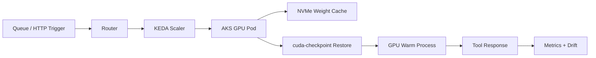
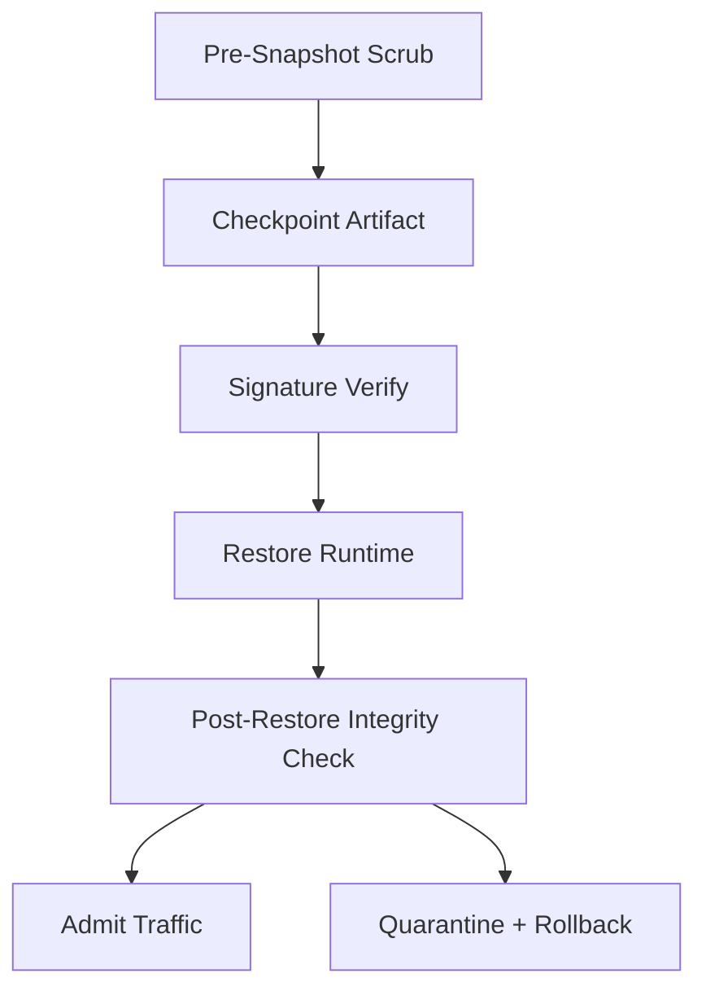

# GPU 冷启动消除选型 FAQ：AKS + CRIUgpu/cuda-checkpoint + NVMe 权重缓存 vs ACA Serverless GPU vs Foundry Managed Endpoints

## 1. 问题定义：Scale-from-zero 的真正瓶颈不在 API，而在 GPU 进程热身链路

企业在多模态智能体场景里常看到“调用超时”。

表面看是应用层超时。

本质上是 GPU 任务从零到可用的链路过长。

典型冷启动链路包括：

- 镜像拉取；
- 容器启动；
- Python 解释器与依赖初始化；
- CUDA context 创建；
- 权重反序列化；
- CUDA Graph capture 或 kernel warmup。

在 14B–32B 专项模型下，这条链路可达 90s–420s。

当业务 SLA 要求 `<8s` 工具响应时，冷启动成为核心阻塞。

企业要么保持 `min_replicas=1` 长期开机付费。

要么接受大量首包超时。

本指南讨论如何在两者之间构建可持续架构。

## 2. 边界澄清：这不是通用“模型托管”问题，也不是 prefill/decode 解耦问题

与一般托管选型不同，本议题重点是“低负载高突发”专用 GPU 工具池。

例如：

- OCR 专项模型；
- 语音转写模型；
- CAD 图元解析模型；
- 化学/生物计算加速模型；
- 视觉检测与分割模型。

这些模型每个都可能低占空比。

但业务要求“随叫随到”。

与 prefill/decode 解耦问题相比，本议题更关注：

- 进程快照恢复；
- 权重本地缓存；
- 多模型共享 GPU 池的冷启动治理。

## 3. 三种候选路线：A ACA Serverless GPU、B AKS CRIUgpu 池化、C Foundry Warm Baseline

### Option A：ACA Serverless GPU

特点：

- 平台托管程度高；
- 伸缩模式清晰；
- 适合快速上线。

优势：

- 运维门槛低；
- 与 KEDA 事件触发整合便利。

短板：

- 深度内核级优化空间有限；
- 多模型共享密度策略可调范围较小。

### Option B：AKS + NVMe 缓存 + cuda-checkpoint/CRIUgpu

特点：

- 自定义程度最高；
- 可做权重本地化与进程快照恢复；
- 可叠加 MIG/MPS/Time-Slicing 策略。

优势：

- 冷启动压降潜力最大；
- 多租户模型池利用率更高。

短板：

- 平台工程复杂；
- 安全清理和快照治理要求高。

### Option C：Foundry Managed Endpoints + Warm Baseline

特点：

- 企业治理体验成熟；
- 可通过最小保温实例换取低冷启动风险。

优势：

- 稳定性高；
- 变更治理流程清晰。

短板：

- 持续保温成本明显；
- 对极端低 duty-cycle 场景成本不友好。

## 4. 12 维选型矩阵：冷启动、密度、安全与成本的一体比较

| 维度 | Option A：ACA Serverless GPU | Option B：AKS CRIUgpu 池化 | Option C：Foundry Warm Baseline |
|---|---|---|---|
| Scale-from-zero p95 | 中 | 高 | 高 |
| 冷启动优化上限 | 中 | 高 | 中 |
| 多模型 GPU 密度 | 中 | 高 | 中 |
| 平台运维复杂度 | 低-中 | 高 | 中 |
| 安全清理可控性 | 中 | 高 | 中-高 |
| 权重缓存控制力 | 中 | 高 | 低-中 |
| 上线速度 | 高 | 中 | 高 |
| 成本下限（低 duty） | 高 | 高 | 中 |
| 合规审计可解释性 | 中 | 高 | 高 |
| 回滚灵活性 | 中 | 高 | 中 |
| 三年 TCO 可控性 | 中 | 高 | 中 |
| 推荐结论 | 快速交付优先 | 规模化低成本首选 | 稳定保温场景首选 |

## 5. 关键瓶颈拆解：镜像层、权重层、进程层、GPU 状态层

冷启动优化必须分层治理。

### 镜像层

使用 Artifact Streaming、Stargz、OverlayBD 可减少首拉时延。

### 权重层

通过本地 NVMe 缓存和 mmap 加速，避免每次远端拉取。

### 进程层

通过 checkpoint/restore 保留解释器与框架初始化成果。

### GPU 状态层

通过 cuda-checkpoint 等机制恢复 CUDA 上下文准备态。

只有四层协同，才能从 180s 级降到秒级。

## 6. 端到端架构：AKS 池化冷启动优化参考拓扑



该拓扑中，NVMe 与快照恢复是核心加速点。

## 7. 运行时安全：快照前清理、快照后校验、跨租户隔离

GPU 快照优化若无安全治理会引入数据残留风险。

必须控制：

- 快照前清除会话态 KV；
- 禁止携带用户敏感上下文进入可复用快照；
- 快照恢复后做完整性校验；
- 不同租户快照仓隔离；
- 快照镜像签名与来源验证。

特别是多租户平台，不可将“性能优化”置于“数据隔离”之上。

补充拓扑：安全清理与恢复校验控制环



## 8. 生产片段：AKS DaemonSet NVMe 权重缓存 + cuda-checkpoint

### 8.1 DaemonSet 预热缓存示例

```yaml
apiVersion: apps/v1
kind: DaemonSet
metadata:
  name: gpu-weight-cache-warmer
spec:
  selector:
    matchLabels:
      app: gpu-weight-cache-warmer
  template:
    metadata:
      labels:
        app: gpu-weight-cache-warmer
    spec:
      nodeSelector:
        accelerator: nvidia
      containers:
        - name: warmer
          image: mcr.microsoft.com/azurelinux/base:3.0
          command: ["/bin/sh", "-c"]
          args:
            - |
              mkdir -p /nvme/models &&
              azcopy cp "https://storage.example/models/*.safetensors" "/nvme/models/" --recursive=true &&
              sleep 3600
          volumeMounts:
            - name: nvme-cache
              mountPath: /nvme
      volumes:
        - name: nvme-cache
          hostPath:
            path: /mnt/local-nvme
            type: DirectoryOrCreate
```

### 8.2 cuda-checkpoint 操作流程

```bash
# 1) lock process state
cuda-checkpoint --pid $MODEL_PID --action lock

# 2) create checkpoint artifact
cuda-checkpoint --pid $MODEL_PID --action checkpoint --output /snapshots/model.ckpt

# 3) restore on demand
cuda-checkpoint --action restore --input /snapshots/model.ckpt
```

### 8.3 KEDA 队列伸缩示例

```yaml
apiVersion: keda.sh/v1alpha1
kind: ScaledObject
metadata:
  name: gpu-worker-queue
spec:
  scaleTargetRef:
    name: gpu-worker
  minReplicaCount: 0
  maxReplicaCount: 30
  triggers:
    - type: azure-queue
      metadata:
        queueName: multimodal-jobs
        queueLength: "5"
```

## 9. ACA Serverless GPU 深度分析：快交付、低运维、受限优化

Option A 适合：

- 时间窗口紧；
- 团队平台能力有限；
- 主要目标是先把业务跑通。

在多数中等规模场景，A 能显著降低建设周期。

但当模型数量多、冷启动优化要求极高时，A 的深度可调性可能不足。

因此 A 常作为阶段性最优，而非长期极致成本最优。

## 10. AKS CRIUgpu 深度分析：极致弹性与极致复杂度并存

Option B 的价值在于可把“每模型常驻”改成“共享池按需恢复”。

在 25 个低 duty-cycle 专项模型场景中，优势明显：

- 减少 idle GPU 浪费；
- 缩短首包时间；
- 提升总池利用率。

但 B 要求：

- 平台团队能维护快照生命周期；
- 能处理 GPU 驱动与运行时兼容矩阵；
- 能构建高可信回滚路径。

否则性能红利会被运维成本吞噬。

## 11. Foundry Warm Baseline 深度分析：稳定与成本之间的平衡

Option C 对强 SLA 场景友好。

通过 warm baseline 可稳定控制首包延迟。

治理、审计、发布流程更统一。

但对低占空比模型池，持续保温成本不可忽视。

若工具模型数量多且调用稀疏，C 的单位请求成本可能偏高。

因此 C 更适合：

- 稳态高频模型；
- 监管优先且预算可承受的业务域。

## 12. TCO 量化：25 个低 duty-cycle GPU 专项模型三年成本比较

### 12.1 假设

- 25 个模型，平均 duty-cycle 12%；
- 峰值并发 180；
- 每日请求 280k；
- SLA：p95 < 8s；
- GPU 规格：A100/H100 混合池。

### 12.2 Always-on 基线（无优化）

- 保温实例成本：`$425k/month`
- 运维成本：`$58k/month`
- 合计：`$483k/month`
- 三年：`$17.39M`

### 12.3 Option A（ACA Serverless GPU）

- 计算消费：`$238k/month`
- 镜像与缓存优化配套：`$21k/month`
- 运维：`$34k/month`
- 合计：`$293k/month`
- 三年：`$10.55M`

### 12.4 Option B（AKS + NVMe + CRIUgpu）

- GPU 共享池：`$176k/month`
- 存储/缓存/快照：`$29k/month`
- 平台工程与 SRE：`$47k/month`
- 合计：`$252k/month`
- 三年：`$9.07M`

### 12.5 Option C（Foundry Warm Baseline）

- 端点保温与弹性：`$268k/month`
- 平台治理运维：`$39k/month`
- 合计：`$307k/month`
- 三年：`$11.05M`

## 13. 场景一：跨国制造企业 25 专项视觉/OCR 工具池

目标：

- 把首包 p95 从 142s 降到 <6s；
- 保持工具参数正确率不下降；
- 将 idle 成本减少 40%+。

落地路径：

- 先做镜像流式与 NVMe 权重缓存；
- 再做进程快照恢复；
- 最后上路由与回退策略。

关键治理：

- 快照内容审计；
- 恢复失败自动回退；
- 异常队列隔离处理。

## 14. 场景二：实时多媒体客服智能体（语音+OCR+结构化抽取）

目标：

- 峰值突发下 p95 控制在 7.5s；
- 低谷时接近 scale-to-zero；
- 三个月内稳定上线全球三地区。

策略：

- 高频模型放 warm baseline；
- 长尾模型走共享池恢复；
- 关键工单走双路径冗余。

结果导向：

- 兼顾 SLA 与成本；
- 可按区域差异化调参；
- 便于后续纳入 FinOps 看板。

## 15. 深度 Q&A 与五步落地指南

Q1：为什么很多团队只做镜像优化效果有限？

因为权重反序列化和 CUDA 初始化常占更大比例。

Q2：快照恢复会不会带来脏状态风险？

会。

必须在快照前做会话态清理并在恢复后做一致性校验。

Q3：何时优先选 ACA 而不是 AKS？

当交付时间最关键且平台能力有限时，ACA 优先。

Q4：何时优先选 AKS 自建？

当模型池规模大、占空比低、长期成本压力高时，AKS 自建更有优势。

Q5：Foundry warm baseline 的最佳使用姿势？

将其用于高频核心模型，避免为低频长尾模型长期保温。

Q6：如何定义 Good fit？

- 对冷启动敏感；
- 模型池较多；
- 愿意投入平台工程；
- 具备治理与审计能力。

Q7：Not for 的典型组织？

- 无 SRE 与平台能力；
- 无法接受快照治理复杂度；
- 业务规模不足以覆盖工程投入。

Q8：五步落地

第一步：测量冷启动链路分层耗时。

第二步：上线镜像流式与权重缓存。

第三步：引入快照恢复与安全清理。

第四步：配置路由回退与可观测告警。

第五步：按月复盘 SLA、成本、失败模式并调参。

收官建议：

GPU 冷启动治理不是单点技巧，而是运行时、缓存、快照、安全、路由协同设计的系统工程。

Q9：如何设置“恢复失败自动降级”？

建议至少有三层降级：

- 首次恢复失败，重试同节点冷恢复；
- 二次失败，切换到备用节点 warm baseline；
- 持续失败，临时路由至稳定托管端点并告警人工介入。

Q10：如何衡量快照策略是否值得长期保留？

可用四个指标联合判断：

- 冷启动 p95 改善幅度；
- 快照恢复失败率；
- 额外平台运维人力成本；
- 单请求总成本变化。

Q11：是否应对所有模型启用 checkpoint？

不建议。

应先覆盖“初始化成本高、占空比低、调用突发高”的模型。

对高频常驻模型，checkpoint 价值可能有限。

Q12：跨区域部署时快照如何同步？

建议不跨区直接复制运行态快照。

采用“同版本重建 + 区域内预热”的方式更稳。

并在区域级故障转移时切换到预定义 warm 容量。

Q13：治理评审节奏如何设置？

推荐双周技术评审 + 月度经营评审：

- 双周看恢复成功率、延迟尾部、异常队列；
- 月度看成本、容量、SLA 违约与优化 ROI。
