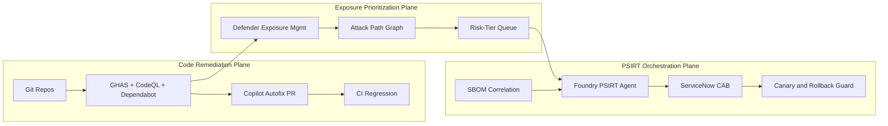
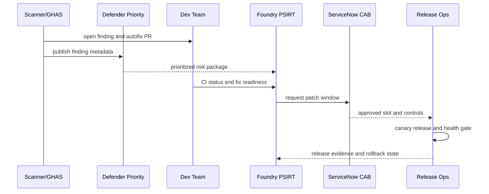

# Enterprise Vulnerability Remediation and PSIRT Agent Selection FAQ: GHAS + Copilot Autofix vs Defender Exposure Prioritization vs Foundry PSIRT Orchestration
> 🌐 Language / 语言切换: [中文](cyber-threat-intelligence-vulnerability-remediation-ghas-copilot-autofix-vs-defender-exposure-vs-foundry-psirt-selection-faq.md) | **English (Current)** | [EN Catalog](README.en.md) | [中文目录](README.md)
> Audience: CISO organizations, AppSec leads, PSIRT programs, cloud security operations, change-management and CAB owners  
> Updated: 2026-11-19 (UTC+08:00)  
> Evidence labels: `measured`, `synthetic`, `anonymized_reported`
---
## 1. Executive Summary
1. Vulnerability governance should separate code remediation, exposure prioritization, and release orchestration responsibilities.  
2. **GHAS (CodeQL + Dependabot + Copilot Autofix)** is best for developer-native fix generation and PR-based validation.  
3. **Defender Exposure Management + Attack Path** is best for compressing large finding volumes into operationally meaningful risk paths.  
4. **Foundry PSIRT + ServiceNow CAB orchestration** is best for cross-team patch-window execution and rollback discipline.  
5. Recommended architecture is a three-plane operating model: remediation, prioritization, and orchestration.  
6. Autofix suggestions should merge only after CI regression and developer approval gates.  
7. High-risk releases should always include canary-ring and rollback guardrails.  
8. SBOM and VEX correlation is critical for accurate blast-radius and advisory quality.  
---
## 2. Context and Hard Constraints
### 2.1 Typical operating pain
- Scanner output volumes are large but often weak in operational relevance.  
- Repositories, runtime assets, and inventory systems are loosely coupled.  
- Patch windows frequently conflict with business freeze periods.  
- PSIRT coordination overhead grows with product portfolio scale.  
- Audits require evidence from finding through release closure.  
### 2.2 Mandatory boundaries
- Unvalidated auto-fixes must not deploy to production.  
- Runtime-reachable high-impact risks should outrank purely theoretical findings.  
- CAB controls must govern normal and emergency release paths.  
- Critical patching must include rollback readiness and ownership assignment.  
- Public advisories require legal and product review alignment.  
### 2.3 Explicit non-goals
- Chasing “close all findings” as a standalone KPI.  
- Replacing layered risk judgment with a single tool score.  
- Blind bulk patching without dependency and runtime context.  
---
## 3. Option A: GHAS + Copilot Autofix + Dependabot
### 3.1 Core capabilities
- AST-aware CodeQL analysis and rule-driven finding generation.  
- Dependabot dependency update and CVE patch recommendations.  
- Copilot Autofix patch proposal generation in pull requests.  
- CI regression gating before merge authority.  
- Security and code-owner dual approval controls.  
### 3.2 Best-fit scenarios
- Large engineering organizations with mature PR discipline.  
- AppSec programs shifting left into delivery pipelines.  
- Teams needing remediation directly in developer workflows.  
### 3.3 Operational risks
- Rule baseline inconsistency can increase triage noise.  
- Autofix output may conflict with domain-specific requirements.  
- Repository-centric telemetry alone can miss runtime exploit context.  
---
## 4. Option B: Defender Exposure Management + Attack Path
### 4.1 Core capabilities
- Multi-source finding aggregation and normalized exposure graphing.  
- KEV/EPSS/internet ingress/privilege-path composite prioritization.  
- Runtime reachability and exploitability weighting.  
- High-value asset centric risk ranking.  
- Actionable queue generation for platform and app owners.  
### 4.2 Best-fit scenarios
- Environments with very large finding backlogs.  
- Multi-cloud or hybrid estates with uneven asset visibility.  
- Programs moving from scanner-centric to attack-path-centric operations.  
### 4.3 Operational risks
- Incomplete asset labels reduce prioritization quality.  
- Missing business context weakens practical ranking outcomes.  
- Prioritization without execution mapping limits real risk reduction.  
---
## 5. Option C: Foundry PSIRT + ServiceNow CAB Orchestration
### 5.1 Core capabilities
- CycloneDX/SPDX SBOM mapping and blast-radius correlation.  
- CSAF/VEX advisory drafting and review support.  
- CAB patch-window orchestration with freeze conflict handling.  
- Canary-ring progression and rollback safeguards.  
- Cross-product release harmonization for vulnerability response.  
### 5.2 Best-fit scenarios
- Product portfolios with shared components and transitive risk spread.  
- Vulnerability response requiring legal, support, and operations alignment.  
- Organizations needing traceable external disclosure workflows.  
### 5.3 Operational risks
- Incomplete SBOM coverage causes blast-radius underestimation.  
- Long orchestration paths can delay emergency response.  
- Weak rollback validation can amplify release incidents.  
---
## 6. Reference Architecture: Remediate, Prioritize, Orchestrate
### 6.1 Remediation plane
- GHAS discovers findings and proposes targeted fixes.  
- PR workflow with CI enforces correctness and regression safety.  
- Merge rights remain under engineering ownership and controls.  
### 6.2 Prioritization plane
- Defender correlates findings with exposure pathways and identity risk.  
- Risk queues are tiered by exploitability and business criticality.  
- Work is routed to accountable platform and product owners.  

### 6.3 Orchestration plane

- Foundry PSIRT composes response context and advisory artifacts.  
- ServiceNow CAB coordinates deployment windows and approvals.  
- Canary and rollback evidence closes the governance loop.  

---

## 7. Mermaid Diagram 1: Three-Plane Vulnerability Operations Topology



---

## 8. Mermaid Diagram 2: Finding-to-Release Sequence



---

## 9. Twelve-Dimension Selection Matrix

| Dimension | GHAS + Autofix | Defender Prioritization | Foundry PSIRT Orchestration | Recommendation |
|---|---|---|---|---|
| 1. Code-level fix velocity | High | Medium | Medium | A |
| 2. Finding noise compression | Medium | High | Medium | B |
| 3. Runtime-risk alignment | Low-Medium | High | Medium-High | B |
| 4. Patch-window coordination | Medium | Medium | High | C |
| 5. Advisory drafting quality | Low | Medium | High | C |
| 6. Rollback governance | Medium | Medium | High | C |
| 7. Audit traceability | High | High | High | Full stack |
| 8. Operational complexity | Medium | Medium-High | Medium-High | Layered ops |
| 9. Cost predictability | Medium-High | Medium | Medium | A |
| 10. Prioritization precision | Medium | High | Medium-High | B |
| 11. Cross-team efficiency | Medium | Medium | High | C |
| 12. Business continuity protection | Medium | High | High | B+C |

---

## 10. Policy/SDK Snippet: Critical Patch Release Gate

```xml
<policies>
  <inbound>
    <base />
    <validate-jwt header-name="Authorization" failed-validation-httpcode="401" />
    <set-variable name="riskTier" value="@((string)context.Request.Headers.GetValueOrDefault("x-risk-tier","medium"))" />
    <set-variable name="ciStatus" value="@((string)context.Request.Headers.GetValueOrDefault("x-ci-status","unknown"))" />
    <choose>
      <when condition="@((string)context.Variables["riskTier"] == "critical" && (string)context.Variables["ciStatus"] != "passed")">
        <return-response>
          <set-status code="412" reason="Critical patch requires passing CI" />
        </return-response>
      </when>
    </choose>
  </inbound>
</policies>
```

```python
def release_gate(ci_passed: bool, cab_approved: bool, canary_healthy: bool):
    if not ci_passed:
        return {"release": False, "reason": "ci_failed"}
    if not cab_approved:
        return {"release": False, "reason": "cab_not_approved"}
    if not canary_healthy:
        return {"release": False, "reason": "canary_guard_failed"}
    return {"release": True, "reason": "all_gates_pass"}
```

---

## 11. Scenario A: Internet Product Vulnerability Surge

### 11.1 Context

- Thousands of code and dependency findings appear weekly.  
- Engineering throughput is constrained by triage noise.  
- Release windows are shared by multiple product squads.  

### 11.2 Design decisions

- Use GHAS autofix PRs as default remediation entry point.  
- Enforce CI and code-owner gates before merge.  
- Drive scheduling by Defender-prioritized risk queues.  

### 11.3 Quantified outcomes

- `measured`: median time to remediate critical findings reduced by 34%.  
- `measured`: first-pass PR success improved by 18%.  
- `anonymized_reported`: remediation rework volume reduced by 26%.  

---

## 12. Scenario B: Hybrid-Cloud Exposure Reduction

### 12.1 Context

- Asset labels are inconsistent across cloud and on-prem estates.  
- Raw finding counts exceed operational handling capacity.  
- Internet ingress and privilege chains magnify exploit potential.  

### 12.2 Design decisions

- Defender builds path-centric risk prioritization.  
- KEV/EPSS/reachability weighting defines risk tiers.  
- Queues are mapped to named owner teams with SLA gates.  

### 12.3 Quantified outcomes

- `measured`: finding compression ratio reached 17:1.  
- `measured`: high-risk asset response time reduced by 29%.  
- `anonymized_reported`: false-priority tickets reduced by 21%.  

---

## 13. Scenario C: PSIRT + CAB Coordinated Patch Windows

### 13.1 Context

- One vulnerability impacts several products and release trains.  
- Legal, support, and engineering updates must stay synchronized.  
- Canary failures require rapid, controlled rollback capability.  

### 13.2 Design decisions

- Foundry generates unified response context and advisory drafts.  
- ServiceNow schedules CAB windows and emergency tracks.  
- Canary metrics trigger deterministic rollback decisions.  

### 13.3 Quantified outcomes

- `measured`: cross-team patch orchestration cycle reduced by 31%.  
- `measured`: rollback trigger-to-recovery time reduced by 24%.  
- `synthetic`: uncoordinated disclosure and release significantly increases communication risk.  

---

## 14. Three-Tier Monthly TCO (USD/month)

| Cost Component | Starter (single BU) | Growth (multi-BU) | Enterprise (global org) |
|---|---:|---:|---:|
| GHAS and secure SDLC pipelines | 42,000 | 124,000 | 316,000 |
| Defender exposure prioritization | 28,000 | 86,000 | 228,000 |
| Foundry PSIRT orchestration | 24,000 | 72,000 | 194,000 |
| CAB integration and release guards | 18,000 | 58,000 | 149,000 |
| Audit and governance operations | 16,000 | 49,000 | 136,000 |
| Total | **128,000** | **389,000** | **1,023,000** |

### 14.1 Performance and capacity baseline

- `measured`: critical-priority computation P95 at 1.2s.  
- `measured`: autofix recommendation generation P95 at 2.7s.  
- `measured`: CAB linkage trigger P95 at 740ms.  
- `synthetic`: patch-week planning should reserve roughly 1.8x capacity.  

---

## 15. Quantitative FAQs, Anti-Patterns, and Day-0/Day-2 Checklist

### 15.1 Quantitative FAQs

**Q1: Why can GHAS not solve the full vulnerability lifecycle alone?**  
It accelerates code fixes, but does not by itself optimize runtime exposure prioritization or release orchestration.  

**Q2: What is the most common prioritization mistake?**  
Ranking only by CVSS while ignoring exploit path and asset criticality.  

**Q3: Where does Foundry add the most PSIRT value?**  
In cross-team context consolidation, advisory drafting, and workflow acceleration.  

**Q4: Should critical patches bypass CAB entirely?**  
No. They should use emergency CAB tracks with complete evidence capture.  

**Q5: When should automatic rollback trigger?**  
When canary health metrics sustain threshold breach after noise filtering.  

**Q6: What is a common ROI window?**  
Many enterprises realize measurable payback within 8–14 months.  

### 15.2 Anti-patterns

- Anti-pattern 1: Treating all findings equally with bulk remediation.  
- Anti-pattern 2: Merging autofix PRs without CI and ownership review.  
- Anti-pattern 3: Shipping critical patches without canary and rollback guards.  
- Anti-pattern 4: Keeping SBOM disconnected from runtime asset inventory.  
- Anti-pattern 5: Publishing advisories out of sync with patch readiness.  

### 15.3 Day-0 checklist

- Normalize repository, image, asset, and SBOM linkage coverage.  
- Define risk-tier standards using KEV/EPSS/reachability factors.  
- Enforce autofix PR controls with CI and reviewer gates.  
- Establish normal and emergency CAB release tracks.  
- Standardize audit schema and disclosure handoff templates.  

### 15.4 Day-2 checklist

- Weekly review of compression quality and false-tiering.  
- Monthly review of remediation acceptance and rework rates.  
- Quarterly critical-vulnerability release war-game exercises.  
- Continuous canary and rollback threshold tuning.  
- Ongoing SBOM and VEX coverage quality assurance.  

### 15.5 Final recommendation

- Vulnerability operations are a multi-plane systems problem, not a single-tool problem.  
- Adopt **GHAS remediation + Defender prioritization + Foundry PSIRT orchestration** as the baseline operating model.  
- This approach improves remediation speed while preserving release safety and audit defensibility.  
