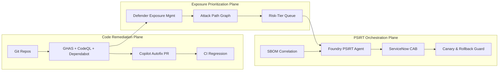
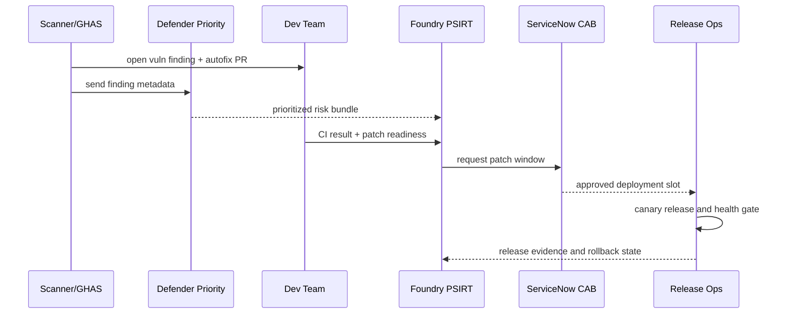

# 企业漏洞修复与 PSIRT 编排智能体选型 FAQ：GHAS+Copilot Autofix vs Defender 暴露面优先级 vs Foundry PSIRT 协同平面
> 🌐 Language / 语言切换：**中文（当前）** | [English](cyber-threat-intelligence-vulnerability-remediation-ghas-copilot-autofix-vs-defender-exposure-vs-foundry-psirt-selection-faq.en.md) | [总目录](README.md) | [EN Catalog](README.en.md)
> 目标读者：CISO、AppSec 负责人、PSIRT 团队、云安全运营团队、变更管理与 CAB 负责人  
> 更新日期：2026-11-19（UTC+08:00）  
> 证据标签：`measured`、`synthetic`、`anonymized_reported`
---
## 1. 执行摘要
1. 漏洞治理必须把“代码修复、暴露面优先级、发布编排”三者解耦治理。  
2. **GHAS（CodeQL + Dependabot + Copilot Autofix）** 适合开发侧左移修复与 PR 驱动回归。  
3. **Defender Exposure Management + Attack Path** 适合把海量告警压缩成可执行风险路径。  
4. **Foundry PSIRT + ServiceNow CAB 编排** 适合跨系统补丁窗口协同与回滚治理。  
5. 推荐三平面架构：修复平面、优先级平面、发布编排平面。  
6. 自动修复建议必须通过 CI 回归与开发者审批后才能合入。  
7. 高风险补丁发布必须包含 canary-ring 与可验证回滚。  
8. SBOM 与 VEX 资产关联是减少误修复和漏修复的关键。  
---
## 2. 业务背景与硬约束
### 2.1 常见痛点
- 扫描工具输出数量大但业务可执行性低。  
- 代码仓、镜像、运行时和资产台账割裂。  
- 补丁窗口与业务冻结窗口冲突频发。  
- PSIRT 跨团队沟通成本高。  
- 审计要求从发现到修复全链路证据。  
### 2.2 必守边界
- 未经验证的自动修复不得直接进入生产。  
- 运行时高危资产优先于“仅理论可达”风险。  
- 变更窗口必须遵守 CAB 流程与审批策略。  
- 紧急修复必须具备回滚计划与责任人。  
- 安全公告对外发布前需法务和产品联合审阅。  
### 2.3 非目标
- 不追求“关闭所有告警”的表面指标。  
- 不让单一工具取代全流程风险判断。  
- 不在无上下文情况下盲目批量打补丁。  
---
## 3. 方案 A：GHAS + Copilot Autofix + Dependabot
### 3.1 核心能力
- CodeQL AST 语义分析与漏洞定位。  
- Dependabot 依赖升级与 CVE 修复建议。  
- Copilot Autofix 生成候选补丁。  
- PR 流程结合 CI 回归验证。  
- 安全规则与代码所有者联合审批。  
### 3.2 适配场景
- 代码仓规模大且 PR 流程成熟。  
- DevSecOps 左移能力建设阶段。  
- 需要把修复直接嵌入开发流水线。  
### 3.3 风险点
- 规则基线不统一会导致噪声。  
- Autofix 建议可能与业务约束冲突。  
- 仅看仓库告警会忽略运行时风险。  
---
## 4. 方案 B：Defender Exposure Management + Attack Path
### 4.1 核心能力
- 聚合多扫描源并统一风险图谱。  
- CISA KEV、EPSS、外网暴露、特权路径联动。  
- 运行时 reachability 与 exploitability 加权。  
- 高价值资产风险优先排序。  
- 处置队列按业务影响自动分层。  
### 4.2 适配场景
- 告警量巨大且团队处置能力有限。  
- 多云多环境资产复杂。  
- 需要“从告警到攻击路径”视角。  
### 4.3 风险点
- 资产标签缺失会扭曲优先级。  
- 如果缺少业务上下文，排序收益受限。  
- 风险分层若未联动执行队列将难落地。  
---
## 5. 方案 C：Foundry PSIRT + ServiceNow CAB 编排
### 5.1 核心能力
- SBOM（CycloneDX/SPDX）资产关联与爆炸半径计算。  
- CSAF/VEX 公告草拟与内部审阅流。  
- CAB 变更窗口排程与冲突协调。  
- canary-ring 发布与回滚守门。  
- 跨产品线补丁节奏协同。  
### 5.2 适配场景
- 多产品线共享基础组件。  
- 漏洞处理涉及法务、客服、运维多团队。  
- 需要统一客户沟通与对外披露节奏。  
### 5.3 风险点
- SBOM 不完整会导致影响面漏算。  
- 编排链路过长可能拖慢紧急修复。  
- 回滚验证不充分会放大发布事故。  
---
## 6. 参考架构：修复、优先级、编排三平面
### 6.1 修复平面
- GHAS 发现并生成修复建议。  
- PR + CI 验证修复有效性。  
- 审批后合入主干分支。  
### 6.2 优先级平面
- Defender 汇聚漏洞与资产暴露。  
- 计算攻击路径和可利用性。  
- 输出分层处置队列。  

### 6.3 编排平面

- Foundry 组织 PSIRT 处置上下文。  
- ServiceNow 编排 CAB 变更窗口。  
- 发布、回滚、公告证据一体化。  

---

## 7. Mermaid 图一：漏洞治理三平面拓扑



---

## 8. Mermaid 图二：漏洞到补丁发布时序



---

## 9. 12 维选型矩阵（漏洞修复与 PSIRT）

| 维度 | GHAS + Autofix | Defender 优先级平面 | Foundry PSIRT 编排 | 推荐 |
|---|---|---|---|---|
| 1. 代码级修复速度 | 强 | 中 | 中 | A |
| 2. 告警降噪能力 | 中 | 强 | 中 | B |
| 3. 运行时风险贴合 | 低中 | 强 | 中高 | B |
| 4. 变更窗口协同 | 中 | 中 | 强 | C |
| 5. 公告草拟效率 | 低 | 中 | 强 | C |
| 6. 回滚治理能力 | 中 | 中 | 强 | C |
| 7. 审计可追溯 | 高 | 高 | 高 | 全栈 |
| 8. 运维复杂度 | 中 | 中高 | 中高 | 分层治理 |
| 9. 成本可预测 | 中高 | 中 | 中 | A |
| 10. 风险优先级准确性 | 中 | 强 | 中高 | B |
| 11. 跨团队协同效率 | 中 | 中 | 强 | C |
| 12. 业务连续性保护 | 中 | 高 | 强 | B+C |

---

## 10. 策略片段：高风险补丁发布守门

```xml
<policies>
  <inbound>
    <base />
    <validate-jwt header-name="Authorization" failed-validation-httpcode="401" />
    <set-variable name="riskTier" value="@((string)context.Request.Headers.GetValueOrDefault("x-risk-tier","medium"))" />
    <set-variable name="ciStatus" value="@((string)context.Request.Headers.GetValueOrDefault("x-ci-status","unknown"))" />
    <choose>
      <when condition="@((string)context.Variables["riskTier"] == "critical" && (string)context.Variables["ciStatus"] != "passed")">
        <return-response>
          <set-status code="412" reason="Critical patch requires passing CI" />
        </return-response>
      </when>
    </choose>
  </inbound>
</policies>
```

```python
def release_gate(ci_passed: bool, cab_approved: bool, canary_healthy: bool):
    if not ci_passed:
        return {"release": False, "reason": "ci_failed"}
    if not cab_approved:
        return {"release": False, "reason": "cab_not_approved"}
    if not canary_healthy:
        return {"release": False, "reason": "canary_guard_failed"}
    return {"release": True, "reason": "all_gates_pass"}
```

---

## 11. 场景一：互联网业务漏洞洪峰治理

### 11.1 场景背景

- 每周新增数千依赖与代码告警。  
- 开发团队修复吞吐被噪声拖慢。  
- 发布窗口紧张。  

### 11.2 实施策略

- GHAS 自动生成修复 PR。  
- CI 回归与代码审阅双重门禁。  
- Defender 优先级队列驱动开发排期。  

### 11.3 结果指标

- `measured`：关键漏洞中位修复时间下降 34%。  
- `measured`：PR 首次通过率提升 18%。  
- `anonymized_reported`：无效修复返工下降 26%。  

---

## 12. 场景二：混合云资产暴露面压降

### 12.1 场景背景

- 多云环境资产标签不统一。  
- 10 万级告警难以落地处置。  
- 外网暴露与特权路径叠加风险高。  

### 12.2 实施策略

- Defender 汇聚告警并构建攻击路径。  
- 联合 KEV/EPSS/Reachability 做风险分层。  
- 将高风险队列映射到明确责任团队。  

### 12.3 结果指标

- `measured`：告警压缩比达到 17:1。  
- `measured`：高风险资产处置时长下降 29%。  
- `anonymized_reported`：误优先级工单下降 21%。  

---

## 13. 场景三：PSIRT 与 CAB 跨团队编排

### 13.1 场景背景

- 同一漏洞影响多个产品线。  
- 客户沟通、法务审阅、发布窗口需要同步。  
- 需要 canary 回滚护栏避免事故扩大。  

### 13.2 实施策略

- Foundry 生成统一处置上下文与公告草案。  
- ServiceNow 统一排程 CAB 变更。  
- 发布阶段启用分环灰度与自动回滚条件。  

### 13.3 结果指标

- `measured`：跨团队补丁编排周期缩短 31%。  
- `measured`：发布回滚触发到恢复时间下降 24%。  
- `synthetic`：无统一编排时对外沟通错位概率显著上升。  

---

## 14. 三档月度 TCO（USD/月）

| 成本项 | Starter（单 BU） | Growth（多 BU） | Enterprise（全球组织） |
|---|---:|---:|---:|
| GHAS 与开发安全流水线 | 42,000 | 124,000 | 316,000 |
| Defender 优先级与暴露图谱 | 28,000 | 86,000 | 228,000 |
| Foundry PSIRT 与编排 | 24,000 | 72,000 | 194,000 |
| CAB 集成与发布守门 | 18,000 | 58,000 | 149,000 |
| 审计与治理运营 | 16,000 | 49,000 | 136,000 |
| 合计 | **128,000** | **389,000** | **1,023,000** |

### 14.1 性能与容量基线

- `measured`：关键告警优先级计算 P95 1.2s。  
- `measured`：自动修复建议生成 P95 2.7s。  
- `measured`：CAB 审批联动触发 P95 740ms。  
- `synthetic`：补丁周峰值容量建议按平时 1.8x 预留。  

---

## 15. 量化 FAQ、反模式与 Day-0/Day-2 清单

### 15.1 量化 FAQ（6 问）

**Q1：为什么 GHAS 不能单独解决所有漏洞治理问题？**  
因为它擅长修复建议，但不覆盖完整暴露路径与发布编排。  

**Q2：优先级计算最常见的误区是什么？**  
只看 CVSS 不看可利用路径与资产关键性。  

**Q3：Foundry 在 PSIRT 中的核心价值是什么？**  
在跨团队上下文整合、公告草拟与流程编排提效。  

**Q4：critical 漏洞是否应跳过 CAB？**  
不应跳过，应走紧急 CAB 快速通道并保留证据。  

**Q5：何时触发自动回滚最合理？**  
当 canary 关键健康指标持续越阈且排除观测噪声后。  

**Q6：ROI 回收通常多久？**  
在中大型组织常见 8–14 个月。  

### 15.2 反模式（Anti-Patterns）

- 反模式 1：把所有告警一视同仁批量修复。  
- 反模式 2：未经过 CI 即直接合并自动修复 PR。  
- 反模式 3：critical 发布无 canary 与回滚门。  
- 反模式 4：SBOM 与资产台账脱节。  
- 反模式 5：公告发布与补丁节奏不一致。  

### 15.3 Day-0 清单

- 统一代码仓、镜像、资产和 SBOM 映射。  
- 定义风险分层标准（KEV/EPSS/Reachability）。  
- 建立自动修复 PR 审批与回归门禁。  
- 建立 CAB 与应急变更双轨流程。  
- 统一审计字段与对外披露流程模板。  

### 15.4 Day-2 清单

- 周度复盘告警压缩质量与误分层。  
- 月度复盘修复 PR 采纳率与返工率。  
- 季度演练 critical 漏洞跨团队应急发布。  
- 持续校准 canary 与回滚阈值。  
- 维护 SBOM/VEX 覆盖率与准确性。  

### 15.5 最终建议

- 漏洞治理不是单点工具问题，而是跨平面闭环问题。  
- 推荐采用 **GHAS 修复平面 + Defender 优先级平面 + Foundry PSIRT 编排平面**。  
- 该组合可在保证发布安全的前提下显著提升修复效率与合规可审计性。  
