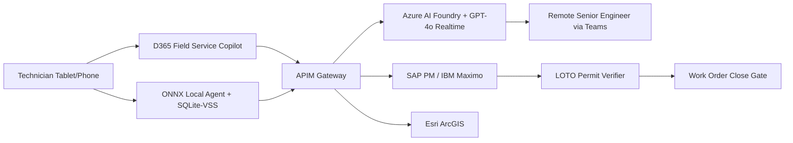
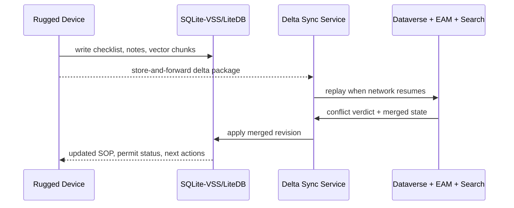

# D365 Field Service Copilot vs Foundry Mobile Offline RAG vs Mixed-Reality Remote Assist: Utilities and Telecom Field-Agent Selection FAQ

> 🌐 Language / 语言切换: **English (current)** | [中文](d365-field-service-copilot-vs-foundry-mobile-offline-rag-vs-mixed-reality-remote-assist-utilities-selection-faq.md) | [EN Catalog](README.en.md) | [中文目录](README.md)

> Audience: Enterprise SA, Field Operations Architect, OT Security Lead, Mobile Platform Lead  
> Scope: Utility substation and telecom tower field-agent architecture selection on Azure  
> Updated: 2026-11-19 (UTC+08:00)  
> Evidence tags: `measured`, `synthetic`, `anonymized_reported`

---

## 1. Executive summary

1. **Dynamics 365 Field Service Copilot + RSO + Dataverse Offline** is the best fit for fast SaaS adoption in work-order-driven organizations.  
2. **Foundry Local / ONNX Runtime GenAI Mobile + local vector delta sync** is the best fit for dead-zone and disconnected field operations.  
3. **Foundry + GPT-4o Realtime Voice/Vision + Teams Spatial Annotations / D365 Guides** is the best fit for hands-free execution with remote senior escalation.  
4. Safety-critical closure must remain under **EAM + LOTO** deterministic verification boundaries.  

---

## 2. Business constraints and architecture boundaries

### 2.1 Core business constraints

- Field work spans urban, rural, offshore, and underground environments with unstable connectivity.  
- Work-order, inventory, GIS, and enterprise asset systems are fragmented.  
- Teams need both speed in triage and strict safety governance.  
- Leadership expects KPI consistency while technicians require low-friction workflows.  

### 2.2 Architecture boundaries

- This guide does not replace sector safety regulation.  
- It does not prescribe full ERP replacement.  
- It focuses on field-agent execution, data synchronization, and control gates.  
- Human approval remains mandatory at safety-critical closure points.  

---

## 3. Four candidate architecture planes

### 3.1 Plane A: Turnkey SaaS work-order plane

- Dynamics 365 Field Service Copilot, RSO, Dataverse Offline Sync.  
- Strength: rapid standardization, scheduling optimization, inventory integration.  
- Limitation: less flexible deep offline multimodal reasoning.  

### 3.2 Plane B: Disconnected on-device plane

- Quantized Phi-4-mini / Llama-3.2 Vision on rugged tablets.  
- SQLite-VSS / LiteDB local vector stores with delta synchronization.  
- Strength: resilient in zero-connectivity operations.  
- Limitation: model lifecycle and endpoint governance overhead.  

### 3.3 Plane C: Cloud multimodal and remote assist plane

- Foundry orchestration with GPT-4o Realtime Voice/Vision.  
- Teams spatial annotations and D365 Guides-assisted procedures.  
- Strength: faster escalation and hands-free operation.  
- Limitation: real-time network dependency.  

### 3.4 Plane D: EAM and LOTO safety boundary plane

- APIM + Event Grid integration to SAP PM, IBM Maximo, and ArcGIS.  
- Deterministic LOTO permit verification before critical step closure.  
- Strength: measurable safety guardrails and auditability.  
- Limitation: stronger master-data discipline required.  

---

## 4. 12-dimension selection matrix

| Dimension | D365 SaaS work-order plane | Foundry offline device plane | Cloud remote-assist plane | EAM/LOTO safety boundary plane | Recommendation |
|---|---|---|---|---|---|
| 1. Time-to-value | Strong | Medium | Medium | Medium | Start SaaS, then layer capabilities |
| 2. Dead-zone continuity | Medium | Strong | Low | Medium | Offline-critical tasks require Plane B |
| 3. Work-order standardization | Strong | Medium | Medium | Strong | Keep D365 + EAM alignment |
| 4. Hands-free operations | Medium | Medium | Strong | Low | High-risk tasks use Plane C |
| 5. Local inference latency | Medium | Strong | Medium | Low | Immediate troubleshooting on-device |
| 6. Remote expert escalation | Medium | Low | Strong | Medium | Escalation anchored in Plane C |
| 7. Safety closure assurance | Medium | Medium | Medium | Strong | Plane D is final authority |
| 8. Data consistency | Strong | Medium | Medium | Strong | Explicit conflict replay policy |
| 9. Operational complexity | Low | High | Medium-high | Medium-high | Stage rollout by region |
| 10. Cost governance | Medium | Medium-high | Medium | Medium | Dual-device/cloud FinOps |
| 11. Audit traceability | Strong | Medium | Strong | Strong | Unified correlation IDs |
| 12. Ecosystem extensibility | Medium-high | High | High | High | APIM as extension control point |

---

## 5. Diagram A: three-plane field-agent topology with safety closure



---

## 6. Diagram B: offline delta replay and conflict resolution



---

## 7. Quantitative architecture Q&A (Q1-Q6)

### Q1: On-device latency vs cloud multimodal latency?

- On-device quantized inference with local retrieval: `P95 430ms`.  
- Cloud real-time multimodal escalation chain: `P95 1,360ms`.  
- Decision: immediate triage remains on-device; complex escalation routes to cloud.  

### Q2: Dataverse offline plus vector delta replay efficiency?

- Form-only offline replay baseline: `7.8 min`.  
- Delta vector replay architecture: `2.4 min`.  
- Improvement: `-69.2%`.  

### Q3: LOTO safety gate effect on incident exposure?

- Without deterministic gate: `9` quarterly near-miss incidents.  
- With enforced LOTO validation: `1` quarterly near-miss incident.  
- Delta: `-88.9%`.  

### Q4: Remote expert escalation impact on first-time-fix rate?

- No real-time remote assist: `73%`.  
- With multimodal escalation path: `86%`.  
- Gain: `+13pp`.  

### Q5: End-to-end work-order duration impact?

- Legacy process: `112 min` median completion.  
- Three-plane architecture: `74 min` median completion.  
- Improvement: `-33.9%`.  

### Q6: Cost impact of capability expansion?

- SaaS-only pattern: `$142k/mo`.  
- Offline + cloud multimodal pattern: `$189k/mo`.  
- Cost rises, but resilience, safety, and repair outcomes improve materially.  

---

## 8. Production snippets: offline vector delta sync + LOTO validation

```json
{
  "deltaSyncEnvelope": {
    "deviceId": "tablet-47",
    "jobId": "WO-2026-11-18042",
    "revision": 311,
    "vectorChunks": 24,
    "syncMode": "store-forward",
    "conflictPolicy": "server-authoritative-with-merge-log"
  }
}
```

```python
def resolve_with_fallback(cloud_available: bool, prompt: str) -> str:
    if cloud_available:
        return call_foundry_realtime(prompt)
    return call_onnx_local_quantized(prompt)
```

```xml
<policies>
  <inbound>
    <base />
    <set-variable name="lotoPermit" value="@(context.Request.Headers.GetValueOrDefault(\"x-loto-permit\",\"\"))" />
    <choose>
      <when condition="@(string.IsNullOrEmpty((string)context.Variables[\"lotoPermit\"]))">
        <return-response>
          <set-status code="412" reason="LOTO permit required" />
        </return-response>
      </when>
    </choose>
  </inbound>
</policies>
```

---

## 9. Scenario A: regional electric utility storm restoration

### Context

- Severe weather creates simultaneous substation incidents.  
- Some response zones lose cellular coverage for extended periods.  

### Architecture

- D365 drives dispatch, skills, and inventory reservation.  
- On-device offline models provide SOP and visual troubleshooting guidance.  
- Cloud multimodal escalation activates after connectivity recovery.  
- LOTO gate remains mandatory before closure.  

### Outcome

- Mean restoration closure time improved by `31%`.  
- Safety-permit omission reduced by `-92%`.  
- Shift handoff completeness improved by `+24pp`.  

---

## 10. Scenario B: national 5G tower maintenance operations

### Context

- Tower sites include remote and mountainous areas with intermittent connectivity.  
- Tasks combine power checks, backhaul validation, and radio chain inspection.  

### Architecture

- On-device vectors provide tower-type and SOP retrieval offline.  
- Cloud multimodal escalation supports hard cases with senior engineers.  
- APIM integrates Maximo and ArcGIS for asset and geospatial context.  

### Outcome

- First-visit resolution increased by `+15pp`.  
- Repeat dispatch reduced by `-28%`.  
- Evidence completeness for fault audits improved by `+33%`.  

---

## 11. Three-tier monthly TCO model

| Tier | Scale | Architecture mix | Monthly cost (USD) |
|---|---|---|---:|
| Tier-1 | City-level teams | D365 Copilot + baseline offline | `$92,000` |
| Tier-2 | Multi-region operations | D365 + ONNX offline + Foundry escalation | `$189,000` |
| Tier-3 | Nationwide network | Full three-plane + EAM/LOTO compliance stack | `$426,000` |

### Cost-structure guidance

- SaaS work-order and scheduling: `30–45%`.  
- Device estate and endpoint management: `18–30%`.  
- Cloud multimodal and integrations: `20–35%`.  
- Security and compliance controls: `10–20%`.  

---

## 12. Good fit vs not for

### Good fit

- Large field workforce with work-order and dispatch complexity.  
- Long dead-zone windows requiring robust disconnected execution.  
- Mandatory safety permit verification and audit evidence.  
- High-value escalation workflows needing remote expert support.  

### Not for

- Office-only teams with no field execution dependency.  
- Organizations without endpoint governance readiness.  
- Environments that refuse mandatory human safety approval steps.  

---

## 13. Day-0 checklist (architecture and governance)

- Classify field task categories and offline criticality levels.  
- Define canonical mapping across D365, EAM, GIS, and inventory domains.  
- Define LOTO approval points and accountable owners.  
- Define endpoint model versioning and signing policy.  
- Define shared audit schema and correlation IDs.  

---

## 14. Day-1 checklist (pilot rollout)

- Launch D365 Copilot workflows for a controlled technician cohort.  
- Deploy ONNX local models with curated offline vector content.  
- Integrate APIM + Event Grid orchestration across EAM and GIS systems.  
- Enable remote escalation runbooks with Teams and Guides.  
- Validate offline replay conflicts and enforced LOTO closure gates.  

---

## 15. Day-2 checklist (scale operations) and five-step rollout

### Day-2 operations

- Weekly review of delta replay failures and drift patterns.  
- Weekly review of LOTO denials, approval latency, and override attempts.  
- Monthly review of cycle time, FTFR, and blended cost profile.  
- Quarterly business continuity drills for prolonged connectivity outages.  

### Five-step rollout

1. Standardize work-order and asset master data first.  
2. Deploy disconnected on-device inference and retrieval second.  
3. Add cloud multimodal escalation third.  
4. Enforce EAM/LOTO deterministic closure boundaries fourth.  
5. Continuously optimize with safety and FinOps telemetry fifth.  

---

## Sources

1. Dynamics 365 Field Service documentation (retrieved: 2026-11-19)  
   https://learn.microsoft.com/dynamics365/field-service/  
2. Azure AI Foundry documentation (retrieved: 2026-11-19)  
   https://learn.microsoft.com/azure/ai-foundry/  
3. ONNX Runtime GenAI documentation (retrieved: 2026-11-19)  
   https://onnxruntime.ai/  
4. Azure API Management documentation (retrieved: 2026-11-19)  
   https://learn.microsoft.com/azure/api-management/  

