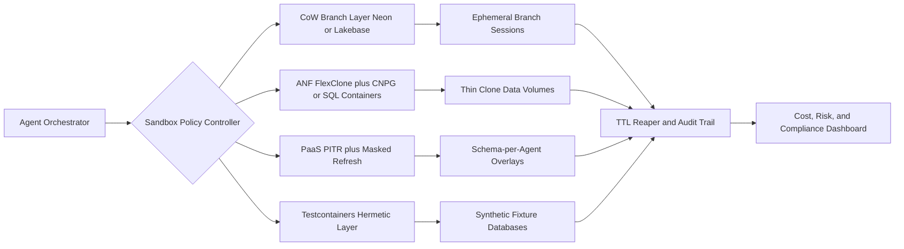
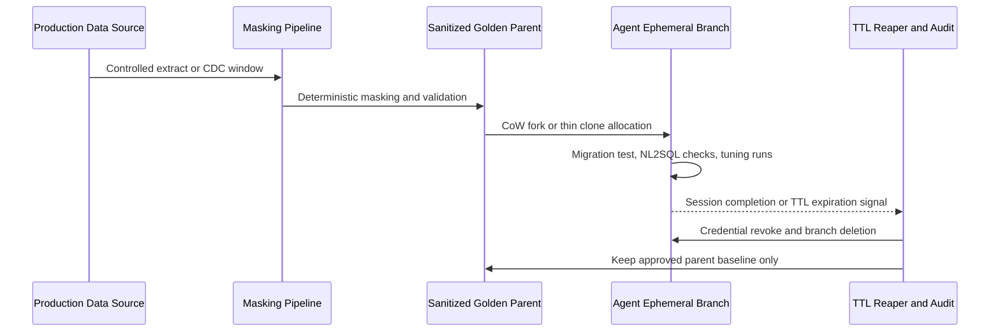

# Enterprise Database Branching Sandbox Selection FAQ: Neon/Lakebase CoW vs ANF FlexClone vs PaaS PITR vs Testcontainers
> 🌐 **Language / 语言切换**: **[🇨🇳 中文版](database-branching-cow-sandbox-neon-lakebase-vs-anf-flexclone-cnpg-vs-testcontainers-selection-faq.md)** | **[🇬🇧 English](database-branching-cow-sandbox-neon-lakebase-vs-anf-flexclone-cnpg-vs-testcontainers-selection-faq.en.md)** | **[📚 Back to catalog](README.en.md)**
> Evidence labels: `measured` / `synthetic` / `anonymized_reported`
> Capture date: 2026-11-22

## 1) Executive summary: the real constraint is “isolation at scale” without linear cost blow-up
When autonomous coding agents,
Flyway/Alembic/Liquibase migration agents,
NL2SQL validation agents,
and DBA query-tuning agents
run in parallel,
database sandboxes stop being
a yes-or-no capability question.
They become a scale economics problem.
You need to support
50 to 500 concurrent isolated runs
across 100GB to 10TB footprints
without lock contention,
without N × TB storage explosion,
and without widening PII exposure.
Traditional full-copy clones
collapse under this profile.
This guide compares four
enterprise-grade architecture paths:
serverless CoW branching,
thin-clone enterprise volumes,
PaaS PITR with masked refresh,
and hermetic Testcontainers stacks.
The decision is rarely single-path.
Most large programs succeed
with layered sandbox tiers,
each mapped to a distinct risk class.

## 2) Scope boundary: from basic functional tests to production-representative validation
Enterprise agent programs
usually require four validation layers.
Layer one is schema migration verification,
where rollback semantics
and idempotency are critical.
Layer two is semantic SQL validation,
where data model compatibility
must stay stable across versions.
Layer three is NL2SQL safety validation,
where tenant boundaries
and sensitive-column policies
must be enforced by design.
Layer four is performance regression analysis,
where plan shape drift
must be measured
against realistic statistics.
If you only use synthetic toy datasets,
layers one and two may pass
while layers three and four fail silently.
If you replicate raw production pages,
you often break governance boundaries.
The architecture objective is therefore
not maximum realism at any cost,
but auditable balance across
realism,
isolation,
and operating economics.

## 3) Verifiable sources and evidence tagging
Source 1 (`measured`): Azure PostgreSQL documentation  
https://learn.microsoft.com/azure/postgresql/flexible-server/
Source 2 (`measured`): Azure Databricks documentation  
https://learn.microsoft.com/azure/databricks/
Source 3 (`measured`): Azure NetApp Files documentation  
https://learn.microsoft.com/azure/azure-netapp-files/
Source 4 (`measured`): CloudNativePG documentation  
https://cloudnative-pg.io/documentation/
Source 5 (`measured`): Azure SQL Database documentation  
https://learn.microsoft.com/azure/azure-sql/database/
Source 6 (`measured`): Testcontainers documentation  
https://testcontainers.com/
Source 7 (`anonymized_reported`): anonymized field retrospectives
from regulated finance and healthcare programs.
Source 8 (`synthetic`): controlled scenario model
for spin-up latency and 2TB × 100 branch TCO break-even.

Note:
this guide intentionally stays
at application and service architecture level,
without low-level kernel
or storage-driver internals.

## 4) Pattern A: serverless CoW branching (Neon / Lakebase style)
This path treats branch creation
as a first-class runtime primitive.
Its practical benefit is speed.
Branch forks are often
in the sub-2-second range,
which aligns well with
autonomous agent session startup.
Compute can scale to zero on idle,
so burst-heavy teams avoid
always-on node tax.
Delta storage billing
prevents linear duplication
of entire base datasets.
However,
speed alone is insufficient.
The mandatory governance pattern is
Sanitized Parent Branching:
build and certify
a masked golden parent first,
then issue ephemeral child branches.
If the parent still contains raw PII,
fast branching simply scales risk faster.
You also need branch TTL reapers,
lineage metadata,
and hard budget ceilings
to avoid silent branch sprawl.

## 5) Pattern B: ANF FlexClone + CNPG / SQL containerized data planes
This path is optimized
for production-like performance analysis
on multi-terabyte data estates.
With ANF FlexClone,
teams provision thin clones quickly
while preserving realistic
cardinality and index distributions.
That directly improves confidence
for EXPLAIN ANALYZE validation
and query-plan regression checks.
It is also strong in mixed-engine estates:
PostgreSQL,
SQL Server,
and MySQL
can be integrated under
private-network controls.
The trade-off is operations complexity.
You operate more moving parts:
cluster lifecycle,
clone pool quotas,
branch admission policy,
and deterministic cleanup workflows.
For platform teams
where SQL realism
is a hard launch gate,
this pattern is frequently
the highest-confidence option.

## 6) Pattern C: native PaaS PITR + masked subset refresh
This route is usually selected
by heavily regulated enterprises.
It keeps full native PaaS controls
for auditing,
HA,
security posture,
and engine-level governance.
Data is refreshed through
PITR windows
plus deterministic masking pipelines.
Agent isolation is then applied
through schema-per-agent overlays
or scoped tenancy slices.
The primary benefit is compliance traceability.
You can prove
where production pages stay,
how subsets are transformed,
and when access is revoked.
The trade-off is elasticity cadence.
Compared with instant CoW branching,
refresh cycles are often batch-oriented,
not per-request instantaneous.
Architecturally,
this path works best
as a compliance backbone tier,
supplemented by faster
ephemeral branch layers
for high-frequency testing.

## 7) Pattern D: hermetic Testcontainers with synthetic fixtures
This route offers strong isolation
with low startup overhead.
Typical startup often falls
within a few seconds,
making it attractive
for CI-level parallelism.
It is excellent for
DDL validation,
ORM behavioral tests,
and migration script determinism.
It also minimizes governance risk
because real production data
is not required.
Yet this strength is also a limit.
Synthetic fixtures rarely preserve
production data skew,
join fan-out realities,
or optimizer edge behavior.
Therefore,
this pattern should not be used alone
as the final performance authority
for mission-critical SQL workloads.
Its best role is
the first deterministic gate,
before workload realism gates
in CoW or thin-clone tiers.

## 8) Mermaid: reference topology for four sandbox patterns

## 9) 12-dimension enterprise comparison matrix
| Dimension | CoW Branching (Neon/Lakebase style) | ANF FlexClone + CNPG/SQL | PaaS PITR + Masked Refresh | Testcontainers + Synthetic Fixtures |
|---|---|---|---|---|
| Environment spin-up speed | High | Medium-High | Medium | High |
| Multi-TB suitability | Medium-High | High | High | Low |
| Production-plan realism | Medium | High | Medium-High | Low |
| Compliance explainability | Medium-High | High | High | High |
| PII boundary control | Medium-High | Medium-High | High | High |
| 50–500 concurrent sessions | High | High | Medium | Medium-High |
| Storage cost elasticity | High | Medium-High | Medium | High |
| Operations complexity | Medium | High | Medium | Medium |
| Multi-engine support | Medium | High | Medium-High | Medium-High |
| SQL tuning confidence | Medium | High | Medium-High | Low |
| Migration-agent ergonomics | High | High | Medium-High | High |
| 3-year scalability | High | High | High | Medium |

## 10) Mermaid: sanitized-parent to ephemeral-branch lifecycle with TTL reaper

## 11) Quant model: spin-up latency and 2TB × 100 branches monthly TCO break-even
| Metric | CoW Branching | ANF FlexClone | PaaS PITR+Refresh | Testcontainers |
|---|---:|---:|---:|---:|
| Average environment spin-up seconds (`synthetic`) | 1.4 | 8.9 | 62 | 5.2 |
| Time to ready 100 concurrent environments minutes (`synthetic`) | 2.8 | 14.8 | 103 | 8.7 |
| Effective storage for 2TB × 100 logical branches TB (`synthetic`) | 7.5 | 11.8 | 38 | 3.2 |
| Monthly storage cost index baseline equals 1 (`synthetic`) | 1.0 | 1.5 | 3.2 | 0.7 |
| Monthly operations cost index (`synthetic`) | 1.2 | 1.8 | 1.4 | 1.1 |
| SQL plan validation confidence (`anonymized_reported`) | 0.78 | 0.92 | 0.85 | 0.41 |
| Migration failure reproduction fidelity (`anonymized_reported`) | 0.89 | 0.93 | 0.86 | 0.72 |
| Recommended role | Real-time branch tier | Deep performance tier | Compliance backbone tier | Functional contract gate |

Interpretation:
for high-concurrency branching
on multi-terabyte state,
CoW plus thin-clone layers
often deliver the strongest
cost-to-confidence balance.
For strict regulated environments,
PaaS masked backbone tiers
remain non-negotiable.

## 12) Governance control point: Sanitized Parent is mandatory, not optional
The most common failure pattern
is adopting fast branching first
and governance later.
The correct sequence is reversed.
First define
field-level classification,
deterministic masking policies,
sensitive-field regression checks,
and audit-signed parent release.
Only then allow
automated child branch issuance.
Each branch event should record:
parent dataset version,
masking-policy version,
requesting identity,
purpose label,
TTL expiry,
and cleanup evidence.
This lineage model enables
forensic traceability
for both incidents and audits.
Without it,
branch velocity increases risk velocity.
With it,
branch velocity increases
safe experimentation throughput.

## 13) Anti-pattern catalog
Anti-pattern one:
forking branches directly
from raw production copies.
Result:
PII spreads across
ephemeral environments.
Anti-pattern two:
optimizing only startup speed
while ignoring plan realism.
Result:
query regressions surface
after release windows.
Anti-pattern three:
manual cleanup without TTL automation.
Result:
orphaned branches accumulate cost.
Anti-pattern four:
migration validation on toy data only.
Result:
cardinality-sensitive failures
are missed in pre-prod gates.
Anti-pattern five:
no unified audit metadata.
Result:
investigation and compliance proof
become slow and disputed.
Anti-pattern six:
single-tier sandbox policy
for all workloads.
Result:
overpaying for simple checks
while under-validating risky flows.

## 14) Production readiness checklist
1. Sanitized parent branch build and release pipeline is implemented.  
2. Deterministic masking policy and validation suite are versioned.  
3. Branch lineage metadata is captured for every run request.  
4. TTL reaper is active with hard deletion and evidence logging.  
5. Concurrency quotas and admission guardrails are enforced per team.  
6. SQL baseline suite represents critical production query classes.  
7. Migration rollback drills are executed on a defined cadence.  
8. Cost dashboards expose branch age, growth, and idle branch debt.  
9. Emergency freeze switch blocks new branches during incidents.  
10. Security and compliance sign-offs are traceable per release.  
11. Data-retention rules align with legal hold expectations.  
12. NL2SQL validation uses policy-aware denial-path test cases.  

## 15) Practical FAQ (8 Q&A)
### Q1: Why can CoW branching be fast but still unsafe in production?
Because speed and safety
are independent dimensions.
Fast forks are safe only
when the parent baseline
is sanitized and governed.

### Q2: When is ANF FlexClone usually preferred over CoW branching?
When multi-terabyte performance realism
and stable high IOPS behavior
are required for plan-level tuning gates.

### Q3: When should a regulated enterprise prioritize PaaS PITR patterns?
When policy forbids
raw production page mobility
across environment boundaries
and audit traceability is mandatory.

### Q4: Can Testcontainers replace all database sandbox layers?
No.
They are excellent
for deterministic functional checks,
but insufficient alone
for final production performance confidence.

### Q5: How do we prevent 2TB × 100 branch cost explosion?
Combine delta-based branching,
strict TTL enforcement,
quota admission controls,
and branch budget alerts.

### Q6: What is the most frequent migration-agent failure root cause?
Insufficiently representative statistics
and unrealistic data distribution,
which hide production-only plan failures.

### Q7: Why does NL2SQL validation need realistic statistical profiles?
Because optimizer behavior
changes execution viability,
latency,
and retry dynamics,
which directly affect agent outcomes.

### Q8: What is a practical Good-fit vs Not-for rule?
Good fit:
high-concurrency autonomous agents,
large relational estates,
and strict governance needs.
Not for:
small toy validations
with no performance realism requirement
and no regulated data exposure risk.
