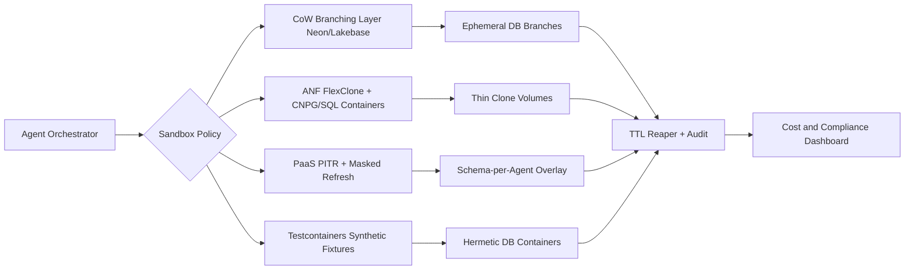
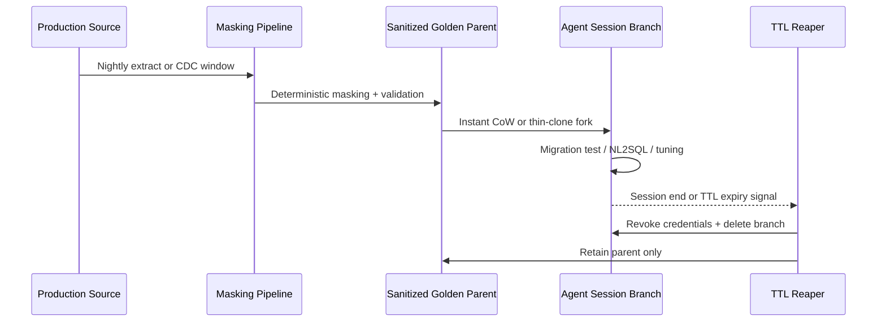

# 企业数据库分支沙箱选型 FAQ：Neon/Lakebase CoW vs ANF FlexClone vs PaaS PITR vs Testcontainers
> 🌐 **Language / 语言切换**: **[🇨🇳 中文版](database-branching-cow-sandbox-neon-lakebase-vs-anf-flexclone-cnpg-vs-testcontainers-selection-faq.md)** | **[🇬🇧 English](database-branching-cow-sandbox-neon-lakebase-vs-anf-flexclone-cnpg-vs-testcontainers-selection-faq.en.md)** | **[📚 返回目录](README.md)**
> 证据标签：`measured` / `synthetic` / `anonymized_reported`
> 抓取日期：2026-11-22

## 1) 执行摘要：数据库沙箱的核心矛盾是“并发隔离规模”与“成本爆炸”同时成立
当自治 Coding Agent、
Flyway/Alembic/Liquibase 迁移代理、
NL2SQL 校验代理、
以及 DBA 调优代理
并发运行时，
数据库沙箱不是“有没有”问题，
而是“能否同时支撑 50–500 并发分支”
且不引发 N×TB 存储爆炸。
很多团队用传统全量副本思路，
在 100GB–10TB 规模下很快失控。
核心挑战有三类：
锁竞争与互相污染，
存储成本线性膨胀，
以及 PII 泄漏面扩大。
本篇比较四类企业主路径：
Serverless CoW 分支，
ANF FlexClone 薄克隆，
PaaS PITR + 脱敏子集刷新，
以及 Testcontainers 合成数据隔离。
结论不是“单一最优”，
而是按监管强度、
数据规模、
并发模式、
查询真实性诉求
做分层决策。

## 2) 场景边界：从“功能测试”升级到“生产代表性验证”
企业代理工作流里，
数据库沙箱至少承担四类任务。
第一类是 schema 迁移演练，
要求 DDL 幂等回滚可验证。
第二类是 SQL 语义校验，
要求执行计划与统计信息接近生产。
第三类是 NL2SQL 安全验证，
要求租户隔离与敏感字段保护。
第四类是性能回归排障，
要求可复现实测计划差异。
若只用轻量容器样例数据，
前两类可能过关，
后两类往往失真。
反过来，
若直接复制生产数据，
又会踩到合规与成本红线。
因此选型关键在于：
在“真实性、隔离性、可控成本”
之间建立可审计平衡。

## 3) 可验证来源与证据标签
来源 1（`measured`）：Azure Native Neon Serverless Postgres 文档  
https://learn.microsoft.com/azure/postgresql/flexible-server/overview  
来源 2（`measured`）：Databricks Lakebase 文档  
https://learn.microsoft.com/azure/databricks/  
来源 3（`measured`）：Azure NetApp Files FlexClone 文档  
https://learn.microsoft.com/azure/azure-netapp-files/  
来源 4（`measured`）：CloudNativePG 项目文档  
https://cloudnative-pg.io/documentation/  
来源 5（`measured`）：Azure Database for PostgreSQL Flexible Server 文档  
https://learn.microsoft.com/azure/postgresql/flexible-server/  
来源 6（`measured`）：Azure SQL Database 文档  
https://learn.microsoft.com/azure/azure-sql/database/  
来源 7（`measured`）：Testcontainers 文档  
https://testcontainers.com/  
来源 8（`anonymized_reported`）：匿名化金融与医疗数据库沙箱复盘。  
来源 9（`synthetic`）：2TB × 100 分支月度成本与时延模型。  
说明：
本文仅讨论应用与服务架构，
不展开内核与驱动层实现细节。

## 4) 方案一：Serverless CoW 分支（Neon/Lakebase）
该路径把“分支”作为一等能力。
典型收益是 fork 速度快，
常见可达 1–2 秒量级。
每个代理会话可拿到
独立可写子分支，
并按增量页计费，
避免全量副本膨胀。
空闲时 compute 可缩到零，
对潮汐研发流量友好。
但落地成败取决于治理前置。
必须采用 Sanitized Parent 模式：
先构建去敏黄金父分支，
再派生短生命周期子分支。
若父分支含原始 PII，
再快的分支机制
都只是快速放大风险。
此外要规划 TTL 回收器，
避免“遗忘分支”长期挂账。

## 5) 方案二：ANF FlexClone + CNPG / SQL 容器
该路径强调多引擎与多 TB 真实性。
通过 ANF FlexClone 形成薄克隆卷，
可在数秒到十余秒内提供
接近生产统计特征的数据副本。
对 PostgreSQL、SQL Server、MySQL
混合生态较友好，
也便于在私网 VNet 内运行。
其优势在于
高 IOPS 与稳定吞吐可预测性，
适合 EXPLAIN ANALYZE 级别验证。
其代价在平台复杂度。
你需要管理
K8s 数据面生命周期、
克隆卷配额策略、
以及跨团队回收纪律。
若企业重视性能真实性，
并接受较高运维门槛，
该路径通常是数据库调优团队首选。

## 6) 方案三：PaaS PITR + 夜间脱敏子集刷新
该路径适合高监管行业边界。
核心思想是：
维持 100% 原生 PaaS 能力，
结合 PITR 与确定性脱敏流水线，
再通过 schema-per-agent 覆盖层
给代理分配隔离工作面。
它的强项是合规与审计。
例如银行和医疗场景中，
可把原始生产页
限制在既定环境层级，
并用脱敏副本做下游验证。
它的短板是启动与刷新节奏。
相较 CoW 即时分支，
PITR + 刷新通常偏批量节奏，
实时弹性不如分支型方案。
因此更适合作为
“合规主干层”，
再叠加轻量分支策略。

## 7) 方案四：Testcontainers + 合成种子夹具
该路径强调绝对隔离与快速冷启。
常见冷启区间可在 3–8 秒。
每个代理会话带独立容器数据库，
零共享底座，
零真实 PII 暴露。
对 DDL、ORM 逻辑、
迁移脚本回归非常高效。
但它有天然盲区：
缺乏真实数据倾斜，
缺乏生产统计分布，
查询优化器回归结论有限。
因此不应把它当作
性能真实性验收终点。
更合理定位是
功能与契约层第一道闸，
性能与计划验证
交给 CoW 或薄克隆层完成。

## 8) Mermaid：四类数据库沙箱架构拓扑

## 9) 12 维企业对比矩阵
| 维度 | CoW 分支（Neon/Lakebase） | ANF FlexClone + CNPG/SQL | PaaS PITR + 脱敏刷新 | Testcontainers 合成夹具 |
|---|---|---|---|---|
| 分支/环境启动时延 | 高 | 中高 | 中 | 高 |
| 多 TB 规模适配 | 中高 | 高 | 高 | 低 |
| 真实统计信息保真 | 中 | 高 | 中高 | 低 |
| 合规审计可解释性 | 中高 | 高 | 高 | 高 |
| PII 暴露控制 | 中高 | 中高 | 高 | 高 |
| 并发 50–500 承载 | 高 | 高 | 中 | 中高 |
| 存储成本弹性 | 高 | 中高 | 中 | 高 |
| 运维复杂度 | 中 | 高 | 中 | 中 |
| 多引擎兼容性 | 中 | 高 | 中高 | 中高 |
| SQL 计划调优有效性 | 中 | 高 | 中高 | 低 |
| 迁移代理友好度 | 高 | 高 | 中高 | 高 |
| 三年可扩展性 | 高 | 高 | 高 | 中 |

## 10) Mermaid：去敏父分支到短生命周期子分支流程

## 11) 量化表：启动时延与 2TB×100 分支月度 TCO break-even
| 指标 | CoW 分支 | ANF FlexClone | PaaS PITR+刷新 | Testcontainers |
|---|---:|---:|---:|---:|
| 单环境平均启动（s，`synthetic`） | 1.4 | 8.9 | 62 | 5.2 |
| 100 并发环境总就绪时间（min，`synthetic`） | 2.8 | 14.8 | 103 | 8.7 |
| 2TB×100 逻辑分支有效存储（TB，`synthetic`） | 7.5 | 11.8 | 38 | 3.2 |
| 月度存储成本指数（基线=1，`synthetic`） | 1.0 | 1.5 | 3.2 | 0.7 |
| 月度运维成本指数（`synthetic`） | 1.2 | 1.8 | 1.4 | 1.1 |
| SQL 计划验证可信度（`anonymized_reported`） | 0.78 | 0.92 | 0.85 | 0.41 |
| 迁移代理失败复现率（`anonymized_reported`） | 0.89 | 0.93 | 0.86 | 0.72 |
| 推荐定位 | 实时分支主线 | 大规模性能验证 | 合规主干层 | 功能契约首闸 |

解释：
若目标是 2TB 基线下的高并发分支，
CoW 与 FlexClone 组合
常给出最佳成本-真实性平衡。
若监管要求极严，
PaaS 脱敏主干不可替代。

## 12) 治理关键：Sanitized Parent 不是可选项而是硬门槛
数据库分支化最大误区
是先上分支能力，
后补数据治理。
正确顺序应反过来：
先定义去敏黄金父层，
再开放子分支自动派生。
建议把父层治理拆成四步：
字段分级，
确定性脱敏，
敏感回归校验，
审计签名发布。
每次派生时记录
父版本号、
策略版本号、
会话拥有者、
TTL 到期时间。
这使得任何一次泄漏排查
都可追溯来源路径。
没有这套链路，
“快速分支”只会变成
“快速扩大合规半径”。

## 13) 反模式清单
反模式一：
直接从生产原始分支派生给代理。
后果是 PII 在沙箱横向扩散。
反模式二：
只看启动速度，
不看查询计划真实性。
后果是性能问题上线后才暴露。
反模式三：
分支无 TTL，
靠人工清理。
后果是存储账单缓慢失控。
反模式四：
迁移验证仅跑合成小数据。
后果是 cardinality 偏差被忽略。
反模式五：
无统一审计元数据。
后果是事故追责与合规证明困难。

## 14) 生产就绪检查清单
1. 已定义 Sanitized Parent 构建与发布流程。  
2. 已定义子分支 TTL 策略与自动回收器。  
3. 已记录分支 lineage（父版本、策略版本、请求者）。  
4. 已建立 PII 字段不可逆去敏与抽检报告。  
5. 已建立迁移代理回滚演练与失败快照保留规则。  
6. 已配置 SQL 计划回归基线（代表性查询集）。  
7. 已设置并发配额与锁冲突告警。  
8. 已纳入成本看板（存储增量、分支存活时长）。  
9. 已定义紧急熔断（禁止新分支、保留调查证据）。  
10. 已完成法务与审计对流程签署。  
11. 已实现“分支借阅配额”与团队预算上限双门禁。  
12. 已建立僵尸分支（超 TTL 未清理）日度巡检任务。  
13. 已定义高风险 SQL（全表更新/删除）强审计与二次确认。  
14. 已在 CI 中加入 schema drift 比对与自动阻断策略。  
15. 已建立分支生命周期事件总线并接入统一 SIEM。  
16. 已对接工单系统，保留人工豁免审批轨迹。  

补充建议：
在真实企业落地中，
建议把四类沙箱
映射到四类任务等级。
L1 功能回归
默认走 Testcontainers，
追求高并发与低成本。
L2 迁移与契约验证
可走 CoW 分支层，
平衡速度与真实性。
L3 计划与性能回归
优先 FlexClone 薄克隆层，
获取高保真统计特征。
L4 强监管稽核场景
走 PaaS PITR 脱敏主干层，
确保合规证据完备。
这种分层策略
能显著降低“单一方案过载”
导致的质量与成本失衡。

## 15) 实战 FAQ（8 问）
### Q1：为什么 CoW 分支快却不一定最安全？
快是能力，
安全来自去敏父层治理，
二者必须同时成立。

### Q2：FlexClone 的核心价值是什么？
在多 TB 规模下提供
高真实性与高 IOPS，
适合计划级调优验证。

### Q3：PaaS PITR 路径何时优先？
当监管要求明确禁止
原始生产页跨环境复制时。

### Q4：Testcontainers 能否替代所有数据库沙箱？
不能。
它适合功能与契约测试，
不适合最终性能代表性结论。

### Q5：如何避免 2TB×100 分支成本爆炸？
采用增量计费分支、
强制 TTL、
并设分支预算阈值告警。

### Q6：迁移代理最常见失败原因是什么？
统计信息偏差与真实数据分布缺失，
导致迁移脚本在生产条件下失真。

### Q7：NL2SQL 代理为什么也需要真实统计？
因为优化器计划会影响
语句可执行性与响应时延，
并反馈到代理重试策略。

### Q8：Good fit 与 Not for 如何界定？
Good fit：
高并发代理、
大体量数据库、
强合规与真实性并重场景。
Not for：
仅小样本功能验证，
无需真实计划与统计代表性的项目。
