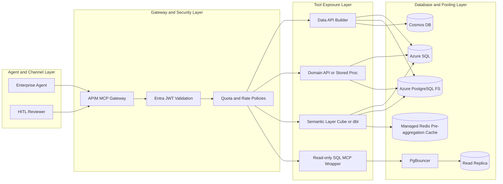
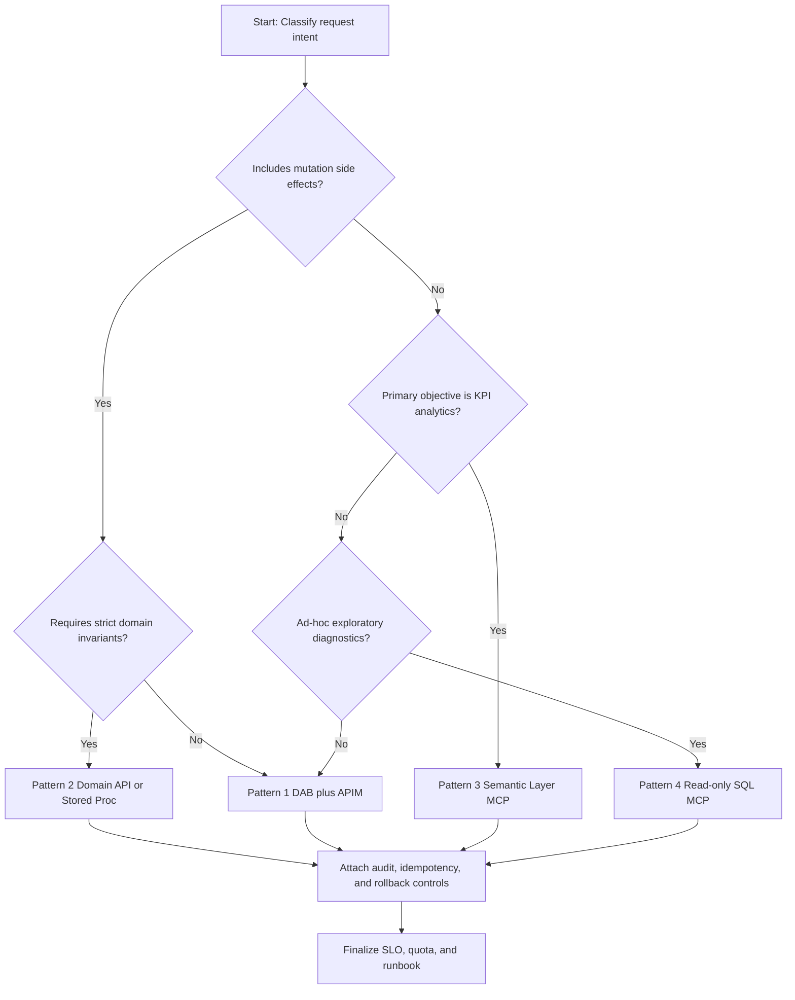

# Enterprise Database-to-MCP Tool Exposure Selection FAQ: Data API Builder + APIM vs Parameterized Domain API/Stored Procedures vs Semantic Layer MCP (Cube/dbt) vs Sandboxed Read-Only SQL MCP

> Audience: Cloud & AI Solution Architects, platform engineering, data platform teams, application security, and FinOps leads.  
> Objective: expose `Azure SQL`, `Azure Database for PostgreSQL Flexible Server`, and `Cosmos DB` as governed enterprise MCP tools without pool exhaustion, runaway scans, join hallucinations, or prompt-injected DML.

## 1. Decision Boundary: The Goal Is Not “Queryable Data,” It Is “Controlled Queryability”

When enterprises expose database capabilities to agents through MCP tools,
productivity gains can be significant.
Operational and security risk also grows quickly.
The most common failures are:
connection pools exhausted by agent fan-out,
runaway table scans on OLTP tiers,
hallucinated joins producing false analytics,
and injected prompts attempting unauthorized DML.

Architecture review must therefore define the allowed database behavior set first.
Model quality alone cannot compensate for missing execution controls.
If behavior boundaries are not explicit,
high-concurrency workloads eventually fail unpredictably.

A practical Day-0 framing is a three-layer control model.
- Protocol layer: who can call which tools.  
- Execution layer: what SQL shape, duration, and volume are allowed.  
- Semantic layer: whether formulas and joins are canonical and auditable.  

This guide compares four production patterns.
Pattern 1 emphasizes declarative exposure.
Pattern 2 emphasizes strict business verbs and transaction invariants.
Pattern 3 emphasizes semantic consistency and analytical acceleration.
Pattern 4 emphasizes constrained exploratory diagnostics.

You can pick one mode,
but most enterprises land on layered combinations.
A primary governed lane plus a constrained auxiliary lane is a common endpoint.

## 2. Pattern Portfolio and Governance Objective Mapping

Pattern 1 is ideal for rapid controlled CRUD/query exposure.
Pattern 2 is ideal for financial, inventory, and operational mutation integrity.
Pattern 3 is ideal for KPI-consistent analytical questions.
Pattern 4 is ideal for bounded ad-hoc diagnostics by trusted internal users.

Prioritization usually follows three objectives.
- Objective A: security and compliance.  
- Objective B: latency and concurrency capacity.  
- Objective C: delivery speed and maintainability.  

If Objective A dominates,
Pattern 2 and Pattern 3 should lead.
If Objectives B and C dominate early,
Pattern 1 is typically the fastest safe baseline.
Pattern 4 should remain supplemental rather than core business path.

Responsibility boundaries also differ by pattern.
Pattern 1 is usually platform-engineering led.
Pattern 2 is domain-team + DBA co-owned.
Pattern 3 is data-modeling-team led.
Pattern 4 is shared between SRE/analytics and security governance.

## 3. Pattern 1: Data API Builder on ACA/AKS + APIM MCP Gateway

Pattern 1 relies on declarative exposure.
`dab-config.json` defines entities, columns, filters, and pagination limits.
APIM then publishes these endpoints as controlled MCP tools.
This significantly reduces custom CRUD service code.

Typical strengths:
- Fast time-to-production with config-first workflows.  
- Clear entity/column allowlists with straightforward auditability.  
- Natural integration with Entra claims for tenant/user scoping.

Typical control architecture:
APIM handles identity, quota, throttling, and telemetry.
DAB handles entity mapping and query boundary enforcement.
Database-side RLS or equivalent policy enforces final authorization.
This layered model is stable under enterprise operational pressure.

Key constraints:
- Complex cross-domain transactional mutations are limited.  
- Poor entity design can still enable expensive query paths.  
- `max-page-size` must be enforced to prevent uncontrolled extraction.

Pattern 1 is commonly the default entry lane,
with Patterns 2 and 3 added per domain as governance needs increase.

## 4. Pattern 2: Parameterized Domain APIs / Stored Procedures via OpenAPI-to-MCP

Pattern 2 removes arbitrary query expression from the agent path.
Agents call typed domain verbs only,
such as `create_credit_memo`, `reopen_case`, or `apply_inventory_hold`.
Each verb binds to validated parameters, transaction scope, and compensation rules.

This model is common in highly regulated industries.
It narrows model freedom to auditable business semantics.
It is especially effective against prompt-injected mutation attempts.

Strengths:
- Mutation operations are guarded by domain invariants and transaction policies.  
- Semantic intent is explicit, improving forensic traceability.  
- Compensation behavior can be designed upfront.

Trade-offs:
- API and procedure evolution workload is higher than Pattern 1.  
- Fast-changing domains may face version management overhead.  
- Analytical flexibility is weaker without Pattern 3 support.

Practical recommendation:
Use Pattern 2 for mutation paths with financial or operational side effects.
Use Pattern 1 for low-risk read workflows.
This split often balances safety and delivery speed.

## 5. Pattern 3: Governed Semantic Layer MCP (Cube/dbt + Redis Pre-Aggregation)

Pattern 3 addresses analytical consistency.
In many enterprises, the largest business risk is not SQL failure,
but KPI inconsistency across teams and channels.
LLM-generated multi-table joins are a frequent source of analytical drift.

Semantic layer MCP externalizes data meaning before tool exposure.
Metrics, dimensions, relationships, and formula logic are modeled first.
Agents query governed semantic endpoints rather than composing raw joins.

Strengths:
- Canonical KPI definitions across business units.  
- Fast analytical response via pre-aggregations and cache strategy.  
- Significant reduction in join-hallucination errors.

Trade-offs:
- Upfront semantic modeling and governance investment.  
- Versioning and regression management become critical disciplines.  
- Ongoing data-team ownership is mandatory.

If your primary workload is management analytics and reporting copilots,
Pattern 3 is often the long-term backbone.
For transactional write paths, combine it with Pattern 2.

## 6. Pattern 4: Sandboxed Read-Only SQL MCP (Replica + PgBouncer + AST Guardrails)

Pattern 4 serves exploratory and diagnostic workflows.
Examples include SRE triage, analyst ad-hoc probing, and controlled internal troubleshooting.
Its value comes from constrained flexibility.

A standard design binds SQL MCP to read replicas only.
PgBouncer transaction pooling limits connection churn.
Strict `statement_timeout`, row limits, and SQLGlot AST guards block dangerous statements.

Strengths:
- High diagnostic agility for long-tail cases.  
- Reduced blast radius against primary transactional stores.  
- Lower initial implementation effort.

Limits:
- Not suitable for authoritative business mutation paths.  
- Not ideal as a canonical KPI-serving interface.  
- Requires strict runtime policy hygiene to stay safe.

Pattern 4 is best used as a controlled auxiliary lane.
It should complement, not replace, governed primary modes.

## 7. End-to-End Database-to-MCP Security, Pooling, and Execution Topology (Mermaid)



This topology keeps high-risk mutation paths and exploratory paths separate.
It also centralizes governance at the gateway for consistency.
That combination reduces single-lane overload and policy drift.

## 8. SA Decision Tree by Risk and Query Shape (Mermaid)



Use this decision flow in architecture review templates.
It keeps intent classification ahead of tooling preference.
That order reduces downstream redesign churn.

## 9. Deployable Snippet #1: `dab-config.json` with Claims, Allowlists, and Pagination Controls

```json
{
  "runtime": {
    "rest": { "enabled": true, "path": "/api" },
    "graphql": { "enabled": false },
    "host": { "mode": "production", "cors": { "origins": ["https://gateway.contoso.com"] } }
  },
  "data-source": {
    "database-type": "mssql",
    "connection-string": "@env('DAB_SQL_CONN')",
    "options": {
      "set-session-context": [
        { "key": "tenant_id", "claim": "tid" },
        { "key": "user_oid", "claim": "oid" },
        { "key": "department", "claim": "dept" }
      ]
    }
  },
  "entities": {
    "invoice_summary": {
      "source": "dbo.v_invoice_summary",
      "permissions": [
        {
          "role": "authenticated",
          "actions": [{ "action": "read", "fields": ["invoice_id", "customer_id", "amount", "status", "due_date"] }],
          "policy": "(@claims.tid == @item.tenant_id)"
        }
      ],
      "graphql": { "enabled": false },
      "rest": { "enabled": true, "methods": ["get"], "max-page-size": 200 }
    }
  }
}
```

This sample demonstrates three practical controls.
- Column-level allowlists for data minimization.  
- Claim-to-session-context mapping for downstream RLS.  
- Hard page-size caps to prevent uncontrolled extraction.

## 10. Deployable Snippet #2: SQLGlot AST + PgBouncer Read-Only SQL MCP Wrapper (Python)

```python
import sqlglot
from sqlglot import exp
import psycopg

DENY_TYPES = (exp.Insert, exp.Update, exp.Delete, exp.Create, exp.Drop, exp.Alter, exp.Truncate)
MAX_ROWS = 500
MAX_SQL_CHARS = 4000

def validate_sql_readonly(sql: str) -> None:
    if len(sql) > MAX_SQL_CHARS:
        raise ValueError("SQL too long")
    tree = sqlglot.parse_one(sql, read="postgres")
    if isinstance(tree, DENY_TYPES):
        raise ValueError("DML/DDL is blocked")
    if tree.find(exp.Command):
        raise ValueError("Raw command is blocked")
    if "for update" in sql.lower():
        raise ValueError("Locking clause is blocked")

def run_query(pool_dsn: str, sql: str):
    validate_sql_readonly(sql)
    guarded_sql = f"SELECT * FROM ({sql}) q LIMIT {MAX_ROWS}"
    with psycopg.connect(pool_dsn, autocommit=True) as conn:
        with conn.cursor() as cur:
            cur.execute("SET default_transaction_read_only = on")
            cur.execute("SET statement_timeout = '3s'")
            cur.execute(guarded_sql)
            rows = cur.fetchall()
    return rows
```

This wrapper enforces pre-execution SQL policy,
then reasserts read-only and timeout controls at connection scope.
It provides execution-layer defense even if an upstream policy is misconfigured.

## 11. Twelve-Dimension Selection Matrix

| Dimension | Pattern 1 DAB + APIM | Pattern 2 Parameterized Domain API/SP | Pattern 3 Semantic Layer MCP | Pattern 4 Read-only SQL MCP |
|---|---|---|---|---|
| 1. Delivery speed | High | Medium | Medium-low | High |
| 2. Mutation safety | Medium-high | High | Low | Low |
| 3. Query flexibility | Medium | Low | Medium | High |
| 4. KPI consistency | Medium | Medium | High | Low |
| 5. Pool stability | Medium-high | High | High | Medium |
| 6. DML injection resistance | Medium-high | High | High | Medium-high |
| 7. Runaway scan risk | Medium | Low | Low | Medium |
| 8. Concurrency scale | Medium-high | Medium | High | Medium |
| 9. Ops complexity | Medium | Medium-high | High | Medium |
| 10. Audit traceability | High | High | High | Medium |
| 11. Cost transparency | High | Medium | Medium | High |
| 12. Transactional fit | Medium | High | Low | Low |

A common enterprise conclusion is:
Pattern 2 for high-risk mutations,
Pattern 3 for authoritative analytics,
Pattern 1 for general governed reads,
Pattern 4 for constrained diagnostics.
This layered model avoids overloading any single pattern.

## 12. Quantitative Comparison: P95 Latency, Max Concurrent Sessions, SQL Accuracy, Monthly TCO

> Assumptions: 80k monthly active agent sessions, 600 peak concurrent requests, read/write ratio 82:18.  
> Values are architecture-planning references for comparison, not commercial quotes.  
> Units: latency in ms, concurrency in stable sessions, SQL accuracy in business-correctness percentage, TCO in USD/month.

| Pattern | Tool-call P95 | Max concurrent sessions | SQL/result accuracy | Monthly TCO | Notes |
|---|---:|---:|---:|---:|---|
| Pattern 1 DAB + APIM | 210 | 1,800 | 91.2% | 68,000 | Fast rollout, moderate governance depth |
| Pattern 2 Domain API/SP | 185 | 1,250 | 97.6% | 96,000 | Strongest mutation safety |
| Pattern 3 Semantic Layer | 145 | 2,400 | 96.8% | 123,000 | Best KPI consistency |
| Pattern 4 Read-only SQL | 260 | 1,050 | 84.9% | 54,000 | Flexible diagnostics, lower semantic safety |

If the main objective is KPI dispute reduction,
Pattern 3 plus Pattern 2 is usually the most stable pairing.
If the objective is rapid governed enablement with lower spend,
Pattern 1 plus Pattern 4 is often the lightest initial path.
Most organizations optimize by domain, not by global single-mode adoption.

## 13. Enterprise Scenario A: Financial Reconciliation and Collections Agent

This scenario includes two request classes.
One class reads balances, invoices, and payment schedules.
Another class performs credit memo, reversal, and adjustment operations.
Mutation errors have immediate financial impact.

Recommended architecture:
- Read path: Pattern 1 DAB + APIM.  
- Mutation path: Pattern 2 parameterized domain APIs/SPs.  
- KPI and risk reporting path: Pattern 3 semantic layer.  
- Investigation path: Pattern 4 read-only SQL sandbox.  

Expected outcomes:
stronger mutation safety,
preserved read-path delivery speed,
and improved analytical consistency for compliance reporting.

## 14. Enterprise Scenario B: Manufacturing and Retail Analytics Copilot

This scenario is dominated by high-frequency analytical requests.
The largest risk is metric inconsistency across teams and channels.
Raw LLM-generated joins tend to drift as schema complexity grows.

Recommended architecture:
- Core analytics path: Pattern 3 semantic layer MCP.  
- Detail retrieval path: Pattern 1 DAB.  
- Troubleshooting path: Pattern 4 read-only SQL MCP.  
- Limited mutation path: Pattern 2 governed business verbs.

This composition separates exploratory flexibility from semantic authority.
Under heavy analytical concurrency,
it usually increases business trust in agent responses.

## 15. Day-0 / Day-2 Checklist and Quantitative FAQ (8 Questions)

### Day-0 (before launch)

- Classify MCP data tools into read, analytics, mutation, and diagnostics lanes.  
- Enforce tenant-level APIM quotas and rate limits.  
- Enable request audit and response evidence summaries for all tools.  
- Require schema validation for every mutation operation.  
- Enforce `statement_timeout` and row limits for read-only SQL paths.  
- Configure RLS or equivalent tenant isolation in databases.  
- Build baseline SQL-accuracy test suites.  
- Set pool high-watermark alert thresholds.  
- Version semantic metrics and run regression checks.  
- Build replay suites for prompt-injection attack patterns.

### Day-2 (operations)

- Track pool utilization and rejection rates daily.  
- Review slow-query top-N and timeout distribution weekly.  
- Measure SQL accuracy and correction rate weekly.  
- Audit mutation success and compensation rates monthly.  
- Check semantic-cache hit rates and invalidation behavior monthly.  
- Tune tenant throttling policies for abnormal traffic.  
- Replay injection test sets periodically and verify block rate.  
- Revisit SKU and cost posture quarterly.

**Q1: With a small platform team, which mode should start first?**  
A1: Pattern 1 is usually the fastest start; add Pattern 2 for high-risk mutations and Pattern 3 for authoritative KPI domains.

**Q2: How can we reduce cross-table join hallucinations?**  
A2: Route authoritative analytics to Pattern 3 semantic-layer tools so joins are pre-modeled rather than generated ad hoc by the model.

**Q3: Can Pattern 4 be exposed directly to broad business users?**  
A3: Usually no; it is better as a constrained internal diagnostics lane due to semantic and governance risk.

**Q4: What is the first mitigation for pool exhaustion incidents?**  
A4: Enforce gateway-side concurrency and rate controls first, then tune pooling parameters, then scale capacity.

**Q5: Why not expose all write actions through Pattern 1 alone?**  
A5: High-risk mutations are safer in Pattern 2 where typed verbs and transactional invariants reduce side-effect risk.

**Q6: If SQL accuracy drops below 90%, where should we debug first?**  
A6: Start with tool schema and semantic-layer definitions before changing model prompts, to avoid misattributing structural issues to model behavior.

**Q7: Why is Pattern 3 often more expensive?**  
A7: Semantic modeling and pre-aggregation infrastructure add cost, but they usually reduce downstream business correction and dispute costs.

**Q8: When should Pattern 4 traffic be migrated to Pattern 1 or Pattern 3?**  
A8: When query patterns become stable and frequent, migrate to governed modes for better consistency, safety, and long-term operability.

