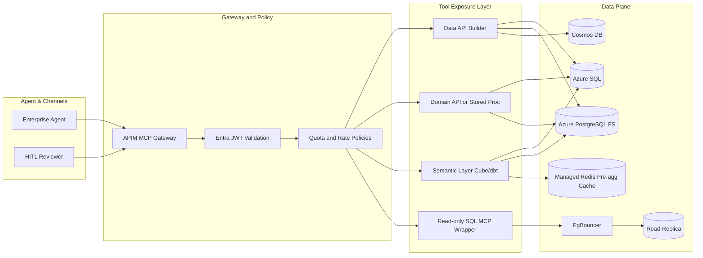
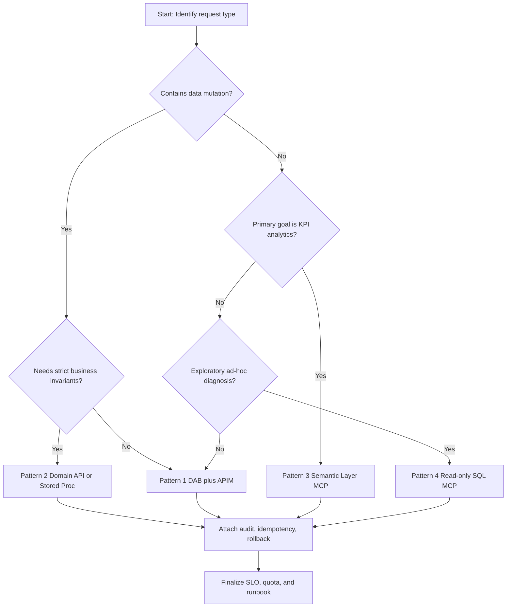

# 企业数据库到 MCP 工具暴露选型 FAQ：Data API Builder + APIM vs 参数化领域 API/存储过程 vs 语义层 MCP（Cube/dbt）vs 只读 SQL MCP 沙箱

> 适用对象：Cloud & AI Solution Architect、平台工程、数据平台、应用安全与 FinOps 团队。  
> 决策目标：把 `Azure SQL`、`Azure Database for PostgreSQL Flexible Server`、`Cosmos DB` 以可治理方式暴露给企业 Agent，避免连接池耗尽、失控扫描、Join 幻觉和 Prompt 注入 DML。

## 1. 决策边界：数据库 MCP 化的核心不是“能查到”，而是“可控地查到”

企业把数据库能力封装成 MCP 工具后，
收益通常来自交互式自动化效率提升。
风险也会同步放大。
最常见的四类事故分别是：
连接池被并发会话打爆、
大表扫描拖垮核心 OLTP、
模型拼接错误 Join 产生伪结论、
Prompt 注入触发越权写操作。

因此，架构评审必须先定义“可允许的数据库行为集合”。
而不是先讨论“模型是否聪明”。
如果行为边界没有先收敛，
任何工具链都会在高并发时出现不可预测故障。

建议在 Day-0 把数据库 MCP 化视为三层控制系统。
- 协议层：谁可调用、可调用哪些动作。  
- 执行层：SQL 能执行到什么粒度与时长。  
- 语义层：业务指标与 Join 关系是否可验证。  

本指南比较四种生产模式。
模式一偏“声明式低代码暴露”。
模式二偏“强约束业务动词”。
模式三偏“语义一致性与分析加速”。
模式四偏“受限探索查询与 SRE 分析”。

你可以单选，也可以按业务风险分层组合。
多数企业最终采用“主路径 + 辅助路径”的双层策略。

## 2. 四类模式与治理目标映射

模式一适合快速构建受控 CRUD/Query 工具面。
模式二适合金融、账务、库存等事务一致性场景。
模式三适合 KPI 一致性要求高的分析型问答。
模式四适合受限的临时探索与运维诊断。

治理目标通常由三个优先级决定。
- 优先级 A：安全与合规。  
- 优先级 B：延迟与并发承载。  
- 优先级 C：研发效率与演进速度。  

如果组织优先级 A 极高，优先考虑模式二或模式三主导。
如果优先级 B 与 C 更高，模式一通常是起步效率最高的主路径。
模式四常作为补充工具，不建议直接作为核心业务路径。

从组织分工看，四种模式也对应不同责任边界。
模式一由平台工程主导。
模式二由应用域团队与 DBA 共治。
模式三由数据建模团队主导。
模式四由 SRE/数据分析平台与安全团队共管。

## 3. 模式一：DAB（ACA/AKS）+ APIM MCP Gateway（声明式白名单优先）

模式一的关键价值在于“声明式暴露”。
通过 `dab-config.json` 明确实体、列、筛选与分页上限，
再由 APIM 统一暴露为 MCP 工具接口。
这条路径可显著减少自定义 CRUD API 代码。

对企业团队而言，
模式一具备三项常见优势。
- 上线快，配置优先，低代码路径清晰。  
- 列级与实体级 allowlist 易审计。  
- 与 Entra JWT 声明联动，便于做租户与用户行级隔离。  

典型安全结构是：
APIM 负责认证、配额、限流与审计。
DAB 负责数据实体映射与查询边界。
数据库端通过 `SESSION_CONTEXT` 或 RLS 策略兜底授权。
这类分层结构在生产中相对稳定。

要注意的约束有三点。
- 复杂跨域事务写操作能力有限。  
- 若实体设计不当，仍可能出现高代价查询路径。  
- 需要严格配置 `max-page-size`，避免一次取全表。  

模式一常作为企业 MCP 数据工具的“默认起步层”。
后续可按业务域引入模式二和模式三增强。
该演进路线可降低初始复杂度。

## 4. 模式二：参数化领域 API / 存储过程 OpenAPI-to-MCP（业务动词强约束）

模式二的核心思想是禁止任意表达式查询。
Agent 只能调用经过建模的业务动词，
例如 `create_credit_memo`、`approve_refund_case`、`close_billing_period`。
每个动词绑定参数类型、事务边界和补偿逻辑。

该模式在金融与高合规行业很常见。
因为它把“模型自由度”降到业务可审计范围内。
这对防 Prompt 注入 DML 极为有效。

模式二的优势包括：
- 写操作可强制走事务规则与约束校验。  
- 业务语义明确，审计与复盘成本低。  
- 失败补偿逻辑可预定义，异常处理更可控。  

代价也很清楚。
- API 建模和版本治理成本高于模式一。  
- 需求变更频繁时，动词演进压力较大。  
- 对跨域分析查询支持较弱，通常要配合模式三。  

建议把模式二用于“有资金/库存/账务副作用”的操作，把模式一用于低风险查询。
这样可在安全与效率之间保持平衡。

## 5. 模式三：语义层 MCP（Cube/dbt Semantic Layer + Redis 预聚合）

模式三解决的是“分析语义一致性”问题。
很多企业事故不是 SQL 执行失败，
而是指标口径前后不一致。
模型生成的临时 Join 常出现隐性偏差。

语义层 MCP 的做法是：
先定义业务指标、维度、关系图与计算口径，
再把语义查询能力以 MCP 工具暴露。
Agent 不直接拼多表 Join，
而是调用已建模语义接口。

该模式的主要收益：
- KPI 口径统一，跨团队解释一致。  
- 预聚合缓存可显著降低分析查询延迟。  
- 大幅减少 LLM Join 幻觉导致的错误结论。  

挑战在于建模治理体系。
- 语义层建设前期投入较大。  
- 指标变更需要严谨版本与回归流程。  
- 需要数据团队长期维护模型质量。  

如果你的 Agent 主要回答经营问题，
模式三通常是长期主路径。
若还包含事务写操作，
建议与模式二组合。

## 6. 模式四：只读 SQL MCP 沙箱（Read Replica + PgBouncer + AST Guard）

模式四面向探索型场景。
例如 SRE 快速诊断、数据分析师辅助查询、非关键业务临时排查。
它强调“只读 + 快速 + 可中断”。

标准做法是把 MCP 查询绑定到只读副本。
结合 PgBouncer 事务池化，
并设置严格 `statement_timeout` 与行数上限。
再用 SQLGlot AST 守护，阻断 DDL/DML 与危险函数。

模式四优势包括：
- 探索效率高，覆盖长尾问题。  
- 对主库冲击可控。  
- 实施成本相对较低。  

但它不适合核心写业务。
也不适合作为统一分析口径来源。
若用作生产决策主路径，
会暴露语义一致性不足的问题。

推荐把模式四定位为“受控探索补充层”。
并与模式一/二/三形成分级路由。

## 7. 端到端数据库到 MCP 安全/连接池/执行拓扑（Mermaid）



该拓扑强调四条工具路径并行存在。
核心是把高风险操作和探索操作隔离。
并通过网关策略统一治理。
这能显著降低单一路径过载风险。

## 8. SA 决策树：按风险级别与查询形态选择模式（Mermaid）



该决策树适合放入架构评审模板。
它把“请求形态”放在第一位。
而不是先选技术栈。
这能减少后续返工。

## 9. 可落地配置片段一：`dab-config.json`（声明白名单 + JWT 声明约束 + 分页上限）

```json
{
  "runtime": {
    "rest": { "enabled": true, "path": "/api" },
    "graphql": { "enabled": false },
    "host": { "mode": "production", "cors": { "origins": ["https://gateway.contoso.com"] } }
  },
  "data-source": {
    "database-type": "mssql",
    "connection-string": "@env('DAB_SQL_CONN')",
    "options": {
      "set-session-context": [
        { "key": "tenant_id", "claim": "tid" },
        { "key": "user_oid", "claim": "oid" },
        { "key": "department", "claim": "dept" }
      ]
    }
  },
  "entities": {
    "invoice_summary": {
      "source": "dbo.v_invoice_summary",
      "permissions": [
        {
          "role": "authenticated",
          "actions": [{ "action": "read", "fields": ["invoice_id", "customer_id", "amount", "status", "due_date"] }],
          "policy": "(@claims.tid == @item.tenant_id)"
        }
      ],
      "graphql": { "enabled": false },
      "rest": { "enabled": true, "methods": ["get"], "max-page-size": 200 }
    }
  }
}
```

这个配置体现三个关键点。
- 字段白名单限制可见列。  
- 声明映射到会话上下文，驱动数据库 RLS。  
- 页大小上限阻断失控全量拉取。  

## 10. 可落地配置片段二：SQLGlot AST + PgBouncer 只读 SQL MCP 包装器（Python）

```python
import sqlglot
from sqlglot import exp
import psycopg

DENY_TYPES = (exp.Insert, exp.Update, exp.Delete, exp.Create, exp.Drop, exp.Alter, exp.Truncate)
MAX_ROWS = 500
MAX_SQL_CHARS = 4000

def validate_sql_readonly(sql: str) -> None:
    if len(sql) > MAX_SQL_CHARS:
        raise ValueError("SQL too long")
    tree = sqlglot.parse_one(sql, read="postgres")
    if isinstance(tree, DENY_TYPES):
        raise ValueError("DML/DDL is blocked")
    if tree.find(exp.Command):
        raise ValueError("Raw command is blocked")
    if "for update" in sql.lower():
        raise ValueError("Locking clause is blocked")

def run_query(pool_dsn: str, sql: str):
    validate_sql_readonly(sql)
    guarded_sql = f"SELECT * FROM ({sql}) q LIMIT {MAX_ROWS}"
    with psycopg.connect(pool_dsn, autocommit=True) as conn:
        with conn.cursor() as cur:
            cur.execute("SET default_transaction_read_only = on")
            cur.execute("SET statement_timeout = '3s'")
            cur.execute(guarded_sql)
            rows = cur.fetchall()
    return rows
```

该包装器把风险控制放在执行前。
并在连接后重复设置只读与超时。
即使上层策略遗漏，
仍有执行层兜底。

## 11. 12 维选型矩阵（安全、性能、可维护与业务适配）

| 维度 | 模式一 DAB + APIM | 模式二 参数化领域 API/SP | 模式三 语义层 MCP | 模式四 只读 SQL MCP |
|---|---|---|---|---|
| 1. 上线速度 | 高 | 中 | 中低 | 高 |
| 2. 写操作安全性 | 中高 | 高 | 低 | 低 |
| 3. 查询灵活性 | 中 | 低 | 中 | 高 |
| 4. KPI 口径一致性 | 中 | 中 | 高 | 低 |
| 5. 连接池稳定性 | 中高 | 高 | 高 | 中 |
| 6. 抗 Prompt 注入 DML | 中高 | 高 | 高 | 中高 |
| 7. 大查询失控风险 | 中 | 低 | 低 | 中 |
| 8. 并发扩展性 | 中高 | 中 | 高 | 中 |
| 9. 运维复杂度 | 中 | 中高 | 高 | 中 |
| 10. 审计追溯性 | 高 | 高 | 高 | 中 |
| 11. 成本可解释性 | 高 | 中 | 中 | 高 |
| 12. 适配事务场景 | 中 | 高 | 低 | 低 |

矩阵结论通常是：
模式二负责高风险写事务，
模式三负责指标分析一致性，
模式一承担通用低风险数据工具，
模式四承接受限探索需求。
这种分层能避免单模式过载。

## 12. 定量对比：P95 延迟、最大并发会话、SQL 准确率与月度 TCO

> 假设：月活 Agent 会话 8 万，工作日峰值并发请求 600，读写比例 82:18。  
> 指标来自架构评估样本，用于模式比较，不等同于采购报价。  
> 单位：延迟毫秒，并发为稳定会话数，SQL 准确率为业务正确率，TCO 为美元/月。

| 模式 | 工具调用 P95 | 最大并发会话 | SQL/结果准确率 | 月度 TCO | 说明 |
|---|---:|---:|---:|---:|---|
| 模式一 DAB + APIM | 210 | 1,800 | 91.2% | 68,000 | 快速上线，治理中等 |
| 模式二 参数化 API/SP | 185 | 1,250 | 97.6% | 96,000 | 事务安全最强 |
| 模式三 语义层 MCP | 145 | 2,400 | 96.8% | 123,000 | 分析一致性最佳 |
| 模式四 只读 SQL MCP | 260 | 1,050 | 84.9% | 54,000 | 探索灵活，口径风险高 |

若目标是“减少业务口径争议”，
模式三与模式二组合最稳。
若目标是“快速工具化并控制成本”，
模式一与模式四组合更轻量。
企业常按域做组合，而非全局单选。

## 13. 企业场景一：金融对账与贷后运营 Agent（强事务约束）

该场景有两类请求。
一类是查询账单、余额、还款计划。
一类是执行冲正、减免、核销等写动作。
写动作错误会直接引发财务风险。

推荐架构是双轨。
- 查询主路径：模式一 DAB + APIM。  
- 写操作主路径：模式二参数化领域 API/SP。  
- 风险报表路径：模式三语义层。  
- 诊断路径：模式四只读 SQL 沙箱。  

预期效果是：
写操作违规风险显著下降，
同时保持查询工具化效率。
并通过语义层统一经营指标口径。

## 14. 企业场景二：制造与零售经营分析 Agent（高并发分析问答）

该场景主要问题不是写操作安全，
而是“同一指标在不同问法下结果不一致”。
如果直接让模型拼 SQL，
跨库 Join 与口径漂移概率会逐步增加。

推荐架构：
- 核心分析：模式三语义层 MCP。  
- 明细查询：模式一 DAB。  
- 运维排障：模式四只读 SQL MCP。  
- 少量事务操作：模式二受控动词接口。  

这种组合可把“探索自由度”与“经营口径稳定”分离。
在高并发分析场景下，
通常能提升业务方对 Agent 输出的信任度。

## 15. Day-0 / Day-2 清单与量化 FAQ（8 问 8 答）

### Day-0（上线前）

- 定义数据库工具分级：查询、分析、事务、诊断四类。  
- 在 APIM 配置租户级配额与速率限制。  
- 为所有 MCP 工具启用请求审计与响应摘要留痕。  
- 对写操作工具强制参数 schema 校验。  
- 为只读 SQL 路径启用 `statement_timeout` 与 `row limit`。  
- 在数据库侧配置 RLS 或等效租户隔离策略。  
- 建立 SQL 准确率基线数据集。  
- 设定连接池高水位告警阈值。  
- 对语义层指标做版本化与回归测试。  
- 建立注入攻击回放测试用例库。  

### Day-2（运行期）

- 每日追踪连接池利用率与拒绝率。  
- 每周复盘慢查询 Top N 与超时分布。  
- 每周评估 SQL 准确率与业务纠错率。  
- 每月审计写操作工具调用成功率与补偿率。  
- 每月核查语义层缓存命中与失效策略。  
- 对异常租户流量执行限流策略校准。  
- 定期回放 Prompt 注入样本并验证拦截率。  
- 按季度优化成本结构与实例规格。  

**Q1：如果团队只有 8 人平台组，首选模式是什么？**  
A1：通常先落地模式一，写操作用模式二兜底，分析域逐步引入模式三。

**Q2：如何避免 Agent 生成跨库错误 Join？**  
A2：核心报表走模式三语义层，把 Join 逻辑从 LLM 即时拼接迁移到预建模。

**Q3：模式四是否可以直接面向业务用户？**  
A3：不建议，模式四更适合作为受限探索与运维诊断，不适合作为口径权威输出。

**Q4：连接池耗尽最有效的首要措施是什么？**  
A4：先做网关限流与并发上限，再做 PgBouncer/连接池参数优化，最后再扩实例。

**Q5：写操作为什么不直接让 DAB 暴露？**  
A5：高风险事务建议走模式二，利用参数化动词和事务约束减少业务副作用风险。

**Q6：SQL 准确率低于 90% 时应先改哪一层？**  
A6：先检查语义层与工具 schema，再评估提示策略，避免把问题全部归因到模型。

**Q7：语义层模式三的成本为何通常更高？**  
A7：主要来自建模与缓存基础设施成本，但可换来更高一致性与更低业务纠错成本。

**Q8：何时应把模式四流量迁移到模式一或三？**  
A8：当重复查询模式稳定且业务频次上升时，应迁移到模式一或三以提升可治理性和准确率。

