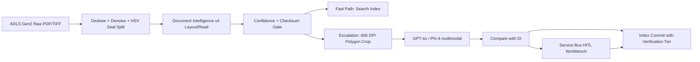
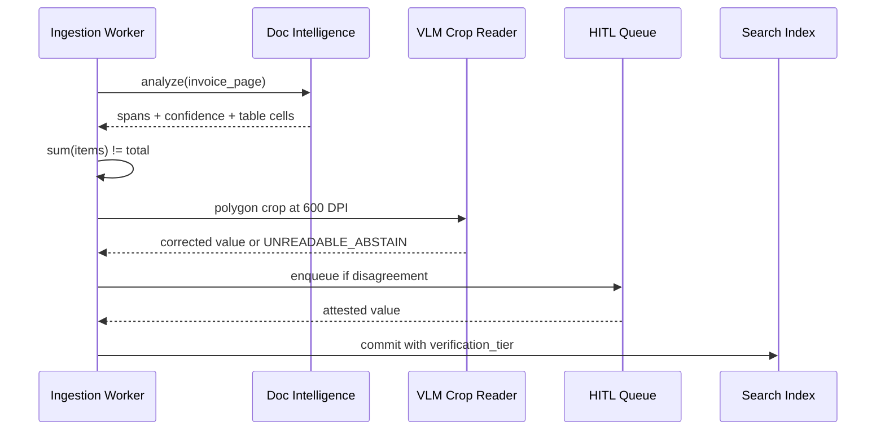

# Enterprise degraded archival scans, handwritten notes, and seal-occlusion RAG ingestion selection FAQ
> Topic ID: #478  
> Section: 3.4 agent state, memory tiering, enterprise RAG, and multimodal data plane  
> Audience: enterprise AI document-platform architects, retrieval/RAG engineering teams, compliance and risk digitization teams  
> Goal: deliver high-trust and cost-controlled multimodal ingestion under degraded scans, stamp occlusion, and handwriting-heavy inputs

## 1 Production problem: silent data poisoning in degraded archives
Banking, insurance, legal, and registry archives are rarely pristine machine-generated PDFs. Real workloads contain `150 DPI` fax pages, skew, blur, thermal noise, fold marks, carbon-copy bleed, and handwritten overlays. In CJK finance documents, red seals frequently overlap amounts and dates. Single-pass OCR can mutate `¥1,850,000.00` into `¥1,350,000.00` or mixed alphanumeric confusion. The dangerous part is that no explicit extraction error is raised. Corrupted values get indexed into retrieval and vector stores, then echoed by downstream agents as authoritative facts. Handwritten medical notes and low-contrast receipts produce similar corruption paths. If systems optimize only throughput without confidence-aware governance, retrieval quality degrades quietly over time. Enterprise document intelligence is therefore a trust-engineering problem, not only a recognition-rate problem.

## 2 Failure chain: seal bleed, mixed handwriting, and full-page VLM hallucination
Failure class one is red/blue stamp channel bleed against black toner text. After grayscale conversion, seal texture merges with digit strokes and causes substitutions. Failure class two is handwritten and printed content within the same field. Boundary ambiguity increases character drift and tokenization instability.
Failure class three is direct full-page VLM conversion.
Pipeline simplicity is attractive, but low-clarity zones encourage plausible completion instead of abstention.
At scale, full-page high-resolution VLM cost expands rapidly.
Coordinate-level grounding fidelity can also weaken, reducing UI highlight traceability.
Readable output is not equivalent to auditable output.

## 3 Four architecture patterns
Pattern A uses `Document Intelligence v4` as deterministic fast path, then confidence/checksum gates, then selective high-DPI polygon escalation to VLM, and mandatory HITL on disagreement.
Pattern B uses dual heterogeneous OCR engines with exact-match consensus for critical fields and escalates mismatches.
Pattern C uses end-to-end full-page VLM ingestion, suitable for small ad hoc workloads.
Pattern D anti pattern runs single-pass grayscale OCR straight into retrieval without confidence inspection or arithmetic validation.
For regulated high-volume workloads, Pattern A should be default.
For zero-tolerance numeric and coding fields, add Pattern B over A.
Pattern C is useful for short-lived or low-scale exploration.
Pattern D should be blocked by platform release policy.

## 4 Twelve-dimension quantified comparison matrix
| Dimension | Pattern A confidence-gated escalation | Pattern B dual OCR consensus | Pattern C full-page VLM | Pattern D anti pattern |
|---|---|---|---|---|
| Digit exact-match rate | `99.6%+` | `99.8%+` | `97.0%-99.0%` | below `94%` |
| Seal-occlusion robustness | high | high | medium | low |
| Handwriting robustness | medium high | high | medium high | low |
| Silent corruption rate | low | lowest | medium | high |
| Cost `$/1K pages` | medium low | medium high | high | low short-term |
| Throughput `pages/min` | high | medium | medium low | high |
| Coordinate preservation | high | high | medium | medium |
| HITL escalation ratio | `1.5%-3%` | `2%-6%` | `4%-12%` | `0%` illusion |
| Sovereign deployability | high | high | medium | high |
| Operational complexity | medium | high | medium | low |
| Three-year TCO | best balance | high assurance high cost | high cost | incident-heavy cost |
| Recommendation | primary path | critical-field enhancement | small-scale supplement | prohibit |

## 5 Pattern A primary path: confidence gate plus selective escalation
Pattern A follows a clear principle: deterministic high-throughput extraction for clean spans and targeted deep reading for uncertain spans.
`Document Intelligence v4 Layout/Read` first emits structured text, tables, polygons, and confidence metadata.
Critical spans are evaluated with both confidence thresholds and domain invariants.
Typical checks include line-item sum versus subtotal and currency-format consistency.
When `confidence < 0.88` or checksum fails, the system does not rerun full page analysis.
It crops only the affected polygon and upscales to `600 DPI` for multimodal re-read.
This keeps VLM spend to a fraction of full-page processing.
If deterministic OCR and VLM disagree, the field is forced into HITL adjudication.
HITL workbenches should show side-by-side source crop, candidates, and rule-failure rationale.
Only validated values are indexed, with explicit verification tier tagging.
This model provides strong balance across cost, throughput, explainability, and governance.
For multinational forms, keep rules policy-pack based and switchable by country and document taxonomy instead of hard-coding a single global validator.
Field-level abstention must remain available so low-quality regions escalate safely instead of producing confident but unverifiable outputs.

## 6 Pattern B: dual-engine heterogeneous OCR consensus
Pattern B is designed for scenarios where silent errors are unacceptable.
A common setup uses `Document Intelligence v4` plus `PaddleOCR`, `Surya`, or `Mistral OCR` as an independent second view.
Critical fields pass automatically only when both engines agree exactly.
Any character-level mismatch triggers VLM arbitration and human sign-off.
This sharply reduces latent corruption risk.
Tradeoff is higher compute and higher operational complexity.
Teams must maintain versioning and drift controls for two OCR stacks.
In practice, B is best applied to risk-tiered fields rather than all text spans.
Amounts, account numbers, IDs, and medical coding should use strict consensus.
Narrative descriptive fields can remain on Pattern A to preserve cost efficiency.
Disagreement samples should be archived as regression assets for threshold and rule tuning.

## 7 Pattern C: where full-page VLM ingestion fits
Pattern C is attractive for rapid pilots and small archival batches.
It minimizes orchestration complexity and can read mixed layouts reasonably well.
However it has three structural limits.
First is cost at scale, especially at multi-million-page volume.
Second is weaker fine-grained coordinate provenance for UI and audit tools.
Third is hallucination risk on blurred or occluded zones if abstention discipline is weak.
Pattern C is generally suitable for `<50K` pages per month and exploratory use.
For production regulated systems, migration to A or A+B should be planned early.
If C is retained, enforce strict `UNREADABLE_ABSTAIN` schemas and random audit sampling.
Keep high-impact numeric fields in a separately verifiable path rather than free-form narrative conversion.

## 8 Pattern D anti pattern and risk amplification
Pattern D means extraction results are indexed without confidence, validation, escalation, or human attestation.
It can look efficient on short-term throughput dashboards.
But it accumulates incorrect facts in the enterprise knowledge base.
Every downstream retrieval call can then amplify poisoning effects.
In credit, claims, and legal workflows, this quickly becomes financial and regulatory exposure.
Pattern D is not simplification; it is deferred incident debt.
Release governance should explicitly block this architecture.
Minimum gates include confidence thresholds, critical-field checksums, escalation policy, verification tiers, and sampling controls.
Missing any of these controls should prevent production rollout.

## 9 Mermaid: confidence-gated degraded-scan ingestion pipeline


## 10 Mermaid: checksum failure to verified commit sequence


## 11 Quantitative Q1 to Q6 worked examples
Q1 blended cost model.
`C_blend = C_docintel + p_escalate * C_vlm_crop + p_hitl * C_human_span`.
If `C_docintel=8.5`, `p_escalate=0.12`, `C_vlm_crop=22`, `p_hitl=0.02`, and `C_human_span=32`, blended cost is about `11.78/1K pages`.
Q2 field exactness.
`P_row_exact = (1 - CER)^k`.
At `CER=0.003` and `k=12`, exactness is about `96.5%`; reducing `CER` to `0.0003` lifts exactness near `99.64%`.
Q3 chromatic segmentation.
HSV dual-red ranges `[0..12]` and `[168..180]` with saturation constraints isolate cinnabar/seal ink.
Q4 retrieval quality lift.
Lower numeric corruption increases `precision@5` and numeric QA faithfulness.
Q5 HITL staffing.
`Reviewers >= pages_per_day * p_hitl / spans_per_reviewer_day`.
Q6 risk-adjusted TCO.
Expected decision-loss from silent corruption must be included with infra cost.

## 12 Code block one: confidence and checksum gate with selective escalation
```python
from decimal import Decimal
from typing import Dict, List

def should_escalate(spans: List[Dict], line_items: List[Decimal], subtotal: Decimal) -> bool:
    min_conf = min(s.get("confidence", 1.0) for s in spans) if spans else 0.0
    checksum_bad = abs(sum(line_items) - subtotal) > Decimal("0.01")
    return min_conf < 0.88 or checksum_bad

def polygon_crop_request(doc_id: str, span: Dict) -> Dict:
    return {
        "doc_id": doc_id,
        "page": span["page"],
        "polygon": span["polygon"],
        "dpi": 600,
        "schema": {"value": "string", "status": "UNREADABLE_ABSTAIN|OK"}
    }

def merge_result(di_value: str, vlm_value: str, vlm_status: str) -> Dict:
    if vlm_status == "UNREADABLE_ABSTAIN":
        return {"tier": "hitl_attested", "value": None}
    if di_value == vlm_value:
        return {"tier": "vlm_crop_verified", "value": di_value}
    return {"tier": "hitl_attested", "value": None}
```

## 13 Code block two: OpenCV HSV red-seal de-occlusion filter
```python
import cv2
import numpy as np

def suppress_red_seal_keep_dark_strokes(img_bgr: np.ndarray) -> np.ndarray:
    hsv = cv2.cvtColor(img_bgr, cv2.COLOR_BGR2HSV)
    lower_red1 = np.array([0, 90, 50], dtype=np.uint8)
    upper_red1 = np.array([12, 255, 255], dtype=np.uint8)
    lower_red2 = np.array([168, 90, 50], dtype=np.uint8)
    upper_red2 = np.array([180, 255, 255], dtype=np.uint8)
    m1 = cv2.inRange(hsv, lower_red1, upper_red1)
    m2 = cv2.inRange(hsv, lower_red2, upper_red2)
    red_mask = cv2.bitwise_or(m1, m2)
    v = hsv[:, :, 2]
    dark_stroke = cv2.inRange(v, 0, 85)
    protect = cv2.bitwise_and(red_mask, cv2.bitwise_not(dark_stroke))
    out = img_bgr.copy()
    out[protect > 0] = (255, 255, 255)
    gray = cv2.cvtColor(out, cv2.COLOR_BGR2GRAY)
    return cv2.GaussianBlur(gray, (3, 3), 0)
```

## 14 Code block three: Azure AI Search reliability-tier index schema
```python
index_schema = {
    "name": "regulated-doc-spans",
    "fields": [
        {"name": "id", "type": "Edm.String", "key": True},
        {"name": "doc_id", "type": "Edm.String", "filterable": True},
        {"name": "content", "type": "Edm.String", "searchable": True},
        {"name": "span_confidence_min", "type": "Edm.Double", "filterable": True, "sortable": True},
        {"name": "verification_tier", "type": "Edm.String", "filterable": True},
        {"name": "source_polygon", "type": "Collection(Edm.Double)"},
        {"name": "page_no", "type": "Edm.Int32", "filterable": True},
        {"name": "numeric_checksum_pass", "type": "Edm.Boolean", "filterable": True},
    ]
}

def build_doc(span):
    return {
        "id": span["id"],
        "doc_id": span["doc_id"],
        "content": span["text"],
        "span_confidence_min": span["confidence_min"],
        "verification_tier": span["tier"],  # doc_intel_clean|vlm_crop_verified|hitl_attested
        "source_polygon": span["polygon"],
        "page_no": span["page"],
        "numeric_checksum_pass": span["checksum_ok"],
    }
```

## 15 Enterprise scenarios, three-year TCO, and D0/D1/D2 runbook
### 15.1 Scenario A: APAC trade-finance and commercial-lending archives
This workload ingests about `2.4M` pages of seal-heavy trade documents every month.
Before remediation, seal overlap produced around `6.8%` silent numeric corruption.
After adopting Pattern A, that dropped to roughly `0.12%`.
HITL remained near `2.1%`, materially lower than full-page VLM alternatives.
Field-level polygon evidence improved audit turnaround.
Business teams preserved throughput while meeting strict regulatory numeric integrity expectations.
Template-tier routing further prioritized high-risk forms for stricter gating and kept low-risk forms on fast path.
In cross-border document sets, currency and format-aware validators reduced manual overrides and improved processing stability.

### 15.2 Scenario B: North American specialty insurance handwritten claims
This workload processes roughly `850K` pages of handwritten clinical and fax packets monthly.
Critical fields such as `ICD-10`, `CPT`, and payout values use Pattern B consensus.
Narrative notes use Pattern A selective escalation.
Disagreement cases flow into HITL with explicit adjudication reasons.
Silent coding errors dropped and claim rework rates improved.
Versioned threshold governance prevented drift during model upgrades.
Peak-hour policy adjusts escalation thresholds to prioritize financial and coding reliability first.
Disagreement corpora are fed back into regression sets and rules to improve machine pass rates over time.

### 15.3 Three-tier three-year TCO guidance
Base tier: Pattern A as primary path for most regulated document factories.
Enhanced tier: A+B hybrid for zero-tolerance critical fields.
Premium tier: A+B plus regional HITL hubs and audit-fusion controls for multi-jurisdiction enterprises.
Financial models must include expected loss from silent corruption, not only API spend.
Cost-only comparisons are incomplete without trust and remediation metrics.
Review escalation ratios, false positives, reviewer productivity, and unit economics at least semi-annually.
Define SLA on field-level reliability and provenance quality, not throughput alone.

### 15.4 D0 D1 D2 eighteen-action runbook
- **D0-1** Inventory document types, quality tiers, and critical-field catalogs.
- **D0-2** Classify high-risk fields such as amount, ID, and medical coding.
- **D0-3** Establish confidence and checksum threshold baselines.
- **D0-4** Build regression corpora for seal occlusion and handwriting.
- **D0-5** Define `UNREADABLE_ABSTAIN` output contract.
- **D0-6** Define HITL task schema and evidence-retention policy.
- **D1-1** Deploy Document Intelligence deterministic path.
- **D1-2** Enable confidence and arithmetic gate checks.
- **D1-3** Integrate polygon crop and VLM escalation.
- **D1-4** Integrate Service Bus plus Cosmos HITL queues.
- **D1-5** Persist verification tier in Search index schema.
- **D1-6** Complete end-to-end adversarial and business acceptance tests.
- **D2-1** Review field-level error and silent-corruption rates weekly.
- **D2-2** Review escalation ratio and queue latency weekly.
- **D2-3** Review model and threshold drift monthly.
- **D2-4** Review reviewer efficiency and rejection causes monthly.
- **D2-5** Review cost-model variance quarterly.
- **D2-6** Execute full-chain compliance simulation quarterly.

This architecture upgrades document pipelines from simple recognition to verifiable trustworthy extraction.
Its core value is the integration of confidence, rule checks, escalation, human attestation, and retrieval provenance tiers.
When downstream agents must cite both source and reliability, this layered model is the only scalable governance path.
Long-term, it also reduces cumulative contamination of enterprise knowledge stores.
The target state is high-throughput, auditable, and accountable multimodal document intelligence at enterprise scale.

Sources retrieved on 2026-11-27  
Azure AI Document Intelligence overview  
https://learn.microsoft.com/azure/ai-services/document-intelligence/overview  
Document Intelligence containers  
https://learn.microsoft.com/azure/ai-services/document-intelligence/containers/install-run  
Azure OpenAI vision capable models  
https://learn.microsoft.com/azure/ai-services/openai/concepts/models  
Azure AI Search overview  
https://learn.microsoft.com/azure/search/search-what-is-azure-search  
OpenCV color space and thresholding  
https://docs.opencv.org/4.x/df/d9d/tutorial_py_colorspaces.html  
Service Bus messaging patterns  
https://learn.microsoft.com/azure/service-bus-messaging/service-bus-messaging-overview  
