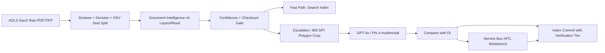
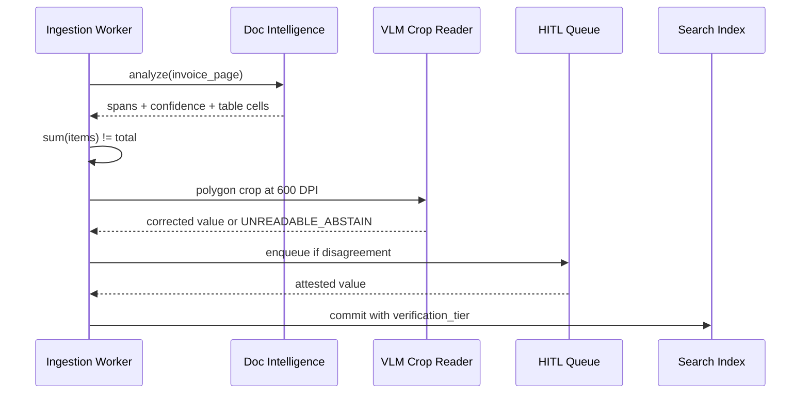

# 企业退化档案扫描、手写与印章遮挡文档 RAG 入湖选型 FAQ
> Topic ID: #478  
> Section: 3.4 智能体状态存储、记忆分层、企业 RAG 与多模态数据面  
> Audience: 企业 AI 文档平台架构师、智能检索/RAG 团队、合规与风控数字化团队  
> Goal: 在退化扫描、红章遮挡、手写混排场景下实现高可信低成本的多模态入库与可追溯检索

## 1 生产问题：退化档案场景下的静默数据污染
银行、保险、法务与政务档案中大量文档并非“清晰可读 PDF”。 实际输入常见 `150 DPI` 传真、斜切、噪声、折痕、复写纸、骑缝章与手写批注叠加。 在 CJK 票据里，红章常直接覆盖金额与日期关键位。 传统单通道 OCR 可能把 `¥1,850,000.00` 误成 `¥1,350,000.00`。 更危险的是系统不报错，错误数字被写入检索索引与向量库。 后续 RAG 问答会“自信复述错误数据”，形成静默合规风险。 保险场景中的手写病历与热敏小票也会触发类似问题。 如果只追求吞吐而不做可信度分层，误读会在数据面长期积累。 因此文档智能化不只是“识别率”问题，而是“可验证可信度工程”问题。

## 2 典型失败链：红章遮挡、手写混排与全页 VLM 幻觉
失败链一是红色印章与蓝色签章的色道污染。 灰度化后印章纹理与黑字融合，导致数字笔画断裂或替换。 失败链二是手写体与印刷体混排。 同一字段中既有机打也有手写补录，单模型易在字符边界处漂移。 失败链三是全页 VLM 直接转换。 虽然流程简单，但在模糊区域 VLM 倾向“补全”而非拒答。 此外全页高分辨率推理成本在千万页规模下急剧放大。 同时全页文本化还可能丢失精细坐标，不利于前端高亮回溯。  
所以企业不能把“可读结果”当成“可审计结果”。

## 3 四种架构路径总览
Pattern A：`Document Intelligence v4` 主通道 + 置信度与校验门控 + 局部高 DPI 多模态升级 + 不一致强制 HITL。  
Pattern B：双引擎 OCR 共识投票 + 关键字段差异升级 + 人工最终签认。  
Pattern C：全页 VLM 端到端转换，适合小规模临时场景。  
Pattern D：单次灰度 OCR 直接入库，不看置信度与表格校验。  
大规模受监管场景应默认 A。  
关键金额/医疗编码零容错场景可在 A 基础上加 B。  
C 作为临时快启路径。  
D 应纳入平台禁用清单。

## 4 十二维量化对比矩阵
| 维度 | Pattern A 置信度门控升级 | Pattern B 双 OCR 共识 | Pattern C 全页 VLM | Pattern D 反模式 |
|---|---|---|---|---|
| 数字精确率 Digit-Exact | `99.6%+` | `99.8%+` | `97.0%-99.0%` | `<94%` |
| 红章遮挡鲁棒性 | 高 | 高 | 中 | 低 |
| 手写体稳定性 | 中高 | 高 | 中高 | 低 |
| 静默污染率 | 低 | 最低 | 中 | 高 |
| 成本 `$/1K 页` | 中低 | 中高 | 高 | 低短期 |
| 吞吐 `pages/min` | 高 | 中 | 中低 | 高 |
| 坐标保真 | 高 | 高 | 中 | 中 |
| HITL 升级比例 | `1.5%-3%` | `2%-6%` | `4%-12%` | `0%` 假象 |
| Sovereign 可部署性 | 高 | 高 | 中 | 高 |
| 运维复杂度 | 中 | 高 | 中 | 低 |
| 三年 TCO | 最优平衡 | 高安全高成本 | 高成本 | 事故高成本 |
| 推荐结论 | 主路径 | 关键字段增强 | 小规模补充 | 禁用 |

## 5 Pattern A 主路径：Document Intelligence 门控 + 局部升级
Pattern A 的核心思想是“绝大多数页面走确定性快路径，少量疑难字段升级精读”。  
先用 `Document Intelligence v4 Layout/Read` 获取结构化文字、表格与置信度。  
对每个关键 span 计算最低置信度并执行业务校验。  
例如发票行项目求和与小计总计一致性、币种格式与位数一致性。  
当 `confidence < 0.88` 或校验失败时，不重跑全页。  
只提取对应 `polygon` 区域并放大到 `600 DPI` 做局部多模态复读。  
局部升级可把 VLM 成本压缩到全页方案的少量比例。  
若 `Document Intelligence` 与 VLM 结果冲突，则进入 HITL。  
HITL 页面必须并排展示原图、框选区域、候选值与规则解释。  
最终只把通过验证的字段写入索引，并记录来源等级。  
这套机制能在成本、吞吐、可解释性之间取得最优平衡。  
对多国家票据场景，建议将规则层做成可配置策略包，按国家税票格式与行业模板差异动态加载，避免同一规则硬套导致误判。  
同时应保留字段级“拒识”能力，宁可升级或人工，不应让模型在低质量区域强行输出确定值。

## 6 Pattern B：双引擎异构 OCR 共识投票
Pattern B 适用于零容错字段特别多的场景。  
主引擎可用 `Document Intelligence v4`，辅引擎可用 `PaddleOCR/Surya/Mistral OCR`。  
关键字段要求两引擎字符级完全一致才自动通过。  
任一字符差异即升级 VLM 仲裁与人工确认。  
这种策略显著降低静默错误。  
代价是双路计算成本与工程复杂度上升。  
还需维护两套模型版本与漂移监控。  
因此 B 通常作为 A 的增强层，而不是所有字段全量启用。  
建议按字段风险分级启用共识投票。  
高风险字段如金额、账号、身份证号、医疗编码必须双验。  
低风险描述性字段可仅走 A 路径以控制成本。  
在长期运营中，可把共识分歧样本沉淀为回归集，持续校准阈值与模板规则。

## 7 Pattern C：全页 VLM 直转的适用边界
Pattern C 对试点和小规模项目极具吸引力。  
它省掉复杂门控流程，接入速度快。  
在图文混排与手写密集页面中，VLM 常优于传统 OCR。  
但它有三类代价。  
第一是成本，千万页规模时会放大到不可接受。  
第二是坐标与字段级证据保真度不足。  
第三是在模糊区域出现“合理但错误”的文本补全。  
因此 C 更适合 `<50K` 页/月的临时项目或数据探索。  
当进入正式监管业务，应尽快迁移到 A 或 A+B。  
若必须长期使用 C，应强制启用严格 `UNREADABLE_ABSTAIN` 输出约束与随机抽检。  
并把高风险字段独立拆分为可验证流程，避免在自由生成文本中混入关键决策数字。

## 8 Pattern D 反模式与风险放大机制
Pattern D 的共同点是“识别即入库”。  
不看置信度，不做业务校验，不做升级，不做人审。  
这种策略在短期 KPI 上看似吞吐高、成本低。  
但会把错误数据持续沉积进企业知识底座。  
后续每次 RAG 检索都会放大污染影响。  
一旦进入审批、理赔、授信等链路，风险直接转换为财务与合规损失。  
因此 D 不是“简化实现”，而是“延迟爆雷”。  
平台治理应通过发布门禁阻止 D 进入生产。  
门禁项至少包括置信度阈值、关键字段校验、升级策略、来源分层与抽检闭环。  
缺任一项都不应上线。

## 9 Mermaid：退化扫描门控式入库全流程


## 10 Mermaid：金额校验失败后的升级时序


## 11 量化推导 Q1 到 Q6
Q1 混合成本。  
`C_blend = C_docintel + p_escalate * C_vlm_crop + p_hitl * C_human_span`。  
若 `C_docintel=8.5`、`p_escalate=0.12`、`C_vlm_crop=22`、`p_hitl=0.02`、`C_human_span=32`，则约 `11.78/1K 页`。  
Q2 字段精确率。  
`P_row_exact = (1 - CER)^k`。  
当 `CER=0.003`、`k=12`，约 `96.5%`。  
通过升级后将 `CER` 压到 `0.0003`，可提升到 `99.64%`。  
Q3 红章掩膜阈值。  
HSV 双红区间 `[0..12]` 与 `[168..180]`，并结合饱和度阈值过滤。  
Q4 检索精度收益。  
关键字段污染下降后，`precision@5` 与数值问答准确率同步提升。  
Q5 HITL 容量预算。  
`Reviewers >= pages_per_day * p_hitl / spans_per_reviewer_day`。  
Q6 风险加权成本。  
需把错误入库引发的决策损失计入 TCO，而非仅比较算力费用。

## 12 代码块一：置信度与校验门控 + 局部升级
```python
from decimal import Decimal
from typing import Dict, List

def should_escalate(spans: List[Dict], line_items: List[Decimal], subtotal: Decimal) -> bool:
    min_conf = min(s.get("confidence", 1.0) for s in spans) if spans else 0.0
    checksum_bad = abs(sum(line_items) - subtotal) > Decimal("0.01")
    return min_conf < 0.88 or checksum_bad

def polygon_crop_request(doc_id: str, span: Dict) -> Dict:
    return {
        "doc_id": doc_id,
        "page": span["page"],
        "polygon": span["polygon"],
        "dpi": 600,
        "schema": {"value": "string", "status": "UNREADABLE_ABSTAIN|OK"}
    }

def merge_result(di_value: str, vlm_value: str, vlm_status: str) -> Dict:
    if vlm_status == "UNREADABLE_ABSTAIN":
        return {"tier": "hitl_attested", "value": None}
    if di_value == vlm_value:
        return {"tier": "vlm_crop_verified", "value": di_value}
    return {"tier": "hitl_attested", "value": None}
```

## 13 代码块二：OpenCV HSV 红章去遮挡滤波
```python
import cv2
import numpy as np

def suppress_red_seal_keep_dark_strokes(img_bgr: np.ndarray) -> np.ndarray:
    hsv = cv2.cvtColor(img_bgr, cv2.COLOR_BGR2HSV)
    lower_red1 = np.array([0, 90, 50], dtype=np.uint8)
    upper_red1 = np.array([12, 255, 255], dtype=np.uint8)
    lower_red2 = np.array([168, 90, 50], dtype=np.uint8)
    upper_red2 = np.array([180, 255, 255], dtype=np.uint8)
    m1 = cv2.inRange(hsv, lower_red1, upper_red1)
    m2 = cv2.inRange(hsv, lower_red2, upper_red2)
    red_mask = cv2.bitwise_or(m1, m2)
    v = hsv[:, :, 2]
    dark_stroke = cv2.inRange(v, 0, 85)
    protect = cv2.bitwise_and(red_mask, cv2.bitwise_not(dark_stroke))
    out = img_bgr.copy()
    out[protect > 0] = (255, 255, 255)
    gray = cv2.cvtColor(out, cv2.COLOR_BGR2GRAY)
    return cv2.GaussianBlur(gray, (3, 3), 0)
```

## 14 代码块三：Azure AI Search 可信度分层索引字段
```python
index_schema = {
    "name": "regulated-doc-spans",
    "fields": [
        {"name": "id", "type": "Edm.String", "key": True},
        {"name": "doc_id", "type": "Edm.String", "filterable": True},
        {"name": "content", "type": "Edm.String", "searchable": True},
        {"name": "span_confidence_min", "type": "Edm.Double", "filterable": True, "sortable": True},
        {"name": "verification_tier", "type": "Edm.String", "filterable": True},
        {"name": "source_polygon", "type": "Collection(Edm.Double)"},
        {"name": "page_no", "type": "Edm.Int32", "filterable": True},
        {"name": "numeric_checksum_pass", "type": "Edm.Boolean", "filterable": True},
    ]
}

def build_doc(span):
    return {
        "id": span["id"],
        "doc_id": span["doc_id"],
        "content": span["text"],
        "span_confidence_min": span["confidence_min"],
        "verification_tier": span["tier"],  # doc_intel_clean|vlm_crop_verified|hitl_attested
        "source_polygon": span["polygon"],
        "page_no": span["page"],
        "numeric_checksum_pass": span["checksum_ok"],
    }
```

## 15 企业场景、三年 TCO 与 D0/D1/D2 落地清单
### 15.1 场景 A：APAC 贸易金融与对公信贷档案
该场景每月处理约 `2.4M` 页红章密集单据。  
上线前红章遮挡导致金额静默污染率约 `6.8%`。  
采用 Pattern A 后下降到 `0.12%`。  
HITL 升级控制在 `2.1%`，成本明显低于全页 VLM。  
平台保留字段级坐标证据，审计回溯时间显著缩短。  
业务侧在不牺牲吞吐的情况下满足了监管对金额准确性的硬约束。  
进一步通过模板分层策略，将高风险单据优先进入严格门控，低风险单据走快速通道，实现风险与效率平衡。  
跨国票据场景中，系统按币种和格式规则自动切换校验器，减少人工配置负担并提升稳定性。

### 15.2 场景 B：北美财险与工伤理赔手写档案
该场景每月处理约 `850K` 页手写病历与传真件。  
关键字段如 `ICD-10`、`CPT` 与赔付金额采用 Pattern B 双引擎共识。  
叙述性手写内容采用 Pattern A 局部升级。  
差异字段自动进入 HITL 并记录裁决原因。  
上线后静默错码显著下降，理赔复核返工率同步下降。  
平台通过版本化阈值管理，避免模型升级引发识别漂移。  
在高峰时段，系统根据队列水位动态调节升级阈值，优先保障金额与编码字段准确性。  
长期运营中，团队把分歧样本回流训练集与规则库，持续提升机器通过率并降低人审压力。

### 15.3 三档三年 TCO 参考
基础档：Pattern A 主路径，适合大多数受监管文档工厂。  
增强档：A+B 混合，适合关键字段零容错行业。  
旗舰档：A+B+区域级 HITL 中心与审计联动，适合跨法域集团。  
评估时需将误读导致的财务风险折现计入总成本。  
不能只比较 API 账单。  
建议每半年复核升级比例、误伤率、人审效率与成本曲线。  
并将字段级准确率与审计可追溯性纳入平台 SLA，而不是仅看吞吐。

### 15.4 D0 D1 D2 十八项执行动作
- **D0-1** 盘点文档类型、页质量分布与关键字段清单。  
- **D0-2** 定义金额、证件号、医疗编码等高风险字段。  
- **D0-3** 建立 `confidence` 与 checksum 基线阈值。  
- **D0-4** 构建红章遮挡与手写样本回归集。  
- **D0-5** 定义 `UNREADABLE_ABSTAIN` 输出契约。  
- **D0-6** 设计 HITL 工单字段与审计留痕规范。  
- **D1-1** 部署 Document Intelligence 主通道。  
- **D1-2** 上线置信度与表格校验门控。  
- **D1-3** 接入 polygon 局部裁剪与 VLM 升级。  
- **D1-4** 接入 Service Bus + Cosmos HITL 队列。  
- **D1-5** 在 Search 索引写入 verification tier。  
- **D1-6** 完成端到端红队与业务验收。  
- **D2-1** 每周复核字段误读率与静默污染率。  
- **D2-2** 每周复核升级比例与队列时延。  
- **D2-3** 每月复核模型版本与阈值漂移。  
- **D2-4** 每月复核人审效率与驳回原因分布。  
- **D2-5** 每季度复核成本模型与预算偏差。  
- **D2-6** 每季度执行全链路合规演练与抽检。  

通过该架构，企业可把“能识别”升级为“可验证可信识别”。  
核心价值在于把置信度、规则、升级、人审和索引来源分层打通。  
当下游智能体回答必须给出处与可信度时，这种分层是唯一可规模化治理路径。  
长期看，它还能显著降低错误数据对知识底座的累积污染。  
最终实现高吞吐、可审计、可追责的企业级多模态文档智能化。
若企业希望把这套能力长期沉淀为集团级标准，建议把字段风险分级、门控阈值版本化、争议样本回流、抽检策略、审计证据保留、跨区域灾备演练与人审产能治理统一纳入同一套运营看板，并要求每次模型升级都必须完成红章遮挡和手写混排的专项回归，以确保新版本在真实退化档案上的精度、稳定性与合规可解释性持续达标而不是仅在理想样本上表现优异，同时将关键字段错误类型按业务损失等级进行周度复盘，把模型问题、规则问题与流程问题拆分归因并闭环整改，持续压降静默污染风险，并建立跨团队知识库沉淀可复用修复策略与最佳实践模板以提升组织学习效率，确保经验可复制并稳定传承，让平台能力随组织规模扩展而持续增强，并形成可审计的持续改进闭环，支撑长期治理与持续运营能力长期稳健达成。

来源抓取日期 2026 11 27  
Azure AI Document Intelligence overview  
https://learn.microsoft.com/azure/ai-services/document-intelligence/overview  
Document Intelligence containers  
https://learn.microsoft.com/azure/ai-services/document-intelligence/containers/install-run  
Azure OpenAI vision capable models  
https://learn.microsoft.com/azure/ai-services/openai/concepts/models  
Azure AI Search overview  
https://learn.microsoft.com/azure/search/search-what-is-azure-search  
OpenCV color space and thresholding  
https://docs.opencv.org/4.x/df/d9d/tutorial_py_colorspaces.html  
Service Bus messaging patterns  
https://learn.microsoft.com/azure/service-bus-messaging/service-bus-messaging-overview  
