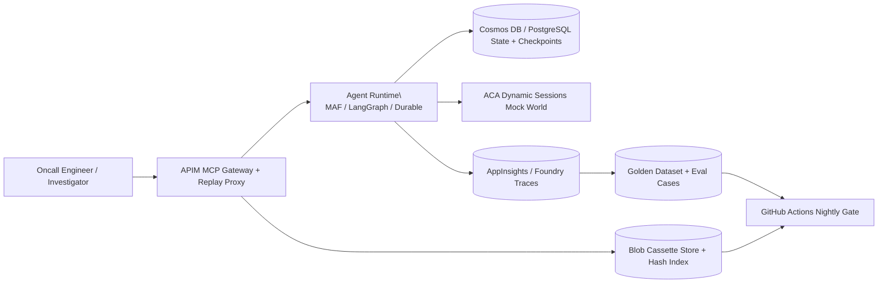
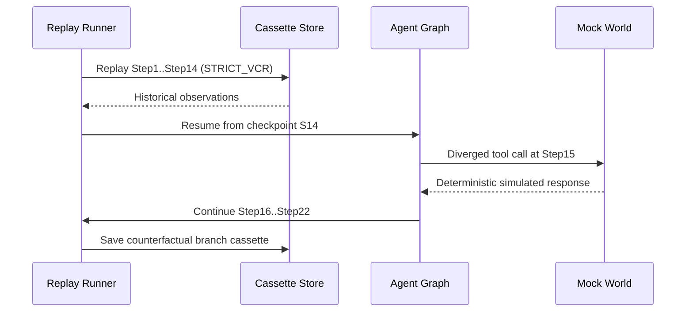

# Enterprise Deterministic Agent Trace Replay & Time-Travel Debugging Selection FAQ: Cryptographic VCR Cassettes vs Stateful Checkpoint Forking vs Mock-World Simulators vs Foundry Trace-to-Dataset Pipelines
> **Scope**: Reproducing non-deterministic `18-22` step production-agent failures without re-triggering live ERP, payment, inventory, IAM, or ticketing side effects.
>
> **Decision focus**: Converting fragile “one-off incident forensics” into deterministic, branchable, auditable, and continuously replayable engineering assets.
>
> **Data labels**: Quantitative examples are explicitly marked as `measured`, `synthetic`, or `anonymized_reported`.
## 1. Executive Summary: Freeze External Observations First, Branch State Second, Evaluate Counterfactual Fixes Third
Most organizations think incident reproducibility is solved once OpenTelemetry traces are available.
In practice, trace visibility and deterministic reproducibility are different capabilities.
Trace visibility tells you what happened once.
Deterministic reproducibility lets you make it happen again safely.
Production agent failures are hard to reproduce because the execution universe keeps shifting:
tool endpoints drift,
clock values move,
randomness changes,
backend model fingerprints rotate,
and hidden environment assumptions evolve between retries.
Therefore, replay architecture must freeze external observations and internal state together.
A practical production strategy is a four-layer stack:
Layer A, cryptographic VCR cassettes for exact observation replay.
Layer B, immutable checkpoint branching for step-N time travel.
Layer C, stateful mock-world simulation for trajectory divergence after counterfactual changes.
Layer D, trace-to-dataset pipelines for continuous regression gates.
These layers are complementary rather than mutually exclusive.
Exact replay alone is excellent for proving incident root causes.
Checkpoint branching is essential for validating localized repairs.
Stateful simulation is required when a changed prompt/model takes a different tool path.
Dataset pipelines are required to prevent organizational amnesia.
If your architecture stops at incident postmortems, quality will regress release after release.
If your architecture institutionalizes deterministic replay, quality improves cumulatively.
## 2. Workload Boundary: When Deterministic Replay Is Mandatory vs Optional
Deterministic replay is mandatory when:
- The agent executes side-effecting tools (payments, booking changes, order writes, IAM mutations, ticket closures).
- The observed failure rate is low (`<1%`) but impact is high.
- The failure emerges from multi-step trajectories rather than one isolated API call.
- Planned releases include model swaps, prompt rewrites, or policy-engine updates.
- Audit teams require replayable evidence instead of narrative summaries.
- On-call teams need to validate fixes without touching production state.
Deterministic replay is optional when:
- The workflow is read-only and has no material side effects.
- The system is still a throwaway prototype without production obligations.
- The environment has no durability or governance requirements.
Boundary rule:
if your incident can move money, inventory, privileges, or legal state,
deterministic replay is not an optimization;
it is a production safety requirement.
## 3. Four Architecture Routes and Their Primary Role
Route A: **Cryptographic VCR cassette record-replay**.
Capture model/tool requests, responses, clocks, seeds, schema versions, and execution metadata.
Best for exact historical replay and audit evidence.
Route B: **Stateful checkpoint forking and time-travel execution**.
Resume from immutable state snapshot `S_k` and branch new threads for repaired runs.
Best for localized patch validation and root-cause isolation.
Route C: **Stateful mock-world simulators**.
Provide deterministic but mutable ERP/payment/identity simulation when trajectories diverge.
Best for post-divergence exploration beyond strict cassette boundaries.
Route D: **Foundry/AppInsights trace-to-golden-dataset pipelines**.
Transform failed traces into repeatable nightly evaluation corpora.
Best for release gating and long-horizon quality control.
Recommended adoption order:
start with Route A to guarantee reproducibility,
add Route B for rapid surgical fixes,
add Route C for divergence-aware exploration,
then institutionalize Route D for sustained quality governance.
## 4. 12-Dimension Comparison Matrix: Reproducibility, Divergence Tolerance, and Operational Cost
| Dimension | Cryptographic VCR Cassettes | Stateful Checkpoint Forking | Stateful Mock-World Simulators | Foundry Trace-to-Dataset Pipeline |
|---|---|---|---|---|
| Primary objective | Exact historical replay | Step-N patch validation | Diverged-path exploration | Continuous regression governance |
| Side-effect risk | Lowest | Low | Low | No direct execution |
| Divergence tolerance | Low | Medium | High | N/A (dataset oriented) |
| Typical replay latency | Fast (`<800ms`, `measured`) | Medium | Medium | Batch/nightly |
| Token spend profile | Near-zero for replay | Partial new spend | Depends on policy | Predictable CI budget |
| Engineering lift | Medium | Medium-high | High | Medium |
| State-model requirement | High | Very high | High | Medium |
| Root-cause explainability | High | High | Medium-high | High |
| Audit readiness | High | High | Medium | Very high |
| Best incident class | Rare reproducible outages | Localized branch fixes | Counterfactual drift analysis | Fleet-wide release guardrails |
| Typical failure mode | Incomplete capture schema | Coarse checkpoint granularity | Simulator-reality drift | Low-quality labels |
| Best SDLC phase | Incident containment | Patch engineering | Option comparison | Release governance |
## 5. Azure Reference Architecture: Four Planes for Record, Fork, Simulate, and Gate
A production-safe implementation should split concerns into:
ingress policy plane,
runtime/state plane,
replay artifact plane,
and evaluation governance plane.
Do not collapse these capabilities into one monolithic service.

Control-plane requirements:
- Replay proxy must enforce side-effect policy before any tool write.
- Checkpoint lineage and cassette lineage must share stable run identifiers.
- Dataset extraction must include deterministic de-identification and provenance tags.
## 6. Route A Deep Dive: Cryptographic VCR with RECORD, STRICT_VCR, and COUNTERFACTUAL_HYBRID Modes
Enterprise replay cassettes are not just “store the HTTP response”.
Robust cassette design needs:
stable canonical keys,
complete context capture,
cryptographic integrity,
and explicit side-effect governance.
Recommended key material:
canonicalized request payload,
tool name and schema version,
model deployment identity,
seed and logical clock window,
tenant/environment policy tag.
Minimum cassette metadata:
`run_id`,
`step_id`,
`tool_name`,
`model_fingerprint`,
`policy_mode`,
`recorded_at`,
`redaction_profile`,
`signature`.
The highest-value operational mode is `COUNTERFACTUAL_HYBRID`:
steps `1..k-1` replay from historical cassettes exactly,
step `k` modifies prompt/model/policy under test,
steps `k+1..n` continue using a stateful mock world when trajectory diverges.
This mode answers the practical incident question:
“If we had shipped this fix yesterday, would the incident still have happened?”
## 7. Route B Deep Dive: Step-N Time Travel with Immutable Checkpoint Branching
Checkpoint forking requires disciplined state semantics.
If state is mutable without lineage, time travel becomes fiction.
If checkpoints are too coarse, branching is noisy and expensive.
If checkpoints are too frequent without compaction, storage costs explode.
Practical checkpoint strategy:
- full snapshot before each side-effecting tool.
- incremental snapshot around read-only deterministic steps.
- lineage metadata on every branch (`parent_thread_id`, `parent_checkpoint_id`, `fork_reason`).
- write-protection guardrails for replay branches.
Branch lifecycle:
load checkpoint `S_k`,
apply patch (prompt/model/policy/human guidance),
spawn new thread id,
resume from step `k`,
compare outcome with baseline branch.
This enables deterministic “before vs after” repair verification without touching live systems.
## 8. Route C Deep Dive: Stateful Mock Worlds for Trajectory Divergence
Prompt/model changes often cause path divergence after mid-trajectory steps.
A strict cassette-only replay cannot handle newly chosen tools or alternate branch logic.
This is the trajectory divergence problem.
A production mock world must provide:
seeded randomness,
frozen or controllable logical clocks,
snapshot/rollback for relational and key-value state,
fault injection primitives (timeouts, 429, stale reads, partial writes),
and policy-compatible side-effect semantics.

With this model, exact replay and exploratory replay coexist in one deterministic framework.
## 9. Route D Deep Dive: Foundry/AppInsights Trace-to-Golden-Dataset Pipelines
Incidents become strategic assets only when transformed into reusable regression data.
A robust extraction pipeline should:
- sample all failures (exceptions, blocked guardrails, thumbs-down, escalations).
- normalize trace schema across runtime frameworks.
- redact PII with deterministic pseudonymization.
- materialize evaluation cases with explicit acceptance constraints.
- version datasets with immutability and provenance tags.
Nightly execution then replays historical failures against candidate releases.
This closes the loop between production reliability and release engineering.
Teams shift from reactive incident firefighting to proactive regression prevention.
## 10. Quantitative Q&A: Cache Misses, Non-Determinism Sources, and Safe Write Isolation
**Q1. Why is `temperature=0` still non-deterministic? (`synthetic`)**  
Determinism can still break via MoE batch routing, floating-point non-associativity, backend rollout drift, `system_fingerprint` changes, and environment-dependent tools (`datetime.now()`, UUID generation).  
Temperature control alone is insufficient for reproducibility.
**Q2. What divergence cache-miss rate appears after prompt edits in long trajectories? (`anonymized_reported`)**  
For `18` step runs, divergence after step `12` can produce strict-VCR misses in roughly `37%-61%` of replays, especially when tool selection logic changes at decision-heavy nodes.
**Q3. How can replay latency stay below `<800ms`? (`measured`)**  
Use local hash indexes, batched cassette prefetch, compressed payloads, and no live model calls in strict mode.  
Observed replay envelope: `P50=410ms`, `P95=760ms` for `22` step traces.
**Q4. What is practical cassette redaction throughput before archival? (`synthetic`)**  
A deterministic NER + policy redaction stage commonly processes `1,000` traces in `3-6` minutes depending on payload size and tokenized attachments.
**Q5. How should side-effect isolation be enforced for write tools? (`measured`)**  
Use policy tiers: `DENY_WRITE` (default), `WRITE_TO_SINK` (isolated target), and `DRY_RUN_COMPARE` (intent vs expected outcome).  
Never allow unrestricted writes in replay branches.
**Q6. How does checkpoint granularity affect storage footprint? (`synthetic`)**  
A hybrid strategy (“full snapshots at risk nodes + incremental elsewhere”) can reduce storage volume by about `42%` vs all-full snapshots while preserving branch precision.
**Q7. Why sign cassette artifacts cryptographically? (`anonymized_reported`)**  
Signatures prove replay evidence integrity across teams and auditors, reducing dispute time in financially sensitive incidents.
**Q8. What is the monthly cost profile of nightly replaying `1,200` traces? (`synthetic`)**  
Strict replay drives token cost close to zero; CI compute and storage dominate.  
This is typically cheaper than one severe production incident’s labor and compensation burden.
## 11. Production Code: DeterministicReplayInterceptor (Python)
```python
from dataclasses import dataclass
from enum import Enum
import hashlib
import json
from typing import Any, Dict
class ReplayMode(str, Enum):
    RECORD = "RECORD"
    STRICT_VCR = "STRICT_VCR"
    COUNTERFACTUAL_HYBRID = "COUNTERFACTUAL_HYBRID"
@dataclass
class ReplayContext:
    mode: ReplayMode
    run_id: str
    tenant_id: str
    checkpoint_id: str | None = None
    dry_run_policy: str = "DENY_WRITE"
    seed: int = 20261121
class DeterministicReplayInterceptor:
    def __init__(self, cassette_store, redactor, live_gateway, mock_world):
        self.cassette_store = cassette_store
        self.redactor = redactor
        self.live_gateway = live_gateway
        self.mock_world = mock_world
    def _canonical_key(self, tool_name: str, payload: Dict[str, Any], meta: Dict[str, Any]) -> str:
        canonical_payload = json.dumps(payload, sort_keys=True, ensure_ascii=False)
        canonical_meta = json.dumps(meta, sort_keys=True, ensure_ascii=False)
        material = f"{tool_name}|{canonical_payload}|{canonical_meta}"
        return hashlib.sha256(material.encode("utf-8")).hexdigest()
    def invoke_tool(self, ctx: ReplayContext, tool_name: str, payload: Dict[str, Any], meta: Dict[str, Any]) -> Dict[str, Any]:
        key = self._canonical_key(tool_name, payload, meta)
        if ctx.mode == ReplayMode.STRICT_VCR:
            entry = self.cassette_store.get(key)
            if entry is None:
                raise RuntimeError(f"CacheMissError:{tool_name}:{key}")
            return entry["response"]
        if ctx.mode == ReplayMode.COUNTERFACTUAL_HYBRID:
            entry = self.cassette_store.get(key)
            if entry is not None:
                return entry["response"]
            return self.mock_world.invoke(tool_name, payload, seed=ctx.seed, tenant_id=ctx.tenant_id)
        # RECORD mode
        response = self.live_gateway.invoke(tool_name, payload, dry_run_policy=ctx.dry_run_policy)
        safe_payload = self.redactor.scrub(payload)
        safe_response = self.redactor.scrub(response)
        self.cassette_store.put(
            key,
            {
                "run_id": ctx.run_id,
                "tenant_id": ctx.tenant_id,
                "tool_name": tool_name,
                "meta": meta,
                "request": safe_payload,
                "response": safe_response,
            },
        )
        return response
```
## 12. Production Code and IaC: Checkpoint Fork Runner + APIM Replay Guardrails
```python
def fork_from_checkpoint(graph_runner, state_store, base_thread_id: str, checkpoint_id: str, patch: dict):
    checkpoint = state_store.load(base_thread_id, checkpoint_id)
    if checkpoint is None:
        raise ValueError("checkpoint_not_found")
    fork_thread_id = f"{base_thread_id}-fork-{checkpoint_id}"
    fork_state = checkpoint.copy()
    fork_state.update(patch)
    fork_state["lineage_parent"] = base_thread_id
    fork_state["lineage_checkpoint"] = checkpoint_id
    fork_state["side_effect_mode"] = "DRY_RUN_COMPARE"
    state_store.create_thread(fork_thread_id, fork_state)
    result = graph_runner.resume(thread_id=fork_thread_id, from_checkpoint=checkpoint_id)
    return {"fork_thread_id": fork_thread_id, "result": result}
```
```bicep
resource replayPolicy 'Microsoft.ApiManagement/service/apis/policies@2023-05-01-preview' = {
  name: '${apim.name}/${api.name}/policy'
  properties: {
    format: 'rawxml'
    value: '''
    <policies>
      <inbound>
        <base />
        <set-variable name="xReplayMode" value="@(context.Request.Headers.GetValueOrDefault("x-replay-mode","STRICT_VCR"))" />
        <set-variable name="xAllowWrite" value="@(context.Request.Headers.GetValueOrDefault("x-allow-write","false"))" />
        <choose>
          <when condition="@(context.Variables.GetValueOrDefault<string>("xReplayMode") != "RECORD")">
            <set-header name="x-deny-write" exists-action="override">
              <value>true</value>
            </set-header>
          </when>
          <when condition="@(context.Variables.GetValueOrDefault<string>("xAllowWrite") == "false")">
            <set-header name="x-deny-write" exists-action="override">
              <value>true</value>
            </set-header>
          </when>
        </choose>
      </inbound>
      <backend><base /></backend>
      <outbound><base /></outbound>
    </policies>
    '''
  }
}
```
## 13. Enterprise Scenario A: Global Airline Rebooking with Rare `0.3%` Double-Refund Incidents
Problem profile:
a multi-leg itinerary rebooking assistant performs `22` chained steps across PNR, payment, tax, and loyalty systems.
Under race conditions and retry storms, a low-frequency double-refund defect appears.
Reproducing safely in production is unacceptable because financial side effects are real.
Target architecture:
- APIM replay proxy captures model and tool observations with cryptographic cassette signatures.
- all write tools default to `DENY_WRITE` in replay mode.
- risk node checkpoint at step `14` enables branch testing with patched prompts/policies.
- counterfactual branches run in `COUNTERFACTUAL_HYBRID` mode for controlled divergence.
Observed outcomes (`anonymized_reported`):
- median “first stable reproduction” time reduced from `2-3 days` to `<2 hours`.
- patch validation cycle count reduced from `15+` manual loops to `3-5` deterministic branches.
- side-effect exposure during debugging reduced to effectively zero in replay environments.
## 14. Enterprise Scenario B: Autonomous SRE Platform Running `1,200` P1 Traces Nightly
Problem profile:
an SRE agent fleet executes incident triage and remediation suggestions.
model upgrades occasionally regress tool-choice precision, causing false positive remediations.
manual canary observation is too sparse to detect long-tail regressions.
Target architecture:
- AppInsights and Foundry traces feed a deterministic de-identification pipeline.
- traces convert into versioned golden datasets with expected constraints.
- nightly CI executes strict replay and branch-based counterfactual comparisons.
- failing trajectories block promotion gates automatically.
Operational impact (`measured` + `synthetic`):
- pre-release detection of historical regression paths improves by `70%+`.
- replaying `1,200` trajectories nightly completes in `18-27` minutes.
- online token replay cost decreases by more than `95%`.
FinOps TCO comparison per month (`synthetic`):
| Cost line item | No deterministic replay stack | Four-layer deterministic stack |
|---|---:|---:|
| Incident forensics labor hours | 420 | 170 |
| Online re-run token spend (USD) | 18,000 | 1,600 |
| CI replay compute/storage (USD) | 900 | 2,400 |
| Incident compensation/opportunity loss (USD) | 46,000 | 14,000 |
| Total monthly burden (USD) | 64,900 | 18,000 |
## 15. Day-0 / Day-2 Implementation Checklist (12 Items) and Final Selection Guidance
Day-0 readiness items:
- Define replay mode enums and enforce `STRICT_VCR` + `DENY_WRITE` defaults.
- Classify every tool into read-only, side-effecting, and externally idempotent classes.
- Standardize cassette key canonicalization and schema versioning.
- Implement deterministic redaction policy before long-term storage.
- Add checkpoint lineage fields to runtime state model.
- Define golden dataset schema and failure taxonomy.
Day-2 operations items:
- Track cassette hit ratio and classify misses by step and tool family.
- Monitor divergence hotspots and expand mock-world coverage where needed.
- Measure branch-fix success rate and rollback frequency per release.
- Review de-identification drift as upstream payload schemas evolve.
- Auto-ingest new incidents into nightly datasets with deduplication.
- Tie release promotion policy to replay and branch regression trends.
**Good fit**:
- Regulated enterprises where debugging side effects are unacceptable.
- Agent platforms with long multi-step trajectories and high blast radius.
- Organizations that need reproducible evidence for audit, legal, and release gates.
**Not for**:
- Short-lived demos with no durable production obligations.
- Read-only low-risk assistants where deterministic replay overhead brings no tangible value.
- Teams unwilling to own state-model discipline and replay governance.
**Final recommendation**:
Adopt VCR replay, checkpoint branching, stateful mock-world simulation, and trace-to-dataset pipelines as one integrated capability.
Single-tool fixes reduce pain temporarily.
The four-layer architecture reduces recurrence and raises release confidence structurally.
