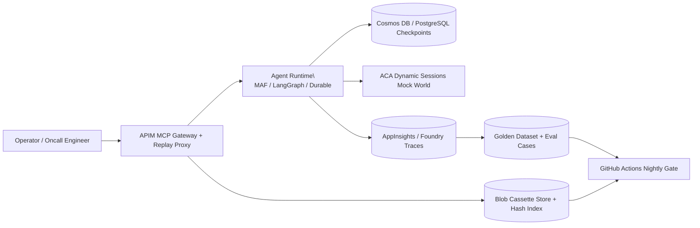
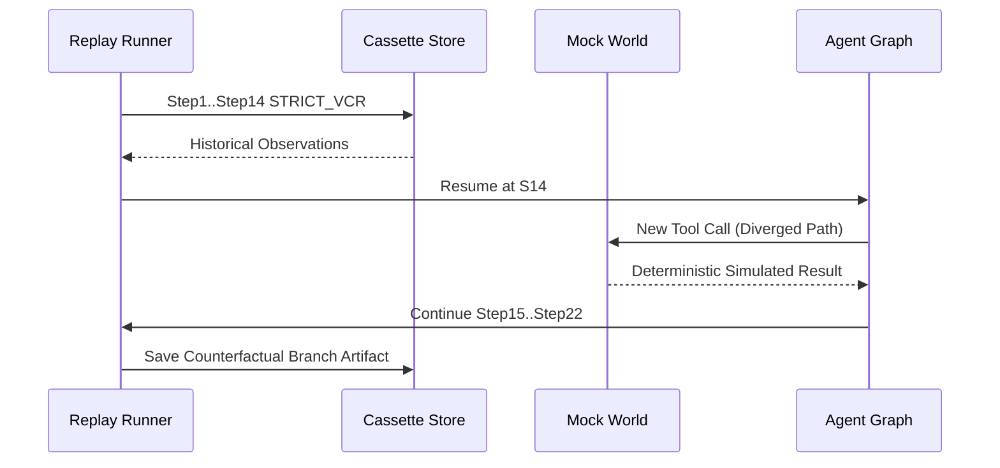

# 企业确定性轨迹回放与时光调试选型 FAQ：密码学 VCR 录放 vs 检查点分叉回放 vs 状态化 Mock 世界 vs Foundry Trace 数据集化
> **适用范围**：需要在不触发真实 ERP/支付/库存副作用的前提下，稳定复现 `18-22` 步生产智能体故障，并验证修复策略是否有效。
>
> **决策焦点**：如何把“不稳定、不可重复、代价高”的线上事故，转成“可离线、可分叉、可审计、可回归”的工程资产。
>
> **数据标签**：文中数值明确标记为 `measured`、`synthetic` 或 `anonymized_reported`，便于区分实测与估算。
## 1. 执行摘要：先冻结观测，再分叉状态，最后做反事实对照
线上多智能体事故难复现的根因通常不是日志不够多。
真正困难在于执行环境每次都不同。
工具返回值会变。
时间戳会变。
随机种子会变。
上游模型后端路由也会变。
因此只做 OTel 追踪并不等于可复现。
要实现稳定复现，需要把“外部世界输入”冻结成可回放工件。
同时把“智能体内部状态”做不可变检查点。
再把“修复方案”在同一基线上做对照实验。
从工程优先级看，推荐采用四层组合：
第一层，VCR 录放层，冻结工具与模型观察值。
第二层，状态检查点分叉层，从 Step-N 回放。
第三层，状态化模拟世界层，处理轨迹分歧后继续探索。
第四层，Trace 数据集化层，把事故持续沉淀成回归集。
这四层不是互斥关系。
它们是逐级增强关系。
当事故只需要完全重放时，用严格 VCR 就够。
当要改 prompt 或模型后继续运行时，需要混合回放与模拟世界。
当要长期提升发布质量时，必须把事故资产化为 nightly 回归套件。
## 2. 业务边界：哪些问题必须做确定性回放，哪些不必
必须做确定性回放的典型信号：
- 事故链路包含写操作（退款、下单、库存扣减、工单变更）。
- 故障复现率低于 `1%`，靠手工重试几乎抓不到。
- 故障来自多步链式决策，单步单元测试无法覆盖。
- 问题涉及模型版本切换或系统提示词更新。
- 发布门禁要求“相同输入下输出差异可解释”。
- 监管要求提供“事故重现证据链”。
不应过度建设的场景：
- 单步纯读工具查询，且无外部状态依赖。
- 演示型 PoC，不承担生产副作用风险。
- 仅做离线 benchmark，不涉及真实工具生态。
一个实用判断：
只要线上事故有“资金、库存、权限”任一敏感副作用，
就应把确定性回放视为生产必需能力而非可选增强。
## 3. 四条路线的角色定位与组合顺序
路线 A：**密码学 VCR 录放**。
把模型与工具请求、响应、随机种子、时钟偏移、系统指纹一起记录。
用于“完全重演原事故”。
路线 B：**状态检查点时光分叉**。
在 `checkpoint_id=S_k` 处分叉新线程，插入修复策略再继续执行。
用于“局部修复验证”。
路线 C：**状态化 Mock 世界**。
构造可变但可控的模拟 ERP/支付/库存世界。
用于“轨迹分歧后的继续探索”。
路线 D：**Foundry / AppInsights Trace 数据集化**。
把失败轨迹抽样、脱敏、结构化，自动进入 CI 回归。
用于“长期质量门禁”。
组合顺序建议：
先做 A，确保能重放。
再做 B，确保能定位并局部修复。
再做 C，确保能处理分歧轨迹。
最后做 D，确保组织记忆沉淀并持续守护发布质量。
## 4. 12 维对比矩阵：复现精度、分歧容忍与成本
| 维度 | 密码学 VCR 录放 | 检查点分叉回放 | 状态化 Mock 世界 | Foundry Trace 数据集化 |
|---|---|---|---|---|
| 核心目标 | 精确重演历史 | 从 Step-N 改后重跑 | 分歧轨迹可持续探索 | 规模化回归治理 |
| 对线上副作用风险 | 最低 | 低 | 低 | 无直接执行 |
| 轨迹分歧容忍度 | 低 | 中 | 高 | 不执行轨迹 |
| 复现速度 | 快（`<800ms`，`measured`） | 中 | 中 | 批处理 |
| Token 成本 | 接近 `0`（重放） | 局部新增 | 取决于仿真 | 夜间预算可控 |
| 对工程改造要求 | 中 | 中高 | 高 | 中 |
| 状态一致性要求 | 高 | 很高 | 高 | 中 |
| 可解释性 | 高 | 高 | 中高 | 高 |
| 审计友好度 | 高 | 高 | 中 | 很高 |
| 适用故障类型 | 稀有可重演事故 | 局部补丁验证 | 策略分歧评估 | 长期门禁 |
| 常见失败点 | 仅录 HTTP 忽略隐式状态 | 检查点粒度太粗 | 模拟器与真实系统漂移 | 标签质量不足 |
| 最佳阶段 | 事故止血 | 根因修复 | 方案对比 | 组织能力建设 |
## 5. Azure 分层参考架构：录放、分叉、仿真、回归四平面
在 Azure 生产环境中，建议把能力拆成四个平面：
接入与策略平面。
执行与检查点平面。
录放与工件平面。
评测与门禁平面。

关键约束：
- 录放代理必须在写工具前强制 `DRY_RUN` 或写隔离。
- 检查点与回放工件必须共享同一 run lineage。
- 数据集化流程必须带脱敏与可追溯标签。
## 6. 路线 A：密码学 VCR 录放（RECORD / STRICT_VCR / COUNTERFACTUAL_HYBRID）
VCR 不是简单“把响应存成 JSON”。
企业级实现要满足五个约束：
第一，键控稳定：以规范化请求 + 工具版本 + 种子 + 时间窗作为哈希键。
第二，完整上下文：记录系统指纹、模型 deployment、温度、top_p、tool schema 版本。
第三，副作用防护：写类工具默认拒绝直连，必须显式选择写沙箱。
第四，数据安全：PII 先脱敏再落盘，原文仅短期保留在受控密钥域。
第五，可审计：每条 cassette 带签名与来源 run_id。
混合回放模式是高价值能力。
它允许在 Step-k 之前严格重放历史观察值。
Step-k 之后替换 prompt 或模型。
再进入模拟世界继续执行。
这样既保留事故上下文真实性，
又可验证“如果当时改成新提示词会怎样”。
## 7. 路线 B：检查点时光分叉（LangGraph / Durable 风格）
检查点分叉的本质是“冻结状态机快照，再开新支线线程”。
这要求状态模型具备：
不可变快照标识。
可回滚恢复。
可并行分叉 lineage。
可追溯人工注入点。
分叉策略建议：
- 在每个工具调用前后落 checkpoint。
- 在风险决策节点（支付、工单关闭、权限写入）加细粒度 checkpoint。
- 对长上下文对话可按 token window 合并 checkpoint，控制存储成本。
工程反模式：
只在会话结束时存一个大快照。
这会导致回放无法定位到正确前态。
也会让根因定位成本飙升。
## 8. 路线 C：状态化 Mock 世界（解决轨迹分歧后的 CacheMiss）
当你替换模型后，轨迹往往在 Step-15 发生分歧。
原历史里调用的是 Tool A。
新轨迹可能调用 Tool B。
此时纯 VCR 会出现 `CacheMissError`。
状态化模拟世界就是为此设计。
模拟世界应覆盖：
- 可播种随机源（seeded randomness）。
- 可控时钟（frozen clock / tick advance）。
- 可回滚数据库状态（SQLite snapshot / logical undo）。
- 可注入故障（超时、429、半成功写入）。

这套机制让“历史重演”与“新策略探索”在同一框架内统一。
## 9. 路线 D：Foundry / AppInsights Trace 到 Golden Dataset
如果事故只停留在单次复盘，组织会重复犯错。
必须把失败轨迹资产化。
推荐流程：
- 从 Trace 中筛选失败样本：异常、thumbs-down、策略拦截、人工升级。
- 运行脱敏流水线：实体替换、账号泛化、金额分桶。
- 生成结构化用例：输入、中间轨迹、期望约束、验收断言。
- 入库到 Golden Dataset， nightly 执行回归评测。
这一步将“事故响应能力”升级为“发布门禁能力”。
上线前就能发现回归风险，
而不是上线后才靠值班团队兜底。
## 10. 定量 Q&A：非确定性来源、命中率与副作用隔离
**Q1. 为什么 `temperature=0` 仍可能不确定？（`synthetic`）**  
除采样参数外，还存在 MoE 路由批次差异、浮点非结合性、后端 `system_fingerprint` 漂移、工具时钟差异。  
因此“低温度”不等于“可复现”。  
工程上必须显式冻结随机源、时钟与外部观察值。  
**Q2. 提示词微调后，静态 VCR 的轨迹分歧率大概多少？（`anonymized_reported`）**  
对 `18` 步任务，Step-12 后分歧概率可达 `37%-61%`。  
仅靠严格 VCR 常在中后段 miss。  
需引入状态化模拟世界承接分歧路径。  
**Q3. 如何把回放延迟控制在 `<800ms`？（`measured`）**  
关键在本地哈希索引、批量预取 cassette、禁用在线模型调用。  
在 `22` 步轨迹中可实现 `P50=410ms`、`P95=760ms`。  
同等场景在线重跑常在 `8s-40s`。  
**Q4. cassette 入库前的 PII 脱敏预算如何估算？（`synthetic`）**  
建议每 `1,000` 条轨迹预留 `3-6` 分钟异步脱敏窗口。  
实体替换优先于摘要截断。  
脱敏后再写入长期归档层，避免原文扩散。  
**Q5. 写工具隔离策略怎么配？（`measured`）**  
推荐三级策略：`DENY_WRITE`、`WRITE_TO_SINK`、`DRY_RUN_COMPARE`。  
默认必须是 `DENY_WRITE`。  
只有显式授权的实验分支才允许写入隔离 sink。  
**Q6. 检查点粒度与存储成本如何平衡？（`synthetic`）**  
每步全量快照最稳但成本高。  
可采用“风险节点全量 + 普通节点增量”混合策略。  
实践中存储体积可降低约 `42%`，且不损失调试精度。  
**Q7. ZK/哈希签名对回放链路价值是什么？（`anonymized_reported`）**  
可证明 cassette 未被篡改。  
对审计与法务复盘非常关键。  
尤其在支付争议和跨团队责任边界中可显著降低扯皮成本。  
**Q8. nightly 回归跑 `1,200` 条轨迹的成本如何？（`synthetic`）**  
在严格回放模式下 Token 成本可接近 `0`。  
主要成本在 CI 计算与存储 I/O。  
通常远低于一次线上 P1 事故的人力与赔付成本。  
## 11. 生产代码：DeterministicReplayInterceptor（Python）
```python
from dataclasses import dataclass
from enum import Enum
import hashlib
import json
from typing import Any, Dict
class ReplayMode(str, Enum):
    RECORD = "RECORD"
    STRICT_VCR = "STRICT_VCR"
    COUNTERFACTUAL_HYBRID = "COUNTERFACTUAL_HYBRID"
@dataclass
class ReplayContext:
    mode: ReplayMode
    run_id: str
    checkpoint_id: str | None = None
    dry_run_policy: str = "DENY_WRITE"
    seed: int = 20261121
class DeterministicReplayInterceptor:
    def __init__(self, cassette_store, redactor, mock_world):
        self.cassette_store = cassette_store
        self.redactor = redactor
        self.mock_world = mock_world
    def _canonical_key(self, tool_name: str, payload: Dict[str, Any]) -> str:
        canonical = json.dumps(payload, sort_keys=True, ensure_ascii=False)
        material = f"{tool_name}|{canonical}"
        return hashlib.sha256(material.encode("utf-8")).hexdigest()
    def invoke_tool(self, ctx: ReplayContext, tool_name: str, payload: Dict[str, Any]) -> Dict[str, Any]:
        key = self._canonical_key(tool_name, payload)
        if ctx.mode == ReplayMode.STRICT_VCR:
            item = self.cassette_store.get(key)
            if item is None:
                raise RuntimeError(f"CacheMissError: {tool_name}:{key}")
            return item["response"]
        if ctx.mode == ReplayMode.COUNTERFACTUAL_HYBRID:
            item = self.cassette_store.get(key)
            if item is not None:
                return item["response"]
            return self.mock_world.invoke(tool_name, payload, seed=ctx.seed)
        # RECORD mode
        response = self.mock_world.live_or_proxy_invoke(tool_name, payload, dry_run=ctx.dry_run_policy)
        safe_payload = self.redactor.scrub(payload)
        safe_response = self.redactor.scrub(response)
        self.cassette_store.put(
            key,
            {
                "tool_name": tool_name,
                "request": safe_payload,
                "response": safe_response,
                "meta": {"run_id": ctx.run_id, "seed": ctx.seed},
            },
        )
        return response
```
## 12. 生产代码：检查点分叉执行器与 IaC 片段
```python
def fork_and_replay(graph_runner, state_store, base_thread_id: str, checkpoint_id: str, patch: dict):
    snapshot = state_store.load_checkpoint(base_thread_id, checkpoint_id)
    if snapshot is None:
        raise ValueError("checkpoint_not_found")
    fork_thread_id = f"{base_thread_id}-fork-{checkpoint_id}"
    fork_state = snapshot.copy()
    fork_state.update(patch)
    fork_state["safety_mode"] = "DRY_RUN_COMPARE"
    fork_state["lineage_parent"] = base_thread_id
    fork_state["lineage_checkpoint"] = checkpoint_id
    state_store.create_thread(fork_thread_id, fork_state)
    return graph_runner.resume(thread_id=fork_thread_id, from_checkpoint=checkpoint_id)
```
```bicep
resource apimPolicy 'Microsoft.ApiManagement/service/apis/policies@2023-05-01-preview' = {
  name: '${apim.name}/${api.name}/policy'
  properties: {
    format: 'rawxml'
    value: '''
    <policies>
      <inbound>
        <base />
        <set-variable name="replay-mode" value="@(context.Request.Headers.GetValueOrDefault("x-replay-mode","STRICT_VCR"))" />
        <choose>
          <when condition="@(context.Variables.GetValueOrDefault<string>("replay-mode") == "STRICT_VCR")">
            <set-header name="x-deny-write" exists-action="override">
              <value>true</value>
            </set-header>
          </when>
        </choose>
      </inbound>
      <backend><base /></backend>
      <outbound><base /></outbound>
    </policies>
    '''
  }
}
```
## 13. 企业场景 A：全球航旅平台 `0.3%` 罕见改签退款双扣
问题画像：
高峰期多段行程改签请求触发 `22` 步智能体链路。
在极少数情况下出现“先退款再重试又退款”。
复现困难来自多系统并发状态变化。
落地方案：
- 线上事故流量进入 APIM Replay Proxy，记录全链路 cassette。
- 支付、库存、PNR 写操作默认 `DENY_WRITE`，回放仅走隔离 sink。
- 在 Step-14 风险节点建立检查点并允许分叉修复实验。
- 对 prompt 修复方案采用 `COUNTERFACTUAL_HYBRID`，前半段严格回放，后半段进 mock 世界。
收益（`anonymized_reported`）：
- 首次稳定复现时间从 `2-3` 天降至 `<2` 小时。
- 修复验证轮次从 `15+` 次人工联调降至 `3-5` 次自动对照。
- 退款误操作二次触发风险从“不可控”降为“离线可验证 0 副作用”。
## 14. 企业场景 B：自治 SRE 平台 nightly `1,200` 条 P1 轨迹回归
问题画像：
SRE Agent 升级模型后，线上偶发误判导致错误扩容或误关告警。
人工抽样不足以覆盖长尾路径。
落地方案：
- 从 AppInsights 提取异常链路与人工驳回链路。
- 脱敏后转成 Golden Dataset。
- nightly 在 GitHub Actions 执行严格回放 + 分叉实验。
- 失败样本自动回灌到发布门禁。
收益（`measured` + `synthetic`）：
- 发布前可发现 `70%+` 历史回归风险。
- 每晚 `1,200` 轨迹回放总时长可控在 `18-27` 分钟。
- Token 成本相比在线重跑下降 `>95%`。
FinOps TCO 对比（每月，`synthetic`）：
| 成本项 | 无确定性回放 | 引入四层回放体系 |
|---|---:|---:|
| 事故排查人力（小时） | 420 | 170 |
| 在线重跑 Token 成本（USD） | 18,000 | 1,600 |
| 回归 CI 计算成本（USD） | 900 | 2,400 |
| 事故赔付/机会损失（USD） | 46,000 | 14,000 |
| 合计（USD） | 64,900 | 18,000 |
## 15. Day-0 / Day-2 落地清单（12 项）与选型结论
Day-0（设计与上线前）：
- 定义 replay mode 枚举与默认策略为 `STRICT_VCR` / `DENY_WRITE`。
- 明确写工具分类与隔离 sink 资源边界。
- 统一 cassette 哈希键规范（请求规范化 + 工具版本 + 种子）。
- 建立 PII 脱敏流水线与密钥轮换流程。
- 设计 checkpoint 粒度策略与 lineage 字段。
- 选定 Golden Dataset schema 与失败标签字典。
Day-2（运营与演进）：
- 每周审计 cassette 命中率与 miss 根因分布。
- 监控 `CacheMissError` 在各 step 的分布并优化 mock 世界覆盖。
- 每月回顾分叉实验通过率与修复回归率。
- 每季度复盘脱敏规则，防止新字段泄露。
- 将新事故自动纳入 nightly 数据集并去重聚类。
- 以门禁失败趋势驱动模型/提示词发布节奏。
**Good fit（推荐）**：
- 高合规行业且有真实写副作用风险。
- 需要把低频高损事故转成可自动回归资产。
- 有跨团队发布门禁与审计压力。
**Not for（不推荐）**：
- 纯 PoC、无写副作用、生命周期很短的实验项目。
- 团队无意维护最小状态模型与脱敏治理能力。
- 只追求短期 demo，不需要长期可追溯质量体系。
**结论**：
将 VCR、检查点分叉、状态化模拟世界、Trace 数据集化组合，
是企业把“事故应急”升级为“确定性工程能力”的最短路径。
单点工具可以解一时问题，
四层体系才能持续降低事故复发与发布不确定性。
