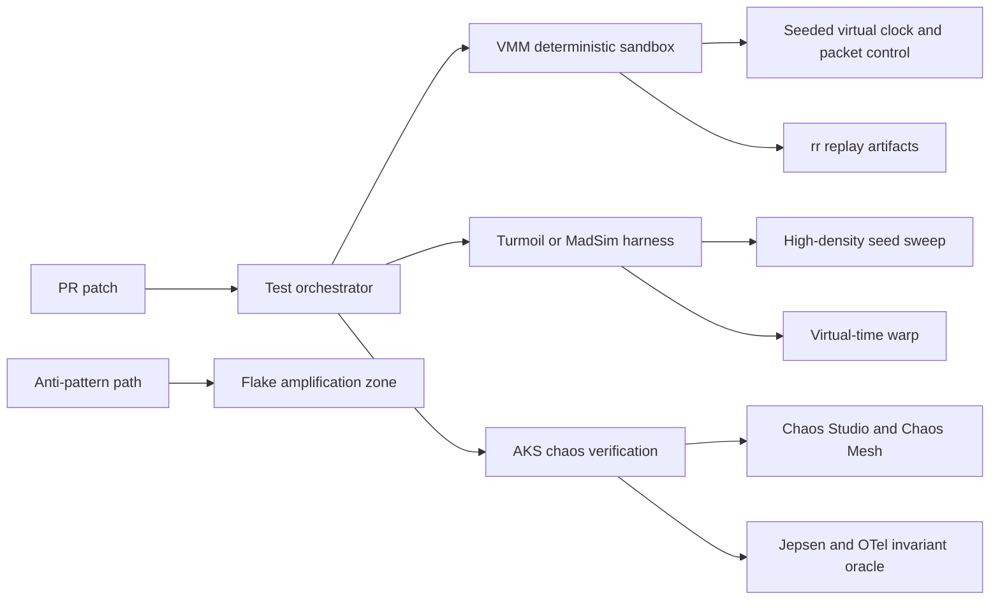
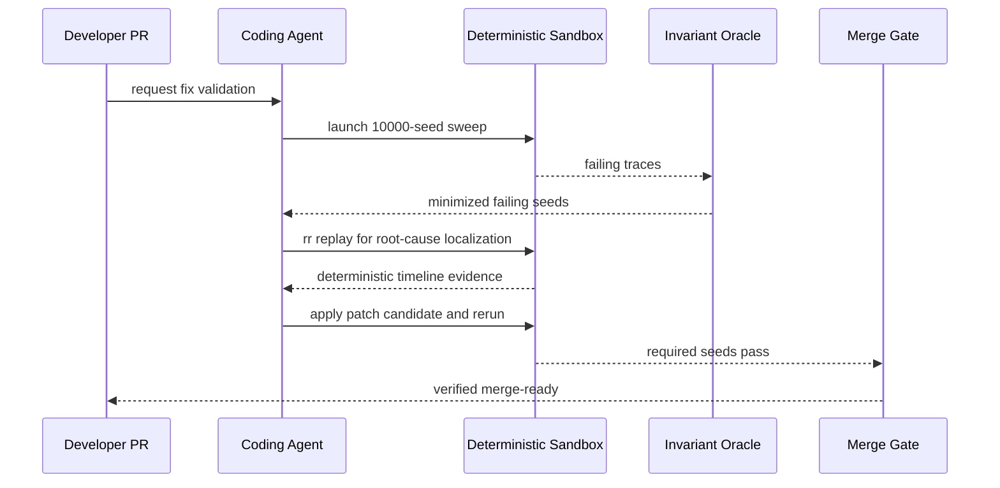
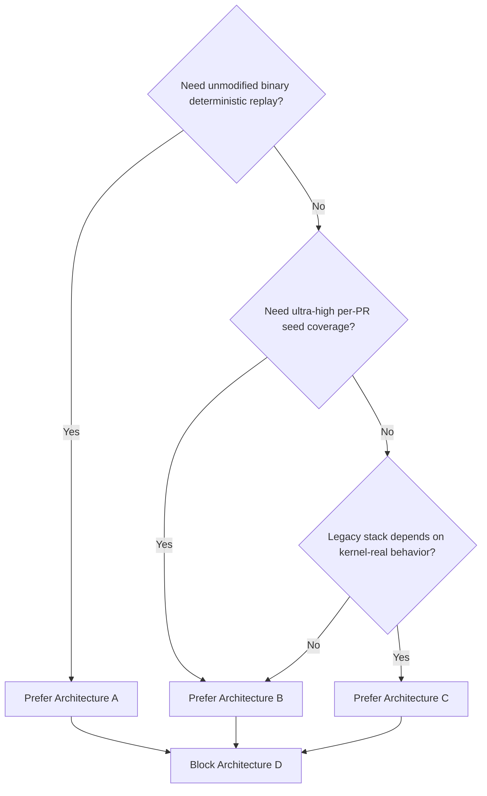

# Enterprise deterministic simulation testing sandbox selection FAQ: Antithesis-class deterministic VMM vs Turmoil/MadSim in-process simulation vs AKS kernel-real chaos verification
> **Audience**: Cloud & AI Solution Architects, distributed systems platform teams, and Coding Agent quality-gate owners.
> **Core question**: how to build reproducible fault-exploration sandboxes that maximize bug discovery while minimizing flaky noise in agent repair loops.
> **Recommendation**: choose A for unmodified-binary deterministic replay, choose B for extreme state-space coverage density, choose C for kernel-real legacy validation, and prohibit D.

## 1. Executive summary
Wall-clock integration tests are insufficient for autonomous repair loops because failure signals are not deterministic.
A provides bit-replayable trajectories from stable seeds and immutable image digests.
B provides very high seed throughput per dollar via virtualized time and event scheduling.
C provides realism for kernel/network/SDK behavior in brownfield environments.
D amplifies flaky noise and contaminates agent decision quality.
This guide quantifies `P_detect`, `S_warp`, flake poisoning accumulation, and three-year TCO at `200/3,000/25,000 PRs per month`.

## 2. Background: repair quality is constrained by test signal quality
Agent capability is bounded by whether failure feedback is reproducible and interpretable.
If failure trajectories change across reruns, root-cause localization becomes probabilistic guesswork.
Distributed systems magnify this through timing races, retries, partitions, and clock effects.
Therefore enterprises need both broad failure discovery and deterministic counterexample replay.
DST formalizes randomness and time into controlled parameters rather than hidden entropy.

## 3. Objectives and boundaries
Objective 1: increase rare-bug discovery with deterministic replayability.
Objective 2: reduce flaky false rejections that poison automated repair loops.
Objective 3: maximize explored fault states under bounded execution budget.
Objective 4: produce auditable counterexample artifacts per failing seed.
Objective 5: embed DST directly into PR gating workflows.
Boundary 1: this guidance focuses on verification infrastructure, not production traffic routing.
Boundary 2: it complements business-level evaluation rather than replacing it.
Boundary 3: it targets Azure-centric enterprise delivery stacks.

## 4. Candidate architectures
Architecture A: deterministic VMM timeline control with seed-bound virtual clocks, packet events, and `rr` replay traces.
Architecture B: in-process deterministic harness with virtualized time/network/disk and high-density seed sweeps.
Architecture C: ephemeral AKS/vCluster chaos verification with kernel-real behavior and invariant oracles.
Architecture D: wall-clock sleep tests or shared staging fault injection anti-patterns.
A emphasizes binary fidelity replay, B emphasizes coverage economics, C emphasizes production realism, D emphasizes noise.

## 5. Architecture A deep dive: deterministic VMM timeline replay
A controls virtual clocks, scheduling order, and packet events under a single seed contract.
The same `(image_digest, seed)` yields bit-stable failure reproduction for forensic debugging.
This creates clean cause-effect loops for patch validation by Coding Agents.
A supports unmodified polyglot services and dependencies, reducing migration friction.
Snapshot multiverse branching enables parallel fault-path exploration from identical initial state.
The trade-off is higher platform complexity and virtualization overhead.

## 6. Architecture B deep dive: in-process deterministic simulation
B executes virtual multi-node clusters within deterministic event loops.
Virtual-time warp can produce orders-of-magnitude faster fault-state exploration.
This supports tens of thousands of seeds per PR at low compute cost.
B requires async runtime seams and may require refactoring in some stacks.
For seam-friendly services, B becomes the dominant high-throughput regression layer.

## 7. Architecture C deep dive: kernel-real chaos verification
C injects faults into real container/network/kernel pathways.
It validates SDK retries, CNI interactions, and real scheduling effects in legacy estates.
C is especially useful where refactoring into deterministic harnesses is impractical.
Its limitation is lower deterministic replay probability than A/B.
C is best used as realism augmentation, not sole quality gate.

## 8. Architecture D anti-pattern
D1 relies on wall-clock sleeps and timing-sensitive assertions vulnerable to noise.
D2 uses shared staging blast zones that destabilize human and automated workflows.
Both inflate flaky false positives and degrade repair-loop trustworthiness.
D should be blocked by policy and template defaults.

## 9. Quantitative equations
Rare bug discovery probability: `P_detect(N) = 1 - (1 - p_bug)^N`.
Virtual-time acceleration: `S_warp = T_simulated / T_wall`.
Flake poisoning accumulation: `1 - (1 - p_flake)^M` across repair iterations.
Track these with MTTR, false-reject rate, and per-PR cost to steer investment.

## 10. Twelve-dimension comparison matrix
| Dimension | Architecture A | Architecture B | Architecture C | Architecture D |
|---|---|---|---|---|
| Deterministic replay | High | High | Medium-Low | Low |
| Seed coverage density | Medium | High | Medium | Low |
| Unmodified binary compatibility | High | Medium-Low | High | High but misleading |
| Kernel-real behavior | Medium | Low | High | Medium |
| Cost efficiency | Medium | High | Medium-Low | Low due rework |
| Refactoring burden | Medium | Medium-High | Medium | Low |
| Agent feedback purity | High | High | Medium | Low |
| PR-scale throughput | Medium-High | High | Medium | Low |
| Auditability | High | High | Medium | Low |
| Brownfield suitability | Medium-High | Low | High | Medium |
| Recommended role | Core replay layer | Primary coverage layer | Realism supplement | Prohibited |
| Primary risk | platform overhead | seam migration effort | replay variance | flake amplification |

## 11. DST topology comparison


## 12. Coding Agent repair-loop sequence


## 13. Selection decision tree


### Q1. Why deterministic replay is critical for Coding Agents
Without deterministic replay, patch validation cannot separate root-cause fixes from stochastic test variance.
Stable replay turns debugging into causal analysis instead of probabilistic guesswork.
This dramatically improves repair-loop confidence and convergence speed.
Deterministic replay is therefore foundational, not optional, for autonomous repair quality.

### Q2. What is the core trade-off between A and B
A optimizes binary-fidelity replay for unmodified production-like stacks.
B optimizes state-space exploration throughput and coverage economics.
A is forensic depth, B is exploration breadth.
Most enterprise programs benefit from layered A+B use rather than exclusive choice.

### Q3. When is C indispensable
C is indispensable when real kernel/network behavior dominates failure modes and refactoring is impractical.
It is also critical for validating brownfield SDK retry interactions in realistic runtime conditions.
However, replay variance means C should not be the sole gate.
Use C as realism reinforcement atop deterministic layers.

### Q4. How to reason about flake poisoning mathematically
The accumulation formula `1 - (1 - p_flake)^M` shows compounded risk over iterative loops.
Even moderate single-run flake rates become harmful as repair iterations grow.
This can cause agents to optimize toward noise rather than defects.
Reducing flake is thus directly tied to repair-loop ROI.

### Q5. What does an enterprise DST layering strategy look like
Use B for broad per-PR exploration, escalate key failures to A for deterministic replay proof, and use C for realism sampling.
Unify all outcomes under one invariant-oracle governance surface.
This combines coverage density, replay determinism, and production behavior confidence.
Layering is the practical path to scale without signal collapse.

### Q6. Five-step rollout and Good fit vs Not for
Step 1: formalize invariants and artifact schemas.
Step 2: make B-based deterministic seed sweeps the default PR gate.
Step 3: escalate high-value failures into A with rr evidence replay.
Step 4: add C for high-risk brownfield runtime paths.
Step 5: prohibit D and continuously track flake and false-reject metrics.
Good fit: high-change distributed systems with autonomous repair goals.
Not for: low-change simple services without concurrency risk.

## 14. Implementation snippets
```yaml
apiVersion: batch/v1
kind: Job
metadata:
  name: dst-seed-sweep
spec:
  parallelism: 64
  completions: 64
  template:
    spec:
      restartPolicy: Never
      containers:
        - name: seed-runner
          image: ghcr.io/example/dst-runner:latest
          env:
            - name: SEED_START
              value: "100000"
            - name: SEED_COUNT
              value: "800"
            - name: ARTIFACT_URI
              value: "abfss://dst-artifacts@storageacct.dfs.core.windows.net/run-${JOB_ID}"
          command: ["python", "run_dst.py", "--oracle", "linearizability", "--upload-adls", "true"]
```

```python
def p_detect(p_bug: float, n_seeds: int) -> float:
    return 1 - (1 - p_bug) ** n_seeds

def warp_factor(t_simulated: float, t_wall: float) -> float:
    return t_simulated / t_wall if t_wall > 0 else float("inf")

def flake_poison_rate(p_flake: float, loops: int) -> float:
    return 1 - (1 - p_flake) ** loops

def invariant_oracle(events):
    balance = 0
    for e in events:
        if e["type"] == "credit":
            balance += e["amount"]
        elif e["type"] == "debit":
            balance -= e["amount"]
        if balance < 0:
            return False, "negative-balance"

    return True, "ok"
```

## 15. Three-year TCO framing at `200 / 3,000 / 25,000 PRs per month`
| Tier | Monthly PR volume | Recommended stack | Cost focus | Core value |
|---|---|---|---|---|
| Tier-1 | 200 | B with light C | coverage plus realism sampling | lower manual regression effort |
| Tier-2 | 3,000 | B + A + sampled C | counterexample governance | stable agent repair loops |
| Tier-3 | 25,000 | full layered A/B/C pipeline | orchestration and artifact economics | high-scale low-noise gating |

## 16. Release checklist
Confirm deterministic seed sweeps are default PR gates instead of sleep-based tests.
Confirm failing traces are minimized and bound to unique seed identities.
Confirm critical failures support rr replay evidence export.
Confirm invariant-oracle versions are traceable with result sets.
Confirm C-layer chaos jobs do not contaminate shared human environments.
Confirm flake, false-reject, and repair success metrics are unified on one dashboard.
Confirm Architecture D paths are blocked in templates and policy controls.
Confirm cost dashboards separate compute, storage, orchestration, and review labor.

## 17. Optimization guidance
Cluster recurrent failing seeds to prioritize high-impact concurrency patterns.
Feed agent mis-repair incidents back into invariant libraries for stronger guards.
Allocate seed budgets by risk tier rather than equal distribution.
Correlate DST output with production incidents to validate offline signal utility.
Rebalance A/B/C mix quarterly based on cost and false-reject movement.

## 18. Conclusion
DST selection is a three-way optimization across replay determinism, coverage density, and runtime realism.
A provides high-fidelity replay, B provides coverage economics, and C provides kernel-real assurance.
D amplifies flaky noise and undermines autonomous repair confidence, so it must remain prohibited.
Layered governance with quantitative metrics enables scalable and auditable enterprise repair quality.
The end-state is evidence-driven, replayable, and low-noise validation for every critical patch.
In continuous governance, establish fixed metrics, accountable roles, and review cadence for seed budget stratification so DST quality remains sustainable, endpoint tag: seed budget stratification.
In continuous governance, establish fixed metrics, accountable roles, and review cadence for invariant version governance so DST quality remains sustainable, endpoint tag: invariant version governance.
In continuous governance, establish fixed metrics, accountable roles, and review cadence for counterexample minimization so DST quality remains sustainable, endpoint tag: counterexample minimization.
In continuous governance, establish fixed metrics, accountable roles, and review cadence for rr retention policy so DST quality remains sustainable, endpoint tag: rr retention policy.
In continuous governance, establish fixed metrics, accountable roles, and review cadence for virtual clock drift sensing so DST quality remains sustainable, endpoint tag: virtual clock drift sensing.
In continuous governance, establish fixed metrics, accountable roles, and review cadence for partition scenario libraries so DST quality remains sustainable, endpoint tag: partition scenario libraries.
In continuous governance, establish fixed metrics, accountable roles, and review cadence for scheduler jitter observation so DST quality remains sustainable, endpoint tag: scheduler jitter observation.
In continuous governance, establish fixed metrics, accountable roles, and review cadence for polyglot stack parity so DST quality remains sustainable, endpoint tag: polyglot stack parity.
In continuous governance, establish fixed metrics, accountable roles, and review cadence for artifact lifecycle control so DST quality remains sustainable, endpoint tag: artifact lifecycle control.
In continuous governance, establish fixed metrics, accountable roles, and review cadence for false reject feedback loops so DST quality remains sustainable, endpoint tag: false reject feedback loops.
In continuous governance, establish fixed metrics, accountable roles, and review cadence for high-risk service prioritization so DST quality remains sustainable, endpoint tag: high-risk service prioritization.
In continuous governance, establish fixed metrics, accountable roles, and review cadence for fault injection safety boundaries so DST quality remains sustainable, endpoint tag: fault injection safety boundaries.
In continuous governance, establish fixed metrics, accountable roles, and review cadence for cost quota governance so DST quality remains sustainable, endpoint tag: cost quota governance.
In continuous governance, establish fixed metrics, accountable roles, and review cadence for orchestration retry discipline so DST quality remains sustainable, endpoint tag: orchestration retry discipline.
In continuous governance, establish fixed metrics, accountable roles, and review cadence for change approval traceability so DST quality remains sustainable, endpoint tag: change approval traceability.
In continuous governance, establish fixed metrics, accountable roles, and review cadence for simulation result signing so DST quality remains sustainable, endpoint tag: simulation result signing.
In continuous governance, establish fixed metrics, accountable roles, and review cadence for audit export contracts so DST quality remains sustainable, endpoint tag: audit export contracts.
In continuous governance, establish fixed metrics, accountable roles, and review cadence for nightly batch windows so DST quality remains sustainable, endpoint tag: nightly batch windows.
In continuous governance, establish fixed metrics, accountable roles, and review cadence for cross-region workload balancing so DST quality remains sustainable, endpoint tag: cross-region workload balancing.
In continuous governance, establish fixed metrics, accountable roles, and review cadence for oncall escalation paths so DST quality remains sustainable, endpoint tag: oncall escalation paths.
Map `P_detect` trajectories to incident taxonomy trends to expose blind spots early, endpoint tag: detect-incident-mapping.
Join `S_warp` telemetry with billing evidence to confirm practical acceleration value, endpoint tag: warp-finops-correlation.
Auto-trigger gate hardening when flake-poisoning metrics exceed control bands, endpoint tag: flake-poison-guardrail.
Standardize counterexample compression and dedup pipelines for storage discipline, endpoint tag: counterexample-dedup-pipeline.
Route seed-failure clusters to code ownership boundaries for faster remediation, endpoint tag: seed-owner-routing.
Maintain domain-tagged chaos template taxonomies for reusable injection design, endpoint tag: chaos-template-taxonomy.
Review false-reject versus miss-detect economics quarterly for balanced policy tuning, endpoint tag: false-reject-miss-delta.
Archive cross-region orchestration failures with structured root-cause labels, endpoint tag: cross-region-rootcause-archive.
Continuously steer the program by low-noise, high-coverage, replayable-first principles, endpoint tag: dst-triad-governance.
## 19. Extended governance appendix
Archive nightly seed-sweep outcomes by business domain for cross-team retrieval efficiency, endpoint tag: seed-bucket-archival.
Auto-link counterexample evidence chains to PR threads to reduce manual transfer overhead, endpoint tag: pr-evidence-linking.
Track timeout failures separately from invariant violations to avoid blended signals, endpoint tag: timeout-invariant-separation.
Classify harness execution failures into resource, logic, and orchestration buckets, endpoint tag: failure-cause-taxonomy.
Increase A-layer replay sampling density during high-risk release weeks, endpoint tag: release-week-replay-boost.
Bind tenant seed budgets to business criticality to prevent priority starvation, endpoint tag: tenant-priority-budgeting.
Define lifecycle policies for stale failing seeds to control historical noise growth, endpoint tag: seed-lifecycle-governance.
Run rr trace compression together with integrity checks before archival, endpoint tag: rr-integrity-compression.
Charge back B-layer sweep cost by repository and owning team, endpoint tag: coverage-cost-chargeback.
Align C-layer chaos windows with active on-call windows for faster incident routing, endpoint tag: chaos-oncall-alignment.
Require dual approval for critical invariant changes to prevent semantic drift, endpoint tag: invariant-dual-approval.
Stamp minimizer-version metadata onto every reduced counterexample artifact, endpoint tag: minimizer-version-trace.
Maintain a shared event-schema dictionary across polyglot services for consistent oracles, endpoint tag: event-schema-unification.
Feed flake event streams into anomaly detection for early contamination alerts, endpoint tag: flake-anomaly-sentinel.
Write successful repair exemplars back into policy and prompt corpora, endpoint tag: repair-success-feedback.
Audit replayability rate directly rather than relying only on aggregate pass rates, endpoint tag: replayability-audit-focus.
Apply hot-cold artifact tiering with explicit retention policy contracts, endpoint tag: artifact-tier-retention.
Set retry-storm thresholds and circuit breaking on orchestration controllers, endpoint tag: orchestrator-retry-circuit.
Manage injection scope with topology-aware allow and deny lists, endpoint tag: injection-scope-policy.
Expose flaky-noise cost as a first-class platform KPI, endpoint tag: noise-cost-kpi.
Alert on cross-region execution skew before one-region saturation occurs, endpoint tag: cross-region-skew-alert.
Require rollback patches to pass through the same DST mainline gates, endpoint tag: rollback-dst-mainline.
Synchronize dependency simulator versions monthly to avoid hidden drift, endpoint tag: dependency-simulator-sync.
Tie random-source provenance to auditable run records for reproducibility trust, endpoint tag: rng-source-auditability.
Attach one-click minimal repro commands to every gating failure ticket, endpoint tag: one-click-repro-ticket.
Allocate extra realism quota in C-layer during upgrade windows, endpoint tag: upgrade-week-realism-quota.
Publish propagation-path visual packs in architecture-review decks, endpoint tag: propagation-visual-pack.
Promote recovery-time percentiles into release admission thresholds, endpoint tag: recovery-percentile-gate.
Adapt seed-coverage strategy by business time window and traffic profile, endpoint tag: time-aware-seed-strategy.
Archive signed result bundles alongside immutable image digests, endpoint tag: signed-result-provenance.
Run weekly human sampling over false-reject cohorts for policy calibration, endpoint tag: false-reject-human-sample.
Maintain dedicated invariant suites for high-value transaction paths, endpoint tag: critical-path-invariant-suite.
Front-load platform change impact modeling into DST planning cycles, endpoint tag: prechange-impact-planning.
Configure retry budgets by risk tier for parallel execution failures, endpoint tag: risk-tier-retry-budget.
Bridge invariant alerts with business SLA alert taxonomy, endpoint tag: invariant-sla-bridge.
Review detection gains and complexity debt together in annual governance, endpoint tag: detection-debt-balance.
Describe fault scenarios with a shared DSL to improve maintainability, endpoint tag: fault-scenario-dsl.
Gate simulator performance regressions in the same CI quality contract, endpoint tag: simulator-regression-gate.
Preserve governance order as evidence-first, replay-first, and noise-minimization-first, endpoint tag: evidence-replay-noise-order.
Document governance exception expirations explicitly so temporary relaxations cannot become silent defaults, endpoint tag: exception-expiry-visibility.
