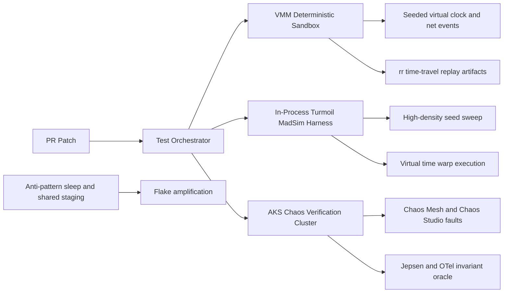
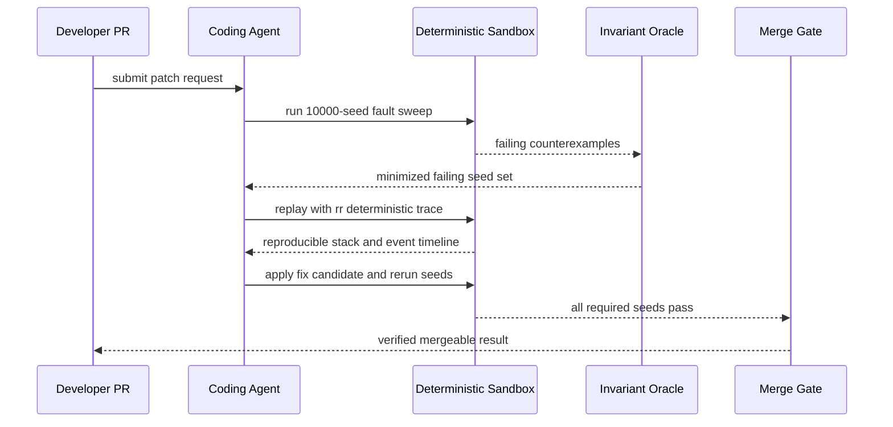
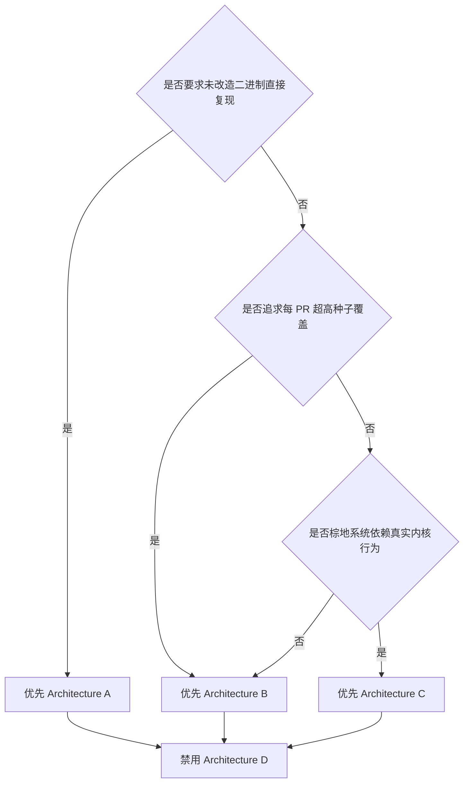

# 企业级确定性仿真测试（DST）沙箱选型 FAQ：`Antithesis 类 VMM` vs `Turmoil/MadSim` 进程内模拟 vs `AKS Chaos` 真实内核混沌
> **适用对象**：Cloud & AI Solution Architect、分布式系统平台团队、Coding Agent 质量门禁团队。
> **核心问题**：如何为 Coding Agent 构建“可重放、可扩展、低波动”的故障探索沙箱，避免 flaky 噪声污染修复闭环。
> **建议结论**：需要无修改二进制复现优先 A；需要超高状态覆盖密度优先 B；棕地系统需真实内核行为优先 C；D 必须禁用。

## 1. 执行摘要
传统 wall-clock 集成测试难以支撑智能体自修复闭环，因为失败不可稳定复现。
A 通过 hypervisor 级确定性时间线把故障反例固定为可重复种子。
B 通过进程内虚拟时钟与虚拟网络以极低成本扫大量故障种子。
C 通过真实内核与真实网络栈检验遗留系统的生产行为一致性。
D 依赖 `sleep()` 与共享 staging，导致 flake 噪声不断放大并污染 Agent 判定。
本文量化四个核心指标：`P_detect`、`S_warp`、flake poisoning rate、以及 `200/3,000/25,000 PRs/mo` 三年 TCO。

## 2. 背景：Agent 修复能力受限于测试信号质量
Coding Agent 能否稳定修复，关键不在模型参数，而在反馈信号是否可重复。
若失败样本每次触发条件不同，Agent 会在噪声中“修复不存在的问题”。
在分布式系统场景，网络乱序、时钟漂移、重试竞态让传统测试波动显著。
因此企业需要把“发现 bug”与“重放 bug”同时纳入测试体系。
DST 的核心是把随机性显式参数化，并把时间与故障注入可编排化。

## 3. 目标与边界
目标一：提升稀有并发 bug 的检出概率且支持确定性重放。
目标二：降低 flaky 误拒导致的 Agent 修复偏航风险。
目标三：以可控成本覆盖更多故障组合与时序分支。
目标四：让修复验收具备可审计的 counterexample 证据。
目标五：将测试体系与 PR 流水线深度耦合而非旁路执行。
边界一：本文聚焦测试与验证，不覆盖线上流量路由策略。
边界二：本文不替代业务语义评测，仅覆盖系统一致性与鲁棒性。
边界三：本文聚焦 Azure 基础设施与常见 polyglot 微服务栈。

## 4. 四类候选架构
Architecture A：确定性 VMM（Antithesis 类）+ 单种子全系统重放 + `rr` 反例时光回溯。
Architecture B：Turmoil/MadSim 进程内仿真 + 虚拟时钟/网络/磁盘 + 高密度种子扫描。
Architecture C：AKS/vCluster + Chaos Studio/Chaos Mesh + Jepsen/OTel 不变量裁决。
Architecture D：sleep 驱动集成测试或共享 staging 故障注入反模式。
A 偏重“真实二进制复现”，B 偏重“覆盖密度/成本效率”，C 偏重“真实内核与棕地兼容”，D 偏重“制造噪声”。

## 5. Architecture A 深入：VMM 级确定性时间线
A 将虚拟时钟、网络事件、调度顺序统一受控于单一 seed。
同一 `(image_digest, seed)` 可重放出位级一致的失败轨迹。
这使 Agent 可以在稳定前提下尝试补丁并验证因果关系。
A 支持未改造的 polyglot 服务与中间件，适合迁移成本敏感企业。
通过 snapshot multiverse 分支，A 可在同一初始态并行探索多故障组合。
A 的成本在于虚拟化控制平面复杂度与资源占用较高。

## 6. Architecture B 深入：进程内确定性仿真
B 把整个“多节点系统”压缩到单进程事件循环中执行。
虚拟时间推进可达 `10^3 ~ 10^4` 量级的壁钟加速。
这使每次 PR 可在分钟级完成数万种子扫描。
B 的限制是需要服务具备明确 async seam，且对语言/框架有约束。
若服务依赖大量 native 侧效应，迁移到 B 的成本会上升。
B 在成本/覆盖密度维度表现突出，常作为主力回归层。

## 7. Architecture C 深入：真实内核混沌验证
C 直接在容器与内核真实环境下注入网络、CPU、I/O 故障。
它能覆盖 SDK 重试、内核 TCP 行为、CNI 路径等真实生产特性。
这对棕地系统尤其关键，因为重构到仿真框架往往成本过高。
C 的不足是重放概率较低，常见 `5%~35%` 可复现率区间。
因此 C 更适合作为“真实性补充层”，而非唯一验收层。

## 8. Architecture D 反模式
D1：`sleep()` + wall-clock 断言让测试结果受负载与调度噪声影响。
D2：共享 staging 注入故障破坏团队稳定性并引发互相干扰。
D 的直接后果是 flake 假阳性增加，Agent 修复循环被噪声污染。
在规模化 PR 流水线中，D 会快速推高误拒与返工成本。

## 9. 量化公式
稀有 bug 检出概率：`P_detect(N) = 1 - (1 - p_bug)^N`。
虚拟时间加速比：`S_warp = T_simulated / T_wall`。
Agent flake 污染率：`1 - (1 - p_flake)^M`，`M` 为修复循环轮数。
建议将上述指标与 MTTR、误拒率、单位 PR 成本联动看板化。

## 10. 12 维选型矩阵
| 维度 | Architecture A | Architecture B | Architecture C | Architecture D |
|---|---|---|---|---|
| 可重放确定性 | 高 | 高 | 中低 | 低 |
| 种子覆盖密度 | 中 | 高 | 中 | 低 |
| 无改造兼容性 | 高 | 中低 | 高 | 高但无效 |
| 真实内核行为 | 中 | 低 | 高 | 中 |
| 运行成本效率 | 中 | 高 | 中低 | 低（返工高） |
| 工程改造成本 | 中 | 中高 | 中 | 低 |
| Agent 反馈纯度 | 高 | 高 | 中 | 低 |
| 扩展到大 PR 规模 | 中高 | 高 | 中 | 低 |
| 审计可追溯 | 高 | 高 | 中 | 低 |
| 适配棕地遗留 | 中高 | 低 | 高 | 中 |
| 推荐阶段 | 核心回放层 | 主力覆盖层 | 真实性补充层 | 禁用 |
| 主要风险 | 平台复杂度 | seam 改造负担 | 复现率偏低 | flake 污染 |

## 11. DST 拓扑对比


## 12. Agent 修复闭环时序


## 13. 选型决策树


### Q1. 为什么确定性重放对 Coding Agent 至关重要
没有确定性重放，Agent 很难判断补丁是否真正修复根因。
同一失败若每次触发轨迹不同，修复迭代会产生大量伪收敛。
确定性重放让“失败 -> 修复 -> 验证”形成可因果追踪闭环。
因此它是高质量自动修复体系的基础设施前提。

### Q2. A 与 B 的本质取舍是什么
A 侧重无需改造的真实二进制兼容与高保真复现。
B 侧重极致覆盖密度与每美元状态空间收益。
A 更像“高保真法庭取证”，B 更像“高速穷举筛查”。
企业通常采用 A+B 组合分层，而非二选一。

### Q3. C 在何种场景不可替代
当系统 heavily 依赖真实内核、CNI 与外部 SDK 行为时，C 提供不可替代验证价值。
特别是棕地系统无法快速重构到仿真 seam 时，C 是现实路径。
但 C 的低复现率决定其不宜作为唯一门禁。
它应承担“真实性补充层”职责。

### Q4. 如何量化 flake 对 Agent 修复循环的伤害
可用 `1 - (1 - p_flake)^M` 估算多轮循环的污染累积概率。
当 `M` 增大时，即便单次 `p_flake` 不高，累计污染也会迅速抬升。
这会让 Agent 把噪声误判为待修复缺陷。
因此降低 flake 是提升 Agent ROI 的核心手段。

### Q5. 如何设计企业级 DST 分层测试栈
建议“B 高频覆盖 + A 关键反例重放 + C 真实性抽检”的三层组合。
B 负责每 PR 大规模探索，A 负责关键反例固定化与回放，C 负责真实环境兜底。
三层结果应归并到统一不变量裁决面板。
这样可同时获得覆盖密度、复现确定性与现实行为一致性。

### Q6. 五步落地与 Good fit / Not for
第一步：定义并固化系统不变量与失败证据结构。
第二步：接入 B 层高密度种子扫描作为默认 PR 门禁。
第三步：对关键失败升级到 A 层确定性回放与 rr 证据。
第四步：对棕地高风险路径加入 C 层真实内核抽检。
第五步：禁用 D 路径并持续复盘 flake 与误拒指标。
Good fit：高频 PR、并发复杂、需要 Agent 自动修复闭环的企业平台。
Not for：低频变更、无并发状态风险、仅做手工验收的简单系统。

## 14. 实施片段
```yaml
apiVersion: batch/v1
kind: Job
metadata:
  name: dst-seed-sweep
spec:
  parallelism: 64
  completions: 64
  template:
    spec:
      restartPolicy: Never
      containers:
        - name: seed-runner
          image: ghcr.io/example/dst-runner:latest
          env:
            - name: SEED_START
              value: "100000"
            - name: SEED_COUNT
              value: "800"
            - name: ARTIFACT_URI
              value: "abfss://dst-artifacts@storageacct.dfs.core.windows.net/run-${JOB_ID}"
          command: ["python", "run_dst.py", "--oracle", "linearizability", "--upload-adls", "true"]
```

```python
import math

def p_detect(p_bug: float, n_seeds: int) -> float:
    return 1 - (1 - p_bug) ** n_seeds

def warp_factor(t_simulated: float, t_wall: float) -> float:
    return t_simulated / t_wall if t_wall > 0 else float("inf")

def flake_poison_rate(p_flake: float, loops: int) -> float:
    return 1 - (1 - p_flake) ** loops

def invariant_oracle(events):
    balance = 0
    for e in events:
        if e["type"] == "credit":
            balance += e["amount"]
        elif e["type"] == "debit":
            balance -= e["amount"]
        if balance < 0:
            return False, "negative-balance"

    return True, "ok"
```

## 15. `200 / 3,000 / 25,000 PRs/mo` 三年 TCO 框架
| 档位 | 月 PR 规模 | 推荐组合 | 成本重点 | 核心收益 |
|---|---|---|---|---|
| Tier-1 | 200 | B + 轻量 C | 快速覆盖与真实抽检 | 降低人工回归负担 |
| Tier-2 | 3,000 | B + A + C 抽样 | 反例治理与平台自动化 | 稳定 Agent 修复闭环 |
| Tier-3 | 25,000 | 分层 A/B/C 全流水线 | 证据存储与调度编排 | 高规模低噪声门禁 |

## 16. 上线核查清单
应确认 PR 门禁默认走确定性种子扫描而非 sleep 测试。
应确认失败样本可最小化并绑定唯一 seed 标识。
应确认关键反例支持 rr 回放并可自动附带到工单。
应确认不变量裁决器版本与测试结果强绑定。
应确认 C 层混沌实验不会污染共享人工环境。
应确认 flake 指标、误拒率与修复成功率在同一仪表盘联动。
应确认 D 反模式路径在策略与模板中被显式禁用。
应确认成本看板区分计算、存储、编排与人工复核成本。

## 17. 运营优化建议
建议将高频失败 seed 做聚类，优先治理最具代表性的竞态模式。
建议把 Agent 误修复案例反写到不变量库，持续提升裁决质量。
建议按业务风险分层设置种子预算，避免资源平均分配导致低效。
建议将 DST 结果与生产事故复盘联动，验证离线门禁有效性。
建议定期回顾 A/B/C 配比，依据成本与误拒变化动态调整。

## 18. 结论
DST 选型的本质是“复现确定性、覆盖密度、真实行为”三目标平衡。
A 提供高保真反例回放，B 提供高性价比覆盖扩展，C 提供真实环境一致性补强。
D 路径会持续放大 flake 噪声并误导 Agent 修复决策，应被系统性淘汰。
采用分层组合并以量化指标持续治理，才能构建可规模化的企业级 Agent 质量闭环。
最终目标是让每次修复都可证据化、可重放、可审计，而不是靠偶然通过测试。
在持续治理中，应围绕“seed 分层预算”建立固定指标、责任角色与复盘节奏，确保 DST 体系长期稳定演进，落点：seed 分层预算。
在持续治理中，应围绕“不变量版本治理”建立固定指标、责任角色与复盘节奏，确保 DST 体系长期稳定演进，落点：不变量版本治理。
在持续治理中，应围绕“反例最小化性能”建立固定指标、责任角色与复盘节奏，确保 DST 体系长期稳定演进，落点：反例最小化性能。
在持续治理中，应围绕“rr 回放留存策略”建立固定指标、责任角色与复盘节奏，确保 DST 体系长期稳定演进，落点：rr 回放留存策略。
在持续治理中，应围绕“虚拟时钟偏差监测”建立固定指标、责任角色与复盘节奏，确保 DST 体系长期稳定演进，落点：虚拟时钟偏差监测。
在持续治理中，应围绕“网络分区模板库”建立固定指标、责任角色与复盘节奏，确保 DST 体系长期稳定演进，落点：网络分区模板库。
在持续治理中，应围绕“调度器抖动观测”建立固定指标、责任角色与复盘节奏，确保 DST 体系长期稳定演进，落点：调度器抖动观测。
在持续治理中，应围绕“跨语言栈一致性”建立固定指标、责任角色与复盘节奏，确保 DST 体系长期稳定演进，落点：跨语言栈一致性。
在持续治理中，应围绕“artifact 生命周期”建立固定指标、责任角色与复盘节奏，确保 DST 体系长期稳定演进，落点：artifact 生命周期。
在持续治理中，应围绕“误拒反馈闭环”建立固定指标、责任角色与复盘节奏，确保 DST 体系长期稳定演进，落点：误拒反馈闭环。
在持续治理中，应围绕“高风险服务优先级”建立固定指标、责任角色与复盘节奏，确保 DST 体系长期稳定演进，落点：高风险服务优先级。
在持续治理中，应围绕“故障注入安全边界”建立固定指标、责任角色与复盘节奏，确保 DST 体系长期稳定演进，落点：故障注入安全边界。
在持续治理中，应围绕“成本配额治理”建立固定指标、责任角色与复盘节奏，确保 DST 体系长期稳定演进，落点：成本配额治理。
在持续治理中，应围绕“编排失败重试”建立固定指标、责任角色与复盘节奏，确保 DST 体系长期稳定演进，落点：编排失败重试。
在持续治理中，应围绕“变更审批追踪”建立固定指标、责任角色与复盘节奏，确保 DST 体系长期稳定演进，落点：变更审批追踪。
在持续治理中，应围绕“仿真结果签名”建立固定指标、责任角色与复盘节奏，确保 DST 体系长期稳定演进，落点：仿真结果签名。
在持续治理中，应围绕“审计导出格式”建立固定指标、责任角色与复盘节奏，确保 DST 体系长期稳定演进，落点：审计导出格式。
在持续治理中，应围绕“夜间批处理窗口”建立固定指标、责任角色与复盘节奏，确保 DST 体系长期稳定演进，落点：夜间批处理窗口。
在持续治理中，应围绕“跨区作业平衡”建立固定指标、责任角色与复盘节奏，确保 DST 体系长期稳定演进，落点：跨区作业平衡。
在持续治理中，应围绕“值班升级路径”建立固定指标、责任角色与复盘节奏，确保 DST 体系长期稳定演进，落点：值班升级路径。
建议将 `P_detect` 与历史事故类别做映射，识别覆盖盲区，标签：detect-incident-mapping。
建议把 `S_warp` 与资源账单关联，验证加速收益真实落地，标签：warp-finops-correlation。
建议对 flake 污染率异常自动触发门禁降级策略，标签：flake-poison-guardrail。
建议将 counterexample 压缩与去重流水线标准化，标签：counterexample-dedup-pipeline。
建议把 seed 失败簇与代码所有者映射，缩短修复路径，标签：seed-owner-routing。
建议将混沌注入模板按业务域分类维护，标签：chaos-template-taxonomy。
建议在季度审查中同步评估误拒成本与漏检成本，标签：false-reject-miss-delta。
建议对跨区域调度失败进行根因标签化沉淀，标签：cross-region-rootcause-archive。
建议持续以“低噪声、高覆盖、可重放”三原则审阅测试体系，标签：dst-triad-governance。
## 19. 扩展治理附录
建议将 nightly 种子扫描结果按业务域分桶归档，提升跨团队检索效率，标签：seed-bucket-archival。
建议将 counterexample 证据链与 PR 评论自动互链，减少人工搬运，标签：pr-evidence-linking。
建议对超时失败与不变量失败分离统计，避免信号混叠，标签：timeout-invariant-separation。
建议把仿真执行失败原因按资源、逻辑、编排三类沉淀，标签：failure-cause-taxonomy。
建议在高峰发布周提高 A 层重放抽样密度，降低变更风险，标签：release-week-replay-boost。
建议将多租户种子预算与业务优先级绑定，避免关键域资源饥饿，标签：tenant-priority-budgeting。
建议引入失败种子寿命策略，防止历史噪声长期堆积，标签：seed-lifecycle-governance。
建议对 rr 追踪文件执行压缩与完整性校验并行流程，标签：rr-integrity-compression。
建议将 B 层扫描成本按仓库与团队维度拆账，标签：coverage-cost-chargeback。
建议把 C 层混沌实验窗口与人值班窗口耦合，缩短应急链路，标签：chaos-oncall-alignment。
建议为关键不变量建立“变更需双签”流程，防止口径漂移，标签：invariant-dual-approval。
建议将 seed 最小化算法版本纳入结果元数据，支持后续追责，标签：minimizer-version-trace。
建议对跨语言服务定义统一事件语义字典，避免判定歧义，标签：event-schema-unification。
建议将 flake 事件流接入异常检测模型做早期预警，标签：flake-anomaly-sentinel。
建议把修复成功样本反向写入提示词与策略库，标签：repair-success-feedback。
建议在季度审计中抽检“失败可重放率”而非只看通过率，标签：replayability-audit-focus。
建议将 artifact 存储冷热分层并绑定保留策略，标签：artifact-tier-retention。
建议对编排器重试风暴设置阈值与熔断，标签：orchestrator-retry-circuit。
建议按依赖拓扑维护故障注入白名单与黑名单，标签：injection-scope-policy。
建议将测试噪声成本显式纳入平台 KPI，标签：noise-cost-kpi。
建议建立跨区域作业倾斜告警，防止单区过载，标签：cross-region-skew-alert。
建议把回滚补丁验证也纳入 DST 主路径，标签：rollback-dst-mainline。
建议对外部依赖模拟器版本进行月度对齐，标签：dependency-simulator-sync。
建议将种子随机源来源与审计记录一一对应，标签：rng-source-auditability。
建议把门禁失败工单自动附带最小复现命令，标签：one-click-repro-ticket。
建议在版本升级周启用额外的 C 层现实校验配额，标签：upgrade-week-realism-quota。
建议将异常传播路径可视化输出到架构评审材料，标签：propagation-visual-pack.
建议把故障恢复时间分位数纳入发布放行门槛，标签：recovery-percentile-gate。
建议按业务时段动态调整种子覆盖策略，标签：time-aware-seed-strategy。
建议将测试结果签名与镜像摘要一并归档，标签：signed-result-provenance。
建议对误拒样本执行每周人工抽样复核，标签：false-reject-human-sample。
建议为高价值交易链路设定专用不变量套件，标签：critical-path-invariant-suite。
建议把平台升级影响评估前置到 DST 计划阶段，标签：prechange-impact-planning。
建议将并行作业失败重试上限按风险分级配置，标签：risk-tier-retry-budget。
建议把不变量告警与业务 SLA 告警建立关联映射，标签：invariant-sla-bridge。
建议在年度复盘中同时评估检测收益与复杂度债务，标签：detection-debt-balance。
建议用统一 DSL 描述故障注入场景以提升可维护性，标签：fault-scenario-dsl。
建议将模拟器性能退化纳入回归门禁，标签：simulator-regression-gate.
建议保持“证据优先、重放优先、低噪声优先”治理序列，标签：evidence-replay-noise-order。
