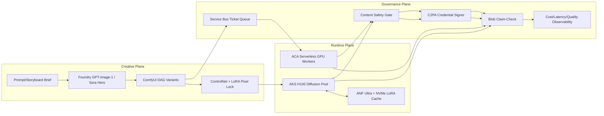
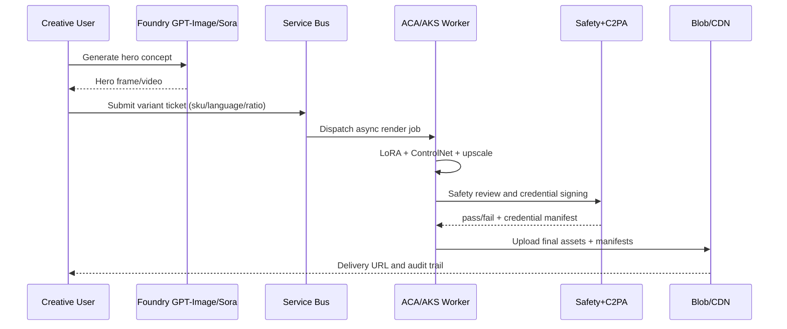
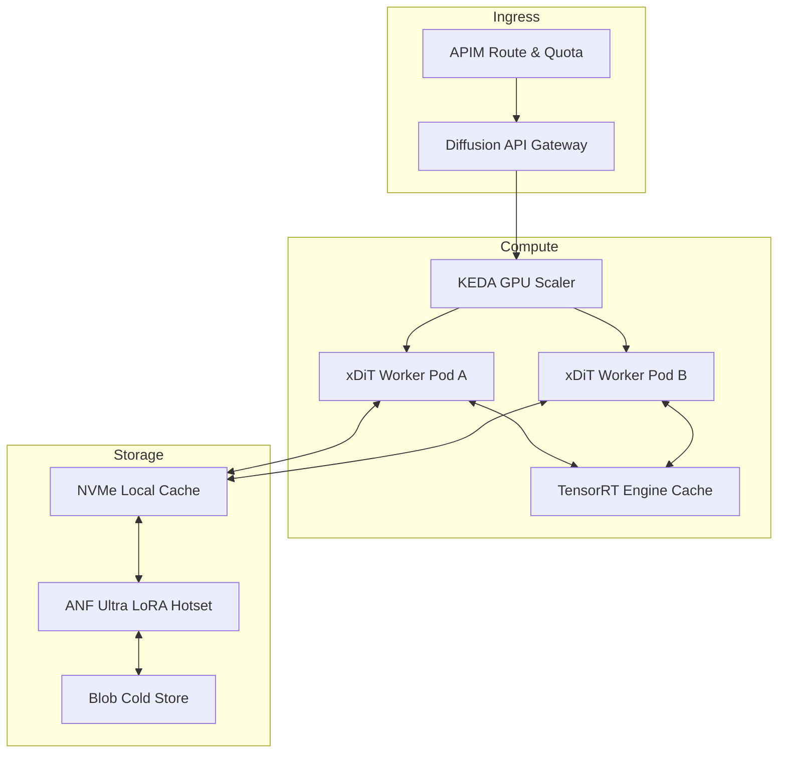

# Enterprise Multimodal Image & Video DiT Serving Infrastructure Selection FAQ: AKS xDiT/TensorRT + Hot-Swap LoRA Pools vs ACA Serverless GPU ComfyUI vs Foundry GPT-Image/Sora

> 🌐 **Language Switch**: [中文](./diffusion-image-video-dit-serving-aks-xdit-tensorrt-lora-vs-aca-serverless-gpu-comfyui-vs-aoai-sora-gpt-image-selection-faq.md) | **English (current)**
> **Audience**: Cloud & AI Solution Architects, media-platform owners, GPU SRE teams, brand-creative engineering leads, and compliance/legal stakeholders.
> **Scope**: End-to-end architecture decisions for enterprise multimodal image and video diffusion-transformer production on Azure, comparing dedicated AKS diffusion pools, ACA Serverless GPU queue workers, Foundry managed GPT-Image-1/Sora endpoints, and hybrid hero-to-variant pipelines with measurable cost, latency, and governance controls.

## 1. Problem framing: why DiT media serving cannot be solved by directly reusing LLM serving assumptions
Diffusion Transformer inference and autoregressive LLM decoding have fundamentally different computational signatures, because DiT executes iterative denoising passes over latent feature maps while LLM engines optimize incremental token generation over KV-cache trajectories.
As a result, techniques that are highly effective for LLM throughput, such as generalized paged KV-cache management, do not automatically remove bottlenecks in DiT workloads where activation pressure, VAE decode stages, and control-branch conditioning dominate runtime and memory behavior.
Enterprise creative production also imposes constraints that pure model benchmarks ignore: exact SKU label integrity, typography lock, color profile consistency, region-specific legal copy, and reproducible provenance for externally published assets.
The production question is therefore not “which model looks most impressive,” but “which serving architecture consistently balances creative quality, pixel-level fidelity, throughput economics, and compliance evidence under real campaign load.”

## 2. Four architecture families (A/B/C/D) and responsibility boundaries
**Architecture A** is a dedicated AKS high-throughput diffusion pool on `NC H100 v5 / ND H100 v5` with `xDiT` USP/PipeFusion, `FP8/TensorRT` optimization, and ANF/NVMe hot LoRA caching for low-latency, high-fidelity enterprise rendering.
**Architecture B** is a queue-driven headless ComfyUI worker fleet on ACA Serverless GPU (`A100/T4`) using Service Bus ticketing, Blob claim-check exchange, and integrated C2PA credential signing for bursty creative workloads.
**Architecture C** uses Foundry managed first-party media endpoints (`GPT-Image-1`, `Sora`) behind APIM and content safety controls to minimize platform operations while preserving enterprise-grade access governance.
**Architecture D** is a two-stage hybrid production pipeline where managed endpoints generate hero concepts and AKS/ACA post-process stages enforce strict product-lock compositing, locale adaptation, and large-batch upscaling.
Most mature enterprises converge toward D as a target state while applying A/B/C selectively by asset class, campaign criticality, and economics.

## 3. End-to-end reference architecture: creative generation, brand-lock enforcement, safety gates, and publish pipeline

This architecture deliberately separates open-ended concept generation from deterministic brand-safe compositing so creative teams can iterate quickly without sacrificing downstream product correctness.
By enforcing safety and credential signing as mandatory publish gates across all compute paths, enterprises preserve end-to-end provenance and can satisfy audit obligations for externally distributed media assets.

## 4. Architecture A deep dive: dedicated AKS xDiT/TensorRT diffusion pool for deterministic throughput and fidelity
Architecture A treats DiT inference as a high-performance compute system, where gains come from multi-GPU partitioning strategy, TensorRT graph specialization, memory locality, and disciplined weight/cache lifecycle management.
On `ND H100 v5`, USP/PipeFusion can partition long video sequences across GPUs and reduce critical-path denoising latency, while FP8/TensorRT compilation lowers kernel overhead and increases effective throughput under stable model variants.
LoRA and ControlNet artifacts should not be repeatedly hydrated from remote cold storage during active production, because that causes I/O jitter and destabilizes tail latency when SKU mix changes abruptly.
A practical enterprise pattern is ANF Ultra as shared hotset with local NVMe as second-level cache, yielding predictable hot-swap behavior for hundreds of brand variants without VRAM thrash.
This architecture is strongest for high-duty-cycle media factories where strict SLA and exact visual consistency outweigh simplicity.

## 5. Architecture B deep dive: elastic headless ComfyUI DAG workers on ACA Serverless GPU
Architecture B converts creative rendering into asynchronous work-ticket execution, making it naturally compatible with campaign burst patterns and low overnight utilization windows.
Headless ComfyUI DAG chains are particularly effective for modular workflows such as segment extraction, relighting, product-lock control, style conversion, and super-resolution post-processing.
Because Serverless GPU introduces hydration and cold-start phases, production implementations should combine queue priority classes, artifact claim-check exchange, and targeted prewarming for expected surge windows.
When diurnal duty cycle is below approximately `25%`, B frequently outperforms dedicated clusters on all-in cost while maintaining acceptable completion SLAs for non-blocking creative workloads.
B is therefore a strong fit for elastic creative operations where absolute low-latency is less critical than cost elasticity and workflow modularity.

## 6. Architecture C deep dive: managed Foundry GPT-Image-1 and Sora endpoints as zero-infrastructure media lane
Architecture C provides rapid adoption and global throughput without GPU fleet ownership, and this can be strategically valuable for teams that prioritize model capability and release speed over low-level runtime control.
For ideation-heavy workflows, managed semantic editing and prompt-driven scene synthesis enable faster exploration loops, reducing concept-to-review time in creative organizations.
However, this path has hard boundaries: exact SKU label typography lock, private LoRA deployment, and deeply customized post-processing kernels are usually outside direct managed endpoint control surfaces.
Consequently, C is often used for upstream hero generation while downstream deterministic stages remain in enterprise-controlled environments when brand precision or legal formatting constraints are strict.

## 7. 12-dimension comparison matrix: latency, throughput, fidelity, operations, and governance
| Dimension | A: AKS xDiT/TensorRT | B: ACA Serverless GPU + ComfyUI | C: Foundry GPT-Image/Sora | D: Hybrid Hero-to-Variant |
|---|---|---|---|---|
| High-resolution single-image latency | Very low (`<1.5s` achievable) | Medium (cold-start-sensitive) | Low-to-medium | Medium-low |
| `720p 5s` video latency | Low (`<25s` achievable) | Medium-high | Medium | Medium |
| Peak concurrent throughput | Very high | Medium-high | Very high (managed scale) | Very high |
| Low-duty-cycle cost efficiency | Medium | Very high | High | High |
| Private LoRA hot-swap support | Very high | High | Low | Very high |
| SKU label pixel-lock fidelity | Very high | High | Medium-low | Very high |
| Multi-stage DAG flexibility | High | Very high | Medium | Very high |
| Infrastructure operations burden | Medium-high | Medium | Very low | Medium |
| Safety + credential integration | High | High | Very high | Very high |
| Multi-region elasticity | High | High | Very high | Very high |
| Change control + rollback determinism | Very high | High | Medium | Very high |
| Recommended role | Core brand production lane | Elastic variant lane | Hero ideation lane | Enterprise target architecture |

## 8. Core quantitative models: denoising compute, VRAM budgeting, and media workload scaling pressure
For image generation, a practical first-order estimate is `F_image ≈ steps * latent_tokens * C_layer`, where latent token count scales roughly with the square of target resolution, making `1024px` workloads substantially more expensive than `768px` under equivalent step budgets.
For video, `F_video ≈ steps * frames * tokens_per_frame * C_spatiotemporal` captures the dominant scaling behavior, and moving from `16` to `40` frames at fixed resolution can exceed `2.5x` compute growth before additional temporal-attention overhead is included.
VRAM planning can be modeled as `M_total = M_weights + M_activations + M_vae_decode + M_lora_delta + M_safety_buffer`, and enterprise runs commonly observe `28–42GB` for high-resolution image lanes and much higher aggregate memory demand for multi-GPU video pipelines.
These models are not academic decoration; they are required to avoid underprovisioned card selection and to prevent hidden tail-latency instability during campaign peaks.

## 9. Cold-start and utilization break-even economics: ACA elasticity versus AKS committed pools
Reserved AKS economics can be approximated using `u* = 1 - discount_pct`; with a `38%` effective commitment discount, break-even utilization is around `62%`, so sustained usage above that threshold typically favors dedicated pools.
ACA Serverless GPU cost behavior is dominated by actual execution plus hydration overhead, and in strongly bursty patterns scale-to-zero can significantly reduce idle burn compared with always-on cluster capacity.
A latency decomposition `L_total = L_queue + L_cold_start + L_infer + L_post` helps teams quantify where SLA erosion originates, and in heavy image stacks `L_cold_start` can consume `20–45%` of total completion time if prewarming is absent.
The architectural decision must therefore be made against real duty-cycle curves and queue distributions rather than isolated peak-performance snapshots.

## 10. Reference diagram 1: hybrid hero-to-variant production sequence

This sequence operationalizes a practical enterprise principle: frontier creativity and deterministic product integrity should be staged separately, so each phase can be optimized with different cost and governance controls.
Queue segmentation by region, campaign tier, and compliance profile is recommended to prevent one launch event from starving all other media workloads.

## 11. Reference diagram 2: AKS high-throughput diffusion topology with multi-tier LoRA cache

This topology highlights three-level artifact locality: cold persistence in Blob, warm shared cache in ANF, and ultra-hot reuse in local NVMe, which jointly stabilize LoRA switching under high concurrency.
Tenant- or brand-tier quota segmentation should be attached to ingress and queue boundaries to avoid resource starvation during major campaign spikes.

## 12. Production configuration snippets: AKS GPU workers, KEDA queue scaling, and ANF hotset provisioning
```yaml
apiVersion: apps/v1
kind: Deployment
metadata:
  name: diffusion-worker
  namespace: media-prod
spec:
  replicas: 2
  selector:
    matchLabels:
      app: diffusion-worker
  template:
    metadata:
      labels:
        app: diffusion-worker
    spec:
      nodeSelector:
        accelerator: nvidia-h100
      containers:
        - name: worker
          image: contoso.azurecr.io/diffusion/worker:2026.11.23
          resources:
            limits:
              nvidia.com/gpu: "1"
              cpu: "8"
              memory: 64Gi
          env:
            - name: LORA_CACHE_DIR
              value: /mnt/lora-hotset
            - name: JOB_QUEUE
              value: media-render-jobs
          volumeMounts:
            - name: lora-hotset
              mountPath: /mnt/lora-hotset
      volumes:
        - name: lora-hotset
          persistentVolumeClaim:
            claimName: anf-lora-hotset-pvc
---
apiVersion: keda.sh/v1alpha1
kind: ScaledObject
metadata:
  name: diffusion-worker-scaler
  namespace: media-prod
spec:
  scaleTargetRef:
    name: diffusion-worker
  minReplicaCount: 2
  maxReplicaCount: 64
  triggers:
    - type: azure-servicebus
      metadata:
        queueName: media-render-jobs
        namespace: sb-media-prod
        messageCount: "4"
```

```bicep
resource sbNamespace 'Microsoft.ServiceBus/namespaces@2023-01-01-preview' = {
  name: 'sb-media-prod'
  location: resourceGroup().location
  sku: {
    name: 'Premium'
    tier: 'Premium'
    capacity: 2
  }
}

resource queue 'Microsoft.ServiceBus/namespaces/queues@2023-01-01-preview' = {
  parent: sbNamespace
  name: 'media-render-jobs'
  properties: {
    lockDuration: 'PT2M'
    maxDeliveryCount: 8
    deadLetteringOnMessageExpiration: true
    requiresDuplicateDetection: true
    duplicateDetectionHistoryTimeWindow: 'PT10M'
  }
}

resource anfVolume 'Microsoft.NetApp/netAppAccounts/capacityPools/volumes@2023-09-01' = {
  name: 'anf-prod/account-media/pool-ultra/lora-hotset'
  location: resourceGroup().location
  properties: {
    usageThreshold: 1099511627776
    serviceLevel: 'Ultra'
    protocolTypes: [
      'NFSv4.1'
    ]
    subnetId: '/subscriptions/<sub>/resourceGroups/<rg>/providers/Microsoft.Network/virtualNetworks/vnet-prod/subnets/snet-anf'
  }
}
```
These snippets represent the minimum production skeleton for queue-driven GPU scaling and hot-artifact locality, and real deployments should add Pod disruption controls, image-signing policy, and progressive rollout guards.

## 13. Production Python worker: async claim-check execution with content safety gate and C2PA credential manifest
```python
import json
import time
from dataclasses import dataclass

from azure.storage.blob import BlobClient
from azure.servicebus import ServiceBusClient


@dataclass
class RenderJob:
    job_id: str
    prompt: str
    negative_prompt: str
    lora_key: str
    controlnet_ref: str
    output_path: str
    policy_profile: str


def load_job(msg_body: str) -> RenderJob:
    payload = json.loads(msg_body)
    return RenderJob(**payload)


def run_diffusion_pipeline(job: RenderJob) -> bytes:
    # Placeholder for xDiT/TensorRT/ComfyUI integration
    content = f"render:{job.job_id}:{job.lora_key}:{int(time.time())}".encode("utf-8")
    return content


def content_safety_gate(image_bytes: bytes, profile: str) -> None:
    if not image_bytes or profile == "":
        raise ValueError("invalid_render_or_policy_profile")


def sign_c2pa_manifest(job: RenderJob, blob_url: str) -> dict:
    return {
        "job_id": job.job_id,
        "asset_url": blob_url,
        "credential_type": "C2PA",
        "generator": "enterprise-diffusion-worker",
        "policy_profile": job.policy_profile,
    }


def process_message(msg_body: str, blob_client: BlobClient) -> dict:
    job = load_job(msg_body)
    output_bytes = run_diffusion_pipeline(job)
    content_safety_gate(output_bytes, job.policy_profile)
    blob_client.upload_blob(output_bytes, overwrite=True)
    manifest = sign_c2pa_manifest(job, blob_client.url)
    return {"job_id": job.job_id, "blob_url": blob_client.url, "manifest": manifest}


def worker_loop(sb_conn: str, queue_name: str, blob_url: str, blob_sas: str):
    blob_client = BlobClient.from_blob_url(f"{blob_url}?{blob_sas}")
    with ServiceBusClient.from_connection_string(sb_conn) as client:
        receiver = client.get_queue_receiver(queue_name=queue_name, max_wait_time=5)
        with receiver:
            for msg in receiver:
                try:
                    result = process_message(str(msg), blob_client)
                    print("render-ok", json.dumps(result, ensure_ascii=False))
                    receiver.complete_message(msg)
                except Exception as ex:
                    print("render-failed", str(ex))
                    receiver.abandon_message(msg)
```
This implementation emphasizes metadata-only queue payloads and blob-based claim-check transfer to keep bus traffic stable and retries idempotent, which is critical in high-volume render pipelines.

## 14. Enterprise scenarios and 3-year TCO: consumer brand asset factory and global marketing short-video production
### 14.1 Scenario A: consumer commerce brand with high-volume multilingual product imagery
A consumer brand organization generates about `620K` multilingual product and campaign image variants per month, where roughly `22%` require strict label typography lock and packaging geometry fidelity while the remaining workload prioritizes creative diversity.
After adopting a hybrid D pipeline, hero concepts were generated on managed endpoints and deterministic SKU compositing was routed to A/B lanes, reducing rework rate from `14.8%` to `4.1%` and materially improving launch predictability.
During campaign peaks, AKS handled fidelity-critical workloads and ACA absorbed long-tail creative demand, keeping aggregate delivery SLA near `99.2%` even under asymmetric burst behavior.

### 14.2 Scenario B: global campaign short-video production with locale-specific adaptation
A retail group producing `42K` short videos (`5–8s`) monthly across `11` regions and `9` aspect-ratio templates observed that pure managed-video workflows could not consistently preserve product-specific typography and legal overlays.
By splitting scene ideation (managed) from brand-lock compositing and subtitle/layout adaptation (self-managed), the team improved compliance pass rate and reduced manual intervention in regional localization workflows.
Service Bus ticket orchestration plus claim-check storage also delivered deterministic replayability, reducing root-cause and rerun turnaround from hours to minutes during campaign incidents.

### 14.3 3-year TCO (`2,400` peak concurrent renders, `500K+` monthly assets)
| 3-year cost item | A | B | C | D |
|---|---:|---:|---:|---:|
| GPU compute and inference runtime | `$4.20M` | `$2.86M` | `$3.44M` | `$3.18M` |
| Platform and orchestration operations | `$1.52M` | `$0.88M` | `$0.62M` | `$1.26M` |
| Brand-consistency rework overhead | `$0.48M` | `$0.74M` | `$1.36M` | `$0.41M` |
| Safety and credential governance | `$0.42M` | `$0.38M` | `$0.34M` | `$0.40M` |
| Availability incidents and recovery effort | `$0.56M` | `$0.49M` | `$0.45M` | `$0.47M` |
| Total 3-year cost | `$7.18M` | `$5.35M` | `$6.21M` | `$5.72M` |

At high scale with strict product fidelity constraints, D commonly wins on effective unit economics because it cuts expensive downstream rework while preserving managed creativity throughput in the upstream stage.

## 15. Worked quantitative Q&A (6) and Day-0/Day-2 operational checklists
### 15.1 Worked quantitative Q&A (6)
**Q1: How do we quantify the compute gap between high-resolution image and short-video DiT workloads?** A practical approximation uses `F_image ≈ steps * latent_tokens * C_layer` and `F_video ≈ steps * frames * tokens_per_frame * C_spatiotemporal`; with equal step budgets, increasing to `40` frames can push video compute to around `40x` image baseline before temporal overhead factors are added.
This explains why video lanes require explicit multi-GPU partitioning strategy and cannot be capacity-planned as a simple extension of image-serving pools.

**Q2: How should VRAM be budgeted for production-safe planning?** Use `M_total = M_weights + M_activations + M_vae_decode + M_lora_delta + M_buffer`; with `14GB + 10GB + 8GB + 3GB + 5GB`, expected demand is roughly `40GB`, leaving little headroom on nominal `40GB` cards under burst conditions.
For campaign-grade reliability, teams should validate peak profiles on larger memory SKUs or split workloads across model-parallel stages to avoid OOM-driven retry storms.

**Q3: How is AKS versus ACA break-even utilization estimated?** With `u* = 1 - discount_pct`, a `38%` commitment discount yields `u*=0.62`, so sustained utilization above `62%` generally favors dedicated AKS pools while lower utilization trends favor serverless elasticity.
This should be calculated from real monthly load profiles, because peak-only analysis often overestimates dedicated cluster value.

**Q4: How do we size queue-driven replicas for SLA clearance?** Apply `replicas = ceil(queued_jobs * avg_render_sec / target_sla_sec)`; with backlog `1,200`, average render `18s`, and target clear window `300s`, required replicas are approximately `72`.
This formula is directly usable in pre-campaign scale rehearsals and can be combined with hard max limits to protect quota boundaries.

**Q5: How do we estimate LoRA hotset capacity to reduce cache thrash?** Use `Hotset_GB = active_lora_count * avg_lora_size_gb * safety_factor`; with `500` active variants, `0.35GB` average size, and `1.3` safety factor, required hotset is about `227.5GB`.
That value informs ANF pool sizing and local NVMe target hit-rate thresholds for stable switching latency under mixed-brand traffic.

**Q6: Why does hybrid D often improve cost per delivered asset despite extra stages?** Evaluate `UnitCost = (C_hero + C_variant + C_rework + C_ops) / assets`; if rework drops from `14.8%` to `4.1%`, reduced `C_rework` can outweigh additional variant-stage processing, frequently yielding `60–75%` lower effective cost per accepted asset at high monthly volume.
The key is that expensive human correction loops are replaced by deterministic machine-stage controls earlier in the pipeline.

### 15.2 Day-0 go-live checklist
1. Define explicit hero-versus-variant routing policy by asset class and compliance tier.
2. Establish separate AKS and ACA quotas, queue priorities, and failover paths.
3. Enforce mandatory Content Safety and C2PA signing before publish.
4. Register LoRA/ControlNet artifacts with versioned rollout and rollback policy.
5. Baseline observability for latency, failure, rework, and unit-cost KPIs.

### 15.3 Day-2 operations checklist
1. Review weekly route-hit distribution and rebalance AKS/ACA workload split.
2. Prune low-hit LoRA artifacts monthly and refresh hotset composition.
3. Run multi-region failover drills and verify replay consistency.
4. Execute pre-campaign load and rollback rehearsals with current KEDA settings.
5. Revalidate safety policy and credential-chain integrity on schedule.

### 15.4 Good fit vs Not for
This architecture family is a strong fit for high-volume, multi-brand, multi-locale media factories that need both creative diversity and deterministic product fidelity, because it separates ideation from compliance-grade compositing and gives each stage the right economic and governance controls.
It is not ideal as a full-stack rollout for small teams with sporadic low-risk creative needs, where a managed-first path may provide better time-to-value and lower operational burden before scale justifies dedicated lanes.

### 15.5 Audit field mapping (example)
| Field | Source layer | Governance purpose | Minimum retention |
|---|---|---|---|
| `job_id` | Queue | Unique work tracking | 3 years |
| `tenant_id` | Gateway | Multi-tenant attribution | 3 years |
| `brand_id` | Workflow | Brand-boundary evidence | 3 years |
| `asset_type` | Workflow | Image/video route analytics | 2 years |
| `hero_model` | Foundry | Hero generation lineage | 2 years |
| `variant_pipeline` | Worker | Variant processing lineage | 2 years |
| `lora_version` | Registry | Weight governance trace | 5 years |
| `controlnet_profile` | Worker | Pixel-lock policy evidence | 3 years |
| `gpu_sku` | Runtime | Performance/cost attribution | 2 years |
| `cold_start_ms` | Runtime | Elasticity penalty tracking | 1 year |
| `infer_ms` | Runtime | Core inference latency | 1 year |
| `postprocess_ms` | Runtime | Post-stage overhead | 1 year |
| `queue_wait_ms` | Queue | Congestion diagnostics | 1 year |
| `safety_result` | Safety | Compliance outcome trace | 5 years |
| `credential_id` | C2PA | Provenance credential chain | 7 years |
| `blob_uri` | Storage | Asset location traceability | 3 years |
| `checksum` | Storage | Integrity verification | 3 years |
| `unit_cost_usd` | FinOps | Economics accountability | 3 years |
| `rework_flag` | QA | Rework ratio tracking | 3 years |
| `publish_channel` | CMS | Distribution audit scope | 2 years |

### 15.6 Runtime alert dictionary (example)
| Alert key | Trigger condition | Immediate action | Primary owner |
|---|---|---|---|
| `queue_backlog_spike` | Sudden queue growth | Scale and inspect campaign hotspot | Platform SRE |
| `cold_start_regression` | Cold-start P95 increase | Adjust prewarm policy and image layers | Runtime team |
| `gpu_oom_rate_high` | OOM ratio above threshold | Reduce tier or switch parallel strategy | GPU engineering |
| `lora_cache_miss_high` | Hot-cache hit rate drop | Recompute hotset and prefetch set | Model platform |
| `safety_reject_spike` | Safety reject surge | Review prompt/policy profile | Compliance |
| `credential_sign_fail` | Credential signing failure | Fail over signer replicas | Security platform |
| `unit_cost_outlier` | Cost per asset anomaly | Audit routing and rework sources | FinOps |
| `sla_breach_risk` | Predicted deadline miss | Enable priority queue policy | Operations lead |
| `region_failover_event` | Regional disruption | Trigger cross-region takeover | Site reliability |
| `artifact_publish_error` | Publish failure growth | Roll back latest release | Content platform |
| `controlnet_drift` | Pixel-lock drift increase | Freeze and revert profile | Visual engineering |
| `comfy_dag_fail_spike` | DAG failure spike | Validate node/plugin versions | Creative engineering |
| `servicebus_dlq_growth` | DLQ accumulation trend | Launch replay remediation batch | On-call ops |
| `blob_latency_regression` | Storage latency increase | Tune partitioning and concurrency | Storage team |
| `apim_quota_throttle` | Gateway throttle surge | Rebalance quotas and batch policy | API platform |
| `c2pa_manifest_gap` | Missing credential records | Block external publish and re-sign | Compliance ops |
| `render_quality_drop` | Quality score decline | Trigger sample review workflow | QA team |
| `locale_layout_failure` | Localization layout failures | Update templates and font policy | Localization team |
| `video_latency_spike` | Video P95 abnormality | Temporarily route to high-power lane | Media platform |
| `ops_backlog_growth` | Operations ticket backlog rises | Expand shift and automation | Platform manager |
