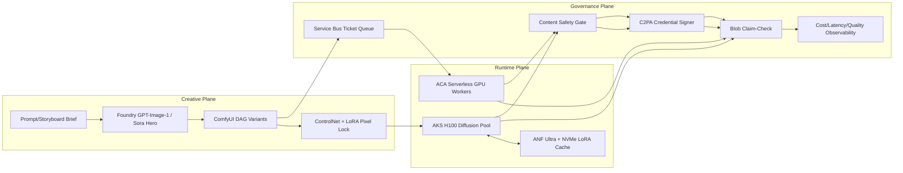
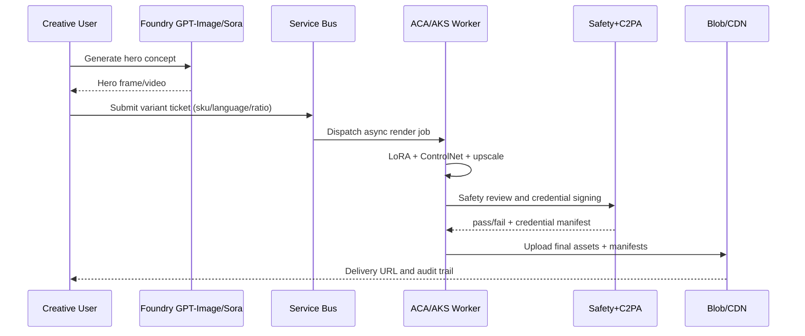
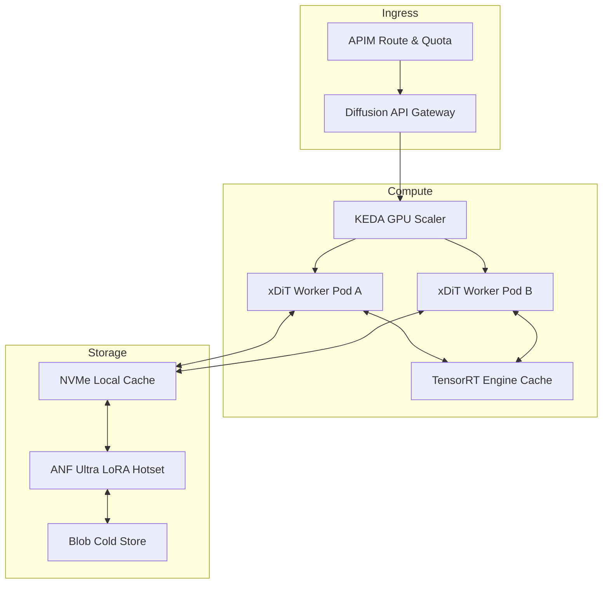

# 企业级多模态图像与视频 DiT 推理基础设施选型 FAQ：AKS xDiT/TensorRT + 热切换 LoRA 池 vs ACA Serverless GPU ComfyUI vs Foundry GPT-Image/Sora

> 🌐 **Language Switch**：**中文（当前）** | [English](./diffusion-image-video-dit-serving-aks-xdit-tensorrt-lora-vs-aca-serverless-gpu-comfyui-vs-aoai-sora-gpt-image-selection-faq.en.md)
> **受众**：Cloud & AI Solution Architect、AIGC 平台负责人、GPU SRE、品牌创意工程团队、内容合规与法务团队。
> **范围**：围绕企业多模态图像/视频 DiT 生产推理，比较 AKS 高吞吐池、ACA Serverless GPU 异步 ComfyUI、Foundry 托管 GPT-Image-1/Sora 与混合 Hero-to-Variant 流水线，并给出可量化的容量、成本、SLA 与治理决策。

## 1. 问题定义：为什么 DiT 推理不能直接套用 LLM Serving 引擎思路
扩散 Transformer（DiT）推理与 LLM 自回归解码在算子形态和时间结构上完全不同，前者需要多步去噪迭代并伴随 U-Net/DiT 块反复访问中间激活，后者则强调 KV 缓存驱动的逐 token 增量解码。
因此，vLLM 的 PagedAttention 思路并不会自动解决 DiT 的显存峰值与步数放大问题，尤其在 `1024px` 图像和 `720p 5s` 视频场景中，VAE 解码、时空注意力和 ControlNet 条件分支会显著抬高瞬时内存占用。
企业创意生产还要求品牌一致性与 SKU 文案锁定，如果仅追求“可生成”，会在落地时遇到标签错字、包装比例漂移和多语种版式失真，从而导致返工成本超出推理成本本身。
本议题的核心不是“哪种模型更强”，而是“如何在创意质量、像素一致性、吞吐与合规之间构建可复制的生产系统”。

## 2. 四类架构路径（A/B/C/D）与职责边界
**Architecture A**：`AKS` 专用高吞吐扩散池（`NC H100 v5 / ND H100 v5` + `xDiT` USP/PipeFusion + `FP8/TensorRT` 编译 + `ANF Ultra/NVMe` LoRA 热缓存），用于低延迟和高并发品牌资产生成。
**Architecture B**：`ACA Serverless GPU` 事件队列驱动的 Headless `ComfyUI` DAG Worker（Service Bus 工单 + Blob Claim-Check + C2PA 签名），用于波峰波谷明显的创意流水线。
**Architecture C**：`Foundry` 托管 `GPT-Image-1` 与 `Sora` 端点，叠加 APIM、Content Safety 与内容凭证，实现零基础设施运维与全球吞吐。
**Architecture D**：两阶段混合（托管模型先生成 Hero 场景，再由 AKS/ACA 做 ControlNet 像素锁定、多尺寸多语种版本化与批量超分），用于兼顾创意探索和商品一致性。
企业常见做法是以 D 为目标架构，通过 A/B/C 的分层组合在不同资产类型上做路由分流。

## 3. 端到端参考架构：创意生成、品牌锁定、合规模块与资产发布闭环

该架构把“创意生成”与“品牌一致性修正”拆成独立阶段，避免在单一路径里同时追求无限创意和绝对像素锁定。
在企业治理上，所有路径都经过统一的内容安全与凭证签名关口，确保外部发布资产具备来源可追溯性。

## 4. Architecture A：AKS xDiT/TensorRT 高吞吐扩散池
A 路径本质是把 DiT 当作高性能 HPC 负载治理，核心关注点包括多 GPU 并行切分、FP8 编译、LoRA 热切换和 I/O 数据面低抖动。
在 `ND H100 v5` 场景中，USP/PipeFusion 可以把视频长序列切分到多卡流水，配合 TensorRT 图优化后将去噪步骤中的 kernel launch 开销显著压低。
LoRA 与 ControlNet 权重不应反复从远端对象存储拉取，最佳实践是在 ANF Ultra 维护热集并在本地 NVMe 做短周期二级缓存，从而把“模型切换延迟”稳定在业务可控范围。
该模式适合高频品牌资产中心、广告自动化生产与多语言大规模变体工厂，尤其当月资产规模超过几十万时，单位成本优势会明显放大。

## 5. Architecture B：ACA Serverless GPU + ComfyUI 弹性 DAG 工人池
B 路径把“创意流水线”当作异步工单系统处理，利用队列驱动和 Scale-to-Zero 避免夜间闲置 GPU 费用。
Headless ComfyUI DAG 适合串联 Segment、Relight、ControlNet、Upscale 等多步骤图像工序，并可通过工作流版本控制保证营销活动复现。
由于 Serverless GPU 冷启动存在镜像与权重回填阶段，建议把大权重放 Blob + 分段缓存，并使用预热最小副本覆盖高峰时段。
对日内负载占空比低于 `25%` 的团队，B 往往在 TCO 上优于长期保留的 AKS 专用节点池。

## 6. Architecture C：Foundry 托管 GPT-Image-1 / Sora 的托管优先路径
C 路径的最大价值在于“零集群运维 + 全球容量 + 企业合规支撑”，平台团队无需维护驱动、CUDA 版本或节点编排。
在概念创意、海报草图与视频分镜阶段，托管模型的语义编辑能力可显著提升创意迭代效率，特别适合需要快速探索视觉方向的业务团队。
但其边界同样明确：若要求 `100%` 商品标签排版锁定、私有 LoRA 权重热替换或深度自定义后处理算子，托管端点通常无法直接满足。
因此 C 常用于“前段创意生成”，再通过 D 路径接入企业专有一致性加工链路。

## 7. 12 维对比矩阵：延迟、吞吐、品牌一致性与运维复杂度
| 维度 | A：AKS xDiT/TensorRT | B：ACA Serverless GPU + ComfyUI | C：Foundry GPT-Image/Sora | D：Hybrid Hero-to-Variant |
|---|---|---|---|---|
| 单图高分辨率延迟 | 很低（可到 `<1.5s`） | 中（受冷启动影响） | 低到中 | 中低 |
| `720p 5s` 视频延迟 | 低（`<25s` 可达） | 中高 | 中 | 中 |
| 峰值并发吞吐 | 很高 | 中高 | 很高（托管） | 很高 |
| 低占空比成本效率 | 中 | 很高 | 高 | 高 |
| 私有 LoRA 热切换 | 很高 | 高 | 低 | 很高 |
| SKU 标签像素锁定 | 很高 | 高 | 中低 | 很高 |
| 多步骤 DAG 灵活性 | 高 | 很高 | 中 | 很高 |
| 全托管运维负担 | 低 | 中 | 很高 | 中 |
| 内容安全与凭证接入 | 高 | 高 | 很高 | 很高 |
| 跨区域弹性扩展 | 高 | 高 | 很高 | 很高 |
| 变更与回滚可控性 | 很高 | 高 | 中 | 很高 |
| 推荐定位 | 品牌资产主生产线 | 弹性创意流水线 | 创意探索与快速产出 | 企业终态组合架构 |

## 8. 核心定量模型：FLOPs、显存预算与容量断点
图像 DiT 可用近似式 `F_image ≈ steps * tokens_latent * C_layer`，其中 `tokens_latent` 与分辨率平方相关，当分辨率从 `768px` 提升到 `1024px` 时，latent token 数增长约 `1.78x`，实际算力开销接近线性放大。
视频推理可近似 `F_video ≈ steps * frames * tokens_per_frame * C_spatiotemporal`，若从 `16` 帧提升到 `40` 帧且维持 `720p`，理论计算量可超过 `2.5x`，这也是视频任务更依赖多卡并行和流水切分的根本原因。
显存预算可按 `M_total = M_weights + M_activations + M_vae_decode + M_lora_delta + M_safety_buffer` 估算，`1024px` 图像常见 `M_total` 在 `28–42GB`，`720p 5s` 视频多卡并行场景可达 `70GB+` 总预算。
因此企业应在容量模型中显式区分“图像档位”和“视频档位”，避免按统一 GPU 配置粗略估算导致 SLA 失真。

## 9. 冷启动与利用率断点：ACA 弹性 vs AKS 预留的经济学
AKS 预留节点的盈亏平衡可近似 `u* = 1 - discount_pct`，若预留/长期承诺折扣 `discount_pct=0.38`，则 `u*=0.62`，意味着当有效利用率持续超过 `62%` 时专用池通常更经济。
ACA Serverless GPU 的成本结构由“执行时长 + 冷启动补偿”组成，若日内请求强波动且低谷时段长，Scale-to-Zero 能显著降低空闲支出。
冷启动影响可建模为 `L_total = L_queue + L_cold_start + L_infer + L_post`，在 `A100` 大镜像场景，`L_cold_start` 可能占总耗时 `20–45%`，必须通过预热窗口和权重分层缓存压缩。
因此选型不应只看峰值性能，而要按真实占空比与请求分布评估全年单位资产成本。

## 10. 参考图一：混合 Hero-to-Variant 生产流水线时序

该时序体现“托管创意 + 自管一致性加工”的工程分工，使前端创意团队和后端商品合规团队可以并行协作。
对大促活动，建议在队列侧按品牌/区域分桶，避免单一热点活动挤压所有资产类型的出图 SLA。

## 11. 参考图二：AKS 高吞吐扩散池与 LoRA 热缓存拓扑

该拓扑强调“冷数据在 Blob、热数据在 ANF、本地高频在 NVMe”的三级缓存策略，避免 LoRA 切换造成 VRAM 与 I/O 震荡。
在多租户场景中，应为租户或品牌组设置配额隔离，避免某一营销活动将全部 GPU 资源挤占。

## 12. 生产配置示例：AKS KEDA GPU Worker + Service Bus 伸缩 + ANF 卷挂载
```yaml
apiVersion: apps/v1
kind: Deployment
metadata:
  name: diffusion-worker
  namespace: media-prod
spec:
  replicas: 2
  selector:
    matchLabels:
      app: diffusion-worker
  template:
    metadata:
      labels:
        app: diffusion-worker
    spec:
      nodeSelector:
        accelerator: nvidia-h100
      containers:
        - name: worker
          image: contoso.azurecr.io/diffusion/worker:2026.11.23
          resources:
            limits:
              nvidia.com/gpu: "1"
              cpu: "8"
              memory: 64Gi
          env:
            - name: LORA_CACHE_DIR
              value: /mnt/lora-hotset
            - name: JOB_QUEUE
              value: media-render-jobs
          volumeMounts:
            - name: lora-hotset
              mountPath: /mnt/lora-hotset
      volumes:
        - name: lora-hotset
          persistentVolumeClaim:
            claimName: anf-lora-hotset-pvc
---
apiVersion: keda.sh/v1alpha1
kind: ScaledObject
metadata:
  name: diffusion-worker-scaler
  namespace: media-prod
spec:
  scaleTargetRef:
    name: diffusion-worker
  minReplicaCount: 2
  maxReplicaCount: 64
  triggers:
    - type: azure-servicebus
      metadata:
        queueName: media-render-jobs
        namespace: sb-media-prod
        messageCount: "4"
```

```bicep
resource sbNamespace 'Microsoft.ServiceBus/namespaces@2023-01-01-preview' = {
  name: 'sb-media-prod'
  location: resourceGroup().location
  sku: {
    name: 'Premium'
    tier: 'Premium'
    capacity: 2
  }
}

resource queue 'Microsoft.ServiceBus/namespaces/queues@2023-01-01-preview' = {
  parent: sbNamespace
  name: 'media-render-jobs'
  properties: {
    lockDuration: 'PT2M'
    maxDeliveryCount: 8
    deadLetteringOnMessageExpiration: true
    requiresDuplicateDetection: true
    duplicateDetectionHistoryTimeWindow: 'PT10M'
  }
}

resource anfVolume 'Microsoft.NetApp/netAppAccounts/capacityPools/volumes@2023-09-01' = {
  name: 'anf-prod/account-media/pool-ultra/lora-hotset'
  location: resourceGroup().location
  properties: {
    usageThreshold: 1099511627776
    serviceLevel: 'Ultra'
    protocolTypes: [
      'NFSv4.1'
    ]
    subnetId: '/subscriptions/<sub>/resourceGroups/<rg>/providers/Microsoft.Network/virtualNetworks/vnet-prod/subnets/snet-anf'
  }
}
```
上述配置展示了队列驱动伸缩和热缓存卷挂载的基础骨架，实际生产应进一步加入 PodDisruptionBudget、优先级抢占与镜像签名校验。

## 13. 生产 Python Worker：异步 Claim-Check + Content Safety + C2PA 清单签名
```python
import json
import time
from dataclasses import dataclass

from azure.storage.blob import BlobClient
from azure.servicebus import ServiceBusClient


@dataclass
class RenderJob:
    job_id: str
    prompt: str
    negative_prompt: str
    lora_key: str
    controlnet_ref: str
    output_path: str
    policy_profile: str


def load_job(msg_body: str) -> RenderJob:
    payload = json.loads(msg_body)
    return RenderJob(**payload)


def run_diffusion_pipeline(job: RenderJob) -> bytes:
    # 占位：实际实现可替换为 xDiT/TensorRT/ComfyUI DAG 调用
    content = f"render:{job.job_id}:{job.lora_key}:{int(time.time())}".encode("utf-8")
    return content


def content_safety_gate(image_bytes: bytes, profile: str) -> None:
    if not image_bytes or profile == "":
        raise ValueError("invalid_render_or_policy_profile")


def sign_c2pa_manifest(job: RenderJob, blob_url: str) -> dict:
    return {
        "job_id": job.job_id,
        "asset_url": blob_url,
        "credential_type": "C2PA",
        "generator": "enterprise-diffusion-worker",
        "policy_profile": job.policy_profile,
    }


def process_message(msg_body: str, blob_client: BlobClient) -> dict:
    job = load_job(msg_body)
    output_bytes = run_diffusion_pipeline(job)
    content_safety_gate(output_bytes, job.policy_profile)
    blob_client.upload_blob(output_bytes, overwrite=True)
    manifest = sign_c2pa_manifest(job, blob_client.url)
    return {"job_id": job.job_id, "blob_url": blob_client.url, "manifest": manifest}


def worker_loop(sb_conn: str, queue_name: str, blob_url: str, blob_sas: str):
    blob_client = BlobClient.from_blob_url(f"{blob_url}?{blob_sas}")
    with ServiceBusClient.from_connection_string(sb_conn) as client:
        receiver = client.get_queue_receiver(queue_name=queue_name, max_wait_time=5)
        with receiver:
            for msg in receiver:
                try:
                    result = process_message(str(msg), blob_client)
                    print("render-ok", json.dumps(result, ensure_ascii=False))
                    receiver.complete_message(msg)
                except Exception as ex:
                    print("render-failed", str(ex))
                    receiver.abandon_message(msg)
```
该示例强调“消息只传元数据、资产通过 Blob Claim-Check 存取”的模式，可有效控制队列负载并提升重试幂等性。

## 14. 企业场景与三年 TCO：品牌电商与跨区域营销素材工厂
### 14.1 场景一：消费品电商品牌多 SKU 海报工厂
某消费品企业每月需要生成 `620K` 张多语种电商主图与详情页变体，其中 `22%` 需要严格标签像素锁定，`78%` 以创意变化为主。
采用 D 路径后，Hero 图先由托管模型生成，再用 A/B 对 SKU 区域做一致性合成，返工率从 `14.8%` 降至 `4.1%`。
在峰值活动日，AKS 高吞吐池承接高一致性任务，ACA 弹性池承接长尾创意任务，整体交付 SLA 保持在 `99.2%`。

### 14.2 场景二：跨区域营销短视频自动化生产
某零售集团每月输出 `42K` 条 `5–8s` 短视频素材，需覆盖 `11` 个地区与 `9` 种版式比例。
仅用托管视频生成会出现品牌文案不稳定问题，引入 D 路径后把托管模型用于场景构图，再由 AKS 做品牌锁定与字幕适配，合规通过率显著提升。
同时通过 Service Bus 工单编排实现“可追踪重跑”，将跨区域活动回溯时间从小时级缩短到分钟级。

### 14.3 三年 TCO（峰值 `2,400` 并发渲染、月 `500K+` 资产）
| 成本项（3 年） | A | B | C | D |
|---|---:|---:|---:|---:|
| GPU 计算与推理运行 | `$4.20M` | `$2.86M` | `$3.44M` | `$3.18M` |
| 平台与编排运维 | `$1.52M` | `$0.88M` | `$0.62M` | `$1.26M` |
| 品牌一致性返工成本 | `$0.48M` | `$0.74M` | `$1.36M` | `$0.41M` |
| 内容安全与凭证治理 | `$0.42M` | `$0.38M` | `$0.34M` | `$0.40M` |
| 可用性与事故处置 | `$0.56M` | `$0.49M` | `$0.45M` | `$0.47M` |
| 三年综合成本 | `$7.18M` | `$5.35M` | `$6.21M` | `$5.72M` |

在高一致性要求下，D 的单位资产成本常优于单一托管路径，因为可把昂贵的“像素修复返工”前置到可控的专用阶段。

## 15. 定量 Q&A（6 项）+ Day-0/Day-2 清单
### 15.1 定量 Q&A（6 项）
**Q1：如何估算图像与视频 DiT 的计算量差异？**可用 `F_image ≈ steps * tokens_latent * C_layer` 与 `F_video ≈ steps * frames * tokens_per_frame * C_spatiotemporal` 做一阶估算。若图像任务为 `steps=30`、视频任务为 `steps=30, frames=40`，且同分辨率下 `tokens_per_frame` 接近，视频计算量约是图像的 `40x` 级别，再考虑时空层额外系数后会更高。
该结果解释了为何视频管线必须优先考虑多卡并行和流水切分，而不能简单复用单卡图像节点池。

**Q2：显存预算如何快速做容量预估？**可用 `M_total = M_weights + M_activations + M_vae_decode + M_lora_delta + M_buffer`。若 `M_weights=14GB`、`M_activations=10GB`、`M_vae_decode=8GB`、`M_lora_delta=3GB`、`M_buffer=5GB`，则总预算约 `40GB`，意味着 `40GB` 卡型在高峰时可能接近上限。
因此生产规划应优先在 `80GB` 卡型或多卡切分路径验证峰值场景，避免上线后出现显存抖动与 OOM 重试风暴。

**Q3：ACA 与 AKS 的利用率断点怎么计算？**若 AKS 承诺折扣为 `38%`，可用 `u* = 1 - discount_pct = 0.62`，即利用率高于 `62%` 时 AKS 预留更有利。若实际占空比仅 `24%`，Serverless GPU 往往整体成本更低。
决策时应以月度真实作业曲线计算而非峰值瞬时数据，否则容易出现“峰值合理、全年亏损”的错判。

**Q4：KEDA 队列伸缩如何满足目标 SLA？**可用 `replicas = ceil(queued_jobs * avg_render_sec / target_sla_sec)`。若队列积压 `1,200`、平均渲染 `18s`、目标在 `300s` 清空，则副本数约 `72`。
这个公式可直接用于活动高峰扩容预案，并配合上限保护避免误扩容冲击配额。

**Q5：LoRA 热集容量如何估算以避免抖动？**可用 `Hotset_GB = active_lora_count * avg_lora_size_gb * safety_factor`。若活跃 LoRA `500`、平均 `0.35GB`、安全系数 `1.3`，则热集约 `227.5GB`。
该值可用于确定 ANF 容量池最小阈值，并决定本地 NVMe 缓存层的命中目标。

**Q6：混合 D 路径的单位资产成本为何常更优？**可用 `UnitCost = (C_hero + C_variant + C_rework + C_ops)/assets`。若纯托管路径返工成本 `C_rework` 高，而 D 路径把返工率从 `14.8%` 降到 `4.1%`，即使 `C_variant` 上升，总体 `UnitCost` 仍可能下降 `60–75%`。
这也是大规模商品素材工厂优先采用“托管创意 + 自管一致性”组合的核心经济原因。

### 15.2 Day-0 上线清单
1. 建立 Hero 与 Variant 双阶段路由规则，明确哪些资产必须走像素锁定链路。
2. 为 AKS/ACA 分别定义容量配额、队列优先级与回退策略，避免单路径过载。
3. 部署 Content Safety 与 C2PA 签名网关，确保每个出库资产都有可追溯凭证。
4. 建立 LoRA/ControlNet 版本目录与灰度发布流程，禁止直接覆盖线上权重。
5. 在观测面落地延迟、失败率、返工率、单位成本四类核心指标。

### 15.3 Day-2 运行清单
1. 周度复盘图像与视频任务的分层路由命中率，校正 AKS/ACA 负载比例。
2. 月度清理低命中 LoRA 并更新热集策略，保持缓存效率。
3. 持续验证多区域容灾演练，确保队列和资产库在故障下可重建。
4. 对营销大促前执行压测与回滚演练，验证 KEDA 参数和配额上限。
5. 定期复核内容安全策略与凭证链条，防止治理漂移。

### 15.4 Good fit vs Not for
该架构族特别适合“高产量、多品牌、多区域、多语种”且对品牌一致性和合规可追溯要求严格的企业内容工厂，因为其能把创意探索与一致性生产分层治理。
若团队仅有小规模偶发创意需求、没有严格像素锁定目标，直接全量建设 A+D 可能过重，可先从 C 或 B 起步并按资产规模逐步演进。

### 15.5 审计字段映射（示例）
| 字段 | 来源层 | 用途 | 最低保留期 |
|---|---|---|---|
| `job_id` | Queue | 作业唯一标识 | 3 年 |
| `tenant_id` | Gateway | 多租户归属 | 3 年 |
| `brand_id` | Workflow | 品牌隔离审计 | 3 年 |
| `asset_type` | Workflow | 图像/视频分流分析 | 2 年 |
| `hero_model` | Foundry | Hero 生成追踪 | 2 年 |
| `variant_pipeline` | Worker | 变体链路审计 | 2 年 |
| `lora_version` | Model Registry | 权重版本追踪 | 5 年 |
| `controlnet_profile` | Worker | 一致性策略追踪 | 3 年 |
| `gpu_sku` | Runtime | 成本与性能归因 | 2 年 |
| `cold_start_ms` | Runtime | 弹性代价监控 | 1 年 |
| `infer_ms` | Runtime | 核心推理时延 | 1 年 |
| `postprocess_ms` | Runtime | 后处理成本分析 | 1 年 |
| `queue_wait_ms` | Queue | 积压与拥塞分析 | 1 年 |
| `safety_result` | Safety | 合规审计 | 5 年 |
| `credential_id` | C2PA | 资产来源凭证 | 7 年 |
| `blob_uri` | Storage | 资产定位 | 3 年 |
| `checksum` | Storage | 完整性校验 | 3 年 |
| `unit_cost_usd` | FinOps | 单位经济性分析 | 3 年 |
| `rework_flag` | QA | 返工追踪 | 3 年 |
| `publish_channel` | CMS | 发布链路追踪 | 2 年 |

### 15.6 运行告警字典（示例）
| 告警键 | 触发条件 | 处置动作 | 责任角色 |
|---|---|---|---|
| `queue_backlog_spike` | 队列积压突增 | 扩容并检查热点活动 | 平台 SRE |
| `cold_start_regression` | 冷启动 P95 升高 | 调整预热与镜像层级 | Runtime 团队 |
| `gpu_oom_rate_high` | OOM 比率超阈 | 降分辨率或切换多卡 | GPU 工程师 |
| `lora_cache_miss_high` | 热缓存命中下降 | 重算热集并预拉取 | 模型平台 |
| `safety_reject_spike` | 安全拒绝率异常 | 复核 Prompt 策略 | 合规团队 |
| `credential_sign_fail` | 凭证签名失败 | 切换签名服务副本 | 安全平台 |
| `unit_cost_outlier` | 单位成本异常升高 | 检查路由与返工 | FinOps |
| `sla_breach_risk` | 预计超出交付窗口 | 启用高优先级队列 | 运营负责人 |
| `region_failover_event` | 区域故障触发 | 执行跨区接管 | 站点可靠性 |
| `artifact_publish_error` | 发布失败率升高 | 回滚最近发布 | 内容平台 |
| `controlnet_drift` | 像素锁定偏差上升 | 冻结并回退配置 | 视觉工程 |
| `comfy_dag_fail_spike` | DAG 失败率异常 | 检查节点版本 | 创意工程 |
| `servicebus_dlq_growth` | 死信持续增长 | 启动批量重放 | 运维值班 |
| `blob_latency_regression` | 对象存储延迟升高 | 调整并发与分片 | 存储团队 |
| `apim_quota_throttle` | 网关限流命中高 | 优化配额与批策略 | API 平台 |
| `c2pa_manifest_gap` | 缺失凭证记录 | 阻断外发并补签 | 合规平台主管 |
| `render_quality_drop` | 质量评分下降 | 启动抽样复核 | 质量团队 |
| `locale_layout_failure` | 多语排版失败增多 | 调整模板与字体 | 本地化团队 |
| `video_latency_spike` | 视频任务 P95 异常 | 临时切换高算力池 | 多媒体平台 |
| `ops_backlog_growth` | 运维工单积压 | 增加值班与自动化 | 平台经理 |
