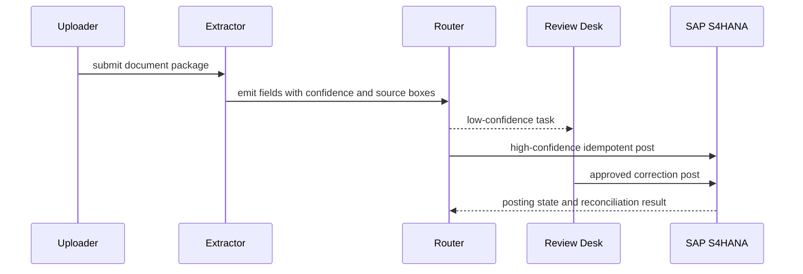

# Document Intelligence Layout vs Foundry Content Understanding vs GPT-4o Vision: Enterprise IDP Selection FAQ

> 🌐 **Language / 语言切换**: **[🇬🇧 English (document-intelligence-layout-vs-foundry-content-understanding-vs-gpt4o-vision-idp-selection-faq.en.md)](document-intelligence-layout-vs-foundry-content-understanding-vs-gpt4o-vision-idp-selection-faq.en.md)** | **[🇨🇳 中文版 (document-intelligence-layout-vs-foundry-content-understanding-vs-gpt4o-vision-idp-selection-faq.md)](document-intelligence-layout-vs-foundry-content-understanding-vs-gpt4o-vision-idp-selection-faq.md)** | **[📚 Architecture Selection FAQ Index](README.en.md)**

## 1) Objective and boundary
Goal: build an auditable, scalable, and cost-governed enterprise IDP architecture for heterogeneous unstructured documents.
Scope: selection matrix, confidence gates, two-stage pipeline, ERP reconciliation closure, and operating governance.
Exclusion: no kernel/driver/register-level tuning or low-level R&D internals.
Conclusion: layout-first coordinates plus semantic normalization plus review queue forms the most audit-ready and cost-efficient production path.
## 2) Verifiable sources with timestamps
- Azure AI Document Intelligence docs (04:35 BJT)。
- Azure AI Content Understanding docs (04:35 BJT)。
- Azure OpenAI GPT-4.1/GPT-4o Vision Structured Outputs docs (04:36 BJT)。
- Azure Blob event trigger docs (04:36 BJT)。
- Azure Service Bus queue docs (04:36 BJT)。
- SAP S/4HANA integration reference (04:37 BJT)。
- APIM AI Gateway governance docs (04:37 BJT)。
Evidence labels are measured/synthetic/anonymized_reported and persisted in evidence files.
## 3) Four IDP patterns and 12-dimension matrix
- A: Document Intelligence (Layout + Custom Neural) fits fixed layouts and coordinate traceability.
- B: Content Understanding fits zero-shot schema definition with managed confidence semantics.
- C: GPT-4o Vision fits long-tail handwriting, stamp-occlusion, and highly heterogeneous fallback cases.
- D: Two-stage pipeline (Layout→LLM→gated review) balances quality, explainability, and cost.
- Dimension 1 geometry traceability.
- Dimension 2 semantic normalization.
- Dimension 3 multilingual mixed-layout adaptability.
- Dimension 4 confidence explainability.
- Dimension 5 throughput and quota elasticity.
- Dimension 6 per-page cost stability.
- Dimension 7 ERP idempotent posting fitness.
- Dimension 8 cross-table reconciliation controllability.
- Dimension 9 human review operational efficiency.
- Dimension 10 audit and regulatory traceability.
- Dimension 11 operational complexity and team skill threshold.
- Dimension 12 anti-pattern risk (single-model direct extraction without gates).
## 4) Scoreboard and confidence thresholds
- Document Intelligence: geometry5, cost5, long-tail3, agility3.
- Content Understanding: agility5, confidence semantics5, cost4, geometry3.
- GPT-4o Vision: long-tail5, semantics4, cost2, geometry2.
- Two-stage golden pipeline: auditability5, quality5, cost-balance4, complexity4.
- Threshold A: >=0.92 routes to STP.
- Threshold B: 0.75~0.92 routes to secondary inference and cross-check.
- Threshold C: <0.75 routes to human review desk.
- Threshold D: any reconciliation failure blocks posting.
## 5) Five calculable Q&As
### Q1 Why pure VLM direct extraction misses audit-grade controls
- Run coordinate-first extraction and confidence scoring before semantic normalization and rule checks.
- Route mid/low confidence fields to secondary inference and review to avoid silent posting errors.
- Every exception must carry source-highlight coordinates and reason codes for audit replay packs.
### Q2 How four patterns compare under one million pages per month
- Run coordinate-first extraction and confidence scoring before semantic normalization and rule checks.
- Route mid/low confidence fields to secondary inference and review to avoid silent posting errors.
- Every exception must carry source-highlight coordinates and reason codes for audit replay packs.
### Q3 Why dual-threshold routing can push end-to-end error below 0.1%
- Run coordinate-first extraction and confidence scoring before semantic normalization and rule checks.
- Route mid/low confidence fields to secondary inference and review to avoid silent posting errors.
- Every exception must carry source-highlight coordinates and reason codes for audit replay packs.
### Q4 How to handle skewed scans and handwritten approvals
- Run coordinate-first extraction and confidence scoring before semantic normalization and rule checks.
- Route mid/low confidence fields to secondary inference and review to avoid silent posting errors.
- Every exception must carry source-highlight coordinates and reason codes for audit replay packs.
### Q5 How to close idempotent reconciliation with SAP S/4HANA
- Run coordinate-first extraction and confidence scoring before semantic normalization and rule checks.
- Route mid/low confidence fields to secondary inference and review to avoid silent posting errors.
- Every exception must carry source-highlight coordinates and reason codes for audit replay packs.
## 6) Layered reference architecture
- Ingestion: Blob + metadata tags + event dispatch.
- Layout: Document Intelligence parses coordinates and table grids.
- Semantic: Content Understanding / GPT-4o normalizes canonical fields.
- Gate: confidence threshold routes STP/secondary-inference/human review.
- Validation: cross-table checks, currency precision, date consistency, mandatory constraints.
- Integration: ERP idempotent posting and posting-state reconciliation.
- Operations: Service Bus review queues and dead-letter handling desk.
- Governance: APIM, audit trails, retention policy, and access isolation.
## 7) Scenario A: trade-finance document concordance platform
- Compares L/C, invoice, packing list, and bill of lading across eight heterogeneous document types.
- Amount, shipment port, goods description, and expiry all keep pixel-level evidence coordinates.
- UCP600 rule engine executes discrepancy detection and blocking before posting.
- Low-confidence fields route to review desk with structured reason coding.
- Compliance sampling can replay the full chain from source to extraction to posting.
## 8) Scenario B: provincial healthcare and insurance claim platform
- Processes around 300k mobile-captured pages daily with de-warp and contrast normalization first.
- Completes table extraction, ICD-10 mapping, claim-rule matching, and amount calculation.
- Coding conflicts or low-confidence pages route to medical review queues.
- Runs multi-source consistency checks and records immutable audit receipts before settlement.
- Tracks STP rate, return ratio, and review latency as core operations metrics.
## 9) Mermaid diagram 1: two-stage golden IDP pipeline
```mermaid
flowchart LR
A[Blob Intake]-->B[Document Intelligence Layout]
B-->C[Field and Table Anchors]
C-->D[Content Understanding or GPT4o Normalization]
D-->E{Confidence Gate}
E-->=0.92-->F[STP Posting]
E--0.75~0.92-->G[Secondary Cross Check]
E--<0.75-->H[Human Review Desk]
G-->I[ERP Reconciliation]
F-->I
H-->I
```
- This flow emphasizes coordinate evidence first, semantic normalization second, and human fallback for low-confidence paths.
## 10) Mermaid diagram 2: review and idempotent posting sequence

- Sequence requires idempotency keys and posting receipts for every write to prevent duplicate ledger entries.
## 11) Bicep template (DI + CU/AOAI + Blob events + Service Bus)
```bicep
targetScope = 'resourceGroup'
param location string = resourceGroup().location
resource di 'Microsoft.CognitiveServices/accounts@2023-05-01' = {
  name: 'di'
  location: location
  kind: 'FormRecognizer'
  sku: { name: 'S0' }
}
resource aoai 'Microsoft.CognitiveServices/accounts@2023-05-01' = {
  name: 'aoai'
  location: location
  kind: 'OpenAI'
  sku: { name: 'S0' }
}
resource sb 'Microsoft.ServiceBus/namespaces@2022-10-01-preview' = {
  name: 'sb-prod'
  location: location
  sku: { name: 'Premium', tier: 'Premium', capacity: 1 }
}
```
- Production setup should add private networking, managed identity, key governance, least privilege, and queue isolation policies.
## 12) Confidence-gate JSON and dual-stage routing code
```json
{
  "thresholds": {"stp": 0.92, "secondary": 0.75},
  "actions": {"stp": "erp_post", "secondary": "llm_cross_check", "review": "human_queue"},
  "required_validation": ["table_balance", "currency_precision", "date_consistency", "counterparty_match"]
}
```
```python
def route(field_conf, validations_ok):
    if field_conf >= 0.92 and validations_ok:
        return 'stp'
    if field_conf >= 0.75:
        return 'secondary'
    return 'review'
```
- Routing policy must be versioned and bound to release records for audit replay and accountability.
## 13) KQL: STP rate, per-page cost, and review-return reason audit
```kql
let t = IdpOpsLogs | where TimeGenerated > ago(30d);
t
| summarize stpRate=avg(todouble(Route == 'stp')), avgCostPerPage=avg(CostUsdPerPage), p95Latency=percentile(EndToEndLatencyMs,95) by DocType
| join kind=leftouter (
    t | where Route == 'review' | summarize reviewReasons=count() by ReturnReason
) on 1==1
```
- Return-reason clustering directly guides preprocessing optimization, field-definition tuning, and review SOP updates.
## 14) Five-step rollout and operations model
- Step 1: define document families, canonical field contracts, and audit ownership.
- Step 2: launch layout-coordinate extraction baseline and collect confidence calibration samples.
- Step 3: add semantic normalization and cross-table checks with dual-threshold routing.
- Step 4: integrate ERP idempotent posting, receipt reconciliation, and exception queues.
- Step 5: scale by document family and continuously optimize STP/cost/latency/return-rate.
- Run monthly quality boards with business, finance, audit, and ops stakeholders.
- Every release batch must retain replay packs and policy version signatures.
