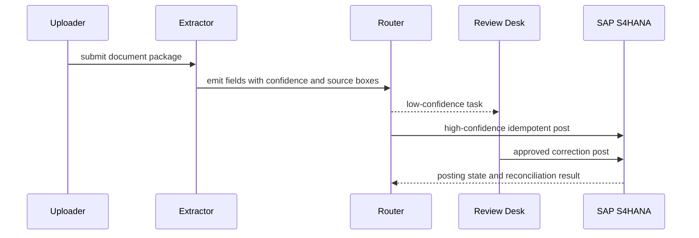

# Document Intelligence Layout vs Foundry Content Understanding vs GPT-4o Vision：企业 IDP 选型 FAQ

> 🌐 **Language / 语言切换**: **[🇨🇳 中文版 (document-intelligence-layout-vs-foundry-content-understanding-vs-gpt4o-vision-idp-selection-faq.md)](document-intelligence-layout-vs-foundry-content-understanding-vs-gpt4o-vision-idp-selection-faq.md)** | **[🇬🇧 English (document-intelligence-layout-vs-foundry-content-understanding-vs-gpt4o-vision-idp-selection-faq.en.md)](document-intelligence-layout-vs-foundry-content-understanding-vs-gpt4o-vision-idp-selection-faq.en.md)** | **[📚 返回架构选型指南目录](README.md)**

## 1) 研究目标与边界
目标：面向复杂非结构化单据，构建可审计、可扩展、可控成本的企业级IDP体系。
范围：选型矩阵、置信门禁、双阶流水线、ERP对账闭环、运营治理。
排除：不涉及内核驱动、寄存器、RDMA/eBPF 等底层研发细节。
结论：版面坐标优先 + 语义归一 + 复核队列是审计友好且成本最优的生产路径。
## 2) 可验证来源与时间戳
- Azure AI Document Intelligence 文档（04:35 BJT）。
- Azure AI Content Understanding 文档（04:35 BJT）。
- Azure OpenAI GPT-4.1/GPT-4o Vision Structured Outputs 文档（04:36 BJT）。
- Azure Blob 事件触发文档（04:36 BJT）。
- Azure Service Bus 队列文档（04:36 BJT）。
- SAP S/4HANA 集成参考（04:37 BJT）。
- APIM AI Gateway 治理文档（04:37 BJT）。
证据标签统一 measured/synthetic/anonymized_reported，并在 evidence 文件中落盘。
## 3) 四类IDP方案 12维矩阵
- A: Document Intelligence（Layout + Custom Neural）适合固定版式和几何坐标溯源。
- B: Content Understanding 适合零样本字段定义与托管置信评分。
- C: GPT-4o Vision 适合长尾手写、遮挡印章和高度异构样本兜底。
- D: 双阶流水线（Layout→LLM→门禁复核）兼顾精度、可解释性与成本。
- 维度1 几何溯源能力。
- 维度2 语义归一能力。
- 维度3 多语混排适应。
- 维度4 置信度可解释。
- 维度5 吞吐与配额弹性。
- 维度6 单页成本稳定性。
- 维度7 ERP幂等落账适配。
- 维度8 跨表勾稽可控性。
- 维度9 人工复核运营效率。
- 维度10 审计与监管可追溯。
- 维度11 运维复杂度与团队门槛。
- 维度12 反模式风险（单模型直抽无门禁）。
## 4) 评分与置信门禁阈值
- Document Intelligence：坐标精度5、成本5、长尾3、敏捷3。
- Content Understanding：敏捷5、置信语义5、成本4、坐标3。
- GPT-4o Vision：长尾5、语义4、成本2、坐标2。
- 双阶黄金流水线：审计5、准确5、成本4、复杂度4。
- 阈值A：>=0.92 直通 STP。
- 阈值B：0.75~0.92 二次推理交叉核验。
- 阈值C：<0.75 进入人工复核台。
- 阈值D：任意勾稽失败即阻断入账。
## 5) 五组可复算 Q&A
### Q1 单靠多模态直抽为何难过审计
- 先做版面坐标与字段置信度抽取，再做语义归一和规则校验。
- 对中低置信字段引入二次推理与人工复核，避免静默误入账。
- 所有异常都必须带原文高亮坐标与原因码进入审计重放包。
### Q2 百万页规模下四类方案成本吞吐如何比较
- 先做版面坐标与字段置信度抽取，再做语义归一和规则校验。
- 对中低置信字段引入二次推理与人工复核，避免静默误入账。
- 所有异常都必须带原文高亮坐标与原因码进入审计重放包。
### Q3 双阈值分流为何能把差错率压到<0.1%
- 先做版面坐标与字段置信度抽取，再做语义归一和规则校验。
- 对中低置信字段引入二次推理与人工复核，避免静默误入账。
- 所有异常都必须带原文高亮坐标与原因码进入审计重放包。
### Q4 倾斜扫描与手写签批如何回退
- 先做版面坐标与字段置信度抽取，再做语义归一和规则校验。
- 对中低置信字段引入二次推理与人工复核，避免静默误入账。
- 所有异常都必须带原文高亮坐标与原因码进入审计重放包。
### Q5 与 SAP S/4HANA 如何做幂等闭环
- 先做版面坐标与字段置信度抽取，再做语义归一和规则校验。
- 对中低置信字段引入二次推理与人工复核，避免静默误入账。
- 所有异常都必须带原文高亮坐标与原因码进入审计重放包。
## 6) 分层参考架构
- 采集层：Blob + 元数据标签 + 事件分发。
- 版面层：Document Intelligence Layout 解析坐标与表格网格。
- 语义层：Content Understanding / GPT-4o 归一字段。
- 门禁层：按置信阈值路由 STP/二次推理/人工复核。
- 校验层：跨表勾稽、币种精度、日期一致性、必填约束。
- 集成层：ERP 幂等落账与状态对账。
- 运营层：Service Bus 复核队列与死信处理台。
- 治理层：APIM、审计留痕、数据留存与权限隔离。
## 7) 场景A：贸易融资单证核验平台
- 对信用证、发票、装箱单、提单等八类异构单据做规则比对。
- 金额、装运港、货描、效期均保留像素级证据坐标。
- UCP600 规则引擎在入账前执行差异点检测与阻断。
- 低置信字段进入复核台并记录结构化原因码。
- 合规抽检可回放“原文→抽取→核验→入账”全链路。
## 8) 场景B：省级医联体理赔直赔平台
- 日均30万张手机翻拍单据，先做去畸变与对比度标准化。
- 完成表格解析、ICD-10 映射、理赔规则命中与金额计算。
- 编码冲突或低置信样本进入医学复核队列。
- 出账前执行多源一致性校验并落审计凭证。
- 以 STP、退回率、复核时延作为运营核心指标。
## 9) Mermaid 图1：双阶IDP黄金流水线
```mermaid
flowchart LR
A[Blob Intake]-->B[Document Intelligence Layout]
B-->C[Field and Table Anchors]
C-->D[Content Understanding or GPT4o Normalization]
D-->E{Confidence Gate}
E-->=0.92-->F[STP Posting]
E--0.75~0.92-->G[Secondary Cross Check]
E--<0.75-->H[Human Review Desk]
G-->I[ERP Reconciliation]
F-->I
H-->I
```
- 该图强调“坐标证据先行、语义归一后置、低置信人工兜底”的生产闭环。
## 10) Mermaid 图2：复核与幂等入账时序

- 时序要求每次写入都绑定幂等键和回执状态，杜绝重复记账。
## 11) Bicep 模板（DI + CU/AOAI + Blob事件 + Service Bus）
```bicep
targetScope = 'resourceGroup'
param location string = resourceGroup().location
resource di 'Microsoft.CognitiveServices/accounts@2023-05-01' = {
  name: 'di'
  location: location
  kind: 'FormRecognizer'
  sku: { name: 'S0' }
}
resource aoai 'Microsoft.CognitiveServices/accounts@2023-05-01' = {
  name: 'aoai'
  location: location
  kind: 'OpenAI'
  sku: { name: 'S0' }
}
resource sb 'Microsoft.ServiceBus/namespaces@2022-10-01-preview' = {
  name: 'sb-prod'
  location: location
  sku: { name: 'Premium', tier: 'Premium', capacity: 1 }
}
```
- 生产环境需补齐私网、托管身份、密钥托管、最小权限和队列隔离策略。
## 12) 字段置信门禁 JSON 与双阶路由代码
```json
{
  "thresholds": {"stp": 0.92, "secondary": 0.75},
  "actions": {"stp": "erp_post", "secondary": "llm_cross_check", "review": "human_queue"},
  "required_validation": ["table_balance", "currency_precision", "date_consistency", "counterparty_match"]
}
```
```python
def route(field_conf, validations_ok):
    if field_conf >= 0.92 and validations_ok:
        return 'stp'
    if field_conf >= 0.75:
        return 'secondary'
    return 'review'
```
- 门禁策略需版本化并绑定发布记录，以支持审计回放和责任追踪。
## 13) KQL：STP率/单页成本/人工退回原因审计
```kql
let t = IdpOpsLogs | where TimeGenerated > ago(30d);
t
| summarize stpRate=avg(todouble(Route == 'stp')), avgCostPerPage=avg(CostUsdPerPage), p95Latency=percentile(EndToEndLatencyMs,95) by DocType
| join kind=leftouter (
    t | where Route == 'review' | summarize reviewReasons=count() by ReturnReason
) on 1==1
```
- 按退回原因聚类可直接指导预处理优化、字段定义修订和复核SOP改进。
## 14) 五步落地与运营机制
- 第一步：定义单据族谱、标准字段契约和审计责任归属。
- 第二步：先上线 Layout 坐标抽取基线并收集置信校准样本。
- 第三步：叠加语义归一与跨表勾稽规则，启用双阈值分流。
- 第四步：接入 ERP 幂等落账、回执对账和例外队列闭环。
- 第五步：按单据族逐波扩容并持续优化 STP/成本/时延/退回率。
- 建立月度质量评审会，联动业务、财务、审计、运维共同决策。
- 所有发布批次必须留存可重放证据包和策略版本签名。
