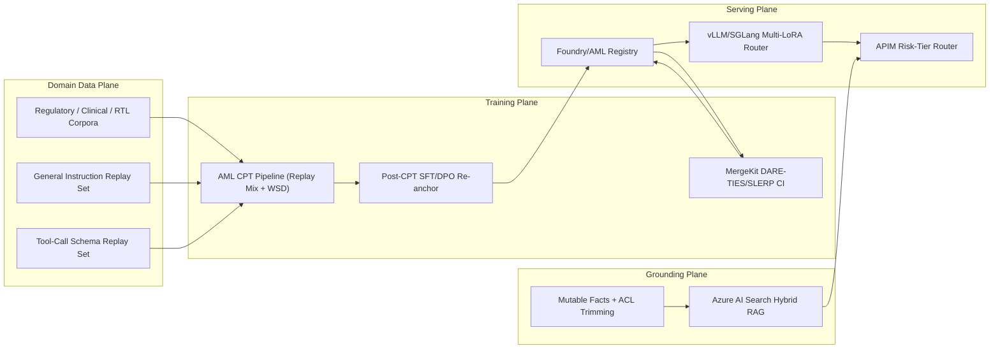
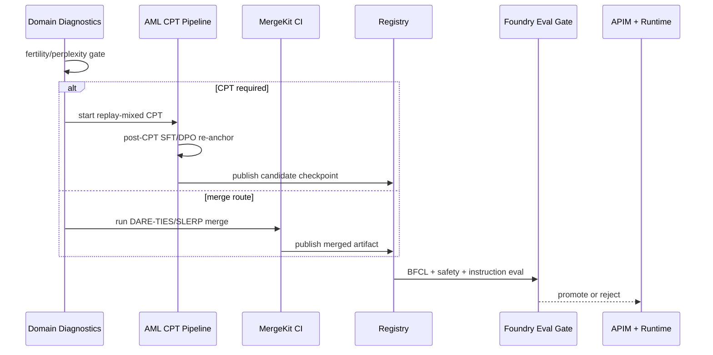

# Enterprise Domain Knowledge Injection and Catastrophic-Forgetting Prevention Selection FAQ: AML Replay-CPT vs MergeKit DARE-TIES Merging vs vLLM Multi-LoRA vs Foundry SFT + RAG

> 🌐 **Language Switch**: [中文](./domain-continual-pretraining-catastrophic-forgetting-aml-replay-cpt-vs-mergekit-ties-dare-vs-multilora-rag-selection-faq.md) | **English (current)**
> **Audience**: Cloud & AI Solution Architects, AI platform leads, enterprise CoE teams, MLOps/LLMOps engineering, security and compliance governance owners.
> **Scope**: End-to-end architecture and operating model for enterprise domain adaptation and catastrophic-forgetting prevention, covering replay-buffered CPT, weight-space merging, runtime Multi-LoRA composition, and SFT+RAG split design with cost, latency, throughput, and risk controls.

## 1. Why naïve domain tuning and raw continued pre-training fail enterprise agent gates
Enterprises often observe a predictable failure pattern when they push `1B–50B` domain tokens into direct adaptation pipelines without replay and alignment re-anchoring: domain terminology improves quickly, but JSON tool-calling conformance, safety refusal boundaries, and instruction-following consistency degrade at the same time.
In production gates this degradation appears as a silent quality debt rather than an immediate training-loss signal, because optimization curves can continue improving while downstream policy and schema behavior deteriorate.
Across internal benchmark suites and common enterprise evaluation stacks, teams frequently report `20–35%` regressions on tool-call schema validity, multi-turn policy adherence, and refusal robustness when replay discipline is missing or under-provisioned.
Another systemic mistake is attempting to encode rapidly changing factual knowledge into model weights through repeated CPT cycles, which can consume `$100K+` compute per cycle while delivering poorer freshness than retrieval-backed grounding.
The architecture question is therefore not “can we train” but “what should be parametric, what should remain retrieval-native, and how do we prove retained capability after adaptation under auditable gates.”

## 2. Four architecture tracks and enterprise decision boundaries
**Architecture A** applies replay-buffered CPT on Azure ML with explicit replay mix and post-CPT SFT/DPO re-anchoring to preserve base behavior while learning genuinely new distributions.
**Architecture B** uses MergeKit (`TIES`, `DARE-TIES`, `SLERP`) to compose capabilities from existing checkpoints or adapters with minimal incremental training and strong regression gates.
**Architecture C** keeps aligned base weights frozen and routes per-request skill adapters in vLLM/SGLang Multi-LoRA mode to maximize update velocity with bounded blast radius.
**Architecture D** splits stable reasoning style into Foundry SFT while routing mutable domain facts through Azure AI Search hybrid RAG, guarded by tokenizer-fertility and perplexity thresholds before approving CPT.
In mature organizations these tracks are selected per domain lane, not globally, and are often combined under one risk-tiered control plane rather than treated as mutually exclusive alternatives.

## 3. End-to-end reference architecture: parametric layer, adapter layer, retrieval layer

This architecture intentionally separates distribution learning, capability composition, and factual freshness, preventing teams from overusing the most expensive lane for problems that are better solved through retrieval and policy routing.
A single APIM-governed front door can expose consistent enterprise contracts while routing requests to CPT-derived weights, merged checkpoints, Multi-LoRA runtime paths, or RAG-enhanced serving paths based on policy and workload profile.
Governance reliability improves when metadata contracts standardize `model_version`, `adapter_set`, `merge_recipe`, `gate_version`, and `rag_snapshot`, allowing deterministic replay and post-incident traceability.
Operationally, this decomposition enables independent scaling and rollback: model rollback, adapter rollback, and retrieval-index rollback are decoupled and can be executed with different RTO targets.

## 4. Architecture A: replay-buffered CPT with post-CPT alignment restoration
Architecture A is justified when domain token distribution is fundamentally different from the base model priors, such as low-resource languages, highly structured symbolic corpora, or deeply specialized domain syntax not recoverable through prompting and retrieval alone.
The replay mix must be treated as first-class training input rather than a late-stage patch, because replay quality and coverage directly determine whether baseline safety and tool behavior survive adaptation.
A practical baseline is `20%` replay over general-instruction and tool-call corpora, then iterative adjustment based on retention gates rather than static recipe reuse.
Post-CPT SFT/DPO re-anchoring is non-negotiable for enterprise gates; skipping this step commonly yields “domain fluent but policy unsafe” models that fail operational risk standards despite strong offline perplexity improvements.
A delivers the highest adaptation depth but has the highest schedule and cost footprint, so it should be reserved for domains where measurable tokenizer and perplexity diagnostics confirm true distribution mismatch.

## 5. Architecture B: MergeKit DARE-TIES/SLERP composition with regression governance
Architecture B is suited for organizations with multiple existing capability artifacts that must be consolidated quickly, such as domain expertise, tool fidelity, regional compliance behavior, and style controls maintained by different teams.
`DARE-TIES` is useful for reducing destructive interference by pruning or reweighting conflicting parameter contributions, while `SLERP` can offer smoother interpolation behavior in specific model families with compatible geometry.
The major risk is deceptive merge success, where merged weights look functionally viable on superficial prompts but regress under policy-sensitive or schema-constrained workloads.
Therefore, merge pipelines must include mandatory BFCL tool-calling gates, safety refusal retention checks, and long-context consistency suites before promotion to shared registries.
Compared with A, B drastically reduces incremental training spend and cycle time, but quality depends on disciplined recipe provenance, objective gate thresholds, and robust rollback semantics.

## 6. Architecture C: runtime Multi-LoRA isolation on vLLM/SGLang
Architecture C isolates business-unit skills at the adapter layer while preserving a frozen aligned base, enabling frequent updates without repeated base-weight releases.
This model is especially effective for enterprises with `10–50` quarterly skill updates across product lines, where release throughput matters as much as model quality.
The limiting factor is adapter residency and HBM slot economics: excessive rank or adapter cardinality can materially affect throughput, scheduler fairness, and first-token latency.
To avoid drift and accidental behavior expansion, adapter sets should be managed through signed manifests, allowlists, and strict incompatibility contracts, with per-request routing keyed by policy headers at APIM ingress.
C offers high organizational agility with bounded risk, provided teams treat adapter governance as a platform discipline rather than an ad hoc runtime convenience.

## 7. Architecture D: Foundry SFT + hybrid RAG split for mutable-fact domains
Architecture D explicitly divides stable reasoning format and interaction style from mutable factual knowledge, reducing costly retraining loops when domain facts change frequently.
When tokenizer fertility and perplexity diagnostics remain below CPT-trigger thresholds, RAG+SFT can usually outperform CPT on freshness while preserving stronger cost and deployment cadence economics.
D requires mature retrieval governance, including ACL trimming, citation integrity, ingestion freshness controls, and replayable index snapshots for audit.
In regulated sectors, D is often the default production lane because it balances explainability, rollback speed, and policy retention while avoiding unnecessary deep parameter rewrites.
A formal “CPT admission gate” should be mandatory so that teams must prove D/C insufficiency before entering high-cost pre-training cycles.

## 8. Twelve-dimension head-to-head matrix
| Dimension | A: Replay-CPT | B: MergeKit merge | C: Multi-LoRA runtime | D: SFT + RAG split |
|---|---|---|---|---|
| New-distribution learning depth | Very high | Medium | Medium | Medium |
| Catastrophic-forgetting risk | Medium (controllable) | Medium to high | Low | Low |
| Tool-calling retention potential | Medium to high | Medium | High | High |
| Safety refusal retention potential | Medium to high | Medium | High | High |
| Update cycle velocity | Low | High | Very high | High |
| Incremental change cost | High | Low to medium | Low to medium | Low |
| Platform complexity | High | Medium | Medium to high | Medium |
| Serving throughput impact | Low | Low | Medium (slot dependent) | Low to medium |
| Audit traceability | High | Medium | High | High |
| Mutable-fact responsiveness | Low | Low | Medium | Very high |
| Multi-BU parallel scaling | Medium | Medium | Very high | High |
| Recommended lifecycle position | Deep distribution migration | Fast capability composition | Steady skill iteration | Mutable-knowledge steady state |

## 9. Quantitative decision formulas and capacity math
Tokenizer fertility can be defined as `F = tokens / words`; persistent `F > 2.2` in target corpora is a strong indicator that baseline tokenization and lexical priors may be insufficient for reliable adaptation through SFT and retrieval alone.
Domain adaptation cost sizing for CPT can use `GPU_hours = 6 * N_params * D_tokens / (GPU_FLOPS * MFU)` and should include replay overhead by scaling `D_tokens` with a replay multiplier such as `1.2` for a `20%` replay mix.
For example, if `N_params=13B`, `D_tokens=8B`, and effective `MFU=0.42`, the resulting GPU-hour estimate can be directly compared against expected business gain and against D-lane alternatives.
Merge interference can be tracked using a practical ratio such as `Interference = Δtask_fail_rate / merge_density`, then tuned by adjusting density and drop-rate in DARE-TIES recipes.
Multi-LoRA capacity can be approximated with `HBM_need = Σ(adapter_rank_i * hidden_dim * layer_count * precision_factor)`, which should be validated against throughput and latency SLOs under realistic concurrency.
Retention gate quality should be measured as `Retention = score_post / score_pre` per critical dimension rather than aggregate score alone, because safety, tool calling, and instruction adherence degrade differently under adaptation pressure.
A robust decision policy should trigger CPT only when diagnostic thresholds and business KPIs jointly justify it, and when projected ROI outperforms retrieval-first alternatives over the target lifecycle horizon.

## 10. Decision sequence from diagnostics to release gates

This sequence enforces an evidence-first pathway and prevents expensive training from being initiated based on intuition or urgency alone.
CPT and merge tracks can run in parallel as experiments, but promotion must remain gate-consistent so outputs are comparable under the same operational constraints.
Release gates should produce immutable evidence bundles including metrics, recipe references, data snapshots, and rollback pointers, not just a pass/fail verdict.
At runtime, APIM policy routing should keep the blast radius small by enabling deterministic fallback to previously approved artifacts when gate-adjacent anomalies are detected.

## 11. Production YAML and Python examples for replay-CPT and merge-gate automation
```yaml
$schema: https://azuremlschemas.azureedge.net/latest/commandJob.schema.json
code: .
command: >-
  python train_cpt.py
  --base_model meta-llama/Llama-3-8b
  --domain_data data/domain.arrow
  --replay_data data/replay.arrow
  --replay_ratio 0.20
  --schedule wsd
  --warmup_steps 800
  --stable_steps 6400
  --decay_steps 3200
  --global_batch_size 2048
  --seq_len 4096
  --output_dir outputs/cpt_candidate
environment: azureml://registries/azureml/environments/pytorch-2.2-cuda12/labels/latest
compute: azureml:nd96isr-h100v5
resources:
  instance_count: 8
inputs:
  domain_data:
    type: uri_file
    path: azureml://datastores/workspaceblobstore/paths/domain/domain.arrow
  replay_data:
    type: uri_file
    path: azureml://datastores/workspaceblobstore/paths/replay/replay.arrow
outputs:
  model_artifact:
    type: uri_folder
    path: azureml://datastores/workspaceblobstore/paths/models/cpt_candidate
```
```python
from __future__ import annotations

import json
import subprocess
from dataclasses import dataclass
from pathlib import Path


@dataclass
class GateResult:
    bfcl_retention: float
    safety_retention: float
    instruction_retention: float
    passed: bool


def run_merge(recipe_path: Path, output_dir: Path) -> None:
    subprocess.run(
        ["mergekit-yaml", str(recipe_path), str(output_dir), "--cuda"],
        check=True,
    )


def run_gate(metrics_path: Path, min_retention: float = 0.985) -> GateResult:
    m = json.loads(metrics_path.read_text(encoding="utf-8"))
    bfcl = m["bfcl_post"] / m["bfcl_pre"]
    safety = m["safety_post"] / m["safety_pre"]
    instr = m["instruction_post"] / m["instruction_pre"]
    passed = min(bfcl, safety, instr) >= min_retention
    return GateResult(bfcl, safety, instr, passed)
```
These examples make replay mix, schedule, and gate criteria explicit, enabling controlled experimentation without losing reproducibility.
Promotion should never rely on one-dimensional aggregate metrics because retention failures often hide in specific domains like schema strictness or refusal boundaries.
Pipeline outputs should include immutable run manifests so that every production artifact can be traced to exact data and recipe decisions.
A promotion contract should require both technical and risk sign-off in regulated environments, especially when adaptation affects policy-sensitive behaviors.

## 12. Enterprise scenarios and three-year TCO
### Scenario A: Fortune 500 core-banking incident and modernization copilot (`80M` LOC Java/PL-SQL + policy corpus)
This domain combines highly specialized syntax with strict operational controls, making A attractive for deep distribution adaptation while requiring aggressive replay discipline and post-CPT alignment restoration.
B can accelerate interim releases by composing incident-response and compliance capabilities, but production promotion still depends on retention gates that protect schema and refusal guarantees.

### Scenario B: Platform engineering migration copilot across `1,200` microservices
This domain favors C and D combinations: runtime adapters preserve team-specific behavior while RAG keeps API and architecture facts current without repeated full training cycles.
A should be reserved for narrow subdomains where diagnostics prove systemic tokenizer and perplexity mismatch rather than day-to-day fact churn.

### Three-year TCO table (example, USD)
| Item | A: Replay-CPT | B: MergeKit | C: Multi-LoRA | D: SFT+RAG |
|---|---:|---:|---:|---:|
| Year-0 build cost | 760,000 | 280,000 | 360,000 | 320,000 |
| Year-1 run cost | 520,000 | 210,000 | 250,000 | 230,000 |
| Year-2 run cost | 500,000 | 205,000 | 245,000 | 220,000 |
| Year-3 run cost | 490,000 | 200,000 | 240,000 | 215,000 |
| Three-year total cost | 2,270,000 | 895,000 | 1,095,000 | 985,000 |
| Three-year value estimate | 3,580,000 | 2,140,000 | 2,520,000 | 2,760,000 |
| Three-year net value | 1,310,000 | 1,245,000 | 1,425,000 | 1,775,000 |
| Best-fit lifecycle stage | Deep domain migration | Rapid composition | Multi-BU steady iteration | Mutable-fact steady state |

## 13. Day-0 and Day-2 checklists
### 13.1 Day-0 readiness checklist
1. Complete fertility and perplexity diagnostics and record formal CPT admission decisions.
2. Version replay datasets and enforce immutable snapshot references in training manifests.
3. Define separate retention thresholds for BFCL, safety refusal behavior, and instruction adherence.
4. Standardize artifact naming for base, adapter/merge recipe, and gate version identifiers.
5. Validate one-click rollback to last stable artifact across serving and routing planes.
6. Separate training and serving budget envelopes to avoid hidden capacity contention.

### 13.2 Day-2 operations checklist
1. Review weekly retention drift against business KPI movement, not model metrics in isolation.
2. Audit replay coverage monthly to prevent baseline drift from stale control datasets.
3. Rebalance Multi-LoRA slot packing as adapter cardinality and traffic patterns evolve.
4. Evaluate merge-interference trends quarterly and adjust merge density/drop-rate policies.
5. Prioritize RAG freshness optimization for high-churn facts before approving new CPT runs.
6. Maintain compliance evidence chains with reproducible gate outcomes and rollback anchors.

## 14. Worked quantitative Q&A with formulas and explicit numbers
**Q1: When is CPT admission justified?** If `F > 2.2` and domain perplexity gap remains above target despite RAG+SFT controls, and if critical KPI retention cannot be recovered by C/D paths, CPT admission is justified.
**Q2: How should replay ratio be tuned?** Start at `20%` replay and increase to `25–30%` only if retention gates fail, because each increase raises training cost and cycle time.
**Q3: How is merge interference measured?** Track changes in BFCL and safety fail rates before and after merge; rising `Δfail` per merge density indicates conflict-heavy composition and recipe adjustment need.
**Q4: How is Multi-LoRA capacity estimated?** Compute per-adapter HBM footprint and multiply by expected concurrent adapter residency; validate against throughput and P95 latency under peak traffic.
**Q5: When does D outperform A economically?** In high-change factual domains, D commonly achieves superior freshness at roughly `1/20` the retraining spend compared with repeated full CPT cycles.
**Q6: What is a practical promotion gate threshold?** A conservative baseline is `min(Retention_BFCL, Retention_Safety, Retention_Instr) >= 0.985` with no regression in top business-critical scenarios.

## 15. Fit boundaries, audit dictionaries, source references, and scale-governance guidance
### 15.1 Good fit vs Not for
This architecture family is a strong fit for enterprises that need simultaneous improvements in domain quality, policy retention, and governance explainability across multiple business units.
It is not a fit for teams seeking one universal lane for all adaptation problems, because mutable-fact workloads and true distribution-mismatch workloads require fundamentally different economic and technical controls.

### 15.2 Audit field dictionary (example)
| Field | Source | Governance purpose | Minimum retention |
|---|---|---|---|
| `model_base` | Registry | Base lineage traceability | 5 years |
| `replay_ratio` | AML | Forgetting-risk control evidence | 5 years |
| `schedule_type` | AML | Training strategy comparability | 3 years |
| `tokenizer_fertility` | Eval | CPT admission justification | 3 years |
| `ppl_gap` | Eval | Distribution mismatch evidence | 3 years |
| `merge_recipe_id` | Merge CI | Composition provenance | 5 years |
| `merge_density` | Merge CI | Interference analysis | 3 years |
| `adapter_set` | Runtime | Adapter governance trace | 3 years |
| `bfcl_retention` | Eval Gate | Tool-calling retention evidence | 5 years |
| `safety_retention` | Eval Gate | Refusal-boundary retention evidence | 5 years |
| `instruction_retention` | Eval Gate | Prompt-policy retention evidence | 5 years |
| `promotion_decision` | Release | Change control and audit proof | 7 years |
| `rollback_anchor` | Release | Controlled fallback integrity | 7 years |
| `rag_snapshot` | Search | Factual grounding traceability | 3 years |
| `cost_center` | FinOps | Cost attribution and chargeback | 5 years |
| `gpu_hours` | Training | Budget accountability | 5 years |
| `throughput_qps` | Serving | Capacity trend governance | 2 years |
| `p95_latency_ms` | Serving | SLA compliance monitoring | 2 years |
| `incident_ticket` | Ops | Failure correlation | 5 years |
| `policy_version` | Governance | Policy trace and rollback | 5 years |

### 15.3 Runtime alert dictionary (example)
| Alert key | Trigger condition | Immediate action | Owner |
|---|---|---|---|
| `retention_drop_bfcl` | BFCL retention below floor | Block promotion and rollback | Model Platform |
| `retention_drop_safety` | Safety retention degrades | Escalate risk review | Security |
| `merge_interference_spike` | Merge conflict metric spikes | Reduce merge density | Merge Team |
| `lora_slot_saturation` | HBM slot pressure exceeds SLO | Re-pack adapters or scale out | Inference |
| `fertility_gate_breach` | Fertility above CPT threshold | Trigger architecture review | SA Team |
| `rag_staleness_high` | Freshness KPI degrades | Prioritize retrieval pipeline tuning | Knowledge Platform |
| `gpu_cost_regress` | Cost per training hour regresses | Freeze new CPT jobs | FinOps |
| `latency_tail_regress` | P95/P99 latency breaches | Rebalance routing and concurrency | SRE |
| `adapter_mismatch` | Adapter manifest drift | Force manifest reconciliation | Runtime Platform |
| `gate_data_drift` | Gate dataset distribution shifts | Re-sample and recalibrate | Evaluation |
| `rollback_failure` | Rollback workflow fails | Activate emergency playbook | Release Engineering |
| `policy_conflict` | Governance policy mismatch | Require manual arbitration | Governance |
| `audit_hash_mismatch` | Evidence hash mismatch | Freeze promotion pipeline | Compliance |
| `quota_exhaustion` | Training quota exhausted | Re-plan capacity windows | Resource Mgmt |
| `tool_schema_regress` | Tool schema pass-rate drops | Increase tool-call replay proportion | Platform |

### 15.4 Source and release-note references (captured 2026-11-14)
1. Azure API Management AI Gateway overview: `https://learn.microsoft.com/en-us/azure/api-management/ai-gateway-overview`
2. Azure API Management changelog: `https://github.com/Azure/API-Management/blob/main/changelogs/api-management-service.md`
3. Azure Container Apps sessions: `https://learn.microsoft.com/en-us/azure/container-apps/sessions`
4. ACA Dynamic Sessions GA announcement: `https://techcommunity.microsoft.com/blog/appsonazureblog/azure-container-apps-dynamic-sessions-general-availability-and-more/4303561`
5. Firecracker releases: `https://github.com/firecracker-microvm/firecracker/releases`
6. Kata Containers releases: `https://github.com/kata-containers/kata-containers/releases`
7. Wasmtime releases: `https://github.com/bytecodealliance/wasmtime/releases`
8. E2B releases: `https://github.com/e2b-dev/e2b/releases`
9. Azure Machine Learning documentation: `https://learn.microsoft.com/en-us/azure/machine-learning/`
10. Azure AI Foundry documentation: `https://learn.microsoft.com/en-us/azure/ai-foundry/`
11. Azure AI Search documentation: `https://learn.microsoft.com/en-us/azure/search/`
12. vLLM project: `https://github.com/vllm-project/vllm`
13. SGLang project: `https://github.com/sgl-project/sglang`
14. MergeKit project: `https://github.com/arcee-ai/mergekit`
15. BigCodeBench and BFCL benchmark references for tool-calling retention governance: `https://github.com/bigcode-project` and `https://github.com/ShishirPatil/gorilla`

### 15.5 Scale-governance guidance for enterprise operating models
Large organizations should treat adaptation governance as a cross-functional operating system rather than a model-team-only activity, because retention quality, compliance resilience, and cost trajectory are jointly determined by platform, security, finance, and domain ownership decisions.
Weekly governance forums should review retention curves, wake-up economics, and policy exceptions together, preventing siloed optimization where one team improves technical metrics while another absorbs hidden business risk.
Configuration values such as replay ratio, merge density, adapter residency limits, and gate thresholds should be change-controlled assets with explicit approvals, rollback criteria, and reproducible evidence attachments.
Release phases should be staged as replay simulation, constrained tenant canary, and full promotion, with objective stop conditions at each stage to avoid implicit risk acceptance during high-pressure delivery windows.
For regulated domains, every promotion and suppression decision should be reproducible without full data exposure, using hash-linked evidence bundles and deterministic gate manifests to satisfy internal and external audit requirements.
Cross-region deployments should maintain region-affinity metadata and deterministic conflict resolution to prevent duplicate wake-ups or inconsistent policy behavior across active-active clusters.
Cost governance should focus on effective value per valid wake-up instead of aggregate spend alone, because aggregate metrics hide policy inefficiencies in specific domain lanes.
As workload diversity increases, teams should continuously rebalance the A/B/C/D mix by observed value density and risk class, ensuring high-cost adaptation paths remain reserved for scenarios where diagnostics and business outcomes clearly justify them.
Enterprises should maintain strict separation between mutable facts and stable reasoning style wherever feasible, because this separation preserves agility and minimizes retraining lock-in across quarterly roadmap shifts.
A mature end state is reached when three conditions are simultaneously true: capability retention is provable, factual freshness is provable, and cost efficiency is provable under the same governance evidence chain.
