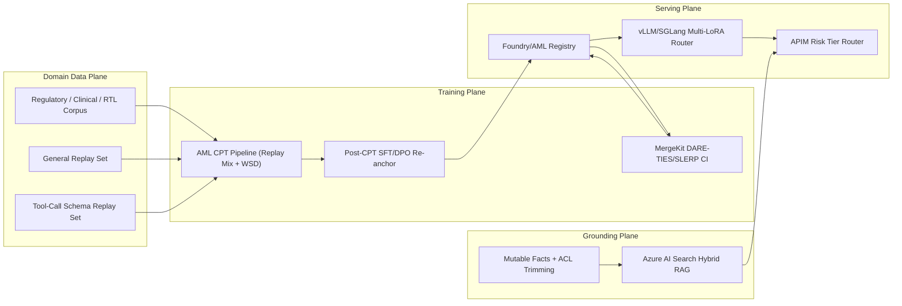
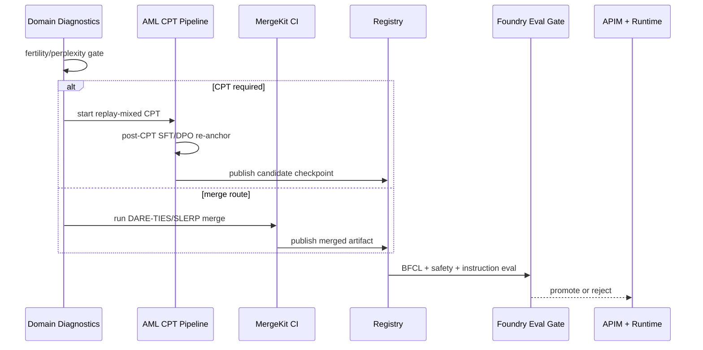

# 企业领域知识注入与灾难性遗忘防护选型 FAQ：AML Replay-CPT vs MergeKit DARE-TIES 合并 vs vLLM Multi-LoRA vs Foundry SFT + RAG

> 🌐 **Language Switch**: **中文（当前）** | [English](./domain-continual-pretraining-catastrophic-forgetting-aml-replay-cpt-vs-mergekit-ties-dare-vs-multilora-rag-selection-faq.en.md)
> **适用对象**：Cloud & AI Solution Architect、模型平台负责人、企业 AI CoE、MLOps/LLMOps 团队、合规与风险治理团队。
> **讨论范围**：围绕领域持续适配与灾难性遗忘防护，比较 Replay-Buffered CPT、权重空间合并、运行时 Multi-LoRA 以及 SFT+RAG 混合路径，覆盖准确率、工具调用保持率、安全拒答保持率、GPU/TCO 与运维复杂度。

## 1. 为什么朴素领域微调与裸 CPT 在企业门禁中经常失败
企业把 `1B–50B` token 的专有语料直接用于全量持续预训练时，常见结果是模型快速吸收领域词汇，却同时损伤基础能力，表现为 JSON 工具调用结构漂移、指令约束执行率下降和安全拒答边界变松。
从评测视角看，若没有 replay 缓冲与后续对齐重锚，`BFCL` 工具调用、多轮指令跟随与安全基准常出现 `20–35%` 回落，这类回落通常不会在训练损失上即时显现，却会在生产回归中集中爆发。
另一个典型误区是把“变化很快的事实知识”当成参数记忆任务处理，导致每周都触发昂贵 CPT 周期，最终把本应由 RAG 解决的时效问题转化为 `$100K+` 级别的 GPU 成本。
因此企业架构重点不应是“能否训练”，而是“哪些知识值得写入参数、哪些知识应留在检索层、以及如何证明适配后基础能力与安全边界仍被保留”。

## 2. 四类架构路径与企业分层决策逻辑
**Architecture A**：在 Azure ML 做 Replay-Buffered CPT，加入 `20%` 通用/指令/工具调用回放并在后续执行 SFT/DPO 重锚，目标是在学习新分布的同时控制遗忘。
**Architecture B**：通过 MergeKit 的 `TIES/DARE-TIES/SLERP` 做权重或适配器合并，以低训练成本组合已有能力，并依赖严格回归门禁避免能力互相干扰。
**Architecture C**：保持基座权重冻结，在 vLLM/SGLang 运行时按请求挂载 Multi-LoRA，实现多 BU 技能并存且零基座漂移。
**Architecture D**：用 Foundry SFT 固化格式与推理风格，用 AI Search Hybrid RAG 承担高频变化事实，并以 tokenizer fertility/perplexity gate 阻断不必要 CPT。
在大多数企业中，这四条路径并非互斥，而是按“知识稳定性、领域新颖度、更新频率、风险等级”组合使用。

## 3. 端到端参考架构：参数层、适配层与检索层的分工

该架构把“学新语法/新分布”的任务放在参数层，把“拼装能力”的任务放在合并层，把“追求事实新鲜度”的任务放在检索层，从而避免所有问题都被拉到最昂贵的训练路径。
在治理实践上，参数层、适配层和检索层分别有不同门禁指标：参数层看保持率，适配层看干扰率，检索层看事实时效与引用可追溯性。
统一 APIM 风险分层路由可把不同服务路径透明化给上层 Agent 编排，业务方获得一致入口而不必关心底层是 CPT、Merge、LoRA 还是 RAG。
建议在元数据中统一记录 `model_version`、`adapter_set`、`merge_recipe`、`rag_snapshot`，保证任何一次线上行为都能回溯到训练与检索证据。

## 4. Architecture A：Replay-Buffered CPT + 对齐重锚
A 的适用前提是领域 token 分布与基础模型差异显著，例如低资源语种、专有术语密集语料、符号结构强约束代码域，且规模通常达到 `>=5B` token。
工程要点是把 replay 当作一等输入，而非事后补救：`20%` 回放混合可显著缓解遗忘，同时 WSD（Warmup-Stable-Decay）比单一余弦衰减更容易稳定长程训练。
完成 CPT 后必须立即执行面向工具调用与安全拒答的 SFT/DPO 重锚，否则“语言会了、边界丢了”的风险依然存在。
A 的成本和周期最高，但在“确实需要改变底层词法与分布建模能力”的场景中，它仍是不可替代路径。

## 5. Architecture B：MergeKit DARE-TIES/SLERP 低成本组合
B 适合已有多个成熟 checkpoint 或 LoRA，需要快速组合“领域能力 + 工具能力 + 区域合规能力”的组织。
`DARE-TIES` 的核心收益是对冲冲突权重，降低简单平均导致的任务互相抵消；`SLERP` 在部分模型族上可提供更平滑插值，但并非总是优于稀疏化合并。
关键风险在于“合并后看似能跑但边界错位”，因此必须把 BFCL、安全拒答、长上下文一致性放进合并流水线门禁。
相较 A，B 的训练成本显著更低，但可解释性与可控性依赖严格 recipe 管理和自动回归。

## 6. Architecture C：vLLM/SGLang Multi-LoRA 运行时组合
C 通过冻结基座并按请求挂载 LoRA，实现 BU 级技能隔离，避免每次业务更新都触发基座变更。
当组织每季度有 `10–50` 个技能更新请求时，C 往往能在变更速度与风险之间取得最佳平衡，因为它把变更半径限制在适配器层。
HBM 槽位和并发命中率是关键瓶颈，若适配器过多且 rank 过高，会在吞吐和首 token 延迟上引入显著惩罚，需要策略化装箱。
在治理上，C 需禁用不必要的扩词路径并实施 adapter 白名单，确保运行时组合不突破预期能力边界。

## 7. Architecture D：Foundry SFT + RAG 的参数-检索分拆
D 的思路是把稳定任务格式、推理风格与输出约束交给 SFT，把高频变化事实交给 RAG，避免每次知识更新都通过训练传播。
当 tokenizer fertility 未超过门槛、perplexity gap 可被检索补偿时，D 通常以远低于 CPT 的成本达到更高事实新鲜度。
该路径对知识工程与检索治理要求更高，但在监管、财务、运维这类事实变化频繁领域，整体 ROI 往往更优。
实践中应设置“CPT 禁入门槛”，只有当 RAG+SFT 无法满足目标保持率与精度时才升级到 A。

## 8. 12 维度对比矩阵
| 维度 | A：Replay-CPT | B：MergeKit 合并 | C：Multi-LoRA | D：SFT+RAG |
|---|---|---|---|---|
| 新分布学习能力 | 很高 | 中 | 中 | 中 |
| 灾难性遗忘风险 | 中（可控） | 中到高 | 低 | 低 |
| 工具调用保持率 | 中到高 | 中 | 高 | 高 |
| 安全拒答保持率 | 中到高 | 中 | 高 | 高 |
| 更新周期速度 | 低 | 高 | 很高 | 高 |
| 单次变更成本 | 高 | 低到中 | 低到中 | 低 |
| 运维复杂度 | 高 | 中 | 中到高 | 中 |
| 推理吞吐影响 | 低 | 低 | 中（槽位影响） | 低到中 |
| 可审计性 | 高 | 中 | 高 | 高 |
| 对数据新鲜度响应 | 低 | 低 | 中 | 很高 |
| 适配多 BU 并行 | 中 | 中 | 很高 | 高 |
| 推荐阶段 | 深度领域迁移 | 快速能力拼装 | 持续技能迭代 | 事实高变企业域 |

## 9. 定量诊断与容量公式
Tokenizer Fertility 可定义为 `F = tokens / words`，当 `F > 2.2` 且领域 perplexity gap 长期高于阈值时，说明基础 tokenizer/分布匹配不足，CPT 优先级上升。
CPT GPU 小时可用 `GPU_hours = 6 * N_params * D_tokens / (GPU_FLOPS * MFU)` 估算，若加入 `20%` replay，`D_tokens` 乘 `1.2`。
若 `N_params=13B`、`D_tokens=8B`、`MFU=0.42`，在 `ND96isr_H100_v5` 的有效吞吐下可粗估训练周期与预算区间，用于与 D 路径做 ROI 比较。
Merge 干扰风险可建模为 `Interference = Δtask_fail_rate / merge_density`，在提高稀疏强度时需监控任务保持率拐点。
Multi-LoRA 槽位估算可写为 `HBM_need = Σ(adapter_rank_i * hidden_dim * layer_count * precision_factor)`，用于确定单实例可承载适配器数量。
保留率门禁建议定义为 `Retention = score_post / score_pre`，并在 BFCL、安全拒答、长上下文三类任务上分别设阈值而非单一总体分数。
当 `RAG_freshness_gain / CPT_cost_ratio` 显著更优时，应强制走 D 路径，避免把检索问题错误升级为训练问题。

## 10. 时序图：从诊断到训练/合并/上线门禁

该时序强调“先诊断后决策”，避免团队先投入大规模训练再补做可行性判断。
对于同一业务域，CPT 与 Merge 也可以并行探索，但最终晋级必须走同一评测门禁以保证可比性。
发布门禁应输出可审计结果包，包括指标、配方版本、数据快照标识和回滚锚点。
在运营侧，Serve 层应保留快速回退能力，确保门禁外问题能在分钟级止损。

## 11. 生产示例：AML Replay-CPT 训练配置与 MergeKit 门禁流水线
```yaml
$schema: https://azuremlschemas.azureedge.net/latest/commandJob.schema.json
code: .
command: >-
  python train_cpt.py
  --base_model meta-llama/Llama-3-8b
  --domain_data data/domain.arrow
  --replay_data data/replay.arrow
  --replay_ratio 0.20
  --schedule wsd
  --warmup_steps 800
  --stable_steps 6400
  --decay_steps 3200
  --global_batch_size 2048
  --seq_len 4096
  --output_dir outputs/cpt_candidate
environment: azureml://registries/azureml/environments/pytorch-2.2-cuda12/labels/latest
compute: azureml:nd96isr-h100v5
resources:
  instance_count: 8
inputs:
  domain_data:
    type: uri_file
    path: azureml://datastores/workspaceblobstore/paths/domain/domain.arrow
  replay_data:
    type: uri_file
    path: azureml://datastores/workspaceblobstore/paths/replay/replay.arrow
outputs:
  model_artifact:
    type: uri_folder
    path: azureml://datastores/workspaceblobstore/paths/models/cpt_candidate
```
```python
from __future__ import annotations

import json
import subprocess
from dataclasses import dataclass
from pathlib import Path


@dataclass
class GateResult:
    bfcl_retention: float
    safety_retention: float
    instruction_retention: float
    passed: bool


def run_merge(recipe_path: Path, output_dir: Path) -> None:
    subprocess.run(
        ["mergekit-yaml", str(recipe_path), str(output_dir), "--cuda"],
        check=True,
    )


def run_gate(metrics_path: Path, min_retention: float = 0.985) -> GateResult:
    m = json.loads(metrics_path.read_text(encoding="utf-8"))
    bfcl = m["bfcl_post"] / m["bfcl_pre"]
    safety = m["safety_post"] / m["safety_pre"]
    instr = m["instruction_post"] / m["instruction_pre"]
    passed = min(bfcl, safety, instr) >= min_retention
    return GateResult(bfcl, safety, instr, passed)
```
上述配置将 replay 比例、训练日程和资源规模显式参数化，便于对比不同策略的遗忘与成本。
MergeKit 流水线通过门禁结果决定晋级，避免“合并成功即上线”的风险路径。
建议把门禁阈值与业务风险级别绑定，高风险域采用更严格保持率下限。
训练与合并产物都应回写同一 Registry 与证据仓，统一审计链路。

## 12. 企业场景与三年 TCO 对比
### 场景 A：半导体 EDA/RTL 辅助研发 Copilot
该场景术语与语法分布与通用语料差异巨大，且对格式精确性要求极高，A 路径常作为主路径，但必须配合严格 replay 与后对齐。
若仅做 SFT 或纯 RAG，容易出现语法局部正确但全局结构不稳定的问题，影响下游工具链自动执行。

### 场景 B：医疗合规文档与低资源语种客服 Copilot
该场景事实更新频繁且合规边界敏感，D 路径通常更优：参数层固化风格与安全，事实层由 RAG 持续更新。
多业务单元并行时，可叠加 C 路径实现适配器隔离，减少主模型发布频率。

### 三年 TCO（示例，单位 USD）
| 项目 | A：Replay-CPT | B：MergeKit | C：Multi-LoRA | D：SFT+RAG |
|---|---:|---:|---:|---:|
| Year-0 建设成本 | 760,000 | 280,000 | 360,000 | 320,000 |
| Year-1 运维成本 | 520,000 | 210,000 | 250,000 | 230,000 |
| Year-2 运维成本 | 500,000 | 205,000 | 245,000 | 220,000 |
| Year-3 运维成本 | 490,000 | 200,000 | 240,000 | 215,000 |
| 三年总成本 | 2,270,000 | 895,000 | 1,095,000 | 985,000 |
| 三年收益估算 | 3,580,000 | 2,140,000 | 2,520,000 | 2,760,000 |
| 三年净收益 | 1,310,000 | 1,245,000 | 1,425,000 | 1,775,000 |
| 推荐落地阶段 | 深域迁移阶段 | 快速拼装阶段 | 多 BU 稳态迭代 | 事实高变稳态 |

## 13. Day-0 / Day-2 上线与运维清单
### 13.1 Day-0 清单
1. 完成 fertility/perplexity 诊断并形成“是否允许 CPT”判定记录。
2. 固化 replay 数据集来源与版本，确保可复现实验。
3. 定义 BFCL、安全拒答、指令跟随三类保持率门槛。
4. 建立模型产物命名规范：`base + adapter/merge + gate_version`。
5. 配置一键回滚到上一个稳定 checkpoint 的自动流程。
6. 为训练与推理建立分离预算，避免互相挤占。

### 13.2 Day-2 清单
1. 周度复盘保持率与业务 KPI 的一致性，防止“指标好看但业务退化”。
2. 月度审查 replay 集覆盖度，防止基线陈旧。
3. 对 Multi-LoRA 槽位使用率与延迟曲线做容量重平衡。
4. 按季度评估 Merge 配方与冲突率趋势。
5. 在事实更新高峰期优先优化 RAG，而非默认触发 CPT。
6. 持续维护审计证据链，满足合规取证要求。

## 14. 六个定量问答（含公式与数值）
**Q1：何时必须优先 CPT？** 当 `F > 2.2` 且 domain perplexity gap 持续超阈，且 RAG+SFT 在关键任务上无法达标时，应进入 A。
**Q2：Replay 比例如何设定？** 经验起点可为 `20%`，若保持率仍低于门槛可升至 `25–30%`，但需评估训练时长与成本线性上升。
**Q3：Merge 干扰怎么评估？** 观察 `ΔBFCL_fail` 与 `Δsafety_refusal`，若升幅超过设定阈值，说明 merge density/drop-rate 需要回调。
**Q4：Multi-LoRA 容量如何估算？** 先计算每个 adapter 的 HBM 占用，再用并发命中峰值做装箱，确保 P95 延迟不越线。
**Q5：何时 D 比 A 更优？** 当事实变化频率高且风格/结构稳定时，D 常以约 `1/20` 的训练成本获得更好时效收益。
**Q6：如何定义最终晋级条件？** 建议 `min(Retention_BFCL, Retention_Safety, Retention_Instr) >= 0.985` 且业务关键场景通过率不下降。

## 15. 适配边界、审计字段与运行告警
### 15.1 Good fit vs Not for
该架构族适合对领域准确率与治理可解释性同时要求高的企业，尤其是多 BU 并行演进、监管审计严格的组织。
对于知识变化极快且语言分布并未显著偏离基础模型的场景，不建议优先走 A，应先验证 D/C 组合。

### 15.2 审计字段字典（示例）
| 字段 | 来源 | 用途 | 保留期 |
|---|---|---|---|
| `model_base` | Registry | 基座追溯 | 5 年 |
| `replay_ratio` | AML | 遗忘治理审计 | 5 年 |
| `schedule_type` | AML | 训练策略对比 | 3 年 |
| `tokenizer_fertility` | Eval | CPT 准入依据 | 3 年 |
| `ppl_gap` | Eval | 分布差异证据 | 3 年 |
| `merge_recipe_id` | Merge CI | 配方追溯 | 5 年 |
| `merge_density` | Merge CI | 干扰分析 | 3 年 |
| `adapter_set` | Runtime | 适配器组合追踪 | 3 年 |
| `bfcl_retention` | Eval Gate | 工具调用保持率 | 5 年 |
| `safety_retention` | Eval Gate | 安全边界保持率 | 5 年 |
| `instruction_retention` | Eval Gate | 指令保持率 | 5 年 |
| `promotion_decision` | Release | 上线审计 | 7 年 |
| `rollback_anchor` | Release | 回滚证据 | 7 年 |
| `rag_snapshot` | Search | 事实快照追溯 | 3 年 |
| `cost_center` | FinOps | 成本归因 | 5 年 |
| `gpu_hours` | Training | 预算核算 | 5 年 |
| `throughput_qps` | Serving | 容量评估 | 2 年 |
| `p95_latency_ms` | Serving | SLA 监控 | 2 年 |
| `incident_ticket` | Ops | 故障关联 | 5 年 |
| `policy_version` | Governance | 策略追溯 | 5 年 |

### 15.3 告警字典（示例）
| 告警键 | 触发条件 | 立即动作 | 责任团队 |
|---|---|---|---|
| `retention_drop_bfcl` | BFCL 保持率低于阈值 | 阻断发布并回滚 | 模型平台 |
| `retention_drop_safety` | 安全保持率下降 | 进入高风险审批 | 安全团队 |
| `merge_interference_spike` | 合并干扰骤升 | 降低 merge density | Merge 团队 |
| `lora_slot_saturation` | HBM 槽位接近上限 | 扩容或重装箱 | 推理团队 |
| `fertility_gate_breach` | fertility 超阈 | 启动 CPT 评审 | 架构团队 |
| `rag_staleness_high` | 事实时效下降 | 优先优化检索更新 | 知识团队 |
| `gpu_cost_regress` | GPU 小时成本异常 | 暂缓新训练作业 | FinOps |
| `latency_tail_regress` | P95 延迟超阈 | 调整路由/并发 | SRE |
| `adapter_mismatch` | 适配器版本漂移 | 强制刷新清单 | 平台团队 |
| `gate_data_drift` | 门禁样本分布漂移 | 重采样评测集 | 评测团队 |
| `rollback_failure` | 回滚失败 | 启动应急剧本 | 发布团队 |
| `policy_conflict` | 治理策略冲突 | 升级人工仲裁 | 治理团队 |
| `audit_hash_mismatch` | 证据哈希不一致 | 冻结发布 | 合规团队 |
| `quota_exhaustion` | 训练配额耗尽 | 触发排期切换 | 资源团队 |
| `tool_schema_regress` | 工具 schema 失败率升高 | 加强 replay 工具样本 | 平台团队 |

### 15.4 演进建议（从试点到规模化）
建议先以 D+C 组合覆盖大多数业务单元，建立成本与治理基线，再把 A 用于少数“确需分布迁移”的高价值场景。
Merge 路径适合在版本迭代频繁阶段快速试错，但必须维持统一门禁与一键回滚，否则规模化后会出现能力碎片化。
随着组织成熟，应把“训练收益”与“检索收益”做统一经济性对比，不再由团队偏好决定路线。
最终成功标准是：保持率可证明、事实时效可证明、成本下降可证明，三者缺一不可。

### 15.5 参考来源与抓取日期（2026-11-14）
1. Azure API Management AI Gateway 概览：`https://learn.microsoft.com/en-us/azure/api-management/ai-gateway-overview`
2. APIM 变更日志：`https://github.com/Azure/API-Management/blob/main/changelogs/api-management-service.md`
3. Azure Container Apps Sessions 文档：`https://learn.microsoft.com/en-us/azure/container-apps/sessions`
4. ACA Dynamic Sessions GA 博文：`https://techcommunity.microsoft.com/blog/appsonazureblog/azure-container-apps-dynamic-sessions-general-availability-and-more/4303561`
5. Firecracker Release：`https://github.com/firecracker-microvm/firecracker/releases`
6. Kata Containers Release：`https://github.com/kata-containers/kata-containers/releases`
7. Wasmtime Release：`https://github.com/bytecodealliance/wasmtime/releases`
8. E2B Release：`https://github.com/e2b-dev/e2b/releases`
9. Azure Machine Learning 文档：`https://learn.microsoft.com/en-us/azure/machine-learning/`
10. Azure AI Foundry 文档：`https://learn.microsoft.com/en-us/azure/ai-foundry/`
11. Azure AI Search 文档：`https://learn.microsoft.com/en-us/azure/search/`
12. vLLM 项目：`https://github.com/vllm-project/vllm`
13. SGLang 项目：`https://github.com/sgl-project/sglang`
14. MergeKit 项目：`https://github.com/arcee-ai/mergekit`
15. Tool-calling 保持率相关基准项目：`https://github.com/ShishirPatil/gorilla`

### 15.6 规模化治理补充：组织机制、变更纪律与成本闭环
在大型企业里，领域持续适配不是模型团队单点工作，而是平台、安全、合规、FinOps 与业务架构共同负责的联合系统，任何一方缺位都会把“局部最优”放大成“全局失衡”。
建议建立周度治理例会，把保留率、业务 KPI、推理成本和上线事件并排评审，避免只看训练指标导致“离线分数升高但线上质量回落”的常见错觉。
对于 replay 比例、merge 稀疏度、LoRA 槽位上限、门禁阈值这四类关键参数，应纳入受控配置管理，任何变更都必须绑定回归证据、风险评估和回滚预案。
发布流程建议固定为“离线回放验证、灰度租户验证、全量推广”三段式，不把线上真实用户流量当作首轮实验场，从而降低高风险域变更导致的不可逆影响。
在跨区域部署中，应把会话主归属区域、模型版本、适配器集合和检索快照写入统一元数据，确保故障转移后仍能复原同一决策语义，而不是仅保证服务可达。
对于监管场景，建议保存门禁结果的哈希签名与证据链，确保审计可在不访问原始敏感数据的情况下复验“为什么发布”与“为什么拒绝”，同时降低跨部门取证成本。
在成本治理层，应跟踪“每千次有效推理的综合成本”而非仅看总账单，因为总账单无法揭示哪些业务域正在被低价值任务消耗模型配额。
若出现“RAG 新鲜度改善但训练成本持续上升”的背离，通常意味着组织把可检索问题错误升级为参数问题，应通过 CPT 准入门槛立即纠偏。
随着业务扩张，建议按域维护 A/B/C/D 路径命中率，按季度做结构性重平衡，让高成本路径只服务于真正需要深度分布迁移的关键能力。
最终成熟标志应同时满足三项可证明结果：工具与安全保持率稳定、知识新鲜度可追溯、单位业务价值成本持续下降，任何单项达标都不能替代全局达标。
另外建议把“模型质量门禁”与“发布变更门禁”彻底解耦，前者负责判断能力是否可用，后者负责判断风险是否可控，这样可以避免在紧急发布压力下以业务理由绕过质量底线。
对多业务单元组织，建议设立统一的适配器命名与淘汰策略，定期清理长期低命中适配器，避免运行时路由复杂度持续增长并反向拖累核心路径延迟。
当组织进入年度预算评审阶段时，应将 CPT、Merge、Multi-LoRA、RAG 四类路径分别建账，按“单位价值增量”而非“历史投入惯性”分配下阶段资源，防止路径锁定。
