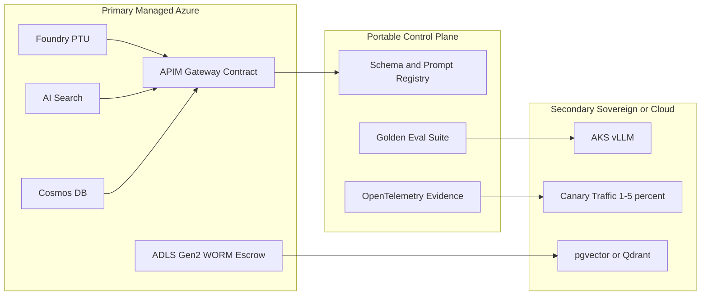
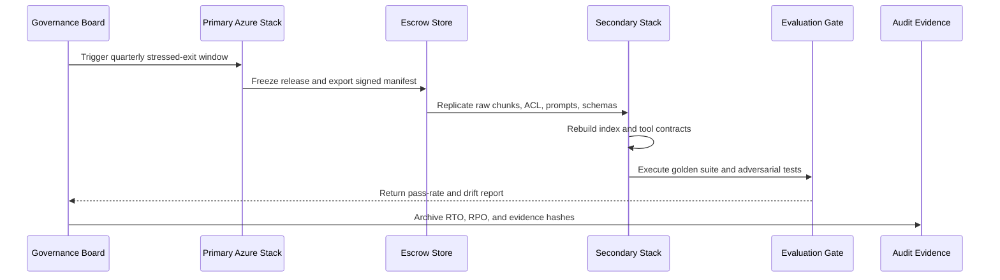
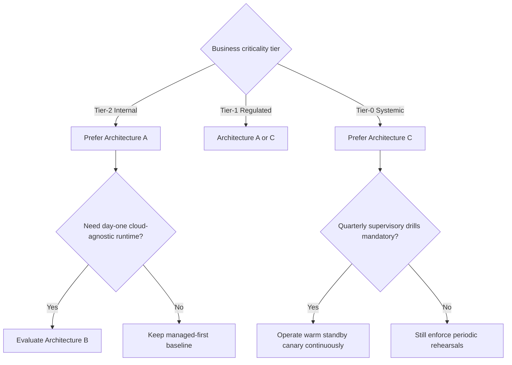

# Enterprise AI Landing-Zone Stressed-Exit Selection FAQ: Portable Core vs Cloud-Agnostic K8s vs Warm-Standby Escrow vs Paper Exit
> **Applies to**: regulated AI platforms governed by `EU DORA Article 28(8)`, `PRA SS2/21`, and `EU Data Act Chapter VI`.
> **Decision pressure**: preserve managed Azure delivery velocity while proving auditable stressed-exit execution inside regulator-defined windows.
> **Core objective**: provide verifiable exit architecture patterns, quantified RTO/TCO tradeoffs, and a tiered rollout framework.

## 1. Executive summary
In a regulatory context, portability is an engineering capability, not a slide-level promise.
Owning Terraform templates across clouds does not prove executable exit readiness.
Real exit readiness requires rebuildable data, versioned contracts, reproducible evaluations, and signed operational evidence.
This guide compares four architecture patterns and identifies which patterns survive quarterly stressed-exit audits.
Architecture A keeps Azure managed services for production velocity while preserving exportable canonical state.
Architecture B enforces cloud-agnostic Kubernetes from Day-1 and buys migration freedom through permanent Day-2 tax.
Architecture C introduces asymmetric warm-standby escrow for Tier-0 critical functions that need auditable cutover certainty.
Architecture D is the anti-pattern that claims portability in policy documents but fails execution drills.
Default recommendation is Architecture A for most enterprise domains.
Upgrade to Architecture C when business impact tolerance collapses to hours and supervision intensity rises.
Use Architecture B only where sovereign constraints and platform depth justify the sustained operations burden.
Never treat proprietary vector indexes or hosted assistant thread state as the sole source of truth.
Always preserve rebuildable raw chunks, ACL manifests, prompt and tool contracts, and regression suites.
Stressed-exit drills are not identical to disaster recovery drills, even though they share observability components.
Disaster recovery optimizes availability restoration; stressed exit optimizes supplier concentration-risk reversibility.
A defensible strategy proves that an independent team can rebuild and pass gates inside the approved window.
This document provides mathematical models, a 12-dimension comparison matrix, and three-tier cost assumptions.
Operational doctrine used here is managed-first for production and evidence-first for reversibility.

## 2. Regulatory constraints, concentration risk, and portability traps
`EU DORA Article 28(8)` requires executable exit strategy and periodic testing for critical ICT dependencies.
`PRA SS2/21` requires impact tolerance definition, resilience controls, and demonstrable recovery performance.
`EU Data Act Chapter VI` strengthens cloud switching rights, portability expectations, and switching-fee constraints.
Together these frameworks require operational reversibility, not only contractual language.
Trap one is exporting vectors without exporting canonical raw chunks and deterministic chunking policy.
Trap two is unversioned prompts and tool contracts, which makes migration regressions untraceable.
Trap three is disconnected evaluation and production telemetry, preventing meaningful equivalence testing.
Trap four is treating exit readiness as a one-off compliance project instead of a recurring platform discipline.
Trap five is confusing “it runs somewhere else” with “it meets equivalent controls and service objectives”.
Concentration-risk mitigation does not ban managed services; it requires auditable reversibility.
The framework in this guide is canonical-state escrow plus contract replayability plus comparable evaluations.

## 3. Four candidate architecture definitions
Architecture A: Pragmatic Portable Core on Managed Azure.
Architecture B: Strict Cloud-Agnostic Kubernetes Everywhere from Day-1.
Architecture C: Asymmetric Warm-Standby Escrow for Regulated Tier-0 Functions.
Architecture D: Paper-Only Exit Plan with Opaque State Lock-in.
These are strategy anchors, not mutually exclusive lifecycle artifacts.
The selected anchor determines ongoing operating economics and exit-time confidence.
Evaluation dimensions include exit latency, reconstruction quality, long-horizon cost, and governance complexity.

## 4. Architecture A mechanics: managed primary plus exportable canonical state
Primary production traffic runs on `Azure AI Foundry + Azure AI Search + Cosmos DB + APIM`.
Canonical state is escrowed in immutable WORM `ADLS Gen2` containers as Parquet raw chunks and ACL manifests.
Tool contracts are versioned via OpenAI-compatible gateway contracts and MCP schema manifests.
Golden regression suites are maintained and shadowed against open-weight models in controlled channels.
Quarterly drills rebuild into AKS vLLM and must meet predefined parity thresholds.
Strength is managed delivery speed with practical reversibility.
Risk appears when teams skip drill cadence and let runbooks decay.

## 5. Architecture B mechanics: cloud-agnostic self-managed stack
Typical stack includes `AKS/EKS/GKE + vLLM + Qdrant/Milvus + Envoy + PostgreSQL`.
Infrastructure can be recreated across clouds in under 72 hours under ideal conditions.
However, daily operation absorbs persistent multi-cluster, GPU, and database platform burden.
Elastic demand profiles can amplify idle-capacity and staffing inefficiencies.
Best fit is sovereign-heavy organizations with mature internal platform engineering.
Poor fit is lean teams optimizing for rapid feature iteration with limited SRE capacity.

## 6. Architecture C mechanics: asymmetric warm standby for critical domains
Primary managed Azure stack serves the majority of business traffic.
Secondary sovereign or alternate-cloud stack continuously receives escrow artifacts and limited canary load.
Raw corpora, prompts, tool contracts, evaluation sets, and signed policy ledgers are replicated asynchronously.
Quarterly stressed-exit drills target `RTO < 4h–12h` for Tier-0 processes.
This pattern balances managed velocity with regulator-grade reversibility evidence.
Tradeoff is higher governance complexity and dedicated dual-plane ownership.

## 7. Architecture D anti-pattern: paper portability
Only vector snapshots are preserved while canonical raw source is missing.
Prompt and tool contract history is absent or non-versioned.
No repeatable drill cadence exists; evidence is assembled ad hoc for audit season.
This pattern may survive desk-review narratives and fail practical execution tests.
Regulators evaluate operational proof, not narrative completeness.

## 8. Twelve-dimension comparison matrix
| Dimension | Architecture A | Architecture B | Architecture C | Architecture D |
|---|---|---|---|---|
| Production delivery velocity | High | Medium | High | High short-term |
| Day-2 SRE burden | Medium-low | High | Medium-high | Low apparent |
| Exit executability | High | Medium-high | Highest | Low |
| Audit evidence density | High | Medium | Highest | Low |
| Initial investment | Medium | High | Medium-high | Low |
| Long-run cost stability | High | Medium-low | Medium-high | Low |
| Model replacement friction | Medium-low | Low | Low | High |
| Data portability maturity | High | Medium-high | High | Low |
| Multi-region compliance fit | High | Medium | High | Low |
| Tier-0 suitability | Medium | Medium | Highest | Low |
| Team capability threshold | Medium | High | High | Low but risky |
| Recommendation | Default | Conditional | Tier-0 priority | Avoid |

## 9. Stressed-exit math and reconstruction time model
Total exit duration can be expressed as:
`T_exit = T_provision + N_chunks / R_embed + T_HNSW_build + T_eval_gate`
`T_provision` captures environment bootstrap and policy deployment lead time.
`N_chunks` captures canonical chunk volume to rebuild.
`R_embed` captures effective embedding throughput in chunks per second.
`T_HNSW_build` captures index build or equivalent retrieval-structure preparation.
`T_eval_gate` captures parity evaluation and sign-off time.
Transfer duration can be modeled as:
`T_transfer = Data_size / Throughput_effective + T_validation`
When embedding-family dimensionality changes, direct vector reuse fails and re-embedding is mandatory:
`T_reembed = N_chunks * Avg_tokens / TPS_embed`
Warm-standby canary operation amortizes portions of `T_provision` and `T_eval_gate`.
Paper-only plans inflate `T_validation` through missing artifact recovery and uncertainty.

## 10. Three-scale planning assumptions (10M, 200M, 2B chunks)
Tier-2 Internal: `10M` chunks, regional or internal support domains.
Tier-1 Regulated: `200M` chunks, multi-entity insurance and claims platforms.
Tier-0 Systemic: `2B` chunks, payment, clearing, or market-critical workflows.
Assume baseline `R_embed = 25,000 chunks/min` with non-linear index-build effects.
Tier-2 target windows are commonly `24h-48h`.
Tier-1 target windows are commonly `12h-24h`.
Tier-0 target windows are commonly `4h-12h` and require continuous warm standby.
Without pre-positioned standby and canary parity, Tier-0 targets are usually unattainable.

## 11. Cost model and expected-value framing
Expected-value cost can be framed as:
`E[Cost] = C_day2 + p_exit * C_migration`
`C_day2` is recurring operating cost.
`p_exit` is annual probability of forced migration or concentration-risk trigger.
`C_migration` is one-time migration execution and validation cost.
Architecture A tends to balance moderate `C_day2` and controlled `C_migration`.
Architecture B tends to increase `C_day2` while reducing migration uncertainty.
Architecture C tends to increase `C_day2` and minimize outage exposure in critical domains.
Architecture D appears cheap until migration and supervisory penalty costs materialize.

## 12. Four-architecture topology


## 13. Quarterly DORA stressed-exit rehearsal sequence


## 14. Criticality-based architecture decision tree


### Q1. Why regulators require executable exit instead of declarative exit
Regulators are reducing concentration-risk fragility, not requesting abstract migration statements.
Executable exit means reconstruction under constrained time with auditable control outcomes.
Contracts and architecture diagrams cannot prove runbook realism under operational pressure.
Quarterly rehearsals expose hidden dependency gaps that static governance documents miss.
A credible drill includes failure branches, not only successful happy-path records.
Accountability requires traceability of who approved which evidence and under what threshold.
Evidence packets should include artifact signatures, evaluation outputs, and rollback posture.
Without comparable benchmarks, output-quality equivalence claims are weak.
Executable exit is resilience engineering, not procurement theater.
The capability should be funded and measured as an ongoing platform objective.

### Q2. What fundamentally differentiates the four architectures
Architecture A optimizes managed velocity while preserving rebuildable canonical state.
Architecture B optimizes cloud-runtime neutrality with sustained operational complexity.
Architecture C optimizes critical-function continuity and supervisory-grade assurance.
Architecture D optimizes short-term convenience while creating hidden systemic fragility.
Architecture A and C both fail if rehearsal cadence and gate discipline are absent.
Architecture B can degrade quickly where platform operations maturity is insufficient.
Architecture C needs explicit ownership boundaries to avoid unmanaged secondary drift.
Enterprises should tier strategy by business criticality, not enforce one strategy globally.

### Q3. How to quantify stressed-exit RTO and re-embedding pressure
Exit timing is dominated by environment bootstrap, re-embedding, index construction, and gate execution.
When embedding families change dimensionality, old vectors cannot be trusted for parity.
Increasing `N_chunks` scales embedding time linearly while index-build cost can curve upward.
Partitioning, hot-warm data tiers, and parallel batch orchestration reduce tail risk.
`T_eval_gate` cannot be compressed below explainability requirements without governance compromise.
Tier-0 hour-level targets require pre-amortized warm-standby operations.
Tier-1 domains accept larger windows but still require recurrent proof.
Mathematical estimation supports capacity planning but does not replace drill evidence.

### Q4. When should Architecture A be upgraded to Architecture C
Upgrade when impact tolerance tightens from day-scale to hour-scale windows.
Upgrade when supervisory audits demand reproducible stressed-exit certificates.
Upgrade when sovereign boundary requirements require materially segregated execution planes.
Upgrade when single-supplier disruption produces systemic business impact.
Upgrade should extend existing managed baselines rather than replace them wholesale.
Before upgrading, complete canonical-state governance, contract versioning, and evaluation readiness.
Skipping these prerequisites converts Architecture C into expensive operational noise.
Decisions should be jointly signed by technology, risk, compliance, and business owners.

### Q5. How to implement minimum viable verifiable-exit on Azure
Step one is defining canonical raw-chunk and ACL-manifest standards.
Step two is enforcing APIM contract versioning and MCP schema release controls.
Step three is building golden regression suites covering quality and safety patterns.
Step four is automating secondary rebuild pipelines and quarterly rehearsal execution.
Step five is integrating evidence outcomes into board-level risk dashboards.
All key artifacts should be hashed and stored in immutable retention scope.
All gate thresholds should be version-frozen before rehearsal starts.
Both pass and reject decisions should be auditable with signer identity.
The snippets below illustrate a practical minimum implementation pattern.

```bicep
resource escrowStorage 'Microsoft.Storage/storageAccounts@2023-05-01' = {
  name: 'stescrowprod001'
  location: resourceGroup().location
  sku: {
    name: 'Standard_ZRS'
  }
  kind: 'StorageV2'
  properties: {
    allowBlobPublicAccess: false
    minimumTlsVersion: 'TLS1_2'
    supportsHttpsTrafficOnly: true
    immutableStorageWithVersioning: {
      enabled: true
    }
  }
}

resource escrowContainer 'Microsoft.Storage/storageAccounts/blobServices/containers@2023-05-01' = {
  name: '${escrowStorage.name}/default/agent-escrow'
  properties: {
    publicAccess: 'None'
    immutableStorageWithVersioning: {
      enabled: true
      immutabilityPolicy: {
        allowProtectedAppendWrites: true
        immutabilityPeriodSinceCreationInDays: 90
        state: 'Unlocked'
      }
    }
  }
}
```

```xml
<policies>
  <inbound>
    <base />
    <set-header name="x-portable-contract-version" exists-action="override">
      <value>@(context.Variables.GetValueOrDefault("contractVersion","2026.11"))</value>
    </set-header>
    <set-header name="x-eval-suite-id" exists-action="override">
      <value>golden-regression-v3</value>
    </set-header>
    <choose>
      <when condition="@(context.Request.Headers.GetValueOrDefault("x-exit-drill","false") == "true")">
        <set-backend-service base-url="https://secondary-vllm.internal" />
      </when>
    </choose>
  </inbound>
  <backend><base /></backend>
  <outbound><base /></outbound>
  <on-error><base /></on-error>
</policies>
```

```python
from dataclasses import dataclass

@dataclass
class ExitEstimate:
    t_provision_hours: float
    n_chunks: int
    embed_rate_chunks_per_hour: float
    t_hnsw_hours: float
    t_eval_hours: float

def estimate_exit_hours(x: ExitEstimate) -> float:
    t_embed = x.n_chunks / max(x.embed_rate_chunks_per_hour, 1.0)
    return x.t_provision_hours + t_embed + x.t_hnsw_hours + x.t_eval_hours

if __name__ == "__main__":
    tier1 = ExitEstimate(2.0, 200_000_000, 12_000_000, 4.5, 2.5)
    print(round(estimate_exit_hours(tier1), 2))
```

### Q6. Anti-pattern detection, go-live checklist, and five-step rollout guide
Anti-pattern one is preserving vectors only while losing canonical raw sources.
Anti-pattern two is hardcoding prompts and tool contracts without release lineage.
Anti-pattern three is claiming switch readiness without shadow parity evidence.
Anti-pattern four is mismatch between compliance documents and operational artifacts.
Anti-pattern five is failing drills and updating slides instead of fixing root causes.
Go-live checklist should include data, contracts, evaluations, rehearsals, and approvals.
Before go-live, require a passed quarterly rehearsal with immutable evidence references.
After go-live, schedule and fund the next rehearsal cycle explicitly.
Five-step rollout guidance is as follows.
Step 1: classify workloads by criticality and assign A/B/C strategy anchors.
Step 2: deploy escrow standards and immutable retention controls.
Step 3: integrate APIM contract governance with evaluation gates.
Step 4: establish secondary rebuild and warm-standby canary execution.
Step 5: monitor RTO, pass-rate, and cost variance as governance KPIs.
Good fit includes regulated enterprises requiring managed speed and auditable reversibility.
Not for teams without evaluation discipline, artifact governance, or rehearsal ownership.

## 15. Three-tier ROI reference assumptions
| Tier | Typical scale | Recommended architecture | Target exit window | Priority investment |
|---|---|---|---|---|
| Tier-2 Internal | 10M chunks and 50 agents | A | 24h-48h | Canonical asset and regression gates |
| Tier-1 Regulated | 200M chunks and 300 agents | A plus C for critical domains | 12h-24h | Warm-standby rebuild and evidence operations |
| Tier-0 Systemic | 2B chunks and 1,200 agents | C | 4h-12h | Continuous canary, dual-plane controls, quarterly drills |

## 16. Conclusion
For most enterprises, Architecture A is the optimal starting point over Day-1 full self-management.
For systemic critical workflows, Architecture C is mandatory to prove reversibility under pressure.
Architecture D should be treated as prohibited posture in governance standards.
Reversibility is sustained engineering discipline, not procurement messaging.
Institutionalized rehearsal and evidence closure are the durable path to concentration-risk reduction.
