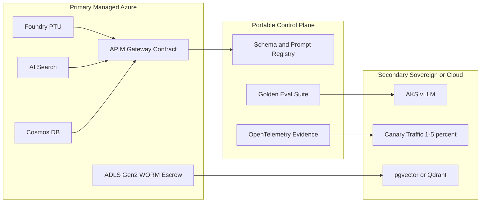
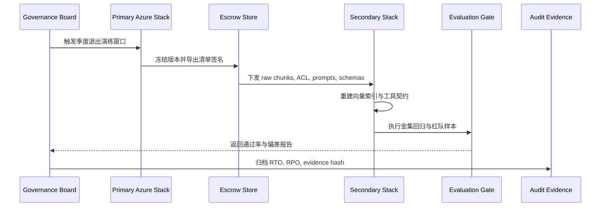
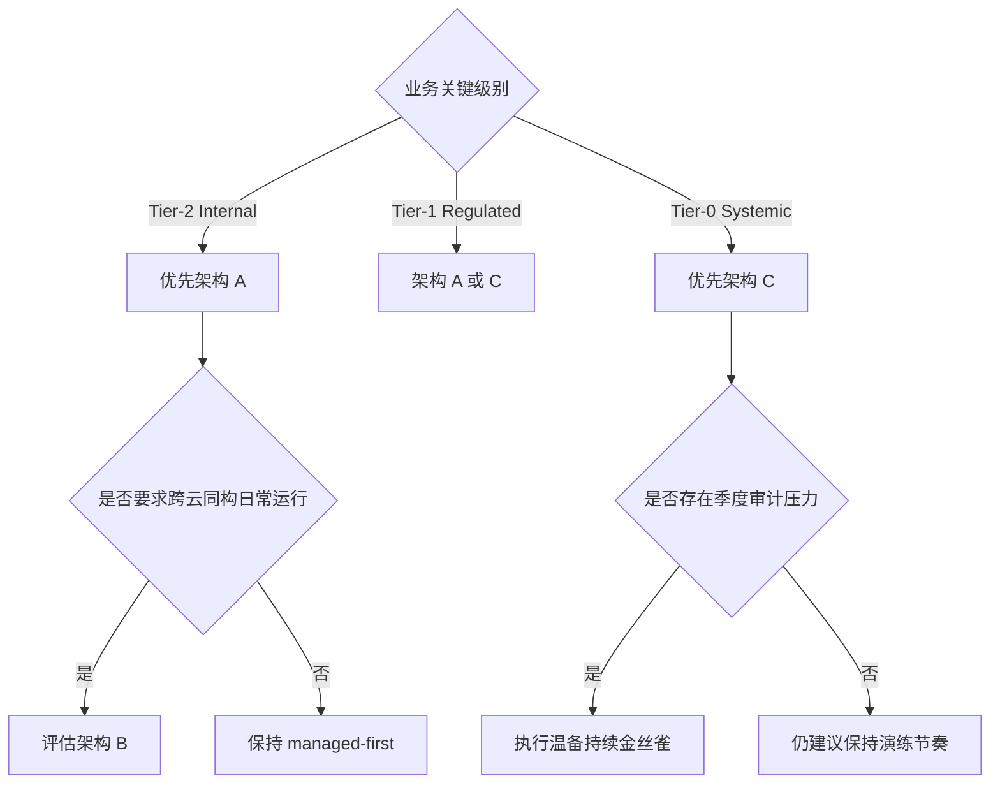

# 企业 AI Landing Zone 监管压力退出选型 FAQ：Portable Core vs Cloud-Agnostic K8s vs Warm-Standby Escrow vs Paper Exit
> **适用场景**：受 `EU DORA Article 28(8)`、`PRA SS2/21` 与 `EU Data Act Chapter VI` 约束的金融与关键行业 AI 平台。
> **决策压力**：既要保持 Azure 托管服务交付速度，又要证明受监管条件下可在规定窗口完成可审计退出。
> **核心目标**：给出可验证的退出演练架构、量化 RTO/TCO、并提供分层落地路径。

## 1. 执行摘要
企业 AI 平台在监管语境中的“可移植性”不是 PPT 承诺，而是可重复执行的工程能力。
仅有跨云 Terraform 仓库不等于可退出，真实退出需要数据、契约、评测、工具链的联动重建。
本指南比较四种常见路线，并明确哪一种能够通过季度压力退出演练审计。
架构 A 将 Azure 托管能力作为生产主平面，同时保留可导出的规范化状态资产。
架构 B 从 Day-1 走全自建跨云栈，获得名义迁移自由，但长期支付高额 SRE 与容量税。
架构 C 面向 Tier-0 系统功能，采用主站托管 + 温备托管/主权隔离域的不对称双平面。
架构 D 属于反模式，只满足“文档层面可退出”，在审计抽检中通常直接失败。
建议默认路径为 A，若业务关键级别达到支付清算或保单核心，则升级到 C。
在组织成熟度不足、且无法建立评测金集与工件托管前，不建议直接选择 B。
任何架构都必须避免把专有向量索引或托管线程态当成唯一事实来源。
必须保存可复建的原始分块、ACL、评测集、模型路由契约与版本签名证据。
退出演练不是灾备演练的替代，二者目标不同但应共享观测与签核流水线。
灾备关注可用性恢复，退出关注供应商集中度风险与可逆性证明。
可逆性证明最低要求是“独立团队在受控窗口内可重建并达标通过评测门禁”。
本文给出完整数学模型、12 维对比矩阵、三档成本模型与五步实施框架。
本文默认“生产期坚持 managed-first，退出期坚持 evidence-first”治理原则。

## 2. 监管约束、集中度风险与技术陷阱边界
`EU DORA Article 28(8)` 强调关键 ICT 供应商中断场景下的可执行退出策略与定期测试。
`PRA SS2/21` 要求重要业务服务的影响容忍度定义、恢复目标、以及可验证韧性能力。
`EU Data Act Chapter VI` 在云切换场景中强调数据可携带、互操作与切换费用约束。
以上规则共同指向一个事实：退出能力必须工程化，而非合同条款化。
常见陷阱一是仅导出向量，不导出原始文本与分块规则，导致跨模型重建不可复现。
常见陷阱二是提示词与工具契约未版本化，迁移后行为偏差无法定位根因。
常见陷阱三是评测集与生产观测割裂，切换后无法判断“变差来自模型还是数据”。
常见陷阱四是把退出演练当一次性项目，未纳入季度节奏与预算治理。
常见陷阱五是将跨云“能跑起来”误判为“达到同等合规与服务等级”。
集中度风险治理不是禁止使用托管服务，而是要求保留可逆路径并可演练验证。
因此本指南采用“核心状态托管可导出 + 契约可重放 + 评测可比较”的判定框架。

## 3. 四类候选架构定义
架构 A：Pragmatic Portable Core on Managed Azure。
架构 B：Strict Cloud-Agnostic K8s-Everywhere from Day-1。
架构 C：Asymmetric Warm-Standby Escrow for Regulated Tier-0。
架构 D：Paper-Only Exit Plan with Opaque State Lock-in。
四类架构并非互斥生命周期阶段，但在同一业务域中必须选择一个主策略。
主策略决定组织的日常运营成本曲线与退出时的可用证据密度。
比较维度包括退出时间、迁移质量、长期成本、交付效率与治理复杂度。

## 4. 架构 A 机制：托管主平面 + 可导出核心状态
生产流量主要运行在 `Azure AI Foundry + Azure AI Search + Cosmos DB + APIM`。
状态层强制保留 `ADLS Gen2` 不可变 WORM 容器中的 Parquet 原始分块与 ACL 映射。
工具契约采用 OpenAI 兼容网关契约与 MCP schema 清单版本化。
评测层维护 golden regression suite，并对开源权重模型保持影子同题评测。
季度演练要求在独立 AKS vLLM 通道完成重建并达到约定通过率阈值。
该架构优势是保留托管交付速度，同时具备退出可验证素材。
该架构风险是团队若忽视演练节奏，会出现“资产在但流程死”的治理漂移。

## 5. 架构 B 机制：Day-1 全自建跨云一致栈
核心组件通常为 `AKS/EKS/GKE + vLLM + Qdrant/Milvus + Envoy + PostgreSQL`。
基础设施即代码可在 72 小时内重建多云同构环境，迁移自由度高。
但常态下需要持续承担多集群升级、GPU 资源碎片、数据库运维与补丁治理。
若业务日均流量波动大，预留与空转导致单位成本显著上升。
该架构适用于强主权约束、且平台团队具备长期自建能力的组织。
不适用于希望以小团队快速迭代业务体验的中小规模企业。

## 6. 架构 C 机制：不对称温备托管与退出托管
主站保持 Azure 托管优势并承载 95% 以上流量。
次站在隔离边界运行 `AKS Arc 或第二云`，承载 1%–5% 影子与金丝雀流量。
原始语料、提示词工件、评测数据集、策略签名账本持续异步复制。
季度执行压力退出演练并输出审计证书，目标 `RTO < 4h–12h`（Tier-0）。
该架构兼顾托管效率与关键功能退出可证性，适用于系统性重要流程。
代价是双平面治理复杂度上升，需要专门 SRE 与审计协作机制。

## 7. 架构 D 反模式：纸面退出
仅保存托管向量索引快照，不保存原始分块与清洗规则。
提示词与工具调用契约无版本，迁移后行为偏差无从定位。
没有季度演练与门禁指标，只在审计前临时准备材料。
该模式在桌面评审阶段可能通过，但在抽样重建演练中大概率失败。
监管关注的是“可执行性证据”，而不是“声明性文档完整度”。

## 8. 十二维横向对比矩阵
| 维度 | 架构 A | 架构 B | 架构 C | 架构 D |
|---|---|---|---|---|
| 生产交付速度 | 高 | 中 | 高 | 高（短期） |
| 日常 SRE 负担 | 中低 | 高 | 中高 | 低（表面） |
| 退出可执行性 | 高 | 中高 | 最高 | 低 |
| 退出审计证据密度 | 高 | 中 | 最高 | 低 |
| 初期投资 | 中 | 高 | 中高 | 低 |
| 长期单位成本稳定性 | 高 | 中低 | 中高 | 低 |
| 模型替换阻力 | 中低 | 低 | 低 | 高 |
| 数据可携带成熟度 | 高 | 中高 | 高 | 低 |
| 多区域合规适配 | 高 | 中 | 高 | 低 |
| 关键系统适配性 | 中 | 中 | 最高 | 低 |
| 团队能力门槛 | 中 | 高 | 高 | 低（但风险高） |
| 推荐结论 | 默认优先 | 条件适用 | Tier-0 优先 | 禁用 |

## 9. 压力退出数学模型与重建时间估算
退出总耗时可表示为：
`T_exit = T_provision + N_chunks / R_embed + T_HNSW_build + T_eval_gate`
其中 `T_provision` 为基础环境拉起与策略下发时间。
`N_chunks` 为可重建分块总量。
`R_embed` 为目标嵌入吞吐（chunks/second）。
`T_HNSW_build` 为索引构建或重排准备时间。
`T_eval_gate` 为回归评测与签核时间。
数据迁移总耗时可表示为：
`T_transfer = Data_size / Throughput_effective + T_validation`
若存在跨族嵌入维度不一致，应增加重嵌入成本项：
`T_reembed = N_chunks * Avg_tokens / TPS_embed`
当采用温备影子通道时，可把 `T_provision` 与部分 `T_eval_gate` 前置摊销。
当采用纸面方案时，`T_validation` 与缺失资产补救会显著扩大尾延迟。

## 10. 三档规模估算（10M / 200M / 2B chunks）
Tier-2 Internal：`10M` chunks，区域型银行或内部支持系统。
Tier-1 Regulated：`200M` chunks，多实体保险与跨区域理赔系统。
Tier-0 Systemic：`2B` chunks，支付清算与系统重要金融流程。
假设 `R_embed = 25,000 chunks/min`，`T_HNSW_build` 随规模非线性增长。
Tier-2 目标窗口可设计为 `24h-48h`。
Tier-1 目标窗口通常为 `12h-24h`。
Tier-0 目标窗口通常为 `4h-12h`，需温备与持续影子支撑。
若无预置温备，Tier-0 在受限窗口内通常无法完成全量重建与门禁。

## 11. 成本模型与期望成本
期望成本模型：
`E[Cost] = C_day2 + p_exit * C_migration`
`C_day2` 表示日常运营成本。
`p_exit` 表示年度触发退出或强制切换概率。
`C_migration` 表示一次退出迁移总成本。
架构 A 通常表现为适中的 `C_day2` 与受控的 `C_migration`。
架构 B 通常表现为较高 `C_day2` 与相对较低的 `C_migration`。
架构 C 通常表现为较高 `C_day2` 但最低的关键业务中断风险。
架构 D 表面 `C_day2` 最低，但真实 `C_migration` 与监管处罚期望值最高。

## 12. 四架构拓扑图


## 13. 季度压力退出演练时序图


## 14. 关键级别选择决策树


### Q1. 监管为什么要求“可执行退出”而不是“声明可退出”
监管的目标是降低集中度风险，不是鼓励企业频繁迁移供应商。
“可执行退出”要求在受限时间窗口内完成技术重建并保持业务可用。
仅提供合同条款或架构图，无法证明工具链与数据链的真实可逆性。
季度演练能暴露平时看不到的证据断点与流程依赖单点。
退出演练必须包含失败路径，不仅是 happy path 的成功截图。
监管问责通常关注“谁在什么时间基于什么证据放行了切换”。
因此证据链要覆盖工件签名、评测结果、审批记录、回退策略。
如果没有可比评测，无法证明新环境输出质量维持在容忍带内。
可执行退出是韧性工程，不是采购谈判附属条款。
企业应将其纳入年度预算与平台治理 KPI。

### Q2. 四种架构在工程机制上有何本质差异
架构 A 的核心是托管生产 + 可导出状态，强调效率与可逆平衡。
架构 B 的核心是一致自建栈，强调迁移自由优先于托管效率。
架构 C 的核心是不对称双平面，强调关键服务连续性与审计确定性。
架构 D 的核心是文档替代工程，短期省事但长期风险不可控。
架构 A 与 C 都需要持续评测门禁与证据归档，否则会退化为 D。
架构 B 若缺乏规模化 SRE 能力，常因复杂度上升导致隐性不可用。
架构 C 需要明确主副职责，避免温备成为“无人维护的第二主站”。
组织应按关键级别分层，而非全企业一刀切单架构。

### Q3. 如何量化退出 RTO 与重嵌入压力
在资产齐备时，退出时间主要由环境拉起、重嵌入、索引构建与评测组成。
当嵌入模型维度变化时，旧向量不能直接复用，必须重嵌入。
`N_chunks` 增长会线性放大重嵌入时间，但索引构建通常呈次线性到超线性混合。
可通过预先分区、冷热分层与并行批次缩短尾部时间。
`T_eval_gate` 不应被压缩到不可解释，否则会牺牲监管可辩护性。
Tier-0 业务若期望 4 小时窗口，必须前置温备与影子评测摊销。
Tier-1 可接受更长窗口，但仍需季度验证“达标不是偶然”。
数学模型用于规划容量，不替代真实演练证据。

### Q4. 何时应从架构 A 升级到架构 C
当业务影响容忍度从“天级”收敛到“小时级”，应评估升级。
当审计明确要求定期退出证书并抽样复现时，应评估升级。
当跨区域主权边界要求实质隔离执行环境时，应评估升级。
当单供应商故障将触发系统性损失时，应优先升级。
升级不是推翻现有平台，而是增加温备平面与演练自动化。
升级前应先补齐资产清单、契约版本、评测金集三项基础设施。
若基础设施不完整，直接上 C 只会把复杂度放大而非降低风险。
升级决策应由技术、风险、合规、业务共同签核。

### Q5. 如何在 Azure 上落地“可验证退出”最小闭环
第一步，定义 canonical raw chunk 与 ACL manifest 的统一规范。
第二步，强制 APIM 网关契约与 MCP schema 版本化发布。
第三步，构建 golden regression suite，覆盖任务准确率与安全门禁样本。
第四步，建立次站重建流水线并按季度执行演练。
第五步，沉淀审计证据包并进入董事会级风险看板。
工程上建议所有关键工件带内容哈希并写入不可变存储。
所有门禁阈值需版本化并在演练开始前冻结。
所有通过与拒绝记录都要保留可追溯审批链。
下列示例展示最小可行实现片段。

```bicep
resource escrowStorage 'Microsoft.Storage/storageAccounts@2023-05-01' = {
  name: 'stescrowprod001'
  location: resourceGroup().location
  sku: {
    name: 'Standard_ZRS'
  }
  kind: 'StorageV2'
  properties: {
    allowBlobPublicAccess: false
    minimumTlsVersion: 'TLS1_2'
    supportsHttpsTrafficOnly: true
    immutableStorageWithVersioning: {
      enabled: true
    }
  }
}

resource escrowContainer 'Microsoft.Storage/storageAccounts/blobServices/containers@2023-05-01' = {
  name: '${escrowStorage.name}/default/agent-escrow'
  properties: {
    publicAccess: 'None'
    immutableStorageWithVersioning: {
      enabled: true
      immutabilityPolicy: {
        allowProtectedAppendWrites: true
        immutabilityPeriodSinceCreationInDays: 90
        state: 'Unlocked'
      }
    }
  }
}
```

```xml
<policies>
  <inbound>
    <base />
    <set-header name="x-portable-contract-version" exists-action="override">
      <value>@(context.Variables.GetValueOrDefault("contractVersion","2026.11"))</value>
    </set-header>
    <set-header name="x-eval-suite-id" exists-action="override">
      <value>golden-regression-v3</value>
    </set-header>
    <choose>
      <when condition="@(context.Request.Headers.GetValueOrDefault("x-exit-drill","false") == "true")">
        <set-backend-service base-url="https://secondary-vllm.internal" />
      </when>
    </choose>
  </inbound>
  <backend><base /></backend>
  <outbound><base /></outbound>
  <on-error><base /></on-error>
</policies>
```

```python
from dataclasses import dataclass

@dataclass
class ExitEstimate:
    t_provision_hours: float
    n_chunks: int
    embed_rate_chunks_per_hour: float
    t_hnsw_hours: float
    t_eval_hours: float

def estimate_exit_hours(x: ExitEstimate) -> float:
    t_embed = x.n_chunks / max(x.embed_rate_chunks_per_hour, 1.0)
    return x.t_provision_hours + t_embed + x.t_hnsw_hours + x.t_eval_hours

if __name__ == "__main__":
    tier1 = ExitEstimate(2.0, 200_000_000, 12_000_000, 4.5, 2.5)
    print(round(estimate_exit_hours(tier1), 2))
```

### Q6. 反模式识别、上线清单与五步落地指南
反模式一：只保存向量索引，不保存原始分块与权限快照。
反模式二：把提示词和工具调用写死在应用代码，缺失版本治理。
反模式三：没有影子评测就宣称“可切换”。
反模式四：合规文档与技术资产不一致，审计时无法对账。
反模式五：演练失败后不做根因闭环，仅更新汇报材料。
上线清单应覆盖数据、契约、评测、演练、审批五类证据。
上线前必须完成最近一个季度演练并保留哈希签名。
上线后必须定义下一季度演练窗口与预算归属。
五步落地指南如下：
第一步：按业务关键级别标注工作负载，确定 A/B/C 主策略。
第二步：建立 escrow 数据规范与不可变存储策略。
第三步：接入 APIM 契约版本与评测门禁流水线。
第四步：建设次站重建与温备影子通道，执行首次演练。
第五步：将 RTO、通过率、成本偏差纳入治理看板并持续迭代。
Good fit：受监管强、关键流程多、需托管效率与可逆并存的组织。
Not for：无评测能力、无资产治理、仅追求短期上线速度的团队。

## 15. 三档 ROI 参考（示例）
| 档位 | 典型规模 | 推荐主架构 | 目标退出窗口 | 重点投入 |
|---|---|---|---|---|
| Tier-2 Internal | 10M chunks / 50 agents | A | 24h-48h | 资产规范化与评测门禁 |
| Tier-1 Regulated | 200M chunks / 300 agents | A + C 关键域 | 12h-24h | 温备重建流水线与证据化审计 |
| Tier-0 Systemic | 2B chunks / 1,200 agents | C | 4h-12h | 持续金丝雀、双平面治理与季度演练 |

## 16. 结论
对大多数企业，最优起点是架构 A，而不是 Day-1 全自建架构 B。
对系统性关键流程，必须引入架构 C 的温备与演练能力。
架构 D 在监管压力下不可接受，应作为明确禁用模式写入标准。
退出可逆性是工程纪律，不是采购口径。
把演练做成可复制流程，才是长期降低集中度风险的核心能力。
补充治理说明：在多数大型集团的实战中，退出演练失败并非发生在“技术组件缺失”，而是发生在跨团队接口定义、审批序列一致性、取证口径一致性与指挥链时序同步四类组织工程断点，因此在落地时必须把平台团队、应用团队、风险合规团队、审计团队、法务团队、外包运维团队、供应商管理团队纳入同一版本化治理节奏，明确每个阶段的输入输出件、签核人、拒绝条件、回退条件、应急例外条件、证据保存期限、证据哈希校验策略、演练窗口冲突解决规则与预算归属规则；同时要求每一次演练都覆盖“标准路径、受限路径、失败路径、回退路径、二次切换路径”，并把演练结果拆分为系统层指标、数据层指标、模型层指标、工具层指标、业务层指标、治理层指标六大类进行复盘，确保不会出现“系统恢复成功但业务控制失败”或“业务控制合规但数据链断裂”的伪成功；在技术细节上需要把原始分块、元数据、权限映射、提示词版本、工具 schema、路由策略、评测数据集、阈值配置、观察指标、告警策略、审批记录统一纳入不可变资产目录，并为每个目录对象定义标准化的完整性校验、可读性校验、可重放性校验、跨环境一致性校验与最小权限校验，使任意时间点都可以由独立小组在不依赖原作者记忆的情况下复建出口环境；在流程细节上则需建立“演练前冻结、演练中观测、演练后归档”的刚性节奏，演练前冻结所有关键阈值与契约版本，演练中持续记录每一步执行耗时与失败重试轨迹，演练后在二十四小时内形成结构化复盘并提交治理委员会裁决，若裁决要求整改则将整改项绑定下一个演练窗口而非无限期搁置；在成本细节上必须把日常托管成本、温备成本、演练成本、失败补救成本、审计准备成本放在同一财务口径下核算，并通过统一计费标签把关键资源映射到业务域，避免出现“平台成本可见、退出成本不可见”的预算盲区；在风险细节上需要定义模型替换风险、数据漂移风险、权限漂移风险、索引重建风险、网络链路风险、身份联邦风险、审批延迟风险的量化阈值，并把这些阈值前置到自动门禁，否则退出能力会在组织扩张中持续退化；最后，在治理文化上要明确退出演练不是失败导向检查，而是韧性能力建设活动，只有把问题暴露在演练窗口，才能避免问题暴露在真实监管事件窗口。
延伸执行要点一：为了避免“演练时才发现资产不可用”的被动局面，企业应在日常变更流程中引入与退出能力强绑定的强制检查项，例如任何数据清洗规则更新必须同步更新可重放配置、任何向量化模型替换必须附带跨模型维度兼容性评估、任何提示词与工具链变更必须产出契约迁移说明、任何 ACL 规则变化必须生成差异审计报告并写入 escrow 目录、任何网关策略变更必须在主副平面执行一致性回放、任何评测阈值调整必须通过风险委员会备案、任何应急特权授予必须在演练结束后完成权利回收与证据核验、任何温备容量缩减必须附带退出窗口再计算结果、任何成本优化动作必须证明不破坏退出时的可复建性、任何供应商接口升级必须进行向后兼容探针验证；同时建议将退出能力指标纳入工程绩效评价，例如把“季度演练通过率”“重建窗口达标率”“证据包完整率”“回退成功率”“跨团队响应时延”等指标与平台目标绑定，让组织在平时就把退出能力当成基础质量的一部分，而不是监管抽检前的临时项目；另外，在多法域运营场景中还需要建立区域化证据分层策略，明确哪些资产可以跨域复制、哪些资产必须在本地保留、哪些索引必须在本地重建、哪些评测样本需要脱敏后跨域对比、哪些审批动作需要双地签核，避免因合规边界不清导致演练中断或证据失效；若企业采用多供应商模型路线，还应维护模型行为差异档案，记录同一任务在不同模型族上的漂移分布、拒答模式、工具调用习惯差异，以便在退出切换时快速定位“平台问题”与“模型特性问题”的边界，减少无效排障时间。
延伸执行要点二：在技术实现层面，推荐建立“退出演练数字孪生台账”，把每次演练涉及的资源图谱、配置版本、数据快照、网络路径、身份关系、审批记录、告警轨迹、故障注入事件、人工干预动作统一编码为可查询对象，并通过不可变日志形成连续时间线，这样不仅可以用于监管问询时的快速答复，还可用于内部培训与演练复盘；对于大规模 `2B` 分块级别的数据体系，建议采用分层重建策略，把高频业务域与低频归档域分开计算 RTO，先恢复高频关键域再恢复长尾域，并在评测门禁中引入“分域放行”机制，避免全量一次性放行造成窗口超时；对于工具链契约治理，建议将 schema 兼容性测试前置到 CI，要求每次 schema 变更都自动生成 backward/forward 兼容报告，并在 APIM 层保留灰度路由策略，以便在演练中执行按租户或按业务线逐步切换；对于身份与权限体系，建议采用短期凭证与最小权限策略并结合双向证明，确保演练期间不会因临时放权造成权限失控；对于观测体系，建议将 `OpenTelemetry` 语义字段标准化到跨环境一致，保证主站与次站的指标、日志、追踪可直接对齐比较，避免出现“有数据但不可比”的观测空洞；对于组织协同，建议预定义演练战情室角色图与升级路径，明确技术负责人、业务负责人、风险负责人、审计负责人在不同事件等级下的决策权限与响应时限，并通过季度桌面推演持续验证指挥链有效性；最终目标是把退出能力沉淀为“可产品化”的平台能力包，包括标准模板、自动化脚本、评测基线、证据格式、复盘流程与培训课程，让新业务线接入时可以继承成熟能力而不是从零摸索。
延伸执行要点三：为了让退出能力在组织迭代中长期稳定，建议建立“策略漂移预警机制”与“证据老化治理机制”双闭环，前者用于监测平台配置与治理策略偏离基线的速度和方向，后者用于识别证据包中即将失效的链接、过期的证书、缺失的签名和不可重放的日志片段；在策略漂移预警方面，可定义月度偏差评分，将网关策略差异、权限模型差异、索引构建参数差异、评测阈值差异、审计模板差异汇总成统一指数，当指数超过阈值时强制触发修复演练；在证据老化治理方面，可按对象类型设置巡检频率，例如合规签名每日巡检、评测样本每周巡检、重建脚本每两周巡检、跨域复制通道每月巡检、全链路演练每季度巡检，并把巡检结果自动写入审计工单系统；此外，建议引入“退出能力变更评审会”作为重大架构变更前置关卡，要求任何影响退出窗口、证据完整性、权限边界、数据携带性的变更必须先通过评审，再进入主干发布流程，防止业务敏捷迭代无意间侵蚀韧性底座；在人才与流程层面，应把退出演练岗位职责制度化，明确值班机制、替补机制、审批代理机制、跨时区协同机制，并定期开展角色轮换演练，以降低单点人员依赖；在供应商管理层面，应把接口变更通知、版本淘汰计划、地域容量变动、计费策略调整纳入风险雷达，并通过合同附件约定必要的提前通知周期与应急协作要求，确保技术规划与合同治理相互支撑；在业务沟通层面，应将退出能力指标与业务连续性目标对齐，向业务负责人解释“为什么某些优化请求必须延后以保护退出窗口”，避免平台团队在短期需求压力下被动牺牲长期韧性；在审计沟通层面，应准备可视化证据板，展示关键路径耗时、失败注入结果、恢复成功率、评测通过率、成本偏差和整改闭环进度，让监管问询从“口头解释”转为“结构化证据对话”；通过这些组织化手段，退出能力才能从项目化动作升级为企业级基础能力。
延伸执行要点四：在跨区域与跨法域协同时，企业还需要建立“分层演练目录”，将演练拆分为数据层、模型层、服务层、身份层、网络层、治理层六个并行子目录并定义最小通过标准，数据层关注原始分块完整率、ACL 映射准确率、快照可读率与重建一致率，模型层关注嵌入吞吐稳定性、模型替换偏差带、关键任务通过率与安全拒答正确率，服务层关注网关契约兼容率、回退策略触发正确率、关键 API 成功率与重试放大抑制效果，身份层关注令牌颁发时延、权限最小化命中率、跨域联邦映射正确率与高危权限回收时效，网络层关注跨域复制吞吐、链路抖动容忍度、私网连通稳定性与故障切换收敛时间，治理层关注审批链闭环率、证据归档及时率、整改完成率与审计问题复发率；每个子目录都应明确“必过项、可降级项、禁止项”，并在演练前完成冻结，演练中完成实时看板，演练后完成差异对账；另外，为避免“演练可过但生产不可用”的错配，建议在温备通道持续维持小比例真实流量并执行业务级 KPI 监控，使退出准备状态与真实业务行为保持同步；对于成本治理，建议在财务系统中单列退出能力科目，分别记录基础建设成本、常态运行成本、演练执行成本、整改追踪成本、审计应答成本，并按业务域分摊，防止退出能力建设被误判为纯平台开销而失去业务支持；对于沟通机制，建议建立双周风险例会，持续评估退出能力热点问题与下游业务影响，把风险发现前置到季度演练之前；对于知识管理，建议沉淀标准化案例库，覆盖成功案例、失败案例、误判案例、整改案例，帮助新团队快速理解“哪些动作会破坏退出窗口、哪些动作会提升退出确定性”；通过分层目录、持续流量、专属成本、例会治理与案例沉淀，企业可以把退出能力从“被动应对监管”升级为“主动构建竞争韧性”。
延伸执行要点五：当组织进入规模化阶段后，建议进一步建立“退出能力成熟度分级模型”，按一级到五级定义能力边界，一级表示仅有策略文档且无可执行资产，二级表示有可执行资产但无固定演练节奏，三级表示季度演练可完成但证据闭环不稳定，四级表示演练稳定并能在跨域场景保持一致证据，五级表示退出能力已经产品化并可复制到新业务线；每一级都应有明确晋级标准与降级触发条件，例如当连续两次演练出现关键指标超阈值即自动降级并触发整改计划；同时应在平台工程体系中建设“退出能力内建测试”，将关键校验注入 CI/CD，包括工件完整性校验、契约兼容性校验、数据可重放校验、评测可复现校验、审批链可追溯校验，使每次发布都能提前发现退出能力受损迹象；对于跨团队协作，建议采用统一术语表和标准化模板，避免同一概念在不同团队出现不同解释导致执行偏差；对于外部审计协同，建议提前准备映射矩阵，把监管条款映射到技术控制点、流程控制点、证据字段和责任角色，审计来临时可以快速完成“条款到证据”的双向追踪；对于高层治理，建议把退出能力纳入年度经营回顾，明确其与业务连续性、品牌可信度、监管信用和资本成本之间的关联，推动管理层持续投入而非临时投入；通过成熟度分级、内建测试、统一术语、映射矩阵和高层纳管，退出能力将从局部工程实践转化为企业级长期治理资产。
延伸执行要点六：在平台运维实践中，还应将退出能力与值班体系深度耦合，建立专门的“退出演练值班日历”，确保关键角色在演练窗口内可用且具备替补；同时建立标准化演练剧本版本库，剧本应覆盖常规切换、部分区域故障、身份联邦异常、索引重建超时、评测门禁失败、审批链阻塞等多类情形，并为每类情形定义固定的检测信号、处置顺序、升级节点和恢复判据；为避免演练依赖个人经验，建议把关键操作全部固化为自动化流程并保留人工确认闸门，既提升执行一致性又避免误操作扩大影响；此外，应在每次演练后生成“能力债务清单”，量化尚未修复的问题规模、风险等级、预计修复工时和责任归属，把能力债务纳入季度规划，防止问题长期滞留；当组织引入新模型、新数据源或新工具协议时，必须执行一次“变更后快速演练”，验证新增要素不会破坏既有退出路径；通过值班耦合、剧本版本化、自动化固化、债务清单化与变更后快速演练，退出能力才能持续保持可执行状态而非静态文档状态。
延伸执行要点七：为了提升董事会与监管沟通效率，建议将退出能力输出为统一的“韧性记分卡”，记分卡至少包含退出窗口达标率、关键任务通过率、证据完整率、整改闭环率、预算偏差率、跨团队协同时延、演练失败复发率七类指标，并对每类指标提供趋势图、阈值状态、责任团队、下步动作四个字段；同时建议建立按月更新的“能力雷达图”，直观展示数据可携带性、契约稳定性、评测充分性、身份可控性、网络可达性、审计可追溯性等维度成熟度，帮助管理层快速识别短板并分配资源；对于监管现场检查，建议提前准备“演练证据快照包”，包含资产清单、执行日志、评测报表、签核链路、整改记录及其哈希索引，确保在限定时间内完成可核验提交；对于外包协作场景，建议把退出演练条款写入服务级别协议，要求外包方配合提供脚本、日志、接口与人员支持，避免关键时刻因职责不清导致演练失败；通过记分卡、雷达图、快照包与合同条款联动，可以把退出能力从技术指标扩展为企业治理指标，持续支撑合规与业务韧性双重目标。
延伸执行要点八：在执行层面还应建立“红黄绿灯”触发机制，当演练关键路径出现红灯事件时立即冻结非必要变更并启动应急评审，当出现黄灯事件时要求在下一个迭代窗口内完成整改并复验，当保持绿灯时方可推进下一阶段优化，通过这种可操作的分级机制把复杂治理要求转化为一线团队可执行的日常动作，避免退出能力沦为少数专家才能理解的抽象概念。
延伸执行要点九：为了防止能力回退，建议在季度复盘中增加“反向抽检”环节，即由未参与本次演练的独立团队按照文档与证据包独立复现关键步骤，并记录复现耗时与偏差原因，若独立复现失败则视为能力未固化，必须在下周期前完成文档修复、流程修复和自动化修复三项整改，以确保退出能力真正具备跨团队可传递性与长期可持续性，并要求复现团队提交结构化改进建议、风险优先级排序、后续追踪计划与责任落地节点，使每一次抽检都能沉淀为下一轮治理优化输入而不是一次性检查动作，同时将抽检结论纳入年度能力评分并与预算分配和治理问责联动，确保改进建议能够形成闭环执行，并形成面向监管沟通和内部治理的统一行动清单，持续提升组织韧性成熟度与跨团队协同执行质量以及审计可验证透明度并强化长期治理稳定性和持续改进韧性能力与稳态表现高。
