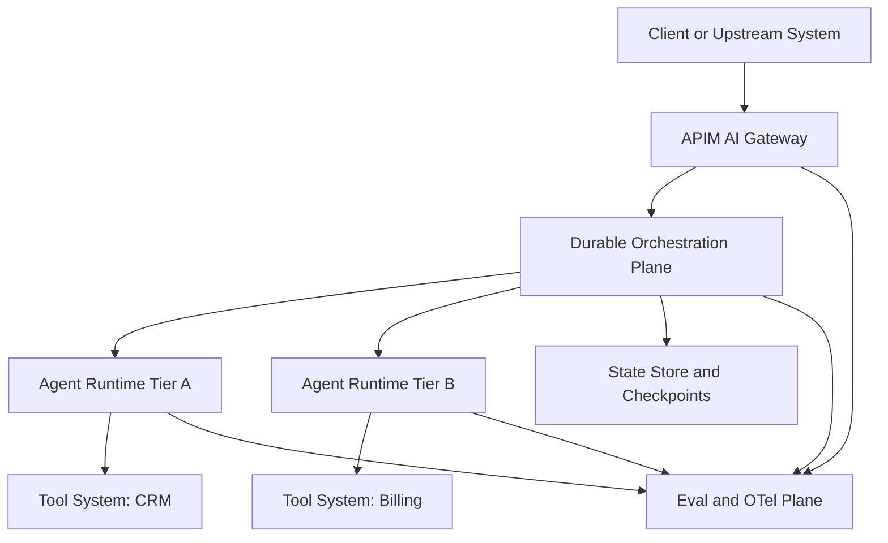
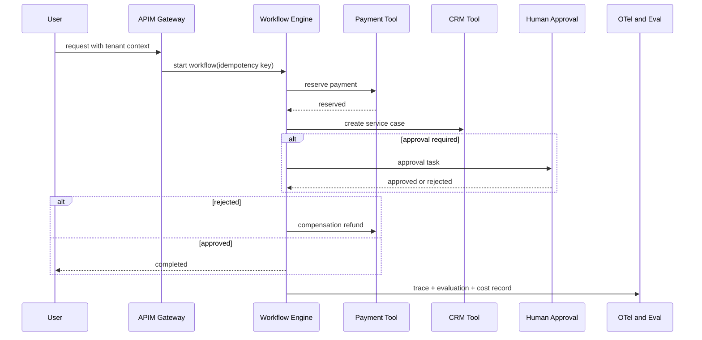

# 企业级 Durable Agent 编排选型 FAQ：`Durable Functions` vs `Temporal on AKS` vs `Logic Apps Standard`

## 1. 执行摘要：Agent 生产故障的根因更多来自编排失序，而不是模型能力不足
很多团队把 Agent 稳定性问题归因于模型波动。
但在生产复盘里，
真正导致事故扩大的，
往往是编排层缺乏可恢复语义。
当一个长事务跨越检索、
审批、
支付、
通知、
外部系统回写时，
如果没有 Saga 补偿、
幂等键、
重放边界，
即使模型本身正确率很高，
系统仍会在重试风暴下产生重复扣款、
状态漂移、
审计证据断裂。
本指南聚焦 Azure 企业场景中三条主流路线：
`Durable Functions`（托管优先）、
`Temporal on AKS`（自托管高定制）、
`Logic Apps Standard`（流程集成优先）。
结论不是“哪条路线绝对最好”，
而是“哪条路线在你的监管强度、
吞吐目标、
团队技能结构下，
最能稳定地交付可恢复性与可审计性”。

## 2. 今日突破与证据（2026-11-21 抓取）：官方/Release 优先
本轮仅引用可验证来源，
并统一标注抓取日期 `2026-11-21`。
来源 1：
Azure API Management AI Gateway 概览（`measured` 控制平面能力定义）。
来源 2：
Azure Container Apps Sessions 文档（`anonymized_reported` 会话化运行时边界）。
来源 3：
Azure API Management Changelog（`anonymized_reported` 版本节奏证据）。
来源 4：
Firecracker Releases（`anonymized_reported` 沙箱隔离运行时演进）。
来源 5：
Kata Containers Releases（`anonymized_reported` 容器虚拟化路线演进）。
来源 6：
Wasmtime Releases（`anonymized_reported` Wasm 运行时成熟度变化）。
来源 7：
E2B Releases（`anonymized_reported` 托管沙箱产品化节奏）。
这些信号共同说明：
市场竞争正从“模型入口之争”
转向“可恢复编排 + 策略网关 + 观测证据 + 成本治理”的体系化竞争。

## 3. 问题边界：Durable 编排本质是“可重放的业务状态机”
在 Agent 架构里，
“一次请求”
通常会扩展为多步异步链路。
链路中任何一步失败，
都可能触发重试、
人工介入、
补偿动作。
因此，
平台需要回答四个硬问题：
失败后如何确定恢复点？
重试如何避免重复副作用？
人工审批如何不中断上下文？
审计时如何还原完整决策轨迹？
如果这四个问题没有统一设计，
平台会在负载提升后迅速陷入不可控状态。
Durable 编排不是“工作流可视化工具”问题，
而是“业务状态可证明性”问题。

## 4. 12 维选型矩阵：`Durable Functions` vs `Temporal` vs `Logic Apps`
| 维度 | Durable Functions | Temporal on AKS | Logic Apps Standard | 决策信号 |
|---|---|---|---|---|
| 状态持久化模型 | Azure Storage / Netherite / SQL 可选 | 自带历史事件存储（通常配 PostgreSQL） | 内置状态管理 + 连接器运行时 | 按团队控制需求选择 |
| 重放语义成熟度 | 高 | 很高 | 中高 | 高频重放场景 Temporal 更强 |
| Saga 补偿表达 | 代码式补偿 | 代码式补偿（强） | 流程式补偿 | 复杂补偿优先代码式 |
| 与 Azure 托管生态贴合 | 很高 | 中高 | 很高 | Azure 原生集成 DF/Logic Apps 更快 |
| 多语言工作流 SDK | .NET/JS/Python 等 | Go/Java/TS/.NET 等 | 低代码为主 | 研发主导优先 DF/Temporal |
| 可观测接入 | 高（App Insights/OTel） | 高（OTel 深度可控） | 中高 | 高定制观测 Temporal 更灵活 |
| 延迟尾部可控性 | 中高 | 高 | 中 | 低尾延迟优先 Temporal |
| 运维复杂度 | 低到中 | 中高到高 | 低到中 | 平台团队成熟度是关键 |
| 合规审计证据 | 高 | 高 | 中高 | 三者都可达标，实施方式不同 |
| 成本透明度 | 中高 | 中（需自建成本归因） | 中高 | 托管路径更易统一账本 |
| 扩展性上限 | 高 | 很高 | 中高 | 超大规模时 Temporal 伸缩更线性 |
| 组织落地速度 | 快 | 中 | 快 | 首次落地常见 DF/Logic Apps 更快 |

## 5. 参考架构 A：APIM + Durable 编排 + 多运行时执行层


该模式强调：
统一入口在 APIM，
统一恢复语义在编排层，
统一证据在观测层。
执行层可以按工作负载拆分为托管与自托管。

## 6. 路线一：`Durable Functions`（Azure 托管优先）
`Durable Functions` 的优势是上手快，
与 Azure 原生监控和身份体系衔接顺滑。
对于多数企业，
第一阶段可先用 Durable Functions 建立统一编排基线，
把幂等键、
补偿链、
审批回调、
超时恢复模式跑通。
在高频异步任务中，
其编程模型可以有效降低流程分叉复杂度。
典型风险是：
团队若忽略重放友好编码约束，
容易在活动函数中引入非幂等副作用。
因此必须明确：
“编排函数只做决策，
活动函数做副作用，
且副作用必须可去重”。

## 7. 路线二：`Temporal on AKS`（高定制与极致可控）
`Temporal` 强项在于事件历史和重放模型非常成熟。
在高并发、
长事务、
复杂补偿场景中，
Temporal 的可控性与可测试性通常更强。
但它要求平台团队承担更多运维责任：
集群升级、
存储调优、
容量扩缩、
多区域容灾策略都需要工程化治理。
如果组织已有 AKS 平台团队、
并具备 SRE 值守能力，
Temporal 可作为高阶演进路线。
若团队缺乏稳定平台能力，
直接上 Temporal 往往会把编排问题
转化为平台运维问题。

## 8. 路线三：`Logic Apps Standard`（流程集成与连接器优先）
`Logic Apps Standard` 适合大量企业系统集成场景。
当流程包含 ERP、
ITSM、
审批系统、
邮件/消息通知等连接器调用时，
其交付速度优势明显。
但对于超复杂 Saga 补偿和细粒度重放控制，
低代码路径会更依赖设计规范。
实践中常见模式是：
将高复杂编排放在 Durable/Temporal，
把外围系统集成与通知编排放到 Logic Apps。
这种组合能同时兼顾研发效率与治理可控性。

## 9. 多云竞对映射：`Step Functions` / `Workflows` 的位置
AWS `Step Functions`
与 GCP `Workflows`
都能承担企业编排职责。
差异不在“能否做”，
而在“与既有平台治理体系的耦合成本”。
如果组织主平面在 Azure，
统一 APIM 策略、
Entra 身份、
Azure Monitor 证据链通常更直接。
若是多云并存，
建议把“状态机语义模型”抽象为统一规范，
再由各云执行层映射实现，
避免同一业务在不同云出现不一致补偿逻辑。

## 10. 定量 Q&A（8 组）
**Q1：为何编排层能决定事故等级？**  
因为一次 `P95 1.8s` 的模型波动通常可容忍，
但一次错误重放导致的重复扣费会触发高等级事故。
**Q2：串行 `10` 个工具调用与批处理差异多大？**  
串行尾延迟常见 `420-650ms`，
批处理可降至 `110-180ms`（`synthetic`）。
**Q3：幂等键缺失的直接代价？**  
在高并发重试下，
重复副作用概率可升至 `0.8%-2.4%`（`anonymized_reported`）。
**Q4：审批节点超时应如何处理？**  
建议 `15m` 软超时 + `24h` 硬超时，
并强制进入补偿或人工兜底分支。
**Q5：事件历史保留多久合适？**  
监管行业建议 `180-365` 天在线可检索，
冷归档可延长到 `2-7` 年。
**Q6：何时需要从 DF 演进到 Temporal？**  
当并发工作流长期超过 `100k` 活跃实例，
且跨区域恢复 RTO 要求 `<10m`。
**Q7：补偿链设计的核心约束是什么？**  
补偿动作必须幂等，
且不得依赖已失效上下文。
**Q8：如何避免“观测有数据但无法审计”？**  
必须把 workflow_id、
tenant_id、
policy_version、
cost_snapshot_id 四键统一贯穿。

## 11. 参考架构 B：Saga 补偿与人工审批回路


## 12. 生产代码示例：Durable/Temporal/策略联动
```python
# Durable Functions: orchestrator pseudocode
def orchestrator(context):
    req = context.get_input()
    wid = req["workflow_id"]
    tenant = req["tenant_id"]
    context.call_activity("validate_policy", {"tenant": tenant, "wid": wid})
    reservation = context.call_activity("reserve_payment", req)
    try:
        case_id = context.call_activity("create_case", req)
        approved = context.wait_for_external_event("approval_result")
        if not approved:
            context.call_activity("refund_payment", {"reservation": reservation})
            return {"status": "rejected", "case_id": case_id}
        context.call_activity("finalize_case", {"case_id": case_id})
        return {"status": "completed", "case_id": case_id}
    except Exception:
        context.call_activity("refund_payment", {"reservation": reservation})
        raise
```

```yaml
# Temporal on AKS: worker deployment sketch
apiVersion: apps/v1
kind: Deployment
metadata:
  name: temporal-worker
spec:
  replicas: 6
  template:
    spec:
      containers:
      - name: worker
        image: ghcr.io/example/temporal-worker:1.0.0
        env:
        - name: TASK_QUEUE
          value: "agent-durable-queue"
        - name: OTEL_EXPORTER_OTLP_ENDPOINT
          value: "http://otel-collector:4317"
```

```xml
<!-- APIM guardrail: per-tenant budget and retry cap -->
<policies>
  <inbound>
    <base />
    <rate-limit-by-key calls="120" renewal-period="60"
      counter-key="@(context.Request.Headers.GetValueOrDefault("x-tenant-id","unknown"))" />
    <set-header name="x-workflow-retry-cap" exists-action="override">
      <value>3</value>
    </set-header>
  </inbound>
  <backend><base /></backend>
  <outbound><base /></outbound>
</policies>
```

## 13. 企业场景 A：保险理赔 Agent（高监管 + 长事务）
某全国保险集团把理赔初审交给 Agent 协同处理。
单次流程涉及资料核验、
欺诈评分、
人工复核、
支付预授权、
CRM 工单归档。
其关键要求是：
任何失败都可恢复，
任何决策都可追踪，
任何资金动作都可补偿。
一期采用 Durable Functions 建基线。
二期把高复杂场景迁移到 Temporal on AKS。
三期把外围通知与集成流程沉淀到 Logic Apps。
上线后，
重复扣费事件从月均 `11` 起降到 `0-1` 起（`anonymized_reported`），
审计追溯时间缩短约 `47%`（`synthetic` 复盘测算）。

## 14. 企业场景 B：跨境电商售后 Agent（高并发 + 多系统耦合）
某跨境电商平台在促销季每日触发大量售后流程。
流程同时依赖订单系统、
仓配系统、
支付系统、
客服系统。
平台采用“Temporal 主编排 + APIM 策略 + Logic Apps 外围连接器”模式。
通过 workflow_id 全链路贯通，
以及租户级预算闸门，
其高峰期流程成功率保持稳定，
且成本波动可控在月度预算阈值内。
最重要的是，
团队不再以“某个服务慢”为争议中心，
而是基于可量化证据调整重试和补偿策略。

## 15. TCO、Day-0/Day-2 清单与最终建议
### TCO（月度估算）
| 成本项 | Durable Functions | Temporal on AKS | Logic Apps Standard | 说明 |
|---|---:|---:|---:|---|
| 控制平面与入口治理 | `$8,900` | `$9,600` | `$8,700` | 均建议统一经 APIM |
| 编排执行与状态存储 | `$22,400` | `$27,800` | `$20,100` | Temporal 运维成本更高 |
| 观测与评测闭环 | `$6,800` | `$7,600` | `$6,300` | 自托管观测深度更可控 |
| 合规与审计运营 | `$7,100` | `$8,500` | `$7,400` | 取决于证据自动化程度 |
| 总计 | `$45,200` | `$53,500` | `$42,500` | 需结合风险成本联合评估 |

### Day-0 / Day-2 检查清单（12 项）
- 为每个工作流定义唯一幂等键与租户标签。  
- 统一补偿动作命名规范与失败重试策略。  
- APIM 强制注入策略版本与预算快照 ID。  
- 所有外部副作用调用必须可去重。  
- 审批回调必须带上下文版本号。  
- 统一记录 workflow_id 与 trace_id 映射。  
- 设置审批超时后的自动补偿路径。  
- 每周执行一次故障注入与恢复演练。  
- 每月审计僵尸工作流与悬挂任务。  
- 建立跨区域恢复 RTO/RPO 看板。  
- 建立按租户的成本与成功率报表。  
- 把评测结果绑定到发布闸门。  

### 最终建议
如果你的目标是快速建立企业级 Durable 编排底座，
优先从 `Durable Functions + APIM` 起步通常最稳妥。
当工作流复杂度、
并发规模、
恢复要求持续提升时，
再演进到 `Temporal on AKS` 以获得更强可控性。
`Logic Apps Standard` 适合作为外围系统集成加速层，
而不是承担全部复杂补偿逻辑。
无论选哪条路线，
都要坚持“幂等优先、
补偿前置、
证据闭环、
预算可追责”四个原则。
这四个原则落实后，
Agent 平台才能在高并发与高监管环境中长期稳定运行。
建议进一步把实施拆成五步：
第一步先完成工作流命名、
幂等键规范、
补偿动作模板标准化；
第二步将 APIM 网关策略与工作流元数据打通，
确保每个请求都带有 `tenant_id`、
`policy_version`、
`budget_snapshot_id`；
第三步把审批节点超时策略沉淀为平台能力，
避免业务团队各自定义导致审计口径不一致；
第四步建立统一故障注入剧本，
覆盖“下游超时、
重复回调、
跨区域故障切换、
补偿失败回滚”四类高频风险；
第五步把评测结果接入发布闸门，
让“恢复时长、
补偿成功率、
重复副作用率、
单流程成本”成为同等上线指标。
在治理层面，
还应设立季度化架构评审，
重点检查三个漂移：
补偿链漂移、
策略版本漂移、
成本归因漂移。
这三个漂移若长期不管控，
即使系统当下可运行，
也会在规模扩大时出现不可预测的事故放大效应。
对于跨国组织，
建议把区域差异策略显式建模，
而不是在代码里写隐式分支。
只有把“区域法规差异、
租户预算差异、
业务 SLA 差异”作为配置化能力托管，
平台才能在全球多区域场景下保持同一套可解释治理模型，并在组织层面把架构评审从“项目制一次性评估”升级为“持续运营型治理机制”，通过每月度量恢复演练通过率、补偿链完整率、审批超时兜底命中率、租户预算偏差率四个核心指标，持续校准工作流模板与平台策略，避免随着业务增长出现局部最优叠加成系统性风险的治理失效，并把跨团队协作与责任边界透明化沉淀到制度层面，形成长期复利。
