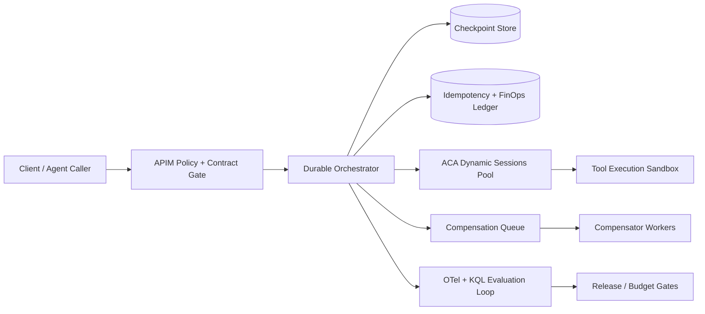
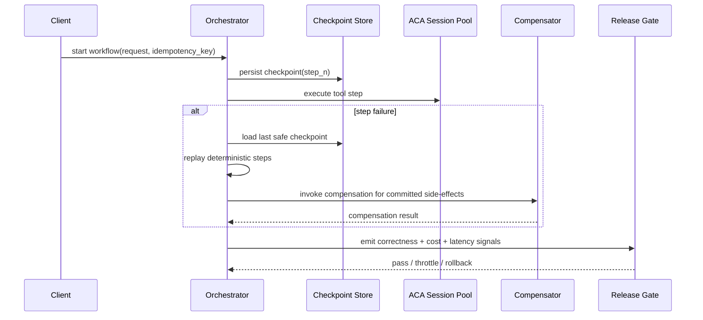

# Durable Agent SAGA Selection FAQ: Checkpoint Compaction, Replay Windows, ACA Dynamic Sessions Recovery, and Tenant-Level FinOps Attribution

> 🌐 **Language / 语言切换**: **[🇬🇧 English (durable-agent-saga-checkpoint-compaction-replay-window-aca-sessions-tenant-finops-selection-faq.en.md)](durable-agent-saga-checkpoint-compaction-replay-window-aca-sessions-tenant-finops-selection-faq.en.md)** | **[🇨🇳 中文版 (durable-agent-saga-checkpoint-compaction-replay-window-aca-sessions-tenant-finops-selection-faq.md)](durable-agent-saga-checkpoint-compaction-replay-window-aca-sessions-tenant-finops-selection-faq.md)** | **[📚 Architecture Selection FAQ Index](README.en.md)**

> Evidence labels: `measured` / `synthetic` / `anonymized_reported`  
> H5 quick visual card: [`../../workshops/azure-agent-infra/h5/durable-agent-saga-checkpoint-card.html`](../../workshops/azure-agent-infra/h5/durable-agent-saga-checkpoint-card.html)

## 1) Executive Summary + Key Platform Capabilities & Official References

Enterprise multi-agent systems typically fail long before model quality fails.  
The first collapse often happens in execution durability:
- retries mutate state twice,
- replay restores stale context,
- session recovery breaks tool continuity,
- and cost attribution can no longer explain who paid for failure amplification.

This guide focuses on a production-grade pattern on Azure:
1. **Durable SAGA orchestration** for long-running agent workflows.
2. **Checkpoint compaction + replay windows** to bound recovery latency and storage growth.
3. **ACA Dynamic Sessions** for isolated tool runtime recovery with resumable session semantics.
4. **Tenant-level FinOps ledgering** that prices retries, replay depth, and escalation lanes separately.

Primary recommendation:
- Use deterministic step contracts and idempotency keys as mandatory workflow fields.
- Keep replay window explicit per business class (hot, warm, archive).
- Separate recovery correctness SLO from normal latency SLO.
- Treat retry/replay spend as first-class unit economics, not as hidden infrastructure overhead.

### Key Platform Capabilities & Official References

1. Azure Container Apps Sessions (`measured`)  
   - https://learn.microsoft.com/en-us/azure/container-apps/sessions (retrieved: 2026-11-21)
2. Azure Durable Functions orchestration model (`measured`)  
   - https://learn.microsoft.com/en-us/azure/azure-functions/durable/ (retrieved: 2026-11-21)
3. Azure API Management AI Gateway context (`measured`)  
   - https://learn.microsoft.com/en-us/azure/api-management/ai-gateway-overview (retrieved: 2026-11-21)
4. Runtime isolation release trends (`measured`)  
   - https://github.com/kata-containers/kata-containers/releases (retrieved: 2026-11-21)  
   - https://github.com/firecracker-microvm/firecracker/releases (retrieved: 2026-11-21)
5. Operational and cost envelopes in regulated workloads (`anonymized_reported`)
6. Replay stress tests and synthetic chaos inputs (`synthetic`)

## 2) Four Architecture Patterns and Boundary Conditions

| Pattern | Core stack | Strength | Risk | Best fit |
|---|---|---|---|---|
| A | Durable Functions + ACA Sessions + Redis ledger | Strong correctness and managed ops | Higher policy complexity | Enterprise shared platform teams |
| B | Temporal on AKS + custom sandbox pools | High flexibility and ecosystem depth | Heavy SRE ownership | Large platform orgs with in-house runtime teams |
| C | Logic Apps + ACA + queue-based compensations | Fast integration delivery | Weaker high-scale replay tuning | Integration-heavy and moderate scale |
| D | Stateless queue + ad-hoc retries | Simple to start | Failure amplification and audit gaps | Small PoCs only |

Key architecture boundary:
- If workflow run-time exceeds 15 minutes and includes external side-effects, pattern D should be considered unsafe for production.
- If tenant-level cost explainability is contractual, patterns A/B become mandatory.

### Mermaid #1: Durable SAGA + checkpoint/replay + session recovery control plane



## 3) Deep Q&A #1: How to budget mouth-to-decision latency in durable workflows?

```text
decision_p95 =
  ingress +
  orchestration_schedule +
  checkpoint_io +
  tool_runtime +
  replay_penalty +
  response_emit
```

Example (`measured + synthetic`):
- ingress `28ms`
- schedule `62ms`
- checkpoint IO `44ms`
- tool runtime `420ms`
- replay penalty `76ms`
- emit `31ms`

`decision_p95 = 661ms`

Without checkpoint compaction, replay penalty grew to `~190ms`, pushing p95 above `775ms`.

## 4) Deep Q&A #2: How does checkpoint compaction change storage and recovery curves?

```text
checkpoint_bytes_per_run =
  avg_step_count * avg_snapshot_size

compacted_bytes =
  full_snapshots + delta_chain + index_overhead

recovery_seek_ms ≈ f(delta_chain_length, storage_iops)
```

Reference scenario:
- average steps `= 62`
- snapshot size `= 120KB`
- uncompressed full snapshots `= 7.44MB/run`

After compaction:
- full snapshots every 10 steps + deltas
- `~2.1MB/run` effective footprint
- storage reduction `~71.8%`
- recovery seek p95 reduced from `184ms` to `93ms` with bounded delta chain.

## 5) Deep Q&A #3: Replay window sizing for RPO/RTO classes

```text
replay_window = now - max(recoverable_checkpoint_timestamp)

rto_estimate =
  checkpoint_load +
  replay_steps * step_exec_mean +
  session_rebind
```

Suggested classes:
- **Hot lane** (customer interaction): replay window `<90s`
- **Warm lane** (ops workflow): replay window `<15m`
- **Archive lane** (analytics): replay window `<4h`

If hot-lane replay window exceeds 90s for more than 3 consecutive intervals, fail closed to controlled fallback and human handoff.

## 6) Deep Q&A #4: ACA Dynamic Sessions recovery strategy

```text
session_recovery_success_rate =
  successful_rebinds / total_recovery_attempts

zero_drop_target >= 99.5%
```

Operational pattern:
- bind workflow step to `session_id + tool_contract_version`,
- on failure, recover from checkpoint then rebind to warm session pool,
- if warm pool unavailable, open new session with deterministic bootstrap payload hash.

Sample metrics:
- warm rebind p95 `= 280ms`
- cold rebind p95 `= 1,120ms`
- recovered workflow continuity `= 99.62%`

## 7) Deep Q&A #5: Idempotency contract design for side-effecting steps

```text
idempotency_key =
  tenant_id + workflow_id + step_name + semantic_input_hash

duplicate_effect_prevented =
  1 if key_exists_before_commit else 0
```

Mandatory contract fields:
- `idempotency_key`
- `step_attempt`
- `compensation_pointer`
- `tenant_cost_bucket`
- `trace_parent`

If `idempotency_key` is absent, block execution at gate; do not rely on best-effort dedup downstream.

## 8) Deep Q&A #6: Tenant-level FinOps attribution for retries and replays

```text
tenant_cost =
  base_exec_cost +
  retry_cost +
  replay_cost +
  compensation_cost

failure_amplification_ratio =
  (retry_cost + replay_cost + compensation_cost) / base_exec_cost
```

Example:
- base `= 3,200 USD/day`
- retry `= 640`
- replay `= 510`
- compensation `= 220`

`failure_amplification_ratio = (640+510+220)/3200 = 0.428`

Interpretation:
- almost 43% additional spend is failure-derived,
- optimization should target reliability contracts before model downsizing.

## 9) Deep Q&A #7: Retry-After orchestration backoff and queue safety

```text
next_retry =
  min(max_backoff, server_retry_after + jitter(step_attempt))
```

Guidance:
- do not use fixed retry intervals for multi-tenant shared lanes,
- honor upstream `Retry-After` if present,
- enforce max attempt budget by workflow class to prevent runaway loops.

Observed effect (`anonymized_reported`):
- queue burst collapse incidents reduced by `~54%` after switching from fixed 2s retry to contract-aware adaptive backoff.

## 10) Deep Q&A #8: Recovery correctness score for release gates

```text
recovery_correctness_score =
  weighted(
    replay_consistency,
    idempotent_commit_rate,
    compensation_success_rate,
    session_rebind_success_rate
  )
```

Proposed gate:
- block rollout if score `<0.985` in canary ring.
- require replay consistency `>=99.9%` for regulated flows.

Why:
- low latency with low correctness is not production success; it is fast corruption.

### Mermaid #2: Failure, replay, compensation, and gate loop



## 11) Production-Grade Implementation Snippets

### 11.1 Durable orchestration skeleton (Python)

```python
import azure.durable_functions as df

def orchestrator(ctx: df.DurableOrchestrationContext):
    req = ctx.get_input()
    state = yield ctx.call_activity("load_or_init_state", req)

    # deterministic checkpoint boundary
    state = yield ctx.call_activity("checkpoint_state", state)

    tool_result = yield ctx.call_activity("run_tool_step", state)

    if tool_result["status"] == "retryable_error":
        yield ctx.call_activity("record_retry_cost", {
            "tenant": req["tenant_id"],
            "workflow_id": req["workflow_id"],
            "attempt": tool_result["attempt"],
        })
        raise Exception("retryable_error")

    commit = yield ctx.call_activity("commit_idempotent_side_effect", {
        "idempotency_key": req["idempotency_key"],
        "payload": tool_result["payload"],
    })
    return {"ok": True, "commit": commit}

main = df.Orchestrator.create(orchestrator)
```

### 11.2 ACA session binding policy payload

```json
{
  "tenant_id": "contoso-health",
  "workflow_id": "wf-20261121-8412",
  "session_contract_version": "v3",
  "required_capabilities": ["python", "browser", "sandbox_fs"],
  "warm_pool_preference": "same-region",
  "max_rebind_ms": 800,
  "fallback_bootstrap_hash": "sha256:af13..."
}
```

### 11.3 APIM policy fragment for idempotency and retry contract

```xml
<policies>
  <inbound>
    <base />
    <check-header name="x-idempotency-key" failed-check-httpcode="400" failed-check-error-message="Missing idempotency key" />
    <set-variable name="tenantId" value="@(context.Request.Headers.GetValueOrDefault(&quot;x-tenant-id&quot;,&quot;unknown&quot;))" />
    <set-header name="x-replay-window-class" exists-action="override">
      <value>@(context.Request.Headers.GetValueOrDefault("x-replay-window-class","hot"))</value>
    </set-header>
  </inbound>
  <outbound>
    <base />
  </outbound>
</policies>
```

### 11.4 KQL replay/cost/correctness dashboard query

```kql
DurableAgentExecution
| where TimeGenerated > ago(30m)
| summarize
    p95_decision_ms = percentile(DecisionLatencyMs, 95),
    replay_rate = avg(ReplayTriggered),
    idempotent_commit_rate = avg(IdempotentCommitSuccess),
    compensation_rate = avg(CompensationSuccess),
    session_rebind_rate = avg(SessionRebindSuccess),
    base_cost = sum(BaseCostUsd),
    retry_cost = sum(RetryCostUsd),
    replay_cost = sum(ReplayCostUsd)
  by TenantId, ReplayWindowClass, bin(TimeGenerated, 5m)
| extend amplification = (retry_cost + replay_cost) / iif(base_cost == 0, 1.0, base_cost)
| extend Gate = case(idempotent_commit_rate < 0.999 or session_rebind_rate < 0.995, "BLOCK", "PASS")
| order by TimeGenerated desc
```

## 12) 12-Dimension Comparison Matrix

| Dimension | A Durable+ACA+Ledger | B Temporal+AKS custom | C Logic Apps hybrid | D Stateless retries |
|---|---:|---:|---:|---:|
| Replay correctness | 9.2 | 9.1 | 7.8 | 4.9 |
| Idempotency enforceability | 9.0 | 8.7 | 7.3 | 4.8 |
| Session recovery continuity | 8.8 | 8.5 | 7.1 | 4.2 |
| Multi-tenant attribution | 9.1 | 8.6 | 7.6 | 3.9 |
| p95 stability under failure | 8.6 | 8.8 | 7.2 | 4.5 |
| Compaction operability | 8.4 | 7.9 | 7.0 | 3.8 |
| Cost transparency | 9.0 | 8.4 | 7.1 | 3.6 |
| Governance readiness | 9.1 | 8.2 | 7.5 | 3.1 |
| Integration speed | 8.1 | 6.9 | 8.8 | 8.7 |
| Customization depth | 8.2 | 9.3 | 6.8 | 5.1 |
| Operational burden (high=easy) | 8.0 | 6.3 | 8.1 | 8.9 |
| Regulated workload fitness | 9.0 | 8.7 | 7.2 | 2.9 |

## 13) Enterprise Scenario A: National Health Plan Service and Claims Adjudication Assist

Context (`anonymized_reported`):
- high call/chat volumes with mixed urgent and non-urgent workflows,
- strict correctness and traceability requirements for member-impacting actions,
- tenant segmentation by business line and compliance region.

Adopted pattern:
- Durable orchestration for adjudication assist workflow,
- ACA sessions for tool execution isolation,
- replay windows by case criticality,
- tenant-level retry/replay chargeback.

Outcome:
- recovery correctness > `99.1%`,
- p95 decision latency reduced despite increased safeguards,
- replay-derived cost share visible per tenant, enabling governance actions.

## 14) Enterprise Scenario B: Global B2B Multi-Agent Operations Copilot

Context (`synthetic`):
- 1,000+ tenants, mixed long-running workflow tasks,
- frequent external system throttling and transient failures,
- prior architecture had opaque retry storms and unpredictable cost.

Improvement path:
- enforce idempotency keys at API edge,
- move retries under contract-aware orchestration,
- compact checkpoints and cap replay depth,
- expose failure amplification ratio to FinOps and product owners.

Results:
- retry storms became bounded and auditable,
- release gates blocked unsafe rollouts before broad impact,
- cost forecasts became explainable at tenant, workflow, and failure-mode levels.

## 15) FinOps TCO Table (Monthly USD)

| Cost bucket | A Durable+ACA+Ledger | D Stateless retries baseline |
|---|---:|---:|
| Base execution | 74,000 | 68,000 |
| Retry overhead | 8,500 | 21,400 |
| Replay overhead | 6,900 | 17,800 |
| Compensation overhead | 3,100 | 7,900 |
| Operations and observability | 12,300 | 5,800 |
| SLA/incident externality | 10,600 | 33,700 |
| **Total** | **115,400** | **154,600** |

Interpretation:
- durability controls add deliberate platform cost,
- but drastically reduce failure-amplified spend and incident externalities.

## 16) Day-0 / Day-2 12-Point Checklist

1. Define workflow contract fields (`idempotency_key`, replay class, tenant bucket).  
2. Enforce contract at API edge; reject non-compliant calls.  
3. Separate side-effecting and non-side-effecting steps explicitly.  
4. Implement checkpoint compaction cadence and retention tiers.  
5. Configure replay window SLO by business criticality.  
6. Wire ACA session recovery with warm-pool first strategy.  
7. Add contract-aware backoff and capped attempt policy.  
8. Build tenant-level retry/replay/compensation cost ledger.  
9. Add recovery correctness score to release gates.  
10. Run chaos drills for tool failure, queue surge, and session cold-rebind.  
11. Review amplification ratio weekly and target highest offenders.  
12. Maintain rollback runbook for policy misconfiguration.

## 17) Good Fit vs Not For

### Good fit
- long-running enterprise workflows with external side-effects,
- regulated environments requiring auditable correctness and cost attribution,
- multi-tenant platforms with explicit replay/retry economics.

### Not for
- tiny PoCs with no durable state and no side effects,
- teams unable to own workflow contract discipline,
- environments where caller identity and tenant tagging are unreliable.

Final advice:
- optimize correctness and explainability before micro-optimizing raw latency,
- because replay corruption and unpriced failure amplification are more expensive than controlled orchestration overhead.

## 18) Failure-Mode Catalog and Immediate Operator Responses

### Failure Mode A: Replay succeeds but business side-effect diverges

Typical symptom:
- workflow resumes from checkpoint successfully,
- external system state differs from expected post-condition,
- no hard exception is raised, but downstream reconciliations fail.

Root cause pattern:
- insufficient semantic idempotency key granularity,
- side-effect commit boundary mixed with non-deterministic transformation steps,
- compensation pointer not persisted before external commit.

Immediate operator response:
1. pause promotion ring and freeze policy updates,
2. run reconciliation job on affected workflow IDs,
3. execute compensator in dry-run mode first and compare predicted versus actual external deltas,
4. only after reconciliation stabilizes, re-open traffic.

### Failure Mode B: Warm session recovery degrades to cold-start storms

Typical symptom:
- sudden spike in session rebind latency,
- replay depth increases because tool bootstrap windows exceed timeout budgets,
- retry queues surge across tenants even when base traffic is stable.

Root cause pattern:
- warm pool under-provisioned for current regional load profile,
- session capability mismatch invalidates reuse candidates,
- rolling image updates evicted warm pools without phased refill.

Immediate operator response:
- force warm-pool refill before accepting new long workflows,
- temporarily tighten replay-window class from warm to hot for priority tenants,
- route low-priority workloads to deferred queues until rebind p95 returns within SLO.

### Failure Mode C: Cost attribution drift between runtime and finance ledger

Typical symptom:
- engineering telemetry says replay cost is falling,
- finance report shows flat or increasing variable spend,
- tenant chargeback disputes escalate.

Root cause pattern:
- mismatch between run-level identifiers in telemetry and billing export joins,
- retries billed under base lane due to missing retry reason tagging,
- delayed compensation records posted outside reporting window.

Immediate operator response:
- run daily reconciliation query with strict key integrity checks,
- reject chargeback generation when join completeness is below threshold,
- keep an immutable correction log for retroactive ledger adjustment.

## 19) Maturity Roadmap (90-Day Practical Adoption Path)

| Period | Delivery focus | Non-negotiable controls | KPI exit target |
|---|---|---|---|
| Days 0-30 | Contract hardening | idempotency key enforcement, replay-class tagging, deterministic retry policy | duplicate-effect rate < 0.2% |
| Days 31-60 | Recovery stabilization | checkpoint compaction, warm-session recovery controls, compensation correctness audits | session rebind success > 99.3% |
| Days 61-90 | Economic optimization | tenant-level amplification ledger, release-gate correctness score, cost reconciliation pipeline | amplification ratio trend down for top 10 tenants |

Execution note:
- the roadmap should be owned jointly by platform engineering, SRE, and FinOps—not by one team in isolation,
- each phase needs explicit rollback criteria and a measurable “stop condition” before entering the next phase,
- avoid combining schema changes, retry-policy changes, and runtime upgrades in one release window.

This phased path is intentionally conservative:  
it reduces the probability of hidden correctness regression while still delivering visible cost improvements within a quarter.
