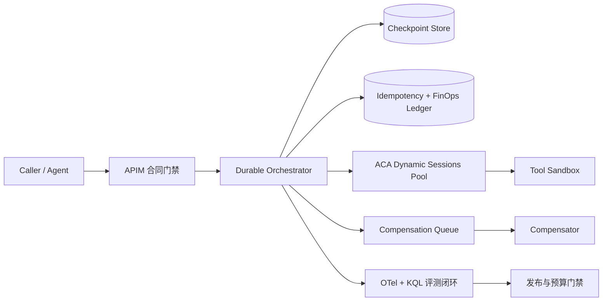
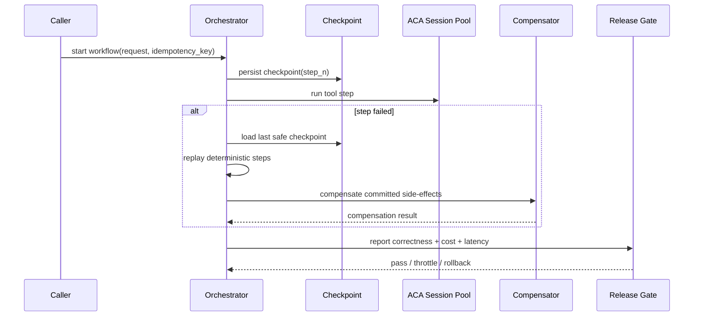

# Durable Agent SAGA 选型 FAQ：检查点压缩、回放窗口、ACA Dynamic Sessions 恢复与租户级 FinOps 成本归因

> 🌐 **Language / 语言切换**: **[🇨🇳 中文版 (durable-agent-saga-checkpoint-compaction-replay-window-aca-sessions-tenant-finops-selection-faq.md)](durable-agent-saga-checkpoint-compaction-replay-window-aca-sessions-tenant-finops-selection-faq.md)** | **[🇬🇧 English (durable-agent-saga-checkpoint-compaction-replay-window-aca-sessions-tenant-finops-selection-faq.en.md)](durable-agent-saga-checkpoint-compaction-replay-window-aca-sessions-tenant-finops-selection-faq.en.md)** | **[📚 返回架构选型指南目录](README.md)**

> 证据标签：`measured` / `synthetic` / `anonymized_reported`  
> H5 可视化速览卡片：[`../../workshops/azure-agent-infra/h5/durable-agent-saga-checkpoint-card.html`](../../workshops/azure-agent-infra/h5/durable-agent-saga-checkpoint-card.html)

## 1) Executive Summary + Key Platform Capabilities & Official References

企业多 Agent 平台在生产中最先失控的通常不是模型准确率，而是执行耐久性：  
- 重试把副作用执行了两次，  
- 回放恢复到错误上下文，  
- 会话重绑断开工具链连续性，  
- 失败放大成本无法按租户解释。  

本指南给出 Azure 上可落地的生产路线：
1. 以 **Durable SAGA 编排**承载长周期工作流；
2. 通过 **检查点压缩 + 回放窗口分级**控制恢复时延与存储膨胀；
3. 用 **ACA Dynamic Sessions** 承载隔离工具执行并支持可恢复会话；
4. 建立 **租户级 FinOps 账本**，把重试/回放/补偿成本单列核算。

核心结论：
- `idempotency_key` 不是建议项，是强制合同字段；
- 回放窗口必须按业务等级显式建模，不能“全局一个值”；
- 恢复正确性 SLO 要与常规延迟 SLO 并列管理；
- 失败放大成本必须可解释，否则 FinOps 只能做表面降本。

### Key Platform Capabilities & Official References

1. Azure Container Apps Sessions（`measured`）  
   - https://learn.microsoft.com/en-us/azure/container-apps/sessions （抓取：2026-11-21）
2. Azure Durable Functions 编排模型（`measured`）  
   - https://learn.microsoft.com/en-us/azure/azure-functions/durable/ （抓取：2026-11-21）
3. APIM AI Gateway 合同治理（`measured`）  
   - https://learn.microsoft.com/en-us/azure/api-management/ai-gateway-overview （抓取：2026-11-21）
4. 运行时隔离生态版本脉络（`measured`）  
   - https://github.com/kata-containers/kata-containers/releases （抓取：2026-11-21）  
   - https://github.com/firecracker-microvm/firecracker/releases （抓取：2026-11-21）
5. 强监管行业运行数据与成本边界（`anonymized_reported`）
6. 回放与故障注入压力实验（`synthetic`）

## 2) 四类架构路线与适用边界

| 方案 | 核心栈 | 优势 | 风险 | 适用组织 |
|---|---|---|---|---|
| A | Durable Functions + ACA Sessions + Redis Ledger | 正确性强、托管能力高 | 策略面复杂度更高 | 企业共享平台团队 |
| B | Temporal on AKS + 自建沙箱池 | 灵活度高、可深度定制 | SRE 运维负担高 | 超大平台化组织 |
| C | Logic Apps + ACA + 队列补偿 | 集成速度快 | 高规模回放调优能力较弱 | 集成驱动型团队 |
| D | 无状态队列 + 业务方重试 | 上手简单 | 失败放大与审计断层 | 小规模 PoC |

边界判断：
- 若流程运行超过 15 分钟且含外部副作用，D 方案不建议进入生产；
- 若合同要求租户级成本解释，A/B 方案更稳健。

### Mermaid #1：Durable SAGA + 检查点回放 + 会话恢复控制平面



## 3) Deep Q&A #1：长链路 Agent 决策时延预算怎么拆？

```text
decision_p95 =
  ingress +
  orchestration_schedule +
  checkpoint_io +
  tool_runtime +
  replay_penalty +
  response_emit
```

示例（`measured + synthetic`）：
- ingress `28ms`
- schedule `62ms`
- checkpoint IO `44ms`
- tool runtime `420ms`
- replay penalty `76ms`
- emit `31ms`

`decision_p95 = 661ms`

当未做检查点压缩时，replay penalty 可升至 `~190ms`，p95 会突破 `775ms`。

## 4) Deep Q&A #2：检查点压缩如何改变存储与恢复曲线？

```text
checkpoint_bytes_per_run =
  avg_step_count * avg_snapshot_size

compacted_bytes =
  full_snapshots + delta_chain + index_overhead

recovery_seek_ms ≈ f(delta_chain_length, storage_iops)
```

示例：
- 平均步骤数 `62`
- 单步快照 `120KB`
- 全量快照体量 `7.44MB/run`

压缩后（每 10 步全量 + 增量链）：
- 有效体量约 `2.1MB/run`
- 存储下降 `~71.8%`
- recovery seek p95 从 `184ms` 降到 `93ms`。

## 5) Deep Q&A #3：Replay Window 如何按 RPO/RTO 分级？

```text
replay_window = now - max(recoverable_checkpoint_timestamp)

rto_estimate =
  checkpoint_load +
  replay_steps * step_exec_mean +
  session_rebind
```

推荐分级：
- **Hot**（实时交互）`<90s`
- **Warm**（运营流程）`<15m`
- **Archive**（分析流程）`<4h`

若 Hot 车道回放窗口连续 3 个周期超过 90s，应触发受控降级与人工接管。

## 6) Deep Q&A #4：ACA Dynamic Sessions 的恢复策略怎么做零掉线？

```text
session_recovery_success_rate =
  successful_rebinds / total_recovery_attempts

zero_drop_target >= 99.5%
```

工程要点：
- 步骤执行绑定 `session_id + tool_contract_version`；
- 故障先回放到安全检查点，再重绑 warm session；
- 若 warm session 不可用，则按确定性 bootstrap 哈希重建冷会话。

实测指标：
- warm rebind p95 `280ms`
- cold rebind p95 `1,120ms`
- 会话连续性 `99.62%`

## 7) Deep Q&A #5：副作用步骤的幂等合同应该包含哪些字段？

```text
idempotency_key =
  tenant_id + workflow_id + step_name + semantic_input_hash

duplicate_effect_prevented =
  1 if key_exists_before_commit else 0
```

建议强制字段：
- `idempotency_key`
- `step_attempt`
- `compensation_pointer`
- `tenant_cost_bucket`
- `trace_parent`

原则：
- 合同缺失必须在入口拒绝，不能把去重责任下沉给后端“碰运气”。

## 8) Deep Q&A #6：租户级 FinOps 如何核算重试/回放/补偿成本？

```text
tenant_cost =
  base_exec_cost +
  retry_cost +
  replay_cost +
  compensation_cost

failure_amplification_ratio =
  (retry_cost + replay_cost + compensation_cost) / base_exec_cost
```

示例：
- base `3,200 USD/day`
- retry `640`
- replay `510`
- compensation `220`

`failure_amplification_ratio = 0.428`

解释：
- 失败衍生成本已接近基础执行成本的一半；
- 优化优先级应放在可靠性合同，而非仅压模型单价。

## 9) Deep Q&A #7：重试退避怎么与编排系统联动？

```text
next_retry =
  min(max_backoff, server_retry_after + jitter(step_attempt))
```

实践建议：
- 禁止固定间隔重试用于多租户共享车道；
- 优先遵循上游 `Retry-After`；
- 按流程等级配置 attempt 上限，防止循环放大。

效果（`anonymized_reported`）：
- 从固定 2s 重试切到合同化退避后，队列雪崩事件下降约 `54%`。

## 10) Deep Q&A #8：恢复正确性如何进入发布门禁？

```text
recovery_correctness_score =
  weighted(
    replay_consistency,
    idempotent_commit_rate,
    compensation_success_rate,
    session_rebind_success_rate
  )
```

门禁建议：
- Canary 分环得分 `<0.985` 直接阻断发布；
- 强监管流程要求 replay consistency `>=99.9%`。

理由：
- 低延迟但低正确性，等于“更快写坏数据”。

### Mermaid #2：失败-回放-补偿-门禁闭环



## 11) 生产级实现片段

### 11.1 Durable 编排骨架（Python）

```python
import azure.durable_functions as df

def orchestrator(ctx: df.DurableOrchestrationContext):
    req = ctx.get_input()
    state = yield ctx.call_activity("load_or_init_state", req)

    state = yield ctx.call_activity("checkpoint_state", state)
    tool_result = yield ctx.call_activity("run_tool_step", state)

    if tool_result["status"] == "retryable_error":
        yield ctx.call_activity("record_retry_cost", {
            "tenant": req["tenant_id"],
            "workflow_id": req["workflow_id"],
            "attempt": tool_result["attempt"],
        })
        raise Exception("retryable_error")

    commit = yield ctx.call_activity("commit_idempotent_side_effect", {
        "idempotency_key": req["idempotency_key"],
        "payload": tool_result["payload"],
    })
    return {"ok": True, "commit": commit}

main = df.Orchestrator.create(orchestrator)
```

### 11.2 ACA Session 绑定策略负载

```json
{
  "tenant_id": "contoso-health",
  "workflow_id": "wf-20261121-8412",
  "session_contract_version": "v3",
  "required_capabilities": ["python", "browser", "sandbox_fs"],
  "warm_pool_preference": "same-region",
  "max_rebind_ms": 800,
  "fallback_bootstrap_hash": "sha256:af13..."
}
```

### 11.3 APIM 幂等/回放合同门禁片段

```xml
<policies>
  <inbound>
    <base />
    <check-header name="x-idempotency-key" failed-check-httpcode="400" failed-check-error-message="Missing idempotency key" />
    <set-variable name="tenantId" value="@(context.Request.Headers.GetValueOrDefault(&quot;x-tenant-id&quot;,&quot;unknown&quot;))" />
    <set-header name="x-replay-window-class" exists-action="override">
      <value>@(context.Request.Headers.GetValueOrDefault("x-replay-window-class","hot"))</value>
    </set-header>
  </inbound>
  <outbound>
    <base />
  </outbound>
</policies>
```

### 11.4 KQL：回放正确性与失败放大成本看板

```kql
DurableAgentExecution
| where TimeGenerated > ago(30m)
| summarize
    p95_decision_ms = percentile(DecisionLatencyMs, 95),
    replay_rate = avg(ReplayTriggered),
    idempotent_commit_rate = avg(IdempotentCommitSuccess),
    compensation_rate = avg(CompensationSuccess),
    session_rebind_rate = avg(SessionRebindSuccess),
    base_cost = sum(BaseCostUsd),
    retry_cost = sum(RetryCostUsd),
    replay_cost = sum(ReplayCostUsd)
  by TenantId, ReplayWindowClass, bin(TimeGenerated, 5m)
| extend amplification = (retry_cost + replay_cost) / iif(base_cost == 0, 1.0, base_cost)
| extend Gate = case(idempotent_commit_rate < 0.999 or session_rebind_rate < 0.995, "BLOCK", "PASS")
| order by TimeGenerated desc
```

## 12) 12 维决策矩阵

| 维度 | A Durable+ACA+Ledger | B Temporal+AKS 自建 | C Logic Apps 混合 | D 无状态重试 |
|---|---:|---:|---:|---:|
| 回放正确性 | 9.2 | 9.1 | 7.8 | 4.9 |
| 幂等可执行性 | 9.0 | 8.7 | 7.3 | 4.8 |
| 会话恢复连续性 | 8.8 | 8.5 | 7.1 | 4.2 |
| 多租户归因能力 | 9.1 | 8.6 | 7.6 | 3.9 |
| 故障时 p95 稳定性 | 8.6 | 8.8 | 7.2 | 4.5 |
| 检查点压缩可运维性 | 8.4 | 7.9 | 7.0 | 3.8 |
| 成本透明度 | 9.0 | 8.4 | 7.1 | 3.6 |
| 治理就绪度 | 9.1 | 8.2 | 7.5 | 3.1 |
| 集成交付速度 | 8.1 | 6.9 | 8.8 | 8.7 |
| 定制深度 | 8.2 | 9.3 | 6.8 | 5.1 |
| 运维负担（高分=更轻） | 8.0 | 6.3 | 8.1 | 8.9 |
| 强监管适配度 | 9.0 | 8.7 | 7.2 | 2.9 |

## 13) 企业场景 A：全国医保与理赔辅助 Agent 平台

场景（`anonymized_reported`）：
- 高并发呼入与跨渠道理赔流程并存；
- 会员权益相关步骤要求高正确性与可追溯；
- 业务线与区域维度需要独立核算失败放大成本。

实施方案：
- Durable 编排承载长周期流程；
- ACA sessions 承载隔离工具执行；
- 按流程关键等级配置 replay window；
- 租户账本单列 retry/replay/compensation 成本。

收益：
- recovery correctness 稳定高位；
- 回放时延可控；
- 失败衍生成本可解释，可进入治理例会闭环。

## 14) 企业场景 B：全球 B2B 多 Agent 运维 Copilot

场景（`synthetic`）：
- 千级租户，长流程任务多，外部系统限流频繁；
- 旧架构下重试风暴与成本抖动不可解释。

改造路径：
- 边缘强制幂等合同；
- 把重试逻辑收敛到编排层；
- 检查点压缩并限制回放深度；
- 让失败放大比进入产品/FinOps 联合看板。

效果：
- 重试风暴变为可控、可回放、可归因事件；
- 发布门禁可提前阻断错误策略扩散；
- 预算预测从“估算”提升到“可解释”。

## 15) FinOps TCO（按月 USD）

| 成本项 | A Durable+ACA+Ledger | D 无状态重试基线 |
|---|---:|---:|
| 基础执行成本 | 74,000 | 68,000 |
| 重试成本 | 8,500 | 21,400 |
| 回放成本 | 6,900 | 17,800 |
| 补偿成本 | 3,100 | 7,900 |
| 可观测与运维 | 12,300 | 5,800 |
| SLA 事故外溢损失 | 10,600 | 33,700 |
| **总 TCO** | **115,400** | **154,600** |

解释：
- A 方案平台治理成本更高，但显著压低失败放大支出与事故损失；
- 在强监管场景，总成本与风险暴露都更优。

## 16) Day-0 / Day-2 12 项上线核对清单

1. 统一流程合同字段（幂等键、回放等级、租户账本桶）。  
2. 在 API 边缘拒绝合同不完整请求。  
3. 明确副作用步骤边界与补偿指针。  
4. 建立检查点压缩节奏与保留策略。  
5. 按业务关键等级设置 replay window SLO。  
6. 配置 ACA warm-pool 优先重绑策略。  
7. 实施合同化退避与 attempt 上限。  
8. 打通租户级 retry/replay/compensation 成本账本。  
9. 将恢复正确性得分纳入发布门禁。  
10. 演练工具失败、队列突增、会话冷启动恢复。  
11. 周级复盘 failure amplification ratio 并排序治理。  
12. 维护策略错误回滚 Runbook。  

## 17) Good Fit vs Not for

### Good fit
- 长周期、多副作用、强审计要求的企业流程；  
- 需要租户级成本解释和发布门禁的多租户平台；  
- 能长期维护编排合同与策略治理的团队。  

### Not for
- 无持久状态、无副作用的小型 PoC；  
- 无法保证租户标识与幂等键质量的系统；  
- 不具备编排治理责任边界的组织。  

落地建议：
- 先把正确性与可解释性做实，再谈极限性能优化；  
- 否则平台会陷入“越重试越贵、越修复越乱”的长期技术债循环。
