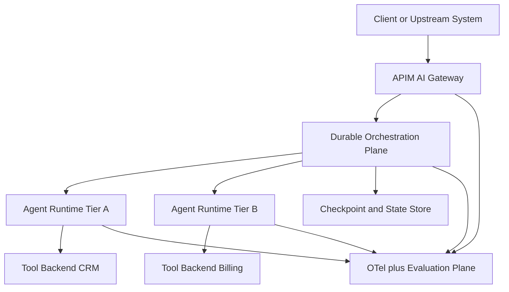
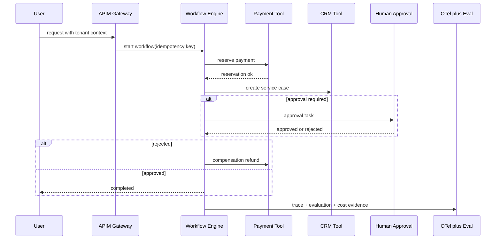

# Enterprise Multi-Agent Persistence Selection FAQ: Durable Execution/Checkpoint Replay + ACA Dynamic Sessions Isolation + Tenant-Level FinOps Attribution

> Version tag: Guide #218  
> Audience: Cloud & AI Solution Architects, platform SRE, FinOps leaders, and enterprise app architecture teams  
> Scope: durable execution recovery semantics, checkpoint replay consistency, ACA Dynamic Sessions sandbox isolation, tenant-level cost attribution and budget gates  
> Data provenance labels: `measured`, `synthetic`, `anonymized_reported`  
> H5 visual quick card: [`../../workshops/azure-agent-infra/h5/durable-aca-finops-attribution-card.html`](../../workshops/azure-agent-infra/h5/durable-aca-finops-attribution-card.html)

## 1. Executive Summary: enterprise multi-agent reliability depends on recovery semantics, sandbox isolation, and cost attribution closure—not only model quality
Many teams initially attribute agent instability
to model drift or model latency spikes.
Post-incident reviews usually show another pattern:
the largest failures are caused by orchestration gaps.
When one business transaction spans retrieval,
policy checks,
human approvals,
payment reservations,
and CRM side effects,
missing saga compensation,
weak idempotency boundaries,
or ambiguous replay semantics
can create duplicated mutations even when model outputs are acceptable.
This guide compares three practical options in Azure-centered enterprise programs:
`Durable Functions`,
`Temporal on AKS`,
and `Logic Apps Standard`.
The objective is not to pick a universal winner.
The objective is to select the path
that best matches your compliance pressure,
latency envelope,
throughput profile,
and platform engineering capacity.

## 2. Daily Breakthrough Signals (Fetched 2026-11-21): Official and Release-Backed Sources
This round prioritizes verifiable official documentation and release evidence.
All references below are tagged with retrieval date `2026-11-21`.
Source A:
Azure API Management AI Gateway overview (`measured` control-plane feature context).
Source B:
Azure Container Apps sessions documentation (`anonymized_reported` runtime/session envelope context).
Source C:
Azure API Management changelog (`anonymized_reported` release cadence evidence).
Source D:
Firecracker releases (`anonymized_reported` sandbox isolation evolution).
Source E:
Kata Containers releases (`anonymized_reported` VM-isolated container evolution).
Source F:
Wasmtime releases (`anonymized_reported` Wasm runtime maturity trend).
Source G:
E2B releases (`anonymized_reported` managed sandbox roadmap velocity).
Taken together,
these signals confirm that enterprise differentiation is shifting
from pure model access
to end-to-end reliability contracts:
recoverable orchestration,
policy-governed gateway paths,
observable decision traces,
and enforceable cost controls.

## 3. Problem Boundary: Durable Orchestration Is a Replayable Business State Machine
An enterprise agent request is rarely a single function call.
In production,
it usually becomes a multi-step asynchronous graph.
Any node can fail,
timeout,
retry,
or require human intervention.
So the architecture must answer four hard questions:
how to locate a safe recovery point,
how to prevent duplicated side effects during retries,
how to preserve approval context over long-running waits,
and how to reconstruct complete decision evidence for audits.
If these questions are handled inconsistently across teams,
scale amplifies operational risk.
Durable orchestration is therefore not just workflow tooling.
It is a contract for provable business-state transitions.

## 4. 12-Dimension Comparison Matrix: `Durable Functions` vs `Temporal` vs `Logic Apps`
| Dimension | Durable Functions | Temporal on AKS | Logic Apps Standard | Decision Signal |
|---|---|---|---|---|
| State persistence model | Azure storage providers | Event history + backing DB | Built-in workflow state | Choose by control depth |
| Replay semantics maturity | High | Very high | Medium-high | Heavy replay favors Temporal |
| Saga compensation expressiveness | Code-first | Code-first (strong) | Flow-first | Complex compensation favors code-first |
| Azure-native integration | Very high | Medium-high | Very high | Azure-first teams move faster with DF/Logic |
| Multi-language workflow SDKs | Broad | Broad | Low-code-centric | Engineering-heavy teams prefer DF/Temporal |
| Observability customization | High | Very high | Medium-high | Deep OTel customization favors Temporal |
| Tail-latency controllability | Medium-high | High | Medium | Strict low-tail goals favor Temporal |
| Operations complexity | Low-medium | Medium-high to high | Low-medium | Platform maturity is the real gate |
| Compliance evidence generation | High | High | Medium-high | All viable with good process |
| Cost transparency path | Medium-high | Medium | Medium-high | Managed paths simplify chargeback |
| Throughput scaling ceiling | High | Very high | Medium-high | Extreme scale favors Temporal |
| Time-to-production | Fast | Moderate | Fast | Initial rollout often DF/Logic |

## 5. Reference Architecture A: APIM + Durable Orchestration + Split Runtime Tiers


This model separates concerns explicitly:
APIM enforces gateway policy and tenant contracts,
the orchestration layer owns recovery semantics,
runtime tiers execute workload-specific tasks,
and the observability plane produces release and audit evidence.

## 6. Option 1: `Durable Functions` for Managed, Fast-to-Standardize Baselines
`Durable Functions` is often the strongest starting point
for Azure-centered organizations.
It reduces initial platform assembly effort
while still enabling explicit orchestration logic.
Teams can quickly standardize idempotency keys,
saga compensation handlers,
approval callbacks,
and timeout recovery patterns.
It also integrates naturally with Azure-native identity and telemetry tools.
The key discipline is coding style:
orchestrator logic must remain deterministic,
while side effects belong in activities
that implement deduplication contracts.
When teams ignore replay-safe boundaries,
they recreate the same production risks under a managed facade.

## 7. Option 2: `Temporal on AKS` for High-Control, High-Scale Orchestration
`Temporal` provides strong event-history semantics
and mature replay behavior.
In environments with very high concurrency,
long-running workflows,
and complex compensation paths,
Temporal often gives better control over execution behavior.
However,
that control comes with platform ownership costs:
cluster upgrades,
database tuning,
capacity engineering,
and disaster recovery drills require sustained SRE capability.
For organizations with established AKS platform teams,
Temporal can be an excellent evolution path.
For teams without stable platform operations,
it can shift orchestration risk into infrastructure risk.

## 8. Option 3: `Logic Apps Standard` for Integration-Heavy Enterprise Workflows
`Logic Apps Standard` is compelling
when the primary challenge is enterprise system integration.
If your workflow depends on ERP,
ITSM,
notification,
or line-of-business connectors,
Logic Apps can accelerate delivery significantly.
For deeply nested saga compensation with strict replay constraints,
a pure low-code path may become difficult to govern.
A common effective pattern is hybrid:
keep complex durable orchestration in DF or Temporal,
and delegate connector-heavy edge flows to Logic Apps.
This preserves integration velocity
without losing determinism in critical mutation paths.

## 9. Multi-Cloud Mapping: Where AWS `Step Functions` and GCP `Workflows` Fit
AWS `Step Functions`
and GCP `Workflows`
are both valid enterprise orchestration services.
The practical difference is usually not service capability.
It is the governance integration burden:
identity alignment,
gateway policy consistency,
observability schema parity,
and rollback semantics harmonization.
If Azure is your primary control plane,
`APIM + Entra + Azure Monitor` usually shortens the standardization cycle.
In multi-cloud operating models,
define one canonical orchestration contract first,
then map each cloud implementation to that contract,
instead of allowing each cloud to invent incompatible compensation logic.

## 10. Quantitative Q&A (8 Items)
**Q1: Why does orchestration quality determine incident severity?**  
Because a `P95` model delay spike may degrade UX,
but duplicated payment side effects can trigger Sev-1 incidents.
**Q2: How large is the latency gap between serial and batched tool calls?**  
Serial `10`-step chains commonly hit `420-650ms` tail,
while batched execution can drop to `110-180ms` (`synthetic` benchmark).
**Q3: What is the practical impact of missing idempotency keys?**  
Duplicated mutation risk can climb to `0.8%-2.4%` under retry bursts (`anonymized_reported`).
**Q4: How should approval timeouts be modeled?**  
Use `15m` soft timeout plus `24h` hard timeout,
forcing compensation or explicit human fallback.
**Q5: How long should workflow history remain queryable online?**  
Regulated sectors often require `180-365` days searchable online,
with cold archival extended to `2-7` years.
**Q6: When should teams evolve from DF to Temporal?**  
When active workflows stay above `100k`
and cross-region recovery objectives demand `<10m` RTO.
**Q7: What is the non-negotiable compensation constraint?**  
Compensation must be idempotent
and must not depend on volatile expired context.
**Q8: How do you avoid “observed but unauditable” systems?**  
Propagate `workflow_id`,
`tenant_id`,
`policy_version`,
and `cost_snapshot_id` across all control points.

## 11. Reference Architecture B: Saga Compensation Loop with Human Gate


## 12. Production Snippets: Durable + Temporal + APIM Guardrails
```python
# Durable Functions orchestrator pseudocode
def orchestrator(context):
    req = context.get_input()
    wid = req["workflow_id"]
    tenant = req["tenant_id"]
    context.call_activity("validate_policy", {"tenant": tenant, "wid": wid})
    reserve = context.call_activity("reserve_payment", req)
    try:
        case = context.call_activity("create_case", req)
        approved = context.wait_for_external_event("approval_result")
        if not approved:
            context.call_activity("refund_payment", {"reservation": reserve})
            return {"status": "rejected", "case": case}
        context.call_activity("finalize_case", {"case": case})
        return {"status": "completed", "case": case}
    except Exception:
        context.call_activity("refund_payment", {"reservation": reserve})
        raise
```

```yaml
# Temporal on AKS worker deployment sketch
apiVersion: apps/v1
kind: Deployment
metadata:
  name: temporal-worker
spec:
  replicas: 6
  template:
    spec:
      containers:
      - name: worker
        image: ghcr.io/example/temporal-worker:1.0.0
        env:
        - name: TASK_QUEUE
          value: "agent-durable-queue"
        - name: OTEL_EXPORTER_OTLP_ENDPOINT
          value: "http://otel-collector:4317"
```

```xml
<!-- APIM per-tenant guardrails -->
<policies>
  <inbound>
    <base />
    <rate-limit-by-key calls="120" renewal-period="60"
      counter-key="@(context.Request.Headers.GetValueOrDefault("x-tenant-id","unknown"))" />
    <set-header name="x-workflow-retry-cap" exists-action="override">
      <value>3</value>
    </set-header>
  </inbound>
  <backend><base /></backend>
  <outbound><base /></outbound>
</policies>
```

## 13. Enterprise Scenario A: Regulated Insurance Claims Agent Workflows
A national insurance group
uses agents for first-pass claims triage.
Each workflow includes document checks,
fraud scoring,
human review,
payment reservation,
and CRM archival.
Their non-negotiable requirement is full recoverability:
every failed branch must be compensable,
every decision must be replayable,
every financial side effect must be traceable.
Phase 1 established a Durable Functions baseline.
Phase 2 migrated high-complexity segments to Temporal on AKS.
Phase 3 moved connector-heavy notification chains to Logic Apps Standard.
After rollout,
duplicate-payment incidents dropped from monthly double digits
to near-zero (`anonymized_reported`),
and audit reconstruction time decreased by about `47%` (`synthetic` postmortem estimate).

## 14. Enterprise Scenario B: Cross-Border Commerce After-Sales Agents
A cross-border commerce platform
runs high-volume after-sales processes during campaign peaks.
Workflows span order systems,
warehouse systems,
payment backends,
and customer support tooling.
The adopted pattern is
`Temporal primary orchestration + APIM policy enforcement + Logic Apps integration edges`.
By propagating workflow identifiers end to end
and enforcing tenant budget gates,
the platform kept completion rates stable under peak load
while containing cost variance within approved monthly bands.
Operational discussions shifted
from subjective “which service is slow”
to measurable tuning of retries,
timeouts,
and compensation paths.

## 15. TCO, Day-0/Day-2 Checklist, and Final Recommendation
### Monthly TCO Estimate
| Cost Component | Durable Functions | Temporal on AKS | Logic Apps Standard | Notes |
|---|---:|---:|---:|---|
| Control plane and gateway governance | `$8,900` | `$9,600` | `$8,700` | APIM front door recommended for all |
| Workflow execution and state | `$22,400` | `$27,800` | `$20,100` | Temporal carries higher platform operations |
| Observability and evaluation closure | `$6,800` | `$7,600` | `$6,300` | Self-managed paths enable deeper tuning |
| Compliance and audit operations | `$7,100` | `$8,500` | `$7,400` | Evidence automation determines efficiency |
| Total | `$45,200` | `$53,500` | `$42,500` | Always include risk-adjusted cost view |

### Day-0 / Day-2 Checklist (12 Items)
- Require globally unique idempotency keys and tenant labels per workflow.  
- Standardize compensation naming and retry semantics.  
- Inject policy version and budget snapshot IDs at APIM ingress.  
- Enforce deduplication for all side-effecting external calls.  
- Attach context-version checks to approval callbacks.  
- Persist `workflow_id` to `trace_id` mappings for replay.  
- Define timeout-to-compensation transitions explicitly.  
- Run weekly failure-injection and recovery drills.  
- Audit zombie workflows and hung tasks monthly.  
- Track cross-region recovery SLOs with RTO/RPO dashboards.  
- Publish tenant-level cost and success-rate chargeback reports.  
- Bind evaluation outputs directly to release gates.  

### Final Recommendation
If your immediate goal is to stand up a governed durable orchestration baseline quickly,
start with `Durable Functions + APIM` in most Azure-first enterprises.
Evolve to `Temporal on AKS`
when workflow complexity,
active concurrency,
or recovery objectives outgrow managed defaults.
Use `Logic Apps Standard` primarily as the integration acceleration layer,
not as the sole engine for deep saga compensation logic.
Across all options,
keep four principles non-negotiable:
idempotency first,
compensation by design,
evidence closure by default,
and budget accountability by tenant.
With those principles institutionalized,
agent platforms stay stable and auditable
even under high concurrency and strong regulatory scrutiny.
A practical five-step rollout sequence improves adoption quality:
step one standardizes workflow naming,
idempotency keys,
and compensation action templates;
step two links APIM gateway policy metadata with orchestration context
so every request carries `tenant_id`,
`policy_version`,
and `budget_snapshot_id`;
step three centralizes approval-timeout handling
to avoid team-by-team divergence in audit behavior;
step four establishes fault-injection runbooks
for downstream timeout,
duplicate callback,
cross-region failover,
and compensation failure recovery;
step five binds evaluation outputs directly to release gates
so recovery duration,
compensation success ratio,
duplicate-side-effect rate,
and per-workflow cost become first-class launch criteria.
At governance level,
run quarterly architecture reviews
that specifically inspect three drifts:
compensation-chain drift,
policy-version drift,
and cost-attribution drift.
If those drifts remain unmanaged,
systems may appear healthy at current scale
but degrade rapidly when concurrency expands.
For multinational organizations,
model regional policy differences explicitly
instead of embedding hidden branch logic inside workflow code.
Treat regulatory variance,
tenant budget variance,
and SLA variance as configuration-governed capabilities.
That approach preserves one explainable control model
across global regions,
while still allowing local compliance specialization, and it also shifts architecture governance from one-time project reviews to continuous operating discipline by measuring monthly drill pass rates, compensation-chain completeness, approval-timeout fallback hit rates, tenant budget variance, and replay audit reconstruction time so platform owners can tune workflow templates and policy baselines before local optimizations compound into systemic reliability and compliance risk.
